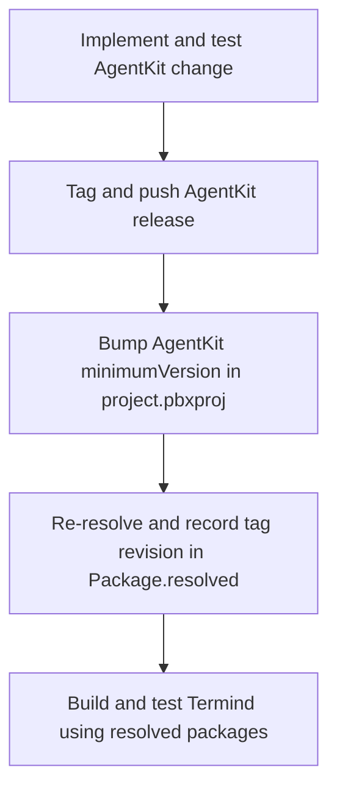

# Build, Test, and Release Gates

This page is the operational playbook for proving a change without accidentally changing the dependency graph or committing local artifacts. The repository has one Xcode project with the macOS `TFM` and iPhone/iPad `TFI` schemes, shared-framework tests in `FrameworkTests/`, and platform tests in `TFMTests/` and `TFITests/`. The Astro landing page is a separate Node workspace under `LandingPage/`.

Choose the narrowest quiet check that proves the changed behavior, then expand to the affected target or default suite before delivery. Preserve complete failure output: a green unrelated build is not evidence that the changed feature works.

## Baseline safety rules

- **Use the resolved package graph.** Every ordinary Xcode build, test, and screenshot build must retain `-onlyUsePackageVersionsFromResolvedFile`. Without it, Xcode may resolve newer dependencies instead of testing the revisions recorded in `Package.resolved`.
- **Keep artifacts and secrets local.** Never commit secrets, local `.env` files, generated build products, `DerivedData/`, `.build/`, `build/`, `*.xcresult`, `LandingPage/dist/`, `node_modules/`, or user-specific Xcode state. `.gitignore` excludes local environment files but explicitly permits `.env.example` and `.env.*.example` templates; inspect the staged diff rather than assuming ignored files cannot be staged.
- **Keep commits focused.** State the outcome, affected layers, and verification in the PR; include bilingual UI screenshots where the change calls for them. Run the Chinese localization check as part of every commit pipeline, including code-only changes.
- **Validate the owner boundary as well as behavior.** A dependency, persistence, or framework-ownership change should include the focused architecture boundary tests; platform/UI changes need the relevant platform target and feature tests.

## Native build and test entrypoints

Run commands from the repository root unless a command changes directory.

### Build the affected product

```sh
xcodebuild -project Termind.xcodeproj -scheme TFM -destination 'platform=macOS' -onlyUsePackageVersionsFromResolvedFile build
```

This is the desktop build entrypoint and also builds the macOS app’s MCP bridge and resolved AgentKit dependency.

```sh
xcodebuild -project Termind.xcodeproj -scheme TFI -destination 'generic/platform=iOS Simulator' -onlyUsePackageVersionsFromResolvedFile build
```

This builds the mobile app and shared frameworks. For an iOS test run, replace the generic destination with an installed iPhone or iPad simulator destination.

### Test narrowly, then at the appropriate scope

The default macOS test entrypoint runs macOS and shared Swift tests:

```sh
xcodebuild -project Termind.xcodeproj -scheme TFM -destination 'platform=macOS' -onlyUsePackageVersionsFromResolvedFile test
```

Constrain a run when a focused suite directly establishes the changed contract, for example:

```sh
xcodebuild -project Termind.xcodeproj -scheme TFM -destination 'platform=macOS' -onlyUsePackageVersionsFromResolvedFile test -only-testing:TFMTests/AppLanguageTests
```

Use the matching mobile scheme and a concrete simulator for `TFITests` work. The `TFM` test action includes `TFMTests` and `FrameworkTests`; `TFI` includes `TFITests` and `FrameworkTests`. Typical focused choices are the test file that names the changed feature, `TFMTests/ArchitectureBoundaryTests.swift` for dependency placement, and `TFMTests/AppLanguageTests.swift` for language-selection/catalog behavior. Do not use an unrelated focused test as a substitute for the affected default suite. Check which suites actually ran: a passing default command does not prove a disabled opt-in suite passed.

### Formatting is a strict check

Swift formatting follows `.swift-format` (four-space indentation and 120-column lines). Lint all owned Swift production and test roots before delivery:

```sh
xcrun swift-format lint --strict --recursive Frameworks TFM TFI FrameworkTests TFMTests TFITests TermindMCPBridge
```

A companion change in AgentKit must also pass its equivalent command over `Sources Tests` from that repository.

## Window tests and screenshot operations

Most routine tests should remain headless. macOS tests that present windows or take focus—including Dock actions, external authentication and Launch Services alerts—must use `.requiresVisibleWindow` at the suite or test level. The trait skips them unless the test host sees `TERMIND_WINDOW_TESTS=1`; for command-line runs, Xcode forwards `TEST_RUNNER_TERMIND_WINDOW_TESTS=1` into the test host. The two safeguards are complementary: gating a test alone cannot stop XCTest from launching the real app. In Debug test runs, `TermindApp` detects the XCTest configuration and suppresses automatic launch of both the main and external-auth scenes by default, with restoration disabled. Setting `TERMIND_WINDOW_TESTS=1` allows automatic launch again; an active screenshot demo also bypasses the default suppression. This host safeguard does **not** replace the trait on a window/focus test.

Opt in only for the named rendering/interaction suite being investigated:

```sh
TEST_RUNNER_TERMIND_WINDOW_TESTS=1 xcodebuild -project Termind.xcodeproj -scheme TFM -destination 'platform=macOS' -onlyUsePackageVersionsFromResolvedFile test -only-testing:TFMTests/ChooserInteractionTests
```

In Xcode, set `TERMIND_WINDOW_TESTS=1` in the Test action environment. Run this on a machine with an appropriate display and keep the selection narrow; the opt-in also lifts the app host's automatic-window suppression. Existing screenshot tests may retain their own dedicated opt-in variables; offscreen layout and logic tests remain part of normal validation. Without the opt-in, routine runs neither execute gated focus-changing tests nor auto-open the test host's windows.

### Mobile key-window integration tests

Do not treat mobile integration suites as part of routine default coverage. Suites that take UIKit's process-wide key-window/presentation state, including `MobileEditorToolbarTests`, `MobileForwardingRenderingTests`, `MobileHostIntegrationRenderingTests`, and `MobileSavedNameRenderingTests`, use a suite-level `TERMIND_MOBILE_UI_TESTS=1` gate and serialization. To run a changed suite, use an installed iPhone or iPad simulator, disable parallel testing, and narrow the selection:

```sh
TEST_RUNNER_TERMIND_MOBILE_UI_TESTS=1 xcodebuild -project Termind.xcodeproj -scheme TFI -destination 'platform=iOS Simulator,name=<installed simulator>' -onlyUsePackageVersionsFromResolvedFile -parallel-testing-enabled NO test -only-testing:TFITests/MobileEditorToolbarTests
```

`TEST_RUNNER_TERMIND_MOBILE_UI_TESTS=1` is the command-line opt-in; Xcode forwards it to the test host as `TERMIND_MOBILE_UI_TESTS=1`. `MobileAdaptiveLayoutTests` is a separate serialized, **ungated** suite: it mounts `MobileRootView` in a temporary key `UIWindow`, resizes size classes and widths, checks tab and navigation identity, drafts, scroll/focus/marked text, and attaches captures across English and both Chinese locales. Its fixture restores the prior key window after each run. Because it also uses process-wide UIKit state, target it narrowly with `-parallel-testing-enabled NO` when investigating adaptive behavior rather than assuming it has the suite-level opt-in:

```sh
xcodebuild -project Termind.xcodeproj -scheme TFI -destination 'platform=iOS Simulator,name=<installed simulator>' -onlyUsePackageVersionsFromResolvedFile -parallel-testing-enabled NO test -only-testing:TFITests/MobileAdaptiveLayoutTests
```

### StoreKit authorization gate

`StoreKitTrialTests` is serialized and skipped unless its host has `TERMIND_STOREKIT_TESTS=1`; it requires manual authorization, not just a successful default macOS test run. When authorized, run it alone with the resolved graph and set the host environment explicitly (in Xcode's Test action, use `TERMIND_STOREKIT_TESTS=1`):

```sh
TERMIND_STOREKIT_TESTS=1 xcodebuild -project Termind.xcodeproj -scheme TFM -destination 'platform=macOS' -onlyUsePackageVersionsFromResolvedFile test -only-testing:TFMTests/StoreKitTrialTests
```

The suite creates and resets an `SKTestSession` against `StoreKit/Termind.storekit`, clears transactions around each fixture, and checks annual trial entitlement and restore, lifetime precedence, pending Ask to Buy, cancellation/network failures, unverified transactions, and invalid or missing introductory-offer configurations. These local StoreKit tests do not replace storefront/Sandbox verification.

For an isolated interactive desktop demo, use a supported scene and one of the three supported languages:

```sh
Scripts/run-screenshot-demo.sh <hosts|workspace|agent|command|metrics|metrics-detail|app-settings> <en|zh-Hans|zh-Hant>
```

The script uses a dedicated `.build/screenshot-demo` derived-data directory, builds `TFM` with the resolved-package flag, and launches a Debug app with matching Apple language and locale arguments. It is for inspection rather than a general regression test.

Marketing screenshots are controlled capture workflows, not ordinary test artifacts:

```sh
Scripts/run-mac-marketing-screenshots.sh
Scripts/run-mobile-marketing-screenshots.sh
```

The macOS script requires macOS 27.x, accepts constrained scene/locale environment selections, builds for testing with resolved packages, waits until the capture window is focused, verifies dimensions, and writes captures under `Marketing/Screenshots/Captures` while backing up prior images. The mobile script requires an iOS/iPadOS 27 runtime, builds once for testing from resolved packages, runs `MobileMarketingScreenshotTests` on the selected supported simulators for `en`, `zh-Hans`, and `zh-Hant`, and verifies its expected capture count. Treat output as a reviewed product asset: recapture the affected platform and locales after a captured UI change, and do not commit transient derived data.

## Localization gate

Define user-facing copy as shared `LocalizedStringResource` entries under `Frameworks/TermindPresentation/Strings` (`AppStrings`), even for one-platform wording; the catalog compiled into each app bundle is `Frameworks/Resources/Localizable.xcstrings`, and bundle metadata belongs in `Frameworks/Resources/InfoPlist.xcstrings`. Keep identifiers and diagnostic codes with their existing owners. `STRING_CATALOG_GENERATE_SYMBOLS = NO` because `AppStrings` owns the Swift-facing API. Any new or changed English string must ship with finished `zh-Hans` and `zh-Hant` translations in the same commit. Preserve placeholders and Chinese punctuation conventions.

The two shared catalogs are manually maintained: keep `extractionState: "manual"`, add keys/translations explicitly, and verify use in both apps and shared code before deleting an entry. A single target's `stale` extraction flag does not establish that a shared key is unused. After a catalog edit run `Scripts/normalize-string-catalogs.py --write` for Xcode-compatible ordering and formatting; do not substitute `jq -S` or a generic JSON formatter. The normalizer leaves translations intact and does not touch AgentKit's catalog. Before committing, run both checks (the catalog check requires `jq` and optionally accepts a catalog path):

```sh
Scripts/check-presentation-copy.sh
Scripts/check-zh-localization.sh
```

The presentation-copy check uses Xcode's Swift parser to scan `TFM` and `TFI` Swift literals at presentation API call sites and fails when app-facing copy is written directly instead of using shared resources; it distinguishes these from identifiers, URLs, comments, and interpolated expressions. The catalog check runs the normalizer in read-only `--check` mode, then validates JSON and, for each Chinese locale, rejects absent localization entries, string units not marked `translated`, empty values except for the empty key, and invalid Han/Latin or punctuation spacing. Fix the reported catalog or copy violation rather than bypassing the gate. Run `AppLanguageTests` when language behavior changes; for resource/formatting behavior also target `PresentationCopyTests`, which exercises multilingual resources, menus, plurals and SwiftUI resource bridging.

AgentKit owns its separate runtime catalog at `../AgentKit/Localizations/Localizable.xcstrings`. After changing that catalog, run the package’s catalog build step because a plain Swift build copies its resources rather than compiling string catalogs:

```sh
../AgentKit/Scripts/build-localizations.sh
```

## Landing-page validation

`LandingPage/` is an independent private Astro package. Its production build runs both `astro check` and `astro build`, emitting output to `LandingPage/dist/`:

```sh
cd LandingPage && npm ci && npm run build
```

Use `npm ci` when reproducing the locked dependency graph; use `npm run dev` for local iteration. For website changes, visually check English and Chinese routes in addition to the build. The site keeps its screenshot inputs deliberately narrow: it imports an explicit allowlist of framed assets rather than copying full-resolution captures into `public/`. `dist/`, `.astro/`, and `node_modules/` are generated and must remain uncommitted.

## AgentKit: release, bump, and re-resolve

AgentKit is a separately developed, host-neutral remote Swift package. Termind’s project currently specifies an up-to-next-major minimum of `0.15.2`; `Termind.xcodeproj/project.xcworkspace/xcshareddata/swiftpm/Package.resolved` pins AgentKit `0.15.2` at revision `4540847d4762f9040be7a8bab4cadd82e494c36d`. The project links the core `AgentKit` product and the opt-in `AgentKitScrubber` product; the package declares the latter as an adapter depending on `ScrubberKit`, leaving the core free of that dependency. With the resolved-package flag, Xcode builds the remote release—not uncommitted edits in a sibling `../AgentKit` working tree or the in-repository `AgentKit/` submodule. Run the separately maintained package's own `swift build && swift test` to validate an unreleased AgentKit change; a successful Termind build does not test it.

A cross-repository change has a strict three-step lifecycle:



This shows the required ordering from a host-neutral package change through Termind consumption.

1. **Release AgentKit first.** In `../AgentKit`, make the host-neutral change and validate it there:

   ```sh
   cd ../AgentKit && swift build && swift test
   ```

   Format its `Sources` and `Tests`, then tag and push the package release. Do not add Termind names, SSH/SFTP behavior, or UI to AgentKit; those stay on the Termind side of the integration boundary.
2. **Bump the app requirement.** Update AgentKit’s `minimumVersion` in `Termind.xcodeproj/project.pbxproj` to the released version.
3. **Re-resolve and commit the lock result.** Re-resolve Swift packages so `Termind.xcodeproj/project.xcworkspace/xcshareddata/swiftpm/Package.resolved` records the released version and exact revision. Commit both the project requirement and resolved file with the Termind-side code that requires them, then validate with the resolved-package build/test commands above.

Do not skip the release or resolve steps: a project-file bump alone does not establish the exact revision used in ordinary builds, and local sibling edits are invisible to that build. Likewise, do not casually refresh the lock file during unrelated work—the resolved graph is a reproducibility boundary.

## Release-oriented checklist

1. Identify the smallest affected product surface and run its focused tests.
2. Run the affected TFM or TFI build/test using `-onlyUsePackageVersionsFromResolvedFile`; include architecture tests for boundary changes.
3. Run strict Swift format lint for Swift changes.
4. Run `Scripts/check-presentation-copy.sh` alongside `Scripts/check-zh-localization.sh` for every commit; complete both Chinese translations, normalize changed catalogs, and run `AppLanguageTests`/`PresentationCopyTests` when their behavior changes.
5. For landing-page changes, run `cd LandingPage && npm ci && npm run build` and inspect English/Chinese routes.
6. Keep visible-window, mobile key-window integration, and StoreKit authorization gates off in routine runs; when affected, opt in with the exact flags above and narrow the suite. Run the ungated adaptive-layout suite deliberately without parallel testing for adaptive UI changes.
7. Regenerate marketing captures only through their dedicated scripts when product imagery changes.
8. For AgentKit work, complete release → minimum-version bump → re-resolve, and commit both dependency files.
9. Inspect the staged diff for secrets, local environment files, derived data, build output, and accidental lock/artifact churn before committing.

CloudKit production deployment and signed-device delivery are separate release evidence, not consequences of a successful local build. Use [CloudKit Schema Deployment and Signed-Device Release Readiness](/openwiki/operations/cloudkit-release-readiness.md) for that matrix. Storefront metadata and Sandbox validation live in [App Store Commerce Configuration and Release Verification](/openwiki/operations/storefront-commerce-release.md); capture, Figma export, and icon checks live in [Marketing Assets, Screenshot Production, Figma Exports, and App Icons](/openwiki/operations/marketing-assets-and-app-icons.md); historical transport performance methodology lives in [Port Forwarding Benchmark Design, Results, and Reproduction](/openwiki/operations/port-forwarding-benchmarks.md).
