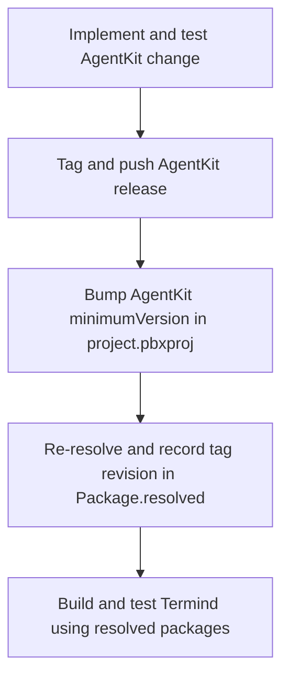

# Build, Test, and Release

This is the operational playbook for proving a change without accidentally changing the dependency graph or committing local artifacts. The repository has one Xcode project with the macOS `TFM` and iPhone/iPad `TFI` schemes, shared-framework tests in `FrameworkTests/`, and platform tests in `TFMTests/` and `TFITests/`. The public Astro website and assets are an independent Git submodule at `com.akinokaede.termind`, with its Node project at that root.

Choose the narrowest quiet check that proves the changed behavior, then expand to the affected target or default suite before delivery. Preserve complete failure output: a green unrelated build is not evidence that the changed feature works.

## Baseline safety rules

- **Use the resolved package graph.** Every ordinary Xcode build, test, and screenshot build must retain `-onlyUsePackageVersionsFromResolvedFile`. Without it, Xcode may resolve newer dependencies instead of testing the revisions recorded in `Package.resolved`.
- **Keep artifacts and secrets local.** Never commit secrets, local `.env` files, generated build products, `DerivedData/`, `.build/`, `build/`, `*.xcresult`, `com.akinokaede.termind/dist/`, `node_modules/`, or user-specific Xcode state. `.gitignore` excludes local environment files but explicitly permits `.env.example` and `.env.*.example` templates; inspect the staged diff rather than assuming ignored files cannot be staged.
- **Keep commits focused.** State the outcome, affected layers, and verification in the PR; include bilingual UI screenshots where the change calls for them. Run the localization check as part of every commit pipeline, including code-only changes.
- **Validate the owner boundary as well as behavior.** A dependency, persistence, or framework-ownership change should include the focused architecture boundary tests; platform/UI changes need the relevant platform target and feature tests.

## Native build and test entrypoints

Run commands from the repository root unless a command changes directory.

### Build the affected product

```sh
xcodebuild -project Termind.xcodeproj -scheme TFM -destination 'platform=macOS' -onlyUsePackageVersionsFromResolvedFile build
```

This is the desktop build entrypoint and also builds the macOS app’s MCP bridge and resolved AgentKit dependency.

```sh
xcodebuild -project Termind.xcodeproj -scheme TFI -destination 'generic/platform=iOS Simulator' -onlyUsePackageVersionsFromResolvedFile build
```

This builds the mobile app and shared frameworks. For an iOS test run, replace the generic destination with an installed iPhone or iPad simulator destination.

### Test narrowly, then at the appropriate scope

The default macOS test entrypoint runs macOS and shared Swift tests:

```sh
xcodebuild -project Termind.xcodeproj -scheme TFM -destination 'platform=macOS' -onlyUsePackageVersionsFromResolvedFile test
```

Constrain a run when a focused suite directly establishes the changed contract, for example:

```sh
xcodebuild -project Termind.xcodeproj -scheme TFM -destination 'platform=macOS' -onlyUsePackageVersionsFromResolvedFile test -only-testing:TFMTests/AppLanguageTests
```

Use the matching mobile scheme and a concrete simulator for `TFITests` work. The `TFM` test action includes `TFMTests` and `FrameworkTests`; `TFI` includes `TFITests` and `FrameworkTests`. Typical focused choices are the test file that names the changed feature, `TFMTests/ArchitectureBoundaryTests.swift` for dependency placement, and `TFMTests/AppLanguageTests.swift` for language-selection/catalog behavior. Do not use an unrelated focused test as a substitute for the affected default suite. Check which suites actually ran: a passing default command does not prove a disabled opt-in suite passed.

### Release configuration and version checks

Both shared schemes use **Debug** for Test, Launch, and Analyze, and **Release** for Profile and Archive. Their test actions list both platform and shared test bundles with `skipped = "NO"`; individual Swift Testing gates still decide whether opt-in UI cases execute. A successful default test run therefore proves neither Release compilation nor execution of gated UI cases.

Before release, inspect the target configuration rather than treating the project-level build number as universal. The committed Debug and Release settings agree within each row:

| Settings owner | `MARKETING_VERSION` | `CURRENT_PROJECT_VERSION` | Meaning |
| --- | --- | --- | --- |
| Project defaults | `1.17.1` | `68` | Inherited by targets without their own override. |
| macOS app `TFM` | `1.17.1` | `105` | Explicit app overrides, not the project build number. |
| iOS app `TFI` | `1.17.1` | `94` | Explicit mobile app overrides. |
| iOS extension `TermindWidgets` (`TFIWidgets/`) | `1.17.1` | `94` | Explicit extension overrides matching the containing mobile app. |

These are committed settings, not evidence of an uploaded build. When bumping a release, review both configurations of each affected app and extension; changing only the project default does not change an explicit target override. Preserve the mobile app/extension version alignment and inspect the final archive before delivery.

Use `Scripts/bump-version.py` rather than assuming all build counters are equal. It checks Debug/Release agreement, increments the Project/TFM/TFI counters independently, and sets Widgets to the resulting TFI state. `build` preserves marketing versions; `major`, `minor`, `patch` (the default), or an explicit three-component version updates marketing versions using TFI as the baseline. Preview first:

```sh
python3 Scripts/bump-version.py patch --dry-run
python3 -m unittest discover -s Scripts/Tests -p 'test_bump_version.py'
```

Use resolved-only Release builds for the affected product in addition to the Debug tests above:

```sh
xcodebuild -project Termind.xcodeproj -scheme TFM -configuration Release -destination 'platform=macOS' -onlyUsePackageVersionsFromResolvedFile build
xcodebuild -project Termind.xcodeproj -scheme TFI -configuration Release -destination 'generic/platform=iOS Simulator' -onlyUsePackageVersionsFromResolvedFile build
```

A Release simulator build is still not signed-device or distribution verification; follow [CloudKit Schema Deployment and Signed-Device Release Readiness](cloudkit-release-readiness.md) for those checks. The localization symbol-generation setting is inherited separately: the project sets `STRING_CATALOG_GENERATE_SYMBOLS = NO` in both configurations, and neither app nor widget overrides it. Keep that setting disabled even though the app targets enable `SWIFT_EMIT_LOC_STRINGS`; extraction and generated Swift API ownership are different concerns.

### Find-controller and mobile search regression routes

For shared Find state and binding changes, use the headless controller suite first:

```sh
xcodebuild -project Termind.xcodeproj -scheme TFM -destination 'platform=macOS' -onlyUsePackageVersionsFromResolvedFile test -only-testing:FrameworkTests/TerminalFindControllerTests
```

`TerminalFindControllerTests` checks that presenting restarts a retained query, navigation without a query emits no binding, and dismissal ends search once. Default dismissal requests terminal focus; native dismissal with `restoringFocus: false` does not, while retaining the query for reopening. It also checks resize suspension, latest-query resume, navigation suppression and closing during suspension without reopening.

Native mobile search needs a separate, deliberate integration run. The file is `TFITests/MobileTerminalSearchTests.swift`, but the **suite identifier is `MobileTerminalSearchIntegrationTests`**:

```sh
TEST_RUNNER_TERMIND_MOBILE_UI_TESTS=1 xcodebuild -project Termind.xcodeproj -scheme TFI -destination 'platform=iOS Simulator,name=<installed simulator>' -onlyUsePackageVersionsFromResolvedFile -parallel-testing-enabled NO test -only-testing:TFITests/MobileTerminalSearchIntegrationTests
```

Replace the destination placeholder with an available simulator. This serialized suite is disabled unless the test host sees `TERMIND_MOBILE_UI_TESTS=1`; use the `TEST_RUNNER_` prefix on the command line, or set `TERMIND_MOBILE_UI_TESTS=1` in Xcode's Test action. A default passing test run is not evidence for this suite.

It exercises repeated terminal search presentation after native cancellation, terminal-focus-then-native cancellation, and programmatic dismissal; empty-query editing and retained queries; SFTP filter close/reopen; and SSH/SFTP connection-journey overlays without replacing the search controller (or the SSH terminal view). A full-workspace SSH fixture additionally reopens search with empty, matching and missing queries and verifies retained surface/output and unchanged connection generation. The fixtures use an in-memory app model and a temporary key `UIWindow`, restores the previous key window, and disconnects the workspace on cleanup. These are local UIKit integration checks, not live SSH/SFTP connection tests. Run them when changing `MobileWorkspaceSearchModifier` or `MobileToolbarSearch`: native cancellation maps to `find.dismiss(restoringFocus: false)`, and the UIKit adapter blocks presentation synchronization during dismissal to prevent reopening mid-transition. See [Behavioral Boundaries and Fixtures](../testing/behavioral-boundaries-and-fixtures.md) for broader fixture guidance.

### Formatting is a strict check

Swift formatting follows `.swift-format` (four-space indentation and 120-column lines). Lint all owned Swift production and test roots before delivery:

```sh
xcrun swift-format lint --strict --recursive Frameworks TFM TFI FrameworkTests TFMTests TFITests TermindMCPBridge
```

A companion change in AgentKit must also pass its equivalent command over `Sources Tests` from that repository.

## Window tests and screenshot operations

Most routine tests should remain headless. macOS tests that present windows or take focus—including Dock actions, external authentication and Launch Services alerts—must use `.requiresVisibleWindow` at the suite or test level. The trait skips them unless the test host sees `TERMIND_WINDOW_TESTS=1`; for command-line runs, Xcode forwards `TEST_RUNNER_TERMIND_WINDOW_TESTS=1` into the test host. The two safeguards are complementary: gating a test alone cannot stop XCTest from launching the real app. In Debug test runs, `TermindApp` detects the XCTest configuration and suppresses automatic launch of both the main and external-auth scenes by default, with restoration disabled. Setting `TERMIND_WINDOW_TESTS=1` allows automatic launch again; an active screenshot demo also bypasses the default suppression. This host safeguard does **not** replace the trait on a window/focus test.

Opt in only for the named rendering/interaction suite being investigated:

```sh
TEST_RUNNER_TERMIND_WINDOW_TESTS=1 xcodebuild -project Termind.xcodeproj -scheme TFM -destination 'platform=macOS' -onlyUsePackageVersionsFromResolvedFile test -only-testing:TFMTests/ChooserInteractionTests
```

In Xcode, set `TERMIND_WINDOW_TESTS=1` in the Test action environment. Run this on a machine with an appropriate display and keep the selection narrow; the opt-in also lifts the app host's automatic-window suppression. Existing screenshot tests may retain their own dedicated opt-in variables; offscreen layout and logic tests remain part of normal validation. Without the opt-in, routine runs neither execute gated focus-changing tests nor auto-open the test host's windows.

### Mobile key-window integration tests

Do not treat gated mobile integration suites as part of routine default coverage. Suites that take UIKit's process-wide key-window/presentation state, including `MobileEditorToolbarTests`, `MobileForwardingRenderingTests`, `MobileHostIntegrationRenderingTests`, and `MobileSavedNameRenderingTests`, use a suite-level `TERMIND_MOBILE_UI_TESTS=1` gate and serialization. To run a changed suite, use an installed iPhone or iPad simulator, disable parallel testing, and narrow the selection:

```sh
TEST_RUNNER_TERMIND_MOBILE_UI_TESTS=1 xcodebuild -project Termind.xcodeproj -scheme TFI -destination 'platform=iOS Simulator,name=<installed simulator>' -onlyUsePackageVersionsFromResolvedFile -parallel-testing-enabled NO test -only-testing:TFITests/MobileEditorToolbarTests
```

`TEST_RUNNER_TERMIND_MOBILE_UI_TESTS=1` is the command-line opt-in; Xcode forwards it to the test host as `TERMIND_MOBILE_UI_TESTS=1`. Check the actual suite/test annotation before choosing a gate. `MobileAdaptiveLayoutTests` is serialized and puts `.requiresKeyWindow` on its native-window cases; pure width-classification logic still runs by default. Its native fixtures preserve tab/navigation identity, drafts, scrolling/focus/marked text across English and both Chinese layouts and restore the previous key window. Opt into those cases explicitly:

```sh
TEST_RUNNER_TERMIND_MOBILE_UI_TESTS=1 xcodebuild -project Termind.xcodeproj -scheme TFI -destination 'platform=iOS Simulator,name=<installed simulator>' -onlyUsePackageVersionsFromResolvedFile -parallel-testing-enabled NO test -only-testing:TFITests/MobileAdaptiveLayoutTests
```

`MobileMetricsJourneyTests` is a serialized **key-window-gated** suite. Its English, Simplified Chinese and Traditional Chinese fixture preserves keyboard-interactive authentication across detail navigation, widths and large type, submits both authentication prompts and checks that only one sampler connection is made. Cleanup restores the prior key window and shuts down the sampler; the test emits review PNGs. Those cases are skipped without opt-in; a default green run is not native presentation evidence:

```sh
TEST_RUNNER_TERMIND_MOBILE_UI_TESTS=1 xcodebuild -project Termind.xcodeproj -scheme TFI -destination 'platform=iOS Simulator,name=<installed simulator>' -onlyUsePackageVersionsFromResolvedFile -parallel-testing-enabled NO test -only-testing:TFITests/MobileMetricsJourneyTests
```

### Marketing capture and framing

App-owned fastlane lanes use `run_tests` (scan) over hosted `MacScreenshotTests` and `MobileScreenshotTests`, not XCUITest snapshot helpers. They build once with resolved packages, run serially and promote only validated successful batches after backing up old bytes. Both platforms now default to seven locales (`en`, `zh-Hans`, `zh-Hant`, `ja`, `ko`, `de`, `fr`). Mac defaults to full-screen 14-inch Workspace and requires macOS 27 plus active/key 2× native capture. Mobile defaults to five scenes on exact iPhone 18 Pro/iPad M5 devices and iOS 27.0; Duo outer/inner are separate opt-in 27.1 display batches. Mobile ready/ack tokens and a per-run capture ID fence each scene before native-dimension validation and batch promotion. `fastlane frames` reads captures, applies licensed device templates and aperture masks to staged copies, and validates all renders before publication.

```sh
bundle exec fastlane mac screenshots plan:true
bundle exec fastlane ios screenshots plan:true
bundle exec fastlane frames plan:true
bundle exec ruby Scripts/Tests/test_screenshots.rb
```

Planning and Ruby checks do not open windows. Actual Mac capture takes desktop focus; do not run it routinely. For a deliberate single-scene desktop preview, `Scripts/run-screenshot-demo.sh workspace en` builds Debug TFM with resolved packages in `.build/screenshot-demo` and opens a new app instance with the demo scene and Apple language/locale arguments. It accepts `en`, `ja`, `ko`, `de`, `fr`, `zh-Hans`, and `zh-Hant`; it is a visual preview, not a general regression test. `Scripts/run-mac-screenshots.sh` / `run-mobile-screenshots.sh` delegate to the capture lanes. Initialize the public asset submodule only for asset work; explicit external review paths remain supported. The canonical [Marketing Assets and App Icons](marketing-assets-and-app-icons.md) owns setup, Ruby requirements, selectors, runtime/posture, handshake, template imports/licenses, Figma and 96-board export details.

### Network fixtures are a separate opt-in

Keep wire-level fixture gates unset during routine verification; a default green run is not evidence of live SSH/SFTP behavior. For example, shared `TailscaleSSHWireTests` is serialized and enabled only when the test host receives `TERMIND_SSH_FIXTURE` (a JSON file path) or `TERMIND_SSH_FIXTURE_JSON` (inline JSON, preferred when sandbox file access is a concern). The inline value takes precedence and supplies `port` and `hostFingerprint`. This suite connects to a real local SSH/SFTP endpoint through a loopback `SSHNetworkDialing` adapter, checks none-authentication and repeated connections, and disconnects on failure. It does not contact a real tailnet. Prepare the matching fixture deliberately and follow [Behavioral Boundaries and Fixtures](../testing/behavioral-boundaries-and-fixtures.md) for the other wire suites; do not enable network fixtures by setting a visible-window or screenshot gate.

### Commerce validation

`StoreKit/Termind.storekit` is a manual development fixture. The former StoreKit trial/catalog test files are removed; `RevenueCatCommerceTests` and `ProPaywallStateTests` verify local access and account-state behavior using fixtures/fakes. Live products, introductory eligibility, purchase and restore require RevenueCat and App Store Sandbox validation.

## Localization gate

Define user-facing copy as shared `LocalizedStringResource` entries under `Frameworks/TermindPresentation/Strings` (`AppStrings`), even for one-platform wording; the catalog compiled into each app bundle is `Frameworks/Resources/Localizable.xcstrings`, and bundle metadata belongs in `Frameworks/Resources/InfoPlist.xcstrings`. Keep identifiers and diagnostic codes with their existing owners. `STRING_CATALOG_GENERATE_SYMBOLS = NO` because `AppStrings` owns the Swift-facing API. Any new or changed English string must ship with finished `zh-Hans`, `zh-Hant`, `ja`, `ko`, `de`, and `fr` translations in the same commit. Preserve placeholders and Chinese punctuation conventions.

The two shared catalogs are manually maintained: keep `extractionState: "manual"`, add keys/translations explicitly, and verify use in both apps and shared code before deleting an entry. A single target's `stale` extraction flag does not establish that a shared key is unused. After a catalog edit normalize the files for Xcode-compatible ordering and formatting; do not substitute `jq -S` or a generic JSON formatter:

```sh
python3 Scripts/normalize-string-catalogs.py --write
python3 Scripts/normalize-string-catalogs.py --check
```

The normalizer leaves translations intact and does not touch AgentKit's catalog; it rejects duplicate keys or invalid JSON before writing any catalog in a batch and atomically replaces each changed file. `--check` reports drift without writing. Before committing, run both copy and catalog checks (the catalog check uses Python and optionally accepts catalog paths):

```sh
Scripts/check-appstrings.sh
python3 Scripts/check-localization.py
```

The presentation-copy check uses Xcode's Swift parser to scan `TFM` and `TFI` Swift literals at presentation API call sites and fails when app-facing copy is written directly instead of using shared resources; it distinguishes these from identifiers, URLs, comments, and interpolated expressions. It requires Xcode's SwiftParser/SwiftSyntax host libraries. The catalog checker imports the normalizer's loader and normalization function and compares normalized bytes to the original without writing; it does not invoke the normalizer's `--check` CLI. It validates JSON and positional format-argument compatibility, including literal `%%`. Translatable entries (`shouldTranslate != false`) require completed, nonempty units in all six non-English locales (except that the empty key may have an empty value). Chinese, Japanese and Korean plurals require only `other`; German requires `one` and `other`; French requires `one` and `other` with optional `many`. Chinese and Japanese have language-specific spacing checks, including the intentional `Type %@` subtitle exception; Korean/German/French are not subject to those spacing rules. Reordered placeholders must retain their original argument positions and types. Fix the reported catalog or copy violation rather than bypassing the gate.

**Use the current Python checker, not retired script names.** `AGENTS.md` names `Scripts/check-localization.py`, but its references to a Chinese-only check and a `jq` requirement lag the implementation: the current checker uses Python's standard library plus the sibling normalizer module and checks all six non-English locales. Do not recommend the unavailable `check-zh-localization.sh` or `check-cjk-localization.py`. The Localization workflow runs on Ubuntu for pull requests and pushes to `main` only when shared catalogs, the normalizer, localization checker, their Python tests, or the workflow change. Its steps are:

```sh
python3 -m unittest discover -s Scripts/Tests -p 'test_normalize_string_catalogs.py'
python3 -m unittest discover -s Scripts/Tests -p 'test_localization.py'
python3 Scripts/check-localization.py
```

This CI job does not run `Scripts/check-appstrings.sh` or native Swift tests, and its path filters do not make it an every-commit check. Keep the local copy and catalog gates in the commit pipeline even for code-only changes. When modifying the validation tools, run the two Python test commands above as well as checking the real catalogs. `Scripts/Tests/test_localization.py` is the current consolidated regression entrypoint: it contains Japanese, Chinese, Korean and European test classes covering spacing exceptions, missing/unfinished coverage, positional argument types, metadata source values and language-specific plural branches. The former `Scripts/Tests/test_cjk_localization.py` is not present; do not use its old discovery pattern, which could discover no tests.

### Focused language and presentation regression tests

Use the resolved-package `AppLanguageTests` command for language-selection behavior: preferences and migration, language ordering, Chinese regional lookup and script isolation, Korean dynamic labels, localized demo conversations and Host-access error presentation. It also checks that the Traditional Chinese display name switches to `正體中文` only for Taiwan when the flag is displayable, and tests colored, grayscale and missing flag pixels.

For resource/formatting behavior also target `PresentationCopyTests`, which exercises resources in `en`, `ja`, `zh-Hans`, and `zh-Hant`, nested native menus, count-sensitive copy and SwiftUI resource bridging. This is focused four-locale coverage, not proof of every supported translation:

```sh
xcodebuild -project Termind.xcodeproj -scheme TFM -destination 'platform=macOS' -onlyUsePackageVersionsFromResolvedFile test -only-testing:TFMTests/PresentationCopyTests
```

The Python gates validate catalog structure and translation invariants; native tests exercise the narrower presentation behaviors described above.

AgentKit owns its separate runtime catalog at `AgentKit/Localizations/Localizable.xcstrings`. After changing that catalog, run the package’s catalog build step because a plain Swift build copies its resources rather than compiling string catalogs:

```sh
AgentKit/Scripts/build-localizations.sh
```

## Public website validation and asset publishing

Initialize `com.akinokaede.termind` only for website/asset work; native app builds do not require it. Its checked-out README requires Node.js 22.12 or newer. The manifest defines `dev` as `astro dev` and `build` as `astro check && astro build`; run `npm run test:locales` after the build for the site's documented locale, metadata, link and asset checks.

```sh
git submodule update --init com.akinokaede.termind
(cd com.akinokaede.termind && npm ci && npm run build && npm run test:locales)
```

The parent repository's `AGENTS.md` requires the separate production build and visual review of English and `/zh/`. The site's current guidance documents `/`, `/de/`, `/fr/`, `/ja/`, `/ko/`, `/zh-hans/`, and `/zh-hant/`, with legacy `/zh/` redirects to Simplified Chinese. Review the affected localized routes as well as the legacy redirect; the parent guidance is not a complete route inventory. Generated `dist/`, `.astro/` and `node_modules/` stay uncommitted. Commit/push reviewed assets via SSH first, then update the parent gitlink; retain the public HTTPS clone URL in `.gitmodules`.

## AgentKit: release, bump, and re-resolve

AgentKit is a separately developed, host-neutral remote Swift package. Termind’s project currently specifies an **up-to-next-minor** minimum of `3.0.1`; the workspace `Package.resolved` selects AgentKit `3.0.1` at revision `3661d156202e9da8d59e5e36ac461913c8bd8536`. The minimum requirement is not itself an exact pin: the resolved file supplies the selected revision for locked builds. The project references both remote package products `AgentKit` and `AgentKitScrubber`, and the resolved graph also includes `ScrubberKit`. The local maintenance manifest declares a dependency-free `AgentKit` core target and an opt-in `AgentKitScrubber` target depending on both `AgentKit` and `ScrubberKit`; this checkout is not itself proof of the shipped remote revision's internals. With the resolved-package flag, Xcode builds the remote release—not uncommitted edits in the repository-root `AgentKit/` maintenance submodule (declared in `.gitmodules`). Run `cd AgentKit && swift build && swift test` from the repository root to validate an unreleased package change; a successful Termind build does not test it.

A cross-repository change has a strict three-step lifecycle:



This shows the required ordering from a host-neutral package change through Termind consumption.

1. **Release AgentKit first.** In `AgentKit`, make the host-neutral change and validate it there:

   ```sh
   cd AgentKit && swift build && swift test
   ```

   Format its `Sources` and `Tests`, then tag and push the package release. Do not add Termind names, SSH/SFTP behavior, or UI to AgentKit; those stay on the Termind side of the integration boundary.
2. **Bump the app requirement.** Update AgentKit’s `minimumVersion` in `Termind.xcodeproj/project.pbxproj` to the released version.
3. **Re-resolve and commit the release state.** Re-resolve Swift packages so `Termind.xcodeproj/project.xcworkspace/xcshareddata/swiftpm/Package.resolved` records the released version and exact revision. Update the `AgentKit/` maintenance gitlink to that released revision. Commit the gitlink, project requirement and resolved file with the Termind-side code that requires them, then validate with the resolved-package build/test commands above.

Do not skip the release or resolve steps: a project-file bump alone does not establish the exact revision used in ordinary builds, and local maintenance edits are invisible to that build. Likewise, do not casually refresh the lock file during unrelated work—the resolved graph is a reproducibility boundary.

### Ghostty direct upstream dependency

Ghostty now comes directly from `Lakr233/libghostty-spm`, with **up-to-next-minor** minimum and resolved version `2.2.2026101502` at `42bacd1339f323a693ddbca779295f4f77e5a697`. There is no local Ghostty maintenance submodule, Termind native-patch/XCFramework release pipeline or keyword-highlighting override workspace. Do not use the removed preparation script or advance an obsolete fork gitlink. The project requirement is authoritative here: `AGENTS.md` still describes an up-to-next-major requirement.

Update the upstream requirement and `Package.resolved` together, then use resolved-only TFM and TFI builds and the affected adapter tests. Grouping, localization and upload policy remain Termind-owned around the package's separate touch/selection hooks. Package internals need their own source/test review; a host test or pin inspection is not a binary-release or live interaction result. See [Ghostty Dependency Updates](ghostty-fork-maintenance.md).

## Release-oriented checklist

1. Identify the smallest affected product surface and run its focused tests.
2. Run the affected TFM or TFI build/test using `-onlyUsePackageVersionsFromResolvedFile`; include architecture tests for boundary changes. For release delivery, also build the affected Release configuration and review app/widget version overrides rather than relying on the project default build number.
3. Run strict Swift format lint for Swift changes.
4. Run `Scripts/check-appstrings.sh` alongside `python3 Scripts/check-localization.py` for every commit; complete all six non-English translations, normalize changed catalogs, and run `AppLanguageTests`/`PresentationCopyTests` when their behavior changes.
5. For website changes, initialize the submodule and inspect its own manifest and guidance, then run `cd com.akinokaede.termind && npm ci && npm run build`. Visually review English and `/zh/` as required by `AGENTS.md`, plus any current routes required by the site's own guidance.
6. Keep visible-window and mobile key-window gates off routinely. For affected native UI cases, opt in with the exact flags above, disable mobile parallel testing and narrow the suite; adaptive key-window cases and Metrics Journey are not default coverage.
7. Regenerate changed native captures through scan, then matching frameit outputs and Figma layers/final JPGs; follow the asset guide's licenses, dimensions, localized visual review and SSH-first publication.
8. For AgentKit work, complete release → minimum-version bump → re-resolve and commit the released maintenance gitlink with both dependency files. For direct Ghostty updates, align the upstream requirement and lockfile and validate both native adapters.
9. Inspect the staged diff for secrets, local environment files, derived data, build output, and accidental lock/artifact churn before committing. A green build or test run is not proof of StoreKit purchase/restore or deployed storefront configuration: record the actual executed suites and follow the separate commerce release verification.

CloudKit production deployment and signed-device delivery are separate release evidence, not consequences of a successful local build. Use [CloudKit Schema Deployment and Signed-Device Release Readiness](cloudkit-release-readiness.md) for that matrix. Storefront metadata and Sandbox validation live in [App Store Commerce Configuration and Release Verification](storefront-commerce-release.md); capture, Figma export, and icon checks live in [Marketing Assets, Screenshot Production, Figma Exports, and App Icons](marketing-assets-and-app-icons.md); historical transport performance methodology lives in [Port Forwarding Benchmark Design, Results, and Reproduction](port-forwarding-benchmarks.md).

## Maintenance checkouts and tool ownership

A maintenance gitlink and a released remote pin are different state. Initializing or editing `AgentKit/`, `libssh2-spm/`, or `libtailscale-spm/` does not redirect the ordinary Xcode package graph. Inspect the package's own manifest and CI before changing native internals; these maintenance checkouts are populated, but their working trees are not the remote package selections.

| Dependency | Maintenance checkout | Current Xcode requirement and resolved release |
| --- | --- | --- |
| AgentKit | `AgentKit/`, the documented repository-root development checkout | `upToNextMinorVersion` from `3.0.1`, resolved `3.0.1` |
| libssh2 | `libssh2-spm/`, branch `termind` | `upToNextMinorVersion` from `2.0.3-termind-4`, resolved `2.0.3-termind-4` |
| Tailscale | `libtailscale-spm/`, branch `main` | `upToNextMinorVersion` from `1.0.3`, resolved `1.0.3` at `b58ed45fb22e53b472ccf6febde1f4a3ab08e295` |
| Ghostty | No local maintenance submodule | Direct upstream remote package described above |

Despite the “exact-version” wording in `AGENTS.md`, libssh2's current Xcode requirement is `upToNextMinorVersion`, not `exactVersion`. The lockfile supplies the selected revision. Repository policy describes clean upstream `Vendor/libssh2` source plus numbered patches applied to ignored `.build/patched-native`; the handwritten exports preserve `CSSH2`. For a native change, initialize the package, run its `python3 Script/test-source.py` and native CMake/CTest checks, then dispatch its Release XCFramework workflow. Only after the package publishes the binary, checksum/manifest and tag should the app advance its maintenance gitlink, Xcode requirement and resolution together. Preserve external-signature regressions and never commit generated native snapshots. This is the parent repository's documented maintenance contract; inspect the package CI before performing a binary release.

Development tools stay in the parent repository, not the optional website:

- `Scripts/check-mcp-bridge.py /path/to/termind-mcp` exercises a built bridge against deterministic loopback HTTP for modern headers, legacy session deletion and JSON-RPC error passthrough. It does not validate the desktop server or a live remote host; see [MCP Server and Bridge](../integrations/mcp-server-and-bridge.md).
- `Scripts/update-pi-model-catalog.sh PI_VERSION` refreshes `Frameworks/Resources/PiModelCatalog.json` from an explicit npm package version, recording commit and integrity. It preserves capability fields and deduplicates provider/ID pairs preferring chat, then image, then other model types; do not replace its pinned input with a moving tag.
- Historical SwiftData fixtures and forwarding benchmark runners have independent provenance and measurement requirements. Use [Behavioral Boundaries and Fixtures](../testing/behavioral-boundaries-and-fixtures.md) and [Port Forwarding Benchmarks](port-forwarding-benchmarks.md), not routine app tests, when changing them.

The project owns target membership, embedding and build settings; shared schemes own build/test selection; `Package.resolved` owns selected remote revisions. Source-level architecture guards complement functional tests but neither audit remote binaries nor prove signed-device, storefront or capture readiness.
