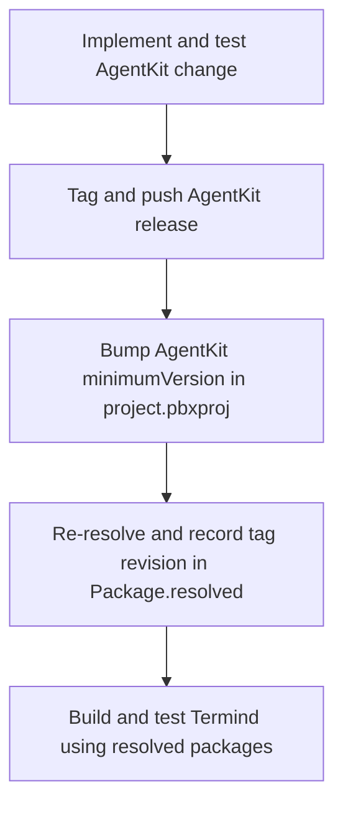

# Build, Validation, Localization, and Dependency Release Operations

This page is the operational playbook for proving a change without accidentally changing the dependency graph or committing local artifacts. The repository has one Xcode project with the macOS `TFM` and iPhone/iPad `TFI` schemes, shared-framework tests in `FrameworkTests/`, and platform tests in `TFMTests/` and `TFITests/`. The Astro landing page is a separate Node workspace under `LandingPage/`.

Choose the narrowest quiet check that proves the changed behavior, then expand to the affected target or default suite before delivery. Preserve complete failure output: a green unrelated build is not evidence that the changed feature works.

## Baseline safety rules

- **Use the resolved package graph.** Every ordinary Xcode build, test, and screenshot build must retain `-onlyUsePackageVersionsFromResolvedFile`. Without it, Xcode may resolve newer dependencies instead of testing the revisions recorded in `Package.resolved`.
- **Keep artifacts and secrets local.** Never commit secrets, `.env` files, generated build products, `DerivedData/`, `.build/`, `build/`, `*.xcresult`, `LandingPage/dist/`, `node_modules/`, or user-specific Xcode state. These are ignored because they are machine- or run-specific, not release inputs.
- **Keep commits focused.** State the outcome, affected layers, and verification in the PR; include bilingual UI screenshots where the change calls for them. Run the Chinese localization check as part of every commit pipeline, including code-only changes.
- **Validate the owner boundary as well as behavior.** A dependency, persistence, or framework-ownership change should include the focused architecture boundary tests; platform/UI changes need the relevant platform target and feature tests.

## Native build and test entrypoints

Run commands from the repository root unless a command changes directory.

### Build the affected product

```sh
xcodebuild -project Termind.xcodeproj -scheme TFM -destination 'platform=macOS' -onlyUsePackageVersionsFromResolvedFile build
```

This is the desktop build entrypoint and also builds the macOS app’s MCP bridge and resolved AgentKit dependency.

```sh
xcodebuild -project Termind.xcodeproj -scheme TFI -destination 'generic/platform=iOS Simulator' -onlyUsePackageVersionsFromResolvedFile build
```

This builds the mobile app and shared frameworks. For an iOS test run, replace the generic destination with an installed iPhone or iPad simulator destination.

### Test narrowly, then at the appropriate scope

The default macOS test entrypoint runs macOS and shared Swift tests:

```sh
xcodebuild -project Termind.xcodeproj -scheme TFM -destination 'platform=macOS' -onlyUsePackageVersionsFromResolvedFile test
```

Constrain a run when a focused suite directly establishes the changed contract, for example:

```sh
xcodebuild -project Termind.xcodeproj -scheme TFM -destination 'platform=macOS' -onlyUsePackageVersionsFromResolvedFile test -only-testing:TFMTests/AppLanguageTests
```

Use the matching mobile scheme and a concrete simulator for `TFITests` work. Typical focused choices are the test file that names the changed feature, `TFMTests/ArchitectureBoundaryTests.swift` for dependency placement, and `TFMTests/AppLanguageTests.swift` for language-selection/catalog behavior. Do not use an unrelated focused test as a substitute for the affected default suite.

### Formatting is a strict check

Swift formatting follows `.swift-format` (four-space indentation and 120-column lines). Lint all owned Swift production and test roots before delivery:

```sh
xcrun swift-format lint --strict --recursive Frameworks TFM TFI FrameworkTests TFMTests TFITests TermindMCPBridge
```

A companion change in AgentKit must also pass its equivalent command over `Sources Tests` from that repository.

## Window tests and screenshot operations

Most routine tests should remain headless. macOS tests that show windows or take focus explicitly use `.requiresVisibleWindow`; the trait enables them only when the test host sees `TERMIND_WINDOW_TESTS=1`. Xcode forwards `TEST_RUNNER_TERMIND_WINDOW_TESTS=1` into that host environment.

Opt in only for the named rendering/interaction suite being investigated:

```sh
TEST_RUNNER_TERMIND_WINDOW_TESTS=1 xcodebuild -project Termind.xcodeproj -scheme TFM -destination 'platform=macOS' -onlyUsePackageVersionsFromResolvedFile test -only-testing:TFMTests/ChooserInteractionTests
```

In Xcode, set `TERMIND_WINDOW_TESTS=1` in the Test action environment. Existing screenshot tests may retain their own dedicated opt-in variables; offscreen layout and logic tests remain part of normal validation. This separation prevents a routine test run from activating the app, stealing focus, or becoming display-dependent.

For an isolated interactive desktop demo, use a supported scene and one of the three supported languages:

```sh
Scripts/run-screenshot-demo.sh <hosts|workspace|agent|command|metrics|metrics-detail|app-settings> <en|zh-Hans|zh-Hant>
```

The script uses a dedicated `.build/screenshot-demo` derived-data directory, builds `TFM` with the resolved-package flag, and launches a Debug app with matching Apple language and locale arguments. It is for inspection rather than a general regression test.

Marketing screenshots are controlled capture workflows, not ordinary test artifacts:

```sh
Scripts/run-mac-marketing-screenshots.sh
Scripts/run-mobile-marketing-screenshots.sh
```

The macOS script requires macOS 27.x, accepts constrained scene/locale environment selections, builds for testing with resolved packages, waits until the capture window is focused, verifies dimensions, and writes captures under `Marketing/Screenshots/Captures` while backing up prior images. The mobile script requires an iOS/iPadOS 27 runtime, builds once for testing from resolved packages, runs `MobileMarketingScreenshotTests` on the selected supported simulators for `en`, `zh-Hans`, and `zh-Hant`, and verifies its expected capture count. Treat output as a reviewed product asset: recapture the affected platform and locales after a captured UI change, and do not commit transient derived data.

## Localization gate

User-facing app text belongs in `Frameworks/Resources/Localizable.xcstrings`; bundle metadata belongs in `InfoPlist.xcstrings`. Any new or changed English string must ship with finished `zh-Hans` and `zh-Hant` translations in the same commit. Preserve format placeholders and Chinese punctuation conventions.

Run the catalog gate before committing; it requires `jq` and accepts an optional catalog path:

```sh
Scripts/check-zh-localization.sh
```

The script first validates the catalog as JSON. For each Chinese locale, it rejects absent localization entries, string units not marked `translated`, empty values except for the empty key, and invalid Han/Latin or punctuation spacing. It exits nonzero at the first category of failure, so fix the catalog rather than bypassing the check. Run `AppLanguageTests` when language behavior changes; those tests cover canonical language preferences and ensure Simplified and Traditional Chinese resolve independently.

AgentKit owns its separate runtime catalog at `../AgentKit/Localizations/Localizable.xcstrings`. After changing that catalog, run the package’s catalog build step because a plain Swift build copies its resources rather than compiling string catalogs:

```sh
../AgentKit/Scripts/build-localizations.sh
```

## Landing-page validation

`LandingPage/` is an independent private Astro package. Its production build runs both `astro check` and `astro build`, emitting output to `LandingPage/dist/`:

```sh
cd LandingPage && npm ci && npm run build
```

Use `npm ci` when reproducing the locked dependency graph; use `npm run dev` for local iteration. For website changes, visually check English and Chinese routes in addition to the build. The site keeps its screenshot inputs deliberately narrow: it imports an explicit allowlist of framed assets rather than copying full-resolution captures into `public/`. `dist/`, `.astro/`, and `node_modules/` are generated and must remain uncommitted.

## AgentKit: release, bump, and re-resolve

AgentKit is a separately developed, host-neutral remote Swift package. Termind’s project specifies an up-to-next-major minimum version, while `Termind.xcodeproj/project.xcworkspace/xcshareddata/swiftpm/Package.resolved` pins the actual build to a precise AgentKit tag and revision. Therefore Xcode builds the resolved remote release—not an uncommitted sibling `../AgentKit` working tree.

A cross-repository change has a strict three-step lifecycle:



This shows the required ordering from a host-neutral package change through Termind consumption.

1. **Release AgentKit first.** In `../AgentKit`, make the host-neutral change and validate it there:

   ```sh
   cd ../AgentKit && swift build && swift test
   ```

   Format its `Sources` and `Tests`, then tag and push the package release. Do not add Termind names, SSH/SFTP behavior, or UI to AgentKit; those stay on the Termind side of the integration boundary.
2. **Bump the app requirement.** Update AgentKit’s `minimumVersion` in `Termind.xcodeproj/project.pbxproj` to the released version.
3. **Re-resolve and commit the lock result.** Re-resolve Swift packages so `Termind.xcodeproj/project.xcworkspace/xcshareddata/swiftpm/Package.resolved` records the released version and exact revision. Commit both the project requirement and resolved file with the Termind-side code that requires them, then validate with the resolved-package build/test commands above.

Do not skip the release or resolve steps: a project-file bump alone does not establish the exact revision used in ordinary builds, and local sibling edits are invisible to that build. Likewise, do not casually refresh the lock file during unrelated work—the resolved graph is a reproducibility boundary.

## Release-oriented checklist

1. Identify the smallest affected product surface and run its focused tests.
2. Run the affected TFM or TFI build/test using `-onlyUsePackageVersionsFromResolvedFile`; include architecture tests for boundary changes.
3. Run strict Swift format lint for Swift changes.
4. Run `Scripts/check-zh-localization.sh` for every commit; complete both Chinese translations and run `AppLanguageTests` when localization behavior changes.
5. For landing-page changes, run `cd LandingPage && npm ci && npm run build` and inspect English/Chinese routes.
6. Run visible-window tests only with explicit opt-in and a narrow suite; regenerate marketing captures only through their dedicated scripts when product imagery changes.
7. For AgentKit work, complete release → minimum-version bump → re-resolve, and commit both dependency files.
8. Inspect the staged diff for secrets, local environment files, derived data, build output, and accidental lock/artifact churn before committing.

CloudKit production deployment and signed-device delivery are separate release evidence, not consequences of a successful local build. For the sync-specific deployment matrix and operational prerequisites, consult `Memory/SETTINGS_SYNC_RELEASE.md`.
