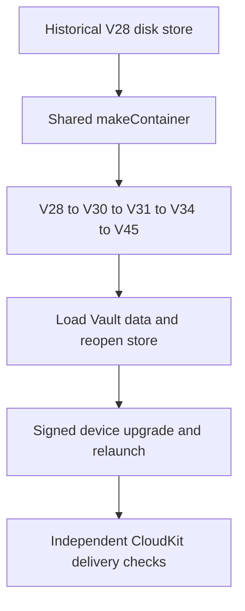
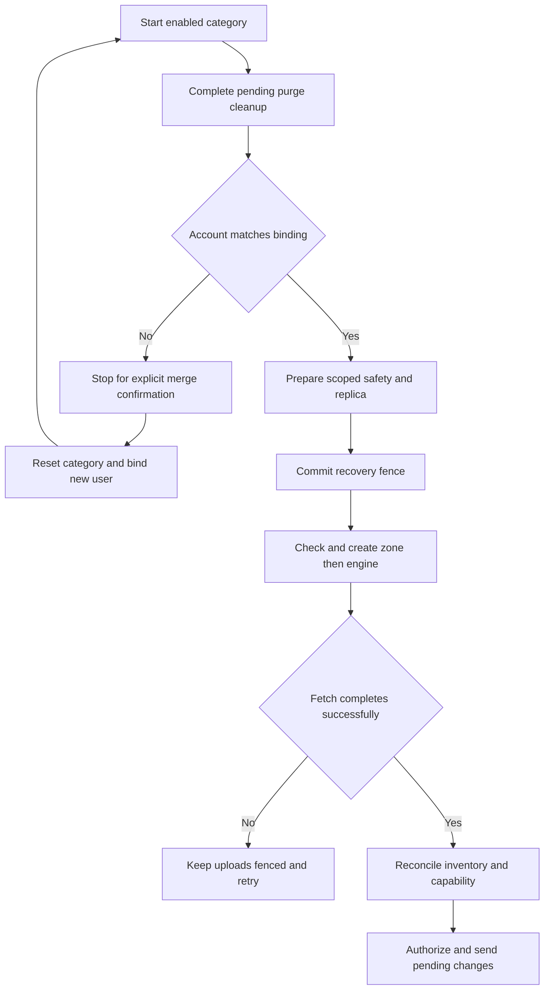

# CloudKit Release Readiness

A passing local build or sync test does not prove that the production CloudKit schema is deployed or that signed devices can exchange records. Treat schema deployment, App Store entitlements, iCloud account state, Keychain delivery, and multi-device behavior as separate release evidence.

The macOS and mobile targets declare the private container `iCloud.com.akinokaede.termind`, shared by the category coordinators. Vault and Device follow the master iCloud switch. Optional categories are History, Metrics and Settings; History defaults on when no preference is stored and does **not** inherit the retired Vault selection or environment. Category lifecycle and account bindings remain independent, and Pro access gates live synchronization without deleting local data. A different CloudKit user is recorded as pending and synchronization stops until explicit merge confirmation; only then does that category reset its old account state, bind the new account, fetch, and allow uploads.

## Schema inventory

Validate the Development schema first, then explicitly deploy it to Production.

| Category | Zone | Record type | Subscription |
| --- | --- | --- | --- |
| Vault configuration | `TermindVaultV1` | `VaultItem` | `termind-vault-v1-changes` |
| History | `TermindConnectionHistoryV1` | `ConnectionHistoryItem` | `termind-connection-history-v1-changes` |
| Device | `TermindConnectionHistoryV1` | `DeviceItem` | `termind-device-v1-changes` |
| Settings and AI configuration | `TermindAIConfigurationV1` | `AIConfigurationItem` | `termind-ai-configuration-v1-changes` |
| SSH preferences | `TermindAIConfigurationV1` | `SSHPreferencesItem` | `termind-ai-configuration-v1-changes` |
| SFTP preferences | `TermindAIConfigurationV1` | `SFTPPreferencesItem` | `termind-ai-configuration-v1-changes` |
| Notification preferences | `TermindAIConfigurationV1` | `NotificationPreferencesItem` | `termind-ai-configuration-v1-changes` |
| Workspace preferences | `TermindAIConfigurationV1` | `WorkspacePreferencesItem` | `termind-ai-configuration-v1-changes` |
| Metrics | `TermindMetricsV1` | `MetricsItem` | `termind-metrics-v1-changes` |

Vault records use the same private container through their own coordinator and compatibility contract. A Vault envelope stores integer `formatVersion` and `counter`, Boolean `isDeleted`, strings `kind`, `entityID`, `writerID`, and `payloadHash`, date `modifiedAt`, inline bytes `payload`, or `payloadAsset` for payloads above the 700,000-byte inline limit. Preserve zone names, record types, subscription identifiers, envelope fields, and format compatibility: older clients must be able to ignore the distinct `SFTPPreferencesItem` record type before attempting to decode it.

## Native History V1 fields

New cloud records contain typed CloudKit fields, not a JSON payload, payload hash,
or asset. `HistoryCloudRecordV1` is the frozen field adapter. History's local
journal encoding is an implementation detail and is not the cloud schema.

| Field | CloudKit type | Meaning |
| --- | --- | --- |
| `formatVersion` | INT64 | Breaking format version for this record type/kind |
| `kind` | STRING | `connectionHistory` or `device` |
| `entityID` | STRING | Lowercase UUID matching the stable record ID |
| `modifiedAt` | TIMESTAMP | Logical modification date |
| `counter` | INT64 | Nonnegative logical modification counter |
| `writerID` | STRING | UUID of the writer installation |
| `isDeleted` | NSNumber 0 or 1 | Protocol tombstone |

`ConnectionHistoryItem` adds `hostID` (STRING UUID), `connectionKind` (STRING:
`ssh`, `telnet`, `sftp`), `connectedAt` (TIMESTAMP), optional `endedAt` (TIMESTAMP),
and optional `sourceDeviceID` (STRING UUID). `DeviceItem` adds `displayName`
(STRING). Live records require their nonoptional fields. Tombstones require only
metadata. Optional fields are explicitly cleared on writes. Neither record uses
CloudKit references: history may arrive before its Host and must remain durable.

Record IDs remain `v1/connectionHistory/<uuid>` and `v1/device/<uuid>`. The `v1`
identity namespace does not change when payload/field versions increase. Event
UUIDs are never reused. Deletion is terminal for an event UUID, including against
later-clock updates from an old client. Retention keeps 250 newest events and
retains overflow tombstones. Clearing history leaves the device directory intact.

History and Device now have separate coordinator owners (`ConnectionHistorySyncCoordinator` and `DeviceSyncCoordinator`): each has its own subscription, engine, journal, account scope and blocked-record status, even though both share the stable `TermindConnectionHistoryV1` zone. The shared `HistoryRecordSyncCoordinator` filters each owner's incoming records, pending batches and safety checks by kind. The retired Vault-to-History importer is not active: new clients neither read old History/Device records from `TermindVaultV1` nor inherit the old Vault History sync preference. Preserve historical cloud records for old clients, but do not promise that legacy edits will continue to import into current clients. TestFlight uses Production, so additive Development schema changes must be explicitly deployed before release. Successful native writes or an authorized schema import create Development types; builds and empty reads do not. Exercise optional `endedAt` and `sourceDeviceID` fields during provisioning.

There is no public-database access in this design. Before release, verify the app entitlements, the private-container Development schema, and the deployed Production schema with credentials that actually have CloudKit management access. An unavailable management token or a successful local test is not deployment evidence.

## Signed-device matrix

Use at least two Macs and one iPhone or iPad signed into the same Apple account, then repeat the critical path across an account switch.

- Add, edit, and delete providers, roles, MCP clients, skills, and terminal configuration. Include offline edits, independent category pause/resume, master pause/resume, delayed Keychain delivery, key rotation, and Pro expiration.
- Verify that an account switch merges before upload and that category selections and account bindings remain independent.
- Confirm that theme text, custom terminal text, and shell-integration changes update existing windows. Font family, size, and follow-theme-size are device-local; distinguish them from fonts authored inside synchronized theme text.
- Confirm that notification preferences (including assistant, terminal and SFTP notification modes, terminal delivery and minimum duration) synchronize as Settings while conversations, approval mode, and the local MCP listener's enabled state, port, tools, and token never synchronize.
- Before deleting the iCloud Keychain copy of a migrated MCP token, verify that the local replacement works.
- Verify Metrics ordering, pause state, disk choices, and network choices across platforms. Metrics records that arrive before their Vault Hosts must remain hidden until those Hosts exist.
- Verify that the published privacy-policy version and effective date match the release being shipped.

Exercise offline edits and delayed delivery deliberately. A clean online two-device pass does not cover journal replay, acknowledgement, account-transition, or missing-Keychain cases.

## SFTP preference compatibility

SFTP preferences synchronize as `v1/sftp/default`; transfer jobs and byte progress are never Settings records. Deploy `SFTPPreferencesItem` before a client version that uploads it.

Current defaults are 30 global transfers, 10 per Host, and Smart topology. The accepted global range is 1–100; per-Host is 1–50 and is additionally clamped to the global value. Historical V21 migration imports an existing local value once, including older 3/2 or 15/5 choices; saved values are not silently reset to the new defaults.

For a release check, change 30/10 to 100/50, close Settings, and verify that another device adopts the new pair without interrupting active transfers. Repeat while offline and while the Settings category or master switch is paused, then resume. Include a device retaining 3/2 and, where compatibility testing is available, an older client that continues syncing the pre-existing record types while ignoring `SFTPPreferencesItem`.

## Installed V28 store upgrade gate

The local SwiftData migration is a separate release gate from CloudKit schema deployment. `TermindPersistence.makeContainer` opens file and in-memory stores with the shared **V45** schema, `TermindMigrationPlan`, and `cloudKitDatabase: .none`; CloudKit transport is owned by the category coordinators instead of SwiftData mirroring. Keep the historical V28 endpoint: the plan takes V27→V28→V30→V31→V34→V35→V36→V37→V38→V39→V40→V41→V42→V43→V44→V45, skipping V29, V32 and V33 as endpoints. V28 supplies the frozen Host shape (including `charset`), and V30 retains V28's `port`, `identityID` and `charset` column names as SSH values while introducing default-disabled Telnet fields. Do not rewrite shipped model shapes or replace the fixture with a store generated from current models just to make migration tests pass.

This is the evidence ladder for upgrading an installed store; each step establishes a different release property.

The checked-in `V28.store` was generated against the historical Persistence build with synthetic data and no passwords or private keys. `PersistenceCompatibilityTests.version28FixtureMigratesAndReopensWithoutLosingData` copies it to a temporary disk path, opens it through the normal factory twice, and checks the preserved SSH port/GB18030 charset, default-disabled Telnet, identity and key references, ordered environment variables, snippet, group and known host, history and installation ID, and workspace defaults. The V31→V34 migration backfills the history event's source device from the existing Vault installation ID and creates a device record, without fabricating an end time. `MobileAppTests.startupLoadsVersion28DataAfterMigrationAndRelaunch` also constructs the mobile app twice from the migrated disk container and checks the projected Host, identity reference and history. These in-process fixtures do **not** prove an on-device installed-app upgrade, process relaunch, Keychain secret availability, mixed-version CloudKit compatibility or Production delivery. Include an upgrade of an existing signed installation with actual credentials, then relaunch and sync on another signed device in the release matrix; a fixture credential reference is not a secret.

## First-stage mixed-version safety

V35 retained existing scoped quarantine/recovery models and added independent History journals, a now-retired importer state, and decoder-capability checkpoints via a lightweight V34→V35 stage. V36 removes the importer table; V37 adds scoped cloud-presence and confirmed-deletion state (its `legacyDeletion` column is retained in the shipped model but no longer read as cleanup intent); V38 adds durable delete-handoff and asset-cleanup sidecars. V39 adds local assistant-model selection; V40 drops retired per-category Vault, Settings and Metrics quarantine tables while retaining the scoped quarantine table. History bootstrap uses local history data and does not reuse retired Vault journal records or old-zone system fields. V41 adds shared notification preferences without changing historical shapes; V42 adds agent-message and conversation provenance and durable collaboration delivery receipts. V43 adds public MCP OAuth configuration; V44 adds Host SSH enablement and forwarding fields; V45 adds Security Key credential metadata to the SSH key model. A V40 notification-preference upgrade and a V41→V42 disk upgrade are separate checks from the V28 fixture: the latter retains existing Host groups and begins with empty collaboration sidecars. These local migrations are separate from deploying CloudKit record types, including `NotificationPreferencesItem`.

The compatibility contract is now fail-closed for records a client detects it cannot safely understand: keep the received bytes and local pending edits, remove that record from upload scheduling, and recheck the final batch/provider. Other compatible records remain eligible. Unsupported fetches and `serverRecordChanged` replies share this path. Only successful supported-data reconciliation clears the restriction; pressing Retry, pausing a category or restarting does not discard it.

Include the following matrix in release validation:

| Scenario | Required result |
| --- | --- |
| New-format record with the same ID as a local pending edit | Block that ID without replacing it with defaults or clearing the local edit. |
| Another record in the same category remains compatible | Upload it; include pending and blocked counts in the aggregate status. |
| Restored save queue, local tombstone, or physical-delete recreation | No path bypasses a blocked ID; a physical delete requires a current durable journal mutation, not merely an engine queue entry. |
| Upload conflict returns an unsupported record | Preserve it in quarantine rather than retrying a stale local payload. |
| Persistence failure during fetch/conflict handling | Retire that engine; a later callback cannot reauthorize it, and restart fetches afresh. |
| Pause/retry/relaunch or account/environment change | Preserve restrictions in their original scope without leaking them into another replica. |
| Supported replacement arrives but its merge fails | Roll back data, metadata and unblock together. |
| Corrupt data rather than a recognized newer format | Explain the restriction without promising that an app update will repair corruption. |

Recovery ordering matters: `prepareAndSynchronize` completes pending purge cleanup, checks account identity, prepares scoped safety/replica state, invalidates a stale or undecodable engine cursor, and **commits the recovery-required fence before checking/creating the zone and constructing the automatically syncing engine**. Explicit fetches and automatic fetch events both fence uploads; only the last successful fetch completes inventory reconciliation and advances the decoder-capability checkpoint, then upload authorization resumes. A failed fetch retains the fence and disables uploads even when the engine is retryable. Overlapping sends keep recovery required until they finish; a persistence failure rolls back and retires the engine so late callbacks cannot clear the fence. On retry/relaunch an interrupted scope refetches from a fresh cursor without discarding durable pending edits. An account mismatch instead records a pending user and stops before engine creation; confirmation resets the category's old account state, binds the pending user and starts a fresh fetch. Environment changes reset the category's zone state without merging into the prior environment.

This shows the committed recovery fence preceding automatic engine activity and the account-confirmation and failed-fetch exits.

Physical deletion is distinct from a protocol tombstone. Batch construction rechecks scoped pending mutations and upload blocks, limits combined saves and deletes to 250, records each delete's causal version durably **before** returning the batch, and holds a per-ID in-flight slot. V37 cloud-presence state and V38 handoffs reconcile incremental deletions and full-inventory absence after a reset or crash. A stale delete acknowledgement cannot erase a newer explicit incarnation; History event UUIDs stay terminal, while other kinds can be explicitly recreated. A reobserved tombstone can require another physical delete. A `.deleted` zone resets and recreates its replica; `.purged` or `.encryptedDataReset` retires the engine and removes only that category's scoped cloud projection and asset cache, without resurrecting the old snapshot. If filesystem cleanup fails after a committed purge, a durable pending cleanup marker is retried before the next engine starts.

Portable tests exercise real journals, coordinators, record coding and batch providers behind a fake CloudKit transport, plus on-disk migration and reopening. `CloudSyncLifecycleTests` verifies that a failed fence save prevents engine creation, failed and overlapping fetches keep uploads fenced, and late callbacks from retired engines are ignored. `CloudSyncSafetyPersistenceTests` verifies scope isolation across container, environment, account, zone and owner; interrupted fetches reopen with the quarantine bytes, recovery fence and local pending intent intact, while compatible edits remain uploadable. It also verifies causal delete-handoff on reopen, V30 store upgrade, and V39→V40 preservation of scoped safety while retired quarantine tables disappear. The cross-category journal test asserts repeated identical system-field and upload-acknowledgement operations do not dirty the context. `CloudSyncPhysicalDeletionTests` covers handoff/restart, stale acknowledgements, full-inventory and incremental deletion, purge isolation and asset-cleanup failure across categories. They do not establish signed-device delivery or Production behavior.

Decoder capability changes now force scoped full rereading; only successful merge and persistence advance the checkpoint and clear quarantine. Native quarantine retains complete CKRecord archives. This does not retrofit unsafe old binaries or preserve unknown fields silently ignored by a V1 JSON decoder: incompatible additions must raise that kind’s version. Keep signed new→old→edit→new tests in the release matrix and document what legacy-only records an old client leaves behind; current clients do not run a continuous old-zone importer.

Validate native event creation, end-time updates and device renames between current signed clients; test older clients separately for legacy coexistence, not continuous import. Repeat duplicate and out-of-order delivery after Clear History; terminal event tombstones must prevent resurrection. Verify History-off/Device-on, newest-250 convergence, local Recents versus cross-device History, and History arriving before its Host.

## Evidence boundaries and release sign-off

Local fixture results and code-level constants are not evidence of deployed Production schema or real signed-device delivery. Re-run current pinned build/test gates and record the actual environment, entitlements and CloudKit management deployment evidence separately.

Release sign-off should record, separately:

1. the current pinned macOS and mobile build/test results, including historical V28 fixture migration and reopening, V40 notification-preference persistence, and V41→V42 collaboration-sidecar migration;
2. an installed signed-device V28 upgrade and relaunch with real credentials, separately from fixture results;
3. successful Development validation and explicit Production deployment for every required zone and record type, including `NotificationPreferencesItem`;
4. the signed multi-device/account-switch matrix, including offline and pause/resume behavior;
5. Keychain-delivery and migrated-token checks;
6. the SFTP preference and mixed-version safety matrices; and
7. the published privacy-policy version and effective date.

See [Settings, Vault, Metrics, and Cloud Sync Workflow](/openwiki/workflows/settings-and-cloud-sync.md) for runtime lifecycle and journals, [Persistent Data, Migrations, and Secret Boundaries](/openwiki/concepts/persistence-and-secrets.md) for local stores and secret references, and [Build, Validation, Localization, and Dependency Release Operations](/openwiki/operations/build-test-and-release.md) for ordinary build gates.
