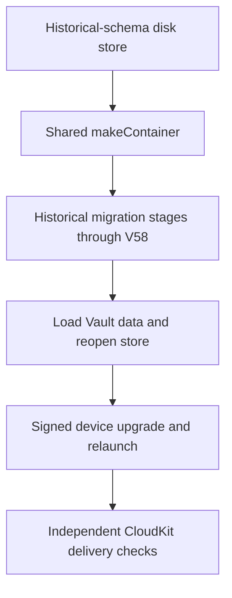
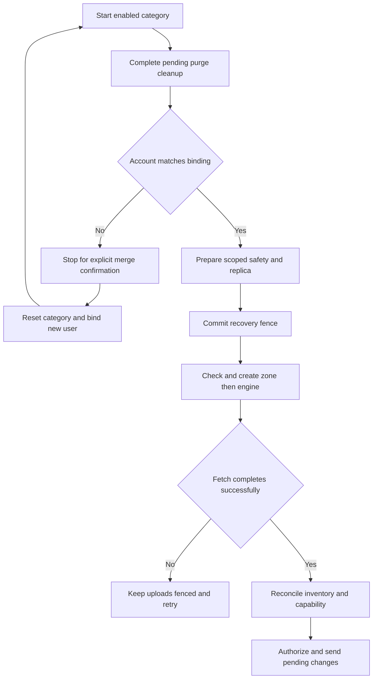

# CloudKit Release Readiness

A passing local build or sync test does not prove that the production CloudKit schema is deployed or that signed devices can exchange records. Treat schema deployment, App Store entitlements, iCloud account state, Keychain delivery, and multi-device behavior as separate release evidence.

Both target entitlement templates ([TFI](../../TFI/TFI.entitlements), [TFM](../../TFM/TFM.entitlements)) declare CloudKit and `iCloud.com.akinokaede.termind`. Their iCloud-container environment uses `$(ICLOUD_CONTAINER_ENVIRONMENT)`; their push environment uses `$(APS_ENVIRONMENT)`. TFI uses the push entitlement key `aps-environment`, while TFM uses `com.apple.developer.aps-environment`.

The checked-in target build configurations in the [project source settings](../../Termind.xcodeproj/project.pbxproj) select these substitutions for both app targets:

| Target | Configuration | Entitlement template | `ICLOUD_CONTAINER_ENVIRONMENT` | `APS_ENVIRONMENT` |
| --- | --- | --- | --- | --- |
| TFI | [Debug](../../Termind.xcodeproj/project.pbxproj#L2028-L2039) | `TFI/TFI.entitlements` | `Development` | `development` |
| TFI | [Release](../../Termind.xcodeproj/project.pbxproj#L2340-L2351) | `TFI/TFI.entitlements` | `Production` | `production` |
| TFM | [Debug](../../Termind.xcodeproj/project.pbxproj#L2590-L2608) | `TFM/TFM.entitlements` | `Development` | `development` |
| TFM | [Release](../../Termind.xcodeproj/project.pbxproj#L2628-L2650) | `TFM/TFM.entitlements` | `Production` | `production` |

These are configuration inputs, not proof of effective signed entitlements or deployed Production schema. For each platform's release artifact, inspect the **signed artifact's** effective CloudKit service, container identifier, container environment and platform-specific push entitlement separately from verifying the actual CloudKit schema deployment with authorized management credentials. Keep signed-capability evidence, schema-deployment evidence and the live multi-device results distinct in release sign-off.

The private container is shared by the category coordinators. Vault and Device follow the master iCloud switch. Optional categories are History, Metrics and Settings; History defaults on when no preference is stored and does **not** inherit the retired Vault selection or environment. Category lifecycle and account bindings remain independent, and Pro access gates live synchronization without deleting local data. A different CloudKit user is recorded as pending and synchronization stops until explicit merge confirmation; only then does that category reset its old account state, bind the new account, fetch, and allow uploads.

## Schema inventory

App composition is a release boundary: [macOS](../../TFM/App/AppModel.swift#L514-L528) starts the five category coordinators only while `proAccess.canUse(.vaultSync)` and otherwise pauses them. [Mobile](../../TFI/App/MobileAppModel.swift#L637-L651) additionally requires at least one active scene. These pauses are not local-data deletion. Check entitlement loss and mobile foreground/background transitions separately from each category's own enabled switch.

Validate the Development schema first, then explicitly deploy it to Production.

| Category | Zone | Record type | Subscription |
| --- | --- | --- | --- |
| Vault configuration | `TermindVaultV1` | `VaultItem` | `termind-vault-v1-changes` |
| History | `TermindConnectionHistoryV1` | `ConnectionHistoryItem` | `termind-connection-history-v1-changes` |
| Device | `TermindConnectionHistoryV1` | `DeviceItem` | `termind-device-v1-changes` |
| Settings and AI configuration | `TermindAIConfigurationV1` | `AIConfigurationItem` | `termind-ai-configuration-v1-changes` |
| SSH preferences | `TermindAIConfigurationV1` | `SSHPreferencesItem` | `termind-ai-configuration-v1-changes` |
| SFTP preferences | `TermindAIConfigurationV1` | `SFTPPreferencesItem` | `termind-ai-configuration-v1-changes` |
| Notification preferences | `TermindAIConfigurationV1` | `NotificationPreferencesItem` | `termind-ai-configuration-v1-changes` |
| Retired highlighting compatibility identity (not active sync) | `TermindAIConfigurationV1` | `TerminalHighlightPreferencesItem` | Existing Settings subscription |
| Workspace preferences | `TermindAIConfigurationV1` | `WorkspacePreferencesItem` | `termind-ai-configuration-v1-changes` |
| Named terminal themes | `TermindAIConfigurationV1` | `TerminalCustomThemeItem` | `termind-ai-configuration-v1-changes` |
| Light/dark theme selections | `TermindAIConfigurationV1` | `TerminalThemeSelectionItem` | `termind-ai-configuration-v1-changes` |
| Metrics | `TermindMetricsV1` | `MetricsItem` | `termind-metrics-v1-changes` |

Terminal keyword highlighting is retired. The legacy `TerminalHighlightPreferencesItem` type and `v1/terminalHighlighting/default` key remain compatibility identities, but current clients exclude them from active capability/upload/presence handling and ignore their fetched, conflict and deletion records before validation. V52 removes local storage and Settings preparation retires pending uploads. Do not provision it as a new active feature or delete historical Production types merely because the local model was removed; mixed-version rollout and existing server-data cleanup are separate decisions.

Vault records use the same private container through their own coordinator and compatibility contract. A Vault envelope stores integer `formatVersion` and `counter`, Boolean `isDeleted`, strings `kind`, `entityID`, `writerID`, and `payloadHash`, date `modifiedAt`, inline bytes `payload`, or `payloadAsset` for payloads above the 700,000-byte inline limit. Preserve zone names, record types, subscription identifiers, envelope fields, and format compatibility: older clients must be able to ignore the distinct `SFTPPreferencesItem` record type before attempting to decode it.

## Native History wire fields

New cloud records contain typed CloudKit fields, not a JSON payload, payload hash,
or asset. `HistoryCloudRecordV1` stays frozen; `HistoryCloudRecordV2` adds `mosh`
and `eternalTerminal` without changing field types. ConnectionHistory writes V2
and reads V1/V2; Device stays V1. Local journal encoding is not the cloud schema.

| Field | CloudKit type | Meaning |
| --- | --- | --- |
| `formatVersion` | INT64 | Breaking format version for this record type/kind |
| `kind` | STRING | `connectionHistory` or `device` |
| `entityID` | STRING | Lowercase UUID matching the stable record ID |
| `modifiedAt` | TIMESTAMP | Logical modification date |
| `counter` | INT64 | Nonnegative logical modification counter |
| `writerID` | STRING | UUID of the writer installation |
| `isDeleted` | NSNumber 0 or 1 | Protocol tombstone |

`ConnectionHistoryItem` adds `hostID` (STRING UUID), `connectionKind` (STRING:
`ssh`, `telnet`, `sftp`, plus V2 `mosh` and `eternalTerminal`), `connectedAt` (TIMESTAMP), optional `endedAt` (TIMESTAMP),
and optional `sourceDeviceID` (STRING UUID). `DeviceItem` adds `displayName`
(STRING). Live records require their nonoptional fields. Tombstones require only
metadata. Optional fields are explicitly cleared on writes. Neither record uses
CloudKit references: history may arrive before its Host and must remain durable.

Record IDs remain `v1/connectionHistory/<uuid>` and `v1/device/<uuid>`. The `v1`
identity namespace does not change when payload/field versions increase. Event
UUIDs are never reused. Deletion is terminal for an event UUID, including against
later-clock updates from an old client. Retention keeps 250 newest events and
retains overflow tombstones. Clearing history leaves the device directory intact.

History and Device now have separate coordinator owners (`ConnectionHistorySyncCoordinator` and `DeviceSyncCoordinator`): each has its own subscription, engine, journal, account scope and blocked-record status, even though both share the stable `TermindConnectionHistoryV1` zone. The shared `HistoryRecordSyncCoordinator` filters each owner's incoming records, pending batches and safety checks by kind. The retired Vault-to-History importer is not active: new clients neither read old History/Device records from `TermindVaultV1` nor inherit the old Vault History sync preference. Preserve historical cloud records for old clients, but do not promise that legacy edits will continue to import into current clients. TestFlight uses Production, so additive Development schema changes must be explicitly deployed before release. Successful native writes or an authorized schema import create Development types; builds and empty reads do not. Exercise optional `endedAt` and `sourceDeviceID` fields during provisioning.

There is no public-database access in this design. Before release, verify the app entitlements, the private-container Development schema, and the deployed Production schema with credentials that actually have CloudKit management access. An unavailable management token or a successful local test is not deployment evidence.

## Signed-device matrix

Use at least two Macs and one iPhone or iPad signed into the same Apple account, then repeat the critical path across an account switch.

- Add, edit, and delete providers, roles, MCP clients, skills, and terminal configuration. Include offline edits, independent category pause/resume, master pause/resume, delayed Keychain delivery, key rotation, and Pro expiration.
- Verify that an account switch merges before upload and that category selections and account bindings remain independent.
- Confirm that theme text, custom terminal text, and shell-integration changes update existing windows. Font family, size, and follow-theme-size are device-local; distinguish them from fonts authored inside synchronized theme text.
- Confirm that notification preferences (including assistant, terminal and SFTP notification modes, terminal delivery and minimum duration) synchronize as Settings while conversations, approval mode, and the local MCP listener's enabled state, port, tools, and token never synchronize.
- Upgrade a V46/V51 highlighting store to V52, reopen it and verify other preferences survive while local highlighting storage/pending uploads are gone. Deliver malformed legacy highlighting records—including conflicts/deletions—alongside valid Settings records; current clients must ignore the retired type without blocking or replacing active preferences. Check coexistence with older clients separately.
- Before deleting the iCloud Keychain copy of a migrated MCP token, verify that the local replacement works.
- Verify Metrics ordering, pause state, disk choices, and network choices across platforms. Metrics records that arrive before their Vault Hosts must remain hidden until those Hosts exist.
- Verify that the published privacy-policy version and effective date match the release being shipped.

Exercise offline edits and delayed delivery deliberately. A clean online two-device pass does not cover journal replay, acknowledgement, account-transition, or missing-Keychain cases.

## SFTP preference compatibility

SFTP preferences synchronize as `v1/sftp/default`; transfer jobs and byte progress are never Settings records. Deploy `SFTPPreferencesItem` before a client version that uploads it.

Current defaults are 30 global transfers, 10 per Host, and Smart topology. The accepted global range is 1–100; per-Host is 1–50 and is additionally clamped to the global value. Historical V21 migration imports an existing local value once, including older 3/2 or 15/5 choices; saved values are not silently reset to the new defaults.

For a release check, change 30/10 to 100/50, close Settings, and verify that another device adopts the new pair without interrupting active transfers. Repeat while offline and while the Settings category or master switch is paused, then resume. Include a device retaining 3/2 and, where compatibility testing is available, an older client that continues syncing the pre-existing record types while ignoring `SFTPPreferencesItem`.

## Native theme release gate

[TerminalThemeCloudRecordV1](../../Frameworks/TermindInfrastructure/Cloud/TerminalThemeCloudRecordV1.swift) is a separate native-field protocol within Settings, not a Vault JSON envelope. Both types carry version/kind/identity/clock/deletion metadata. Themes add `name`, `appearance`, `baseThemeName` and exactly one of `configuration` (STRING) or `configurationAsset` (raw UTF-8 CKAsset), protected by SHA-256 `configurationHash`. The asset threshold is the shared 700,000-byte limit. Selections add `appearance`, `selectionKind` (`builtin` or `custom`), `builtInThemeName` and optional `customThemeID`; appearance must match the stable selection key. Tombstone writes clear live fields. Unknown versions, invalid appearance, invalid selection combinations and corrupt asset/hash data fail decoding rather than defaulting.

[TerminalCustomThemeTests](../../FrameworkTests/TerminalCustomThemeTests.swift#L162-L305) checks native records without JSON payload fields, large-asset corruption, selection-before-theme arrival, independent per-theme merges, deletion without bootstrap resurrection, and one-time migration of legacy custom text from a V56 disk store followed by reopening. An unresolved custom selection remains stored until its theme arrives; legacy terminal preference updates do not erase the new library. Deploy both native types and exercise inline/asset configurations, optional fields, light/dark choices and selection-before-theme ordering on signed devices. Local tests are not deployment evidence.

## Installed-store upgrade gate

The local SwiftData migration is a separate release gate from CloudKit schema deployment. Both apps use `TermindPersistence.makeContainer` for normal local-store creation: mobile accepts an injected `dependencies.container`, otherwise uses an in-memory container when `inMemory` is true or Hosts are supplied, and passes its Application Support `Termind.store` URL for disk storage. macOS uses the factory's default file configuration outside tests and screenshot demos. On macOS, before opening that file-backed container, startup also checks for another running app with the same bundle identifier. This prevents a concurrently running older installation, which might not respect the newer store lock, from opening the shared sandbox; a conflict presents a database-in-use alert and exits instead of migrating. Tests and screenshot demos use an in-memory container and skip this process check. The factory creates file or in-memory `ModelConfiguration` values with the shared **V58** versioned schema, `TermindMigrationPlan`, and `cloudKitDatabase: .none`. **The SwiftData container does not mirror to CloudKit**: private-database transport and its journals are owned by the category coordinators. On macOS, the factory additionally takes a per-store cross-process lock *before* opening or migrating the file and retains it for the container lifetime; an in-use store can reject a second process rather than race a migration.

Keep the historical V28 endpoint: the plan takes V27→V28→V30→V31→V34→V35→V36→V37→V38→V39→V40→V41→V42→V43→V44→V45→V46→V47→V48→V49→V50→V51→V52→V53→V54→V55→V56→V57→V58, skipping V29, V32 and V33 as migration endpoints. V28 supplies the frozen Host shape (including `charset`), and V30 retains V28's `port`, `identityID` and `charset` column names as SSH values while introducing default-disabled Telnet fields. Do not rewrite shipped model shapes or replace the fixture with a store generated from current models just to make migration tests pass.

This is the evidence ladder for upgrading an installed store; each step establishes a different release property.

The current repository does **not** supply `Scripts/generate-v28-fixture.swift`, the former `V28.store` fixture test, or `MobileAppTests.startupLoadsVersion28DataAfterMigrationAndRelaunch`. Do not cite them as current release evidence. [PersistenceCompatibilityTests](../../FrameworkTests/PersistenceCompatibilityTests.swift) instead creates historical-schema disk stores: V30→V31 retains a Host's Telnet enablement; V31→V34 retains Host/identity values and backfills the history source device from the Vault installation ID without inventing an end time; V31/V34 reopen twice without importing retired Vault history journal entries; V35 reopens twice after removing the importer table while preserving native Device data and account bindings. [MobileAppTests](../../TFITests/MobileAppTests.swift#L24-L30) verifies shared-schema empty startup, not the retired V28 upgrade journey. These are in-process checks, not signed installation upgrades, Keychain-delivery tests or Production CloudKit evidence. For release, upgrade a retained signed installation with real credentials, relaunch, check retained data and secret access, then sync to another signed device. Preserve the shipped V28 migration endpoint even though the old fixture is no longer supplied.

## First-stage mixed-version safety

V35 retained existing scoped quarantine/recovery models and added independent History journals, a now-retired importer state, and decoder-capability checkpoints via a lightweight V34→V35 stage. V36 removes the importer table; V37 adds scoped cloud-presence and confirmed-deletion state (its `legacyDeletion` column is retained in the shipped model but no longer read as cleanup intent); V38 adds durable delete-handoff and asset-cleanup sidecars. V39 adds local assistant-model selection; V40 drops retired per-category Vault, Settings and Metrics quarantine tables while retaining the scoped quarantine table. History bootstrap uses local history data and does not reuse retired Vault journal records or old-zone system fields. V41 adds shared notification preferences without changing historical shapes; V42 adds agent-message and conversation provenance and durable collaboration delivery receipts. V43 adds public MCP OAuth configuration; V44 adds Host SSH enablement and forwarding fields; V45 adds Security Key credential metadata to the SSH key model; V46 historically adds terminal keyword-highlighting preferences; V51 adds Snippet color and V52 removes the retired highlighting model. The notification test creates a disk store with the V40 schema and an existing Workspace preference, opens it through the current container factory, saves a V41-introduced notification preference, then reopens the file and checks both values. It checks schema membership in V41 but not V40; the independent V41→V42 migration test retains an existing Host group and starts with empty collaboration sidecars. These checks are separate from historical Host migration coverage and deployment of active CloudKit types such as `NotificationPreferencesItem`; legacy highlighting is ignored rather than a new active deployment requirement. The notification test does not itself establish signed-device delivery.

The compatibility contract is now fail-closed for records a client detects it cannot safely understand: keep the received bytes and local pending edits, remove that record from upload scheduling, and recheck the final batch/provider. Other compatible records remain eligible. Unsupported fetches and `serverRecordChanged` replies share this path. Only successful supported-data reconciliation clears the restriction; pressing Retry, pausing a category or restarting does not discard it.

Include the following matrix in release validation:

| Scenario | Required result |
| --- | --- |
| New-format record with the same ID as a local pending edit | Block that ID without replacing it with defaults or clearing the local edit. |
| Another record in the same category remains compatible | Upload it; include pending and blocked counts in the aggregate status. |
| Restored save queue, local tombstone, or physical-delete recreation | No path bypasses a blocked ID; a physical delete requires a current durable journal mutation, not merely an engine queue entry. |
| Upload conflict returns an unsupported record | Preserve it in quarantine rather than retrying a stale local payload. |
| Persistence failure during fetch/conflict handling | Retire that engine; a later callback cannot reauthorize it, and restart fetches afresh. |
| Pause/retry/relaunch or account/environment change | Preserve restrictions in their original scope without leaking them into another replica. |
| Supported replacement arrives but its merge fails | Roll back data, metadata and unblock together. |
| Corrupt data rather than a recognized newer format | Explain the restriction without promising that an app update will repair corruption. |

Recovery ordering matters: `prepareAndSynchronize` completes pending purge cleanup, checks account identity, prepares scoped safety/replica state, invalidates a stale or undecodable engine cursor, and **commits the recovery-required fence before checking/creating the zone and constructing the automatically syncing engine**. Explicit fetches and automatic fetch events both fence uploads; only the last successful fetch completes inventory reconciliation and advances the decoder-capability checkpoint, then upload authorization resumes. A failed fetch retains the fence and disables uploads even when the engine is retryable. Overlapping sends keep recovery required until they finish. A delegate persistence failure rolls back and retires the engine, disabling uploads; the dispatcher rejects its late callbacks, and an interrupted scope's next startup discards the old cursor and refetches while keeping durable journal pending intent. This is distinct from cancellation during pause or account transition: retired operations may finish later, but their cancellation is ignored rather than reported as a new failure or allowed to overwrite the replacement operation's status. An account mismatch instead records a pending user and stops before engine creation; confirmation resets the category's old account state, binds the pending user and starts a fresh fetch. Environment changes reset the category's zone state without merging into the prior environment.

This shows the committed recovery fence preceding automatic engine activity and the account-confirmation and failed-fetch exits.

Physical deletion is distinct from a protocol tombstone. Batch construction rechecks scoped pending mutations and upload blocks, limits combined saves and deletes to 250, records each delete's causal version durably **before** returning the batch, and holds a per-ID in-flight slot. V37 cloud-presence state and V38 handoffs reconcile incremental deletions and full-inventory absence after a reset or crash. A stale delete acknowledgement cannot erase a newer explicit incarnation; History event UUIDs stay terminal, while other kinds can be explicitly recreated. A reobserved tombstone can require another physical delete. A `.deleted` zone resets and recreates its replica; `.purged` or `.encryptedDataReset` retires the engine and removes only that category's scoped cloud projection and asset cache, without resurrecting the old snapshot. If filesystem cleanup fails after a committed purge, a durable pending cleanup marker is retried before the next engine starts.

Portable tests exercise real journals, coordinators, record coding and batch providers behind a fake CloudKit transport, plus on-disk migration and reopening. `CloudSyncSafetyTests` checks across all sync categories that supported remote winners remove stale journal/engine work, older or losing records cannot acknowledge a local winner, unsupported fetched records and server conflicts preserve quarantine and block only the affected ID at the batch/provider boundaries, and a failed merge rolls back the unblock. `DatabaseStartupGuardTests` tests the process-ID decision (self allowed, other process refused), not an actual signed older-app coexistence or lock race. `CloudSyncLifecycleTests` verifies that a failed fence save prevents engine creation, failed and overlapping fetches keep uploads fenced, and late callbacks from retired engines are ignored. `CloudSyncSafetyPersistenceTests` verifies scope isolation across container, environment, account, zone and owner; interrupted fetches reopen with the quarantine bytes, recovery fence and local pending intent intact, while compatible edits remain uploadable. It also verifies causal delete-handoff on reopen, V30 store upgrade, and V39→V40 preservation of scoped safety while retired quarantine tables disappear. The cross-category journal test asserts repeated identical system-field and upload-acknowledgement operations do not dirty the context. `CloudSyncPhysicalDeletionTests` covers handoff/restart, stale acknowledgements, full-inventory and incremental deletion, purge isolation and asset-cleanup failure across categories. They do not establish signed-device delivery or Production behavior.

Decoder capability changes now force scoped full rereading; only successful merge and persistence advance the checkpoint and clear quarantine. Native quarantine retains complete CKRecord archives. This does not retrofit unsafe old binaries or preserve unknown fields silently ignored by a V1 JSON decoder: incompatible additions must raise that kind’s version. Keep signed new→old→edit→new tests in the release matrix and document what legacy-only records an old client leaves behind; current clients do not run a continuous old-zone importer.

Validate native event creation, end-time updates and device renames between current signed clients; test older clients separately for legacy coexistence, not continuous import. Repeat duplicate and out-of-order delivery after Clear History; terminal event tombstones must prevent resurrection. Verify History-off/Device-on, newest-250 convergence, local Recents versus cross-device History, and History arriving before its Host.

## Evidence boundaries and release sign-off

Local fixture results and code-level constants are not evidence of deployed Production schema or real signed-device delivery. Re-run current pinned build/test gates and record the actual environment, entitlements and CloudKit management deployment evidence separately.

Release sign-off should record, separately:

1. the current pinned macOS and mobile build/test results, including historical-schema disk migration and reopening, V40 notification-preference persistence, and V41→V42 collaboration-sidecar migration;
2. an installed signed-device upgrade and relaunch with real credentials, separately from historical-schema fixture results;
3. successful Development validation and explicit Production deployment for required active types, including `NotificationPreferencesItem`, plus explicit mixed-version retirement checks for legacy highlighting without casually deleting historical server types;
4. the signed multi-device/account-switch matrix, including offline and pause/resume behavior;
5. Keychain-delivery and migrated-token checks;
6. the SFTP preference and mixed-version safety matrices; and
7. the published privacy-policy version and effective date.

See [Settings, Vault, Metrics, and Cloud Sync Workflow](../workflows/settings-and-cloud-sync.md) for runtime lifecycle and journals, [Persistent Data, Migrations, and Secret Boundaries](../concepts/persistence-and-secrets.md) for local stores and secret references, and [Build, Validation, Localization, and Dependency Release Operations](build-test-and-release.md) for ordinary build gates.

## Current local and wire compatibility gates

Do not equate **local SwiftData V58**, per-kind `formatVersion`, and stable `v1/...` record identities. The [container factory](../../Frameworks/TermindPersistence/TermindPersistence.swift#L22-L40) selects V58 without enabling SwiftData CloudKit mirroring; [SyncRecordFormats](../../Frameworks/TermindDomain/Vault/SyncRecordFormats.swift#L45-L60) independently selects each wire reader/writer.

| Kind | Current writer | Accepted readers |
| --- | --- | --- |
| Host | V8 | V1, V2, V4, V5, V6, V7, V8 — **not V3** |
| HostGroup | V7 | V1–V7 |
| SSHKey | V3 | V1, V2, V3 |
| Snippet | V2 | V1, V2 |
| Metrics selection | V2 | V1, V2 |
| Workspace template | V2 | V1, V2 |
| ConnectionHistory | V2 | V1, V2 |
| Device | V1 | V1 |
| Terminal custom theme and appearance selection | V1 native fields | V1 |

Tailscale group configuration is part of HostGroup; managed peer Hosts cannot encode as standalone Vault Host records. Sign-in/profile/cache data and profile cleanup remain local. V49 removes durable command/SFTP history, V50 adds profile cleanup, V51 adds Snippet color over the frozen historical Snippet model, and V52 removes highlighting. V53 replaces the local Host model for session-persistence preferences; V54 replaces it again for `iconOverrideID`. Both V52→V53 and V53→V54 are lightweight migration stages, not CloudKit format upgrades. V55 adds terminal transport preferences, V56 Wake-on-LAN, V57 named themes and appearance selections, and V58 Host creation ordering without inventing dates for historical Hosts; all four subsequent stages are lightweight too.

### Host upload and decode checks

A default `VaultEnvelope` takes its writer version from the kind registry. Vault's final record provider rechecks upload permission and configuration-kind eligibility, reads the scoped journal's outgoing entry and passes it to record coding. [VaultSyncCodec](../../Frameworks/TermindPersistence/VaultSyncPersistence.swift#L56-L172) dispatches by kind and version, including Host V8 and HostGroup V7. V6 adds terminal transports, V7 Wake-on-LAN, and Host V8 creation dates. Writes below V8 reject nonnil Host `createdAt`; below V7 reject nondefault Wake-on-LAN; below V6 reject nondefault terminal transports, including group-peer preferences. [VaultWireV5](../../Frameworks/TermindPersistence/VaultWireV5.swift) wraps V4 data: Host adds its optional artwork override; HostGroup adds overrides indexed by lowercase UUID for existing Tailscale host preferences. Invalid or orphaned group override keys fail decoding. User-selected artwork stays separate from detected-distribution metadata.

Older-format writes must not silently lose these fields: formats below V5 reject nonnil Host or group-peer icon overrides; formats below V4 reject nondefault session-persistence preferences. Host V3 is unsupported even though HostGroup V3 exists. Include protocol tombstones as well as live payloads in mixed-version tests.

### Focused repository checks

These are inspected test contracts, **not a report that the tests were executed or that a release is ready**:

| Check | Repository assertion and boundary |
| --- | --- |
| [HostIconTests](../../FrameworkTests/HostIconTests.swift#L166-L288) | Saved ordinary Host choices pass through the journal and wire codec to another store, including unknown IDs and clearing to Automatic. Tailscale choices survive rediscovery and HostGroup wire round trips. Older Host formats reject lossy artwork writes; Host tombstones round-trip in V1/V2/V4/V5. A V53 disk store migrates, retains existing fields, saves artwork and reopens through the current factory. |
| [SessionPersistenceTests](../../FrameworkTests/SessionPersistenceTests.swift#L118-L184) | Legacy Host/group formats reject nondefault session preferences; a V52 disk Host store opens twice through the current factory with persistence disabled. This is not a save-and-reopen test of a newly enabled session setting. |
| [SnippetColorTests](../../FrameworkTests/SnippetColorTests.swift#L61-L141) | A V50 disk store retains content and relationships, saves color and reopens. V1 rejects colored writes; a newer received V1 clears color to none; both Snippet tombstone versions round-trip. |
| [TailscaleSyncSafetyTests](../../FrameworkTests/TailscaleSyncSafetyTests.swift#L13-L86) | A simulated older HostGroup capability plus quarantine causes restart to discard the cursor, reread, merge, unblock and advance to the current capability. Metrics similarly replays an unsupported selection. Despite the `v3ReplayAcceptsIndependentConnectionsToTheSameTailnet` name, its record uses the current default writer; this is **not** a frozen V3 payload or a Host-V5-specific replay fixture. |

Capability identity is derived from sorted per-kind **reading** versions. Adding a decoder therefore requires full rereading even if CloudKit has no new changes; only successful fetch/reconciliation persistence advances the checkpoint. Retain failed-fetch fencing and failed-merge rollback checks alongside the successful replay test. Validate mixed-version Host/HostGroup/key/Metrics/Snippet edits, tombstones, quarantine and refetch independently of local migrations. Add signed new→old→edit→new coverage for session preferences and artwork, including Tailscale peer overrides; the repository checks above do not establish live CloudKit delivery.
