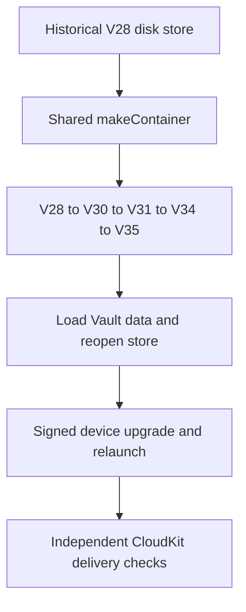

# CloudKit Schema Deployment and Signed-Device Release Readiness

A passing local build or sync test does not prove that the production CloudKit schema is deployed or that signed devices can exchange records. Treat schema deployment, App Store entitlements, iCloud account state, Keychain delivery, and multi-device behavior as separate release evidence.

The macOS and mobile targets use the private container `iCloud.com.akinokaede.termind`. Vault and Device follow the master iCloud switch. Optional categories are History, Metrics and Settings, in that order; History inherits the prior Vault selection once on existing installs and defaults on for new installs. Category lifecycle and account bindings remain independent, and Pro access gates live synchronization without deleting local data.

## Schema inventory

Validate the Development schema first, then explicitly deploy it to Production.

| Category | Zone | Record type | Subscription |
| --- | --- | --- | --- |
| Vault configuration | `TermindVaultV1` | `VaultItem` | `termind-vault-v1-changes` |
| History and Device | `TermindConnectionHistoryV1` | `ConnectionHistoryItem`, `DeviceItem` | `termind-connection-history-v1-changes` |
| Settings and AI configuration | `TermindAIConfigurationV1` | `AIConfigurationItem` | `termind-ai-configuration-v1-changes` |
| SSH preferences | `TermindAIConfigurationV1` | `SSHPreferencesItem` | `termind-ai-configuration-v1-changes` |
| SFTP preferences | `TermindAIConfigurationV1` | `SFTPPreferencesItem` | `termind-ai-configuration-v1-changes` |
| Workspace preferences | `TermindAIConfigurationV1` | `WorkspacePreferencesItem` | `termind-ai-configuration-v1-changes` |
| Metrics | `TermindMetricsV1` | `MetricsItem` | `termind-metrics-v1-changes` |

Vault records use the same private container through their own coordinator and compatibility contract. A Vault envelope stores integer `formatVersion` and `counter`, Boolean `isDeleted`, strings `kind`, `entityID`, `writerID`, and `payloadHash`, date `modifiedAt`, inline bytes `payload`, or `payloadAsset` for payloads above the 700,000-byte inline limit. Preserve zone names, record types, subscription identifiers, envelope fields, and format compatibility: older clients must be able to ignore the distinct `SFTPPreferencesItem` record type before attempting to decode it.

## Native History V1 fields

New cloud records contain typed CloudKit fields, not a JSON payload, payload hash,
or asset. `HistoryCloudRecordV1` is the frozen field adapter. History's local
journal encoding is an implementation detail and is not the cloud schema.

| Field | CloudKit type | Meaning |
| --- | --- | --- |
| `formatVersion` | INT64 | Breaking format version for this record type/kind |
| `kind` | STRING | `connectionHistory` or `device` |
| `entityID` | STRING | Lowercase UUID matching the stable record ID |
| `modifiedAt` | TIMESTAMP | Logical modification date |
| `counter` | INT64 | Nonnegative logical modification counter |
| `writerID` | STRING | UUID of the writer installation |
| `isDeleted` | INT64 | Protocol tombstone, 0 or 1 |

`ConnectionHistoryItem` adds `hostID` (STRING UUID), `connectionKind` (STRING:
`ssh`, `telnet`, `sftp`), `connectedAt` (TIMESTAMP), optional `endedAt` (TIMESTAMP),
and optional `sourceDeviceID` (STRING UUID). `DeviceItem` adds `displayName`
(STRING). Live records require their nonoptional fields. Tombstones require only
metadata. Optional fields are explicitly cleared on writes. Neither record uses
CloudKit references: history may arrive before its Host and must remain durable.

Record IDs remain `v1/connectionHistory/<uuid>` and `v1/device/<uuid>`. The `v1`
identity namespace does not change when payload/field versions increase. Event
UUIDs are never reused. Deletion is terminal for an event UUID, including against
later-clock updates from an old client. Retention keeps 250 newest events and
retains overflow tombstones. Clearing history leaves the device directory intact.

The legacy importer reads `TermindVaultV1` through its independent `termind-history-legacy-vault-v1-changes` subscription. New clients write events and devices only to the new zone; preserve old records for old TestFlight clients. TestFlight uses Production, so additive Development schema changes must be explicitly deployed before release. Successful native writes or an authorized schema import create Development types; builds and empty reads do not. Exercise optional `endedAt` and `sourceDeviceID` fields during provisioning.

There is no public-database access in this design. Before release, verify the app entitlements, the private-container Development schema, and the deployed Production schema with credentials that actually have CloudKit management access. An unavailable management token or a successful local test is not deployment evidence.

## Signed-device matrix

Use at least two Macs and one iPhone or iPad signed into the same Apple account, then repeat the critical path across an account switch.

- Add, edit, and delete providers, roles, MCP clients, skills, and terminal configuration. Include offline edits, independent category pause/resume, master pause/resume, delayed Keychain delivery, key rotation, and Pro expiration.
- Verify that an account switch merges before upload and that category selections and account bindings remain independent.
- Confirm that theme text, custom terminal text, and shell-integration changes update existing windows. Font family, size, and follow-theme-size are device-local; distinguish them from fonts authored inside synchronized theme text.
- Confirm that conversations, approval mode, and the local MCP listener's enabled state, port, tools, and token never synchronize.
- Before deleting the iCloud Keychain copy of a migrated MCP token, verify that the local replacement works.
- Verify Metrics ordering, pause state, disk choices, and network choices across platforms. Metrics records that arrive before their Vault Hosts must remain hidden until those Hosts exist.
- Verify that the published privacy-policy version and effective date match the release being shipped.

Exercise offline edits and delayed delivery deliberately. A clean online two-device pass does not cover journal replay, acknowledgement, account-transition, or missing-Keychain cases.

## SFTP preference compatibility

SFTP preferences synchronize as `v1/sftp/default`; transfer jobs and byte progress are never Settings records. Deploy `SFTPPreferencesItem` before a client version that uploads it.

Current defaults are 30 global transfers, 10 per Host, and Smart topology. The accepted global range is 1–100; per-Host is 1–50 and is additionally clamped to the global value. Historical V21 migration imports an existing local value once, including older 3/2 or 15/5 choices; saved values are not silently reset to the new defaults.

For a release check, change 30/10 to 100/50, close Settings, and verify that another device adopts the new pair without interrupting active transfers. Repeat while offline and while the Settings category or master switch is paused, then resume. Include a device retaining 3/2 and, where compatibility testing is available, an older client that continues syncing the pre-existing record types while ignoring `SFTPPreferencesItem`.

## Installed V28 store upgrade gate

The local SwiftData migration is a separate release gate from CloudKit schema deployment. `TermindPersistence.makeContainer` opens file and in-memory stores with the shared V35 schema, `TermindMigrationPlan`, and `cloudKitDatabase: .none`; CloudKit transport is owned by the category coordinators instead of SwiftData mirroring. Keep the historical V28 endpoint: the plan takes V27→V28→V30→V31→V34→V35, skipping V29, V32 and V33 as endpoints. V28 supplies the frozen Host shape (including `charset`), and V30 retains V28's `port`, `identityID` and `charset` column names as SSH values while introducing default-disabled Telnet fields. Do not rewrite shipped model shapes or replace the fixture with a store generated from current models just to make migration tests pass.

This is the evidence ladder for upgrading an installed store; each step establishes a different release property.

The checked-in `V28.store` was generated against the historical Persistence build with synthetic data and no passwords or private keys. `PersistenceCompatibilityTests.version28FixtureMigratesAndReopensWithoutLosingData` copies it to a temporary disk path, opens it through the normal factory twice, and checks the preserved SSH port/GB18030 charset, default-disabled Telnet, identity and key references, ordered environment variables, snippet, group and known host, history and installation ID, and workspace defaults. The V31→V34 migration backfills the history event's source device from the existing Vault installation ID and creates a device record, without fabricating an end time. `MobileAppTests.startupLoadsVersion28DataAfterMigrationAndRelaunch` also constructs the mobile app twice from the migrated disk container and checks the projected Host, identity reference and history. These in-process fixtures do **not** prove an on-device installed-app upgrade, process relaunch, Keychain secret availability, mixed-version CloudKit compatibility or Production delivery. Include an upgrade of an existing signed installation with actual credentials, then relaunch and sync on another signed device in the release matrix; a fixture credential reference is not a secret.

## First-stage mixed-version safety

V35 retains existing quarantine/recovery models and adds independent History journals, source-import state and decoder-capability checkpoints via a lightweight V34→V35 stage. Local bootstrap preserves UUIDs, installation identity, modification versions, tombstones and pending intent without reusing old-zone system fields. This local migration is separate from deploying the two new native CloudKit record types.

The compatibility contract is now fail-closed for records a client detects it cannot safely understand: keep the received bytes and local pending edits, remove that record from upload scheduling, and recheck the final batch/provider. Other compatible records remain eligible. Unsupported fetches and `serverRecordChanged` replies share this path. Only successful supported-data reconciliation clears the restriction; pressing Retry, pausing a category or restarting does not discard it.

Include the following matrix in release validation:

| Scenario | Required result |
| --- | --- |
| New-format record with the same ID as a local pending edit | Block that ID without replacing it with defaults or clearing the local edit. |
| Another record in the same category remains compatible | Upload it; include pending and blocked counts in the aggregate status. |
| Restored save queue, local tombstone, or physical-delete recreation | No path bypasses the restriction; never emit physical deletes from a restored queue. |
| Upload conflict returns an unsupported record | Preserve it in quarantine rather than retrying a stale local payload. |
| Persistence failure during fetch/conflict handling | Retire that engine; a later callback cannot reauthorize it, and restart fetches afresh. |
| Pause/retry/relaunch or account/environment change | Preserve restrictions in their original scope without leaking them into another replica. |
| Supported replacement arrives but its merge fails | Roll back data, metadata and unblock together. |
| Corrupt data rather than a recognized newer format | Explain the restriction without promising that an app update will repair corruption. |

Portable tests exercise real journals, coordinators, record coding and batch providers behind a fake CloudKit transport, plus on-disk migration and reopening. They do not establish signed-device delivery or Production behavior.

Decoder capability changes now force scoped full rereading; only successful merge and persistence advance the checkpoint and clear quarantine. Native quarantine retains complete CKRecord archives. This does not retrofit unsafe old binaries or preserve unknown fields silently ignored by a V1 JSON decoder: incompatible additions must raise that kind’s version. Keep signed new→old→edit→new and old→import→new tests in the release matrix.

Validate old-client event creation, end-time updates and device renames through the continuous read-only importer. Repeat duplicate and out-of-order delivery after Clear History; terminal event tombstones must prevent resurrection. Verify History-off/Device-on, newest-250 convergence, local Recents versus cross-device History, and History arriving before its Host.

## Evidence boundaries and release sign-off

The historical 2026-09-19 implementation record covered full TFI, focused iPad, focused TFM, multilingual visual, formatting, and localization checks. It did not establish a fully green macOS suite, Production schema deployment, or real signed-device delivery; failures outside the implementation scope remained. Treat those counts as historical context only and rerun current release checks.

Release sign-off should record, separately:

1. the current pinned macOS and mobile build/test results, including historical V28 fixture migration and reopening;
2. an installed signed-device V28 upgrade and relaunch with real credentials, separately from fixture results;
3. successful Development validation and explicit Production deployment for every required zone and record type;
4. the signed multi-device/account-switch matrix, including offline and pause/resume behavior;
5. Keychain-delivery and migrated-token checks;
6. the SFTP preference and mixed-version safety matrices; and
7. the published privacy-policy version and effective date.

See [Settings, Vault, Metrics, and Cloud Sync Workflow](/openwiki/workflows/settings-and-cloud-sync.md) for runtime lifecycle and journals, [Persistent Data, Migrations, and Secret Boundaries](/openwiki/concepts/persistence-and-secrets.md) for local stores and secret references, and [Build, Validation, Localization, and Dependency Release Operations](/openwiki/operations/build-test-and-release.md) for ordinary build gates.
