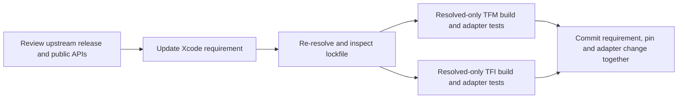

# Ghostty Dependency Updates

Termind does not maintain a local Ghostty fork. Xcode consumes
`https://github.com/Lakr233/libghostty-spm.git` directly, and the app owns every
menu, upload and lifetime decision layered on top of the package's native entry
points. A Ghostty update is therefore a dependency-and-adapter change, not a
native patch or binary release.

## Dependency contract

| Input | Current value / responsibility |
| --- | --- |
| Remote repository | `Lakr233/libghostty-spm` (remote SPM package, no gitlink). |
| Xcode requirement | `upToNextMinorVersion` from `2.2.2026101502`, resolved product set `GhosttyTerminal`, `GhosttyTheme`, `GhosttyKit`. |
| Resolved version | `2.2.2026101502`. |
| Resolved revision | `42bacd1339f323a693ddbca779295f4f77e5a697`. |
| Local maintenance submodule | None; `.gitmodules` declares only `AgentKit`, `libssh2-spm`, `libtailscale-spm` and `com.akinokaede.termind`. |
| App-owned adapters | macOS `TermindTerminalView` in the persistent surface owner; iOS `MobileTerminalView` behind the retained `MobileTerminalSurface`. |

The requirement and the resolved pin are separate parts of one contract. The
requirement in `project.pbxproj` expresses policy; `Package.resolved` selects the
revision that `-onlyUsePackageVersionsFromResolvedFile` builds actually use. Both
must land in the same commit as any adapter change they require.

`AGENTS.md` still describes an up-to-next-major Ghostty requirement. The project
declaration and the committed lockfile are authoritative for the current
policy, so read them rather than the prose when preparing an update.



## Update procedure

1. Review the intended upstream release and the public APIs Termind actually
   uses: touch menus, selection menus, key commands, find, resize, clipboard and
   drag-and-drop. When a change depends on gesture, search, resize or native
   binary internals, inspect the selected package source and its tests; host
   overrides alone do not establish package internals.
2. Update the `libghostty-spm` requirement in `Termind.xcodeproj/project.pbxproj`,
   re-resolve deliberately, and inspect the resulting `Package.resolved`. Do not
   advance unrelated pins as a side effect.
3. Validate both native products against the resolved graph:

   ```sh
   xcodebuild -project Termind.xcodeproj -scheme TFM -destination 'platform=macOS' -onlyUsePackageVersionsFromResolvedFile build
   xcodebuild -project Termind.xcodeproj -scheme TFI -destination 'generic/platform=iOS Simulator' -onlyUsePackageVersionsFromResolvedFile build
   ```

4. Run the affected adapter suites (see the regression table below), choosing a
   real available simulator for mobile integration and opting into window or
   key-window gates only when the interaction itself needs them.
5. Recheck localization for changed app menu copy and run the repository's
   AppStrings and localization gates, plus strict Swift formatting for Swift
   edits.

There is no Termind Ghostty gitlink to advance and no Termind-owned binary URL or
checksum to publish: the upstream package owns its artifact publication. The
`libssh2-spm` maintenance-submodule and native-patch release procedure is
unrelated and must not be copied onto Ghostty.

## Keep menu and surface behavior in Termind

Ghostty owns rendering, parsing, baseline input and its native menu entry points.
Termind owns grouping, localization, commands, upload authorization and
view/session lifetimes.

- **iOS touch menus.** `MobileTerminalView` overrides `touchMenuItems(for:)` and
  `touchSelectionMenuItems(for:)` separately and routes each through the same
  customizer. The two hooks stay distinct because Ghostty builds the selected-text
  menu independently of the ordinary touch menu; a single override would drop one
  context. Recognized actions are re-titled through `AppStrings`, editing actions
  are grouped first as a medium-size inline row, the SSH Upload File group is
  inserted, and unrelated inherited items are preserved.
- **macOS selection menu.** `TermindTerminalView` overrides `selectionMenuPoint(at:)`
  to return `nil` while mouse input is captured and to offer the app's default
  menu even when nothing is selected. `selectionContextMenu()` keeps the
  superclass selection menu only when the superclass reports a selection,
  localizes Copy, and appends localized Paste, Select All, Upload File and an
  Open with SFTP submenu with app-owned actions.
- **Availability is re-checked on invocation.** Upload and SFTP actions test their
  capability closure again when the item is triggered, so a stale menu cannot
  send a file to a disconnected or changed destination. Paste enablement follows
  clipboard contents at menu-build time.
- **Right-click paste stays a host preference.** Paste-on-right-click applies only
  when the setting is on, no mouse input is captured and Option is not held;
  Option bypass and captured input remain host behavior, not an iOS hook contract.
- **Surfaces outlive SwiftUI mounts.** Native terminal views are owned per
  workspace/session, so Find presentation, search suspension during resize and
  remount behavior are app concerns and must not be collapsed into package menu
  behavior.

See [Ghostty Terminal Integration](../concepts/ghostty-terminal-integration.md)
for the transport boundary and package-inspection limits.

## Focused regression checks

A successful resolve is not acceptance for a Ghostty update. Run the affected
adapter suites against the new resolved graph:

| Boundary | Regression coverage to retain |
| --- | --- |
| macOS context menu | `TerminalContextMenuTests` checks that Upload File appears only when bound, reflects live availability, and does not fire while unavailable. |
| macOS mouse and drag integration | `TerminalMouseInteractionTests` checks copy-on-release, right-click paste routing and Option bypass, once-only bracketed paste/broadcast, captured mouse reports without broadcast or clipboard mutation, path drops, and upload picker attachment to the persistent window. |
| iOS touch menus | `MobileTerminalUploadMenuTests` checks that editing actions form the first row, AutoFill and upload stay after it, and upload actions are disabled when unavailable. |
| iOS keyboard integration | `MobileTerminalKeyboardTests` checks native accessory grouping and localized labels across OS-specific geometry, plus readiness-gated focus, remount behavior, literal symbol output versus bracketed paste, sticky modifiers and surface identity across keyboard toggles. |

The mobile keyboard integration suite requires a key window: opt in with
`TEST_RUNNER_TERMIND_MOBILE_UI_TESTS=1`, use `-parallel-testing-enabled NO`, and
target a real available simulator with a narrow
`-only-testing:TFITests/MobileTerminalKeyboardIntegrationTests` filter. The macOS
mouse suite requires a visible window: opt in with
`TEST_RUNNER_TERMIND_WINDOW_TESTS=1` and
`-only-testing:TFMTests/TerminalMouseInteractionTests`. Keep these gates off for
routine logic checks. Extend verification to Find, resize, shell integration and
remote interaction when an upstream change touches those boundaries; see
[Shell Integration](../concepts/shell-integration.md).

## Verification limits

Pin and manifest inspection proves dependency selection, not an upstream binary
rebuild, a supported platform slice, a live gesture result or remote terminal
behavior. A host adapter test does not prove package internals. Use
[Build, Test, and Release](build-test-and-release.md) for pinned build commands
and the opt-in test flags.
