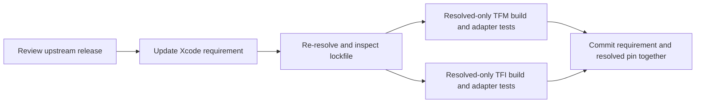

# Ghostty Dependency Updates

The canonical page path is retained for existing links, but **Termind no longer maintains a local Ghostty fork/submodule**. Xcode consumes `https://github.com/Lakr233/libghostty-spm.git` directly. The former `termind`-branch fork, native patch/XCFramework release workflow and `build/KeywordHighlighting` override workspace are not current Termind operations.

## Current dependency contract

| Input | Current value / responsibility |
| --- | --- |
| Remote repository | `Lakr233/libghostty-spm`. |
| Xcode requirement | Up-to-next-major starting at `2.2.2026100501`. |
| Resolved version | `2.2.2026100501`. |
| Resolved revision | `7199bd7aa3c32d0a5edcab7fe87b3c1e76f76de9`. |
| Local maintenance submodule | None; `.gitmodules` does not declare Ghostty. |
| App-owned adapters | macOS `TermindTerminalView` / retained view owner, iOS `MobileTerminalView` / retained `MobileTerminalSurface`. |

The minimum requirement is not an exact pin; `Package.resolved` selects the revision used by `-onlyUsePackageVersionsFromResolvedFile` builds. No local directory edit or obsolete generated workspace changes that remote build input.



## Update procedure

1. Review the intended upstream release and relevant public APIs. If the change depends on gesture, search, resize, clipboard or native binary internals, inspect the **selected package source/tests**; host overrides alone do not establish those internals.
2. Update the Ghostty requirement in `Termind.xcodeproj/project.pbxproj`, intentionally re-resolve packages, and inspect the resulting `Package.resolved`. Do not advance unrelated dependencies casually. Commit both dependency records together with any required app adapter change.
3. Validate both native products against the resolved graph:

   ```sh
   xcodebuild -project Termind.xcodeproj -scheme TFM -destination 'platform=macOS' -onlyUsePackageVersionsFromResolvedFile build
   xcodebuild -project Termind.xcodeproj -scheme TFI -destination 'generic/platform=iOS Simulator' -onlyUsePackageVersionsFromResolvedFile build
   ```

4. Run the affected surface/menu/Find tests, choosing a real available simulator for mobile integration. Keep native window gates off for ordinary logic checks; opt into a narrow visible-window/key-window suite only when its interaction needs validation. Record actual tests and manual interaction results, not just a successful dependency resolve.
5. Recheck localization and both Chinese scripts for changed app menu copy. Run strict Swift formatting for Swift edits and the repository's AppStrings/localization commit gates.

There is **no Termind Ghostty gitlink to advance** and no Termind-owned binary URL/checksum release to publish first. The upstream package owns its artifact publication. libssh2's maintenance-submodule/native-patch release procedure is separate and must not be copied onto Ghostty.

## Keep native customization in Termind

Ghostty owns rendering, parsing, baseline input and its native menu entry points. Termind owns grouping, localization, commands, upload authorization and view/session lifetimes:

- iOS uses separate `touchMenuItems(for:)` and `touchSelectionMenuItems(for:)` overrides. Each calls the matching superclass hook, localizes recognized action identifiers, groups editing actions first, adds an SSH Upload File group and preserves unrelated inherited items.
- macOS independently overrides `selectionContextMenu()` and its menu location/gesture behavior. Paste-on-right-click and Option bypass are host preferences, not an iOS hook contract.
- Upload availability is checked again on invocation; a stale menu is not permission to send a file to a disconnected or changed destination.
- Native surfaces remain session/workspace-owned across SwiftUI mount changes. App Find state, native search dismissal and resize coordination must not be collapsed into package menu behavior.

See [Ghostty Terminal Integration](../concepts/ghostty-terminal-integration.md) for host/test evidence and its explicit package-inspection boundary. The retired app keyword-highlighting feature is handled by V52/Settings compatibility, not a reason to resurrect the deleted fork workspace. See [Persistent Data and Secrets](../concepts/persistence-and-secrets.md).

## Verification limits

Pin/manifest inspection proves dependency selection, not an upstream binary rebuild, supported platform slice, live gesture result or remote terminal behavior. This documentation update does not itself claim those builds or interactions ran. Use [Build, Test, and Release](build-test-and-release.md) for pinned validation and opt-in flags.
