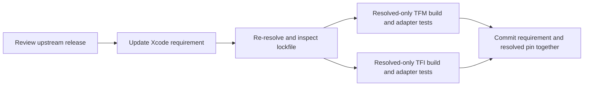

# Ghostty Dependency Maintenance

The canonical page path is retained for existing links, but **Termind no longer maintains a local Ghostty fork/submodule**. Xcode consumes `https://github.com/Lakr233/libghostty-spm.git` directly. The former `termind`-branch fork, native patch/XCFramework release workflow and `build/KeywordHighlighting` override workspace are not current Termind operations.

## Current dependency contract

| Input | Current value / responsibility |
| --- | --- |
| Remote repository | `Lakr233/libghostty-spm`. |
| Xcode requirement | `upToNextMinorVersion` starting at `2.2.2026101502` (below `2.3.0`). |
| Resolved version | `2.2.2026101502`. |
| Resolved revision | `42bacd1339f323a693ddbca779295f4f77e5a697`. |
| Local maintenance submodule | None; `.gitmodules` does not declare Ghostty. |
| App-owned adapters | macOS `TermindTerminalView` / retained view owner, iOS `MobileTerminalView` / retained `MobileTerminalSurface`. |

The minimum requirement is not an exact pin; `Package.resolved` selects the revision used by `-onlyUsePackageVersionsFromResolvedFile` builds. No local directory edit or obsolete generated workspace changes that remote build input, and there is no local Ghostty staging override. For the version policy, the [project declaration](../../Termind.xcodeproj/project.pbxproj) and [committed lockfile](../../Termind.xcodeproj/project.xcworkspace/xcshareddata/swiftpm/Package.resolved) are authoritative: `AGENTS.md` still describes an up-to-next-major requirement, but the current project uses up-to-next-minor.


The update workflow validates both app adapters before committing the aligned requirement and resolution.

## Update procedure

1. Review the intended upstream release and relevant public APIs. If the change depends on gesture, search, resize, clipboard or native binary internals, inspect the **selected package source/tests**; host overrides alone do not establish those internals.
2. Update the Ghostty requirement in `Termind.xcodeproj/project.pbxproj`, intentionally re-resolve packages, and inspect the resulting `Package.resolved`. Do not advance unrelated dependencies casually. Commit both dependency records together with any required app adapter change.
3. Validate both native products against the resolved graph:

   ```sh
   xcodebuild -project Termind.xcodeproj -scheme TFM -destination 'platform=macOS' -onlyUsePackageVersionsFromResolvedFile build
   xcodebuild -project Termind.xcodeproj -scheme TFI -destination 'generic/platform=iOS Simulator' -onlyUsePackageVersionsFromResolvedFile build
   ```

4. Run the affected surface/menu/Find tests, choosing a real available simulator for mobile integration. Keep native window gates off for ordinary logic checks; opt into a narrow visible-window/key-window suite only when its interaction needs validation. Record actual tests and manual interaction results, not just a successful dependency resolve.
5. Recheck localization and both Chinese scripts for changed app menu copy. Run strict Swift formatting for Swift edits and the repository's AppStrings/localization commit gates.

There is **no Termind Ghostty gitlink to advance** and no Termind-owned binary URL/checksum release to publish first. The upstream package owns its artifact publication. libssh2's maintenance-submodule/native-patch release procedure is separate and must not be copied onto Ghostty.

## Keep native customization in Termind

Ghostty owns rendering, parsing, baseline input and its native menu entry points. Termind owns grouping, localization, commands, upload authorization and view/session lifetimes:

- iOS uses separate `touchMenuItems(for:)` and `touchSelectionMenuItems(for:)` overrides. Each calls the matching superclass hook, localizes recognized action identifiers, groups editing actions first, adds an SSH Upload File group and preserves unrelated inherited items.
- macOS independently overrides `selectionContextMenu()` and `selectionMenuPoint(at:)` to offer a default menu even without a selection, but suppresses menus during captured mouse input. It retains the superclass selection menu only when the superclass reports a selection, localizes Copy, and appends localized Paste and Select All. Paste availability follows clipboard contents. Bound Upload File and Open with SFTP actions are app-owned additions; the SFTP submenu offers current/new workspace placement and rechecks availability on invocation. Paste-on-right-click and Option bypass remain host preferences, not an iOS hook contract.
- Upload availability is checked again on invocation; a stale menu is not permission to send a file to a disconnected or changed destination.
- Native surfaces remain session/workspace-owned across SwiftUI mount changes. App Find state, native search dismissal and resize coordination must not be collapsed into package menu behavior.

See [Ghostty Terminal Integration](../concepts/ghostty-terminal-integration.md) for host/test evidence and its explicit package-inspection boundary. The retired app keyword-highlighting feature is handled by V52/Settings compatibility, not a reason to resurrect the deleted fork workspace. See [Persistent Data and Secrets](../concepts/persistence-and-secrets.md).

## Focused regression checks

A successful resolve is not sufficient acceptance for a Ghostty update. Run the relevant adapter suites against the new resolved graph:

| Boundary | Regression coverage to retain |
| --- | --- |
| iOS native accessory | [MobileTerminalKeyboardTests](../../TFITests/MobileTerminalKeyboardTests.swift) checks upstream key grouping with Paste last and matching accessibility labels. Geometry expectations are OS-specific: 60-point intrinsic height on iOS 26 and later, 52 points on earlier systems, and 36 × 36-point buttons. At widths 320, 390, 430, 844 and 1024, scrolling to the end must make Paste reachable. |
| iOS keyboard integration | `MobileTerminalKeyboardIntegrationTests` in the same file checks readiness-gated initial focus, remount behavior, literal symbol output versus bracketed clipboard paste, sticky modifiers during composition, and surface identity across keyboard toggles. |
| macOS mouse and drag integration | [TerminalMouseInteractionTests](../../TFMTests/TerminalMouseInteractionTests.swift) checks copy-on-release, right-click paste routing and Option bypass, once-only bracketed paste/broadcast, captured mouse reports without broadcast or clipboard mutation, path drops, and upload picker attachment to the persistent window. |
| Native menu adapters | `MobileTerminalUploadMenuTests` and `TerminalContextMenuTests` protect menu grouping, localization-facing action identifiers, upload bindings and action-time availability checks. |

The mobile keyboard integration suite requires a key window: opt in with `TEST_RUNNER_TERMIND_MOBILE_UI_TESTS=1`, use `-parallel-testing-enabled NO`, and select a real available simulator with a narrow `-only-testing:TFITests/MobileTerminalKeyboardIntegrationTests` filter. The macOS mouse suite requires a visible window and active display: opt in with `TEST_RUNNER_TERMIND_WINDOW_TESTS=1` and `-only-testing:TFMTests/TerminalMouseInteractionTests`. Keep these gates off for routine logic checks. Expand verification to Find, resize, shell integration and remote interaction when the upstream change touches those boundaries; see [Shell Integration](../concepts/shell-integration.md).

## Verification limits

Pin/manifest inspection proves dependency selection, not an upstream binary rebuild, supported platform slice, live gesture result or remote terminal behavior. This documentation update does not itself claim those builds or interactions ran. Use [Build, Test, and Release](build-test-and-release.md) for pinned validation and opt-in flags.
