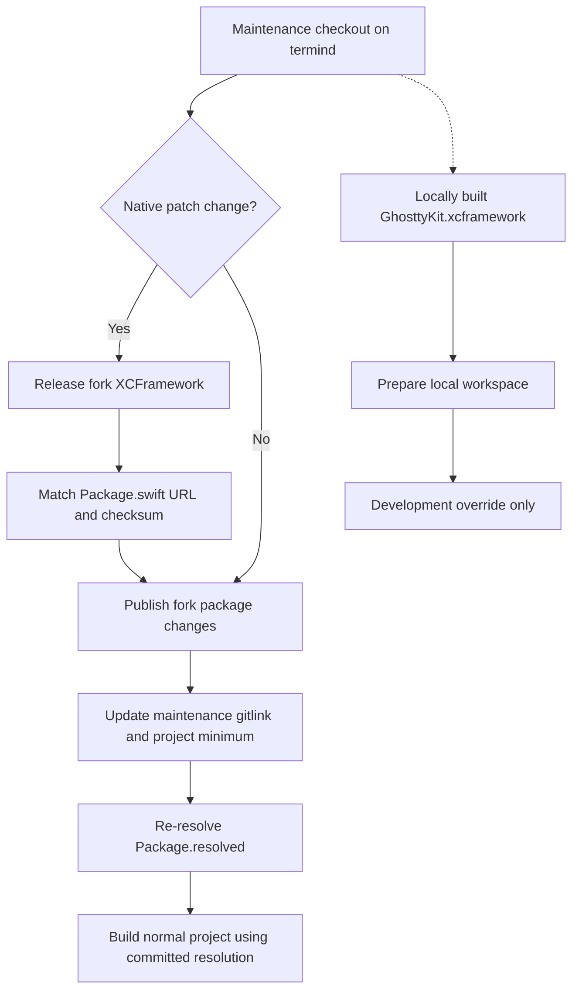

# Ghostty Fork Maintenance

## Maintenance checkout versus app input

Termind has **three distinct Ghostty boundaries**:

- **Maintenance source:** `libghostty-spm/` is a Git submodule of the public `AkinoKaede/libghostty-spm` fork, tracking `termind`; upstream is `Lakr233/libghostty-spm`.
- **Released Swift package:** Xcode consumes that fork remotely with an up-to-next-major version requirement in `Termind.xcodeproj/project.pbxproj`. `Package.resolved` locks the release and revision, not the maintenance working tree. Uncommitted submodule edits are not app inputs in the normal project build.
- **Native binary:** Native patch changes cross a separate XCFramework release boundary. Updating source or the app's package pin alone is insufficient: the fork needs a released XCFramework and a matching `Package.swift` URL/checksum.

The current project minimum and resolved version are both **`2.2.2026100303`**, with resolved revision **`fc5444ea40e9d7c6204bd5dd46d23a884e987181`**. This is the existing pin, not a proposed bump. See the [project requirement](../../Termind.xcodeproj/project.pbxproj), [lockfile](../../Termind.xcodeproj/project.xcworkspace/xcshareddata/swiftpm/Package.resolved), and [repository dependency rules](../../AGENTS.md).

**Checkout limitation:** `libghostty-spm/` is empty in this checkout. Initialize it with:

```sh
git submodule update --init libghostty-spm
```

Then inspect the fork's own guidance, manifests, build scripts and tests before modifying it. The release rules below are grounded in `AGENTS.md` and the local helper. This checkout does not establish the fork's patch-application algorithm, release workflow ordering, verification scripts, exact manifest contents, or UIKit implementation details.

| Change | Ownership boundary | Required consumption step |
| --- | --- | --- |
| Native changes in `Patches/ghostty/` | Fork native build and XCFramework release | Release a new fork XCFramework and update the manifest URL/checksum before advancing the app pin. |
| Swift terminal API or menu hook | Fork package | Publish the package change from `termind`, then update Termind's three dependency records together. |
| Menu localization, grouping and upload choices | Termind platform subclasses and shared `AppStrings` | Change and test the app layer; change the fork only when its extension seam needs to change. |

## Release boundary and coordinated update


*The release path synchronizes maintenance source, the remote package requirement and its resolution; the local workspace is a separate development path, not evidence that the released binary or package is correct.*

The required update boundary is:

1. **Publish fork changes from `termind`.** Test the proposed change using the initialized fork's current instructions. For native patches, first satisfy the new XCFramework release and matching manifest URL/checksum requirement. Do not infer that a local binary proves the released artifact matches.
2. **Update the maintenance gitlink and project requirement.** Move the Termind submodule gitlink to the published change and update `minimumVersion` in `project.pbxproj` to the release the app needs.
3. **Re-resolve the lockfile.** Ensure `Package.resolved` records the intended released version and revision. Keep the gitlink, project requirement and lockfile together with the app-side change that consumes them.

For normal app validation, retain `-onlyUsePackageVersionsFromResolvedFile` so Xcode uses the committed resolution rather than silently advancing dependencies:

```sh
xcodebuild -project Termind.xcodeproj -scheme TFM -destination 'platform=macOS' -onlyUsePackageVersionsFromResolvedFile build
xcodebuild -project Termind.xcodeproj -scheme TFI -destination 'generic/platform=iOS Simulator' -onlyUsePackageVersionsFromResolvedFile build
```

These builds validate normal remote-package consumption; they do not replace the fork's native release validation. General commands and UI-test opt-ins are in [Build, Test, and Release](build-test-and-release.md).

## Local development override

[Scripts/prepare-local-ghostty-workspace.sh](../../Scripts/prepare-local-ghostty-workspace.sh) stages a local SPM override without editing the committed project requirement. Its comment directs maintainers to build the native framework using the package's `build.sh` first; inspect that script after initializing the checkout rather than assuming its implementation here.

Concrete prerequisites are Bash and `python3`, the maintenance package's `Package.local.swift`, the project's existing `Package.resolved`, and a locally built framework at `libghostty-spm/BinaryTarget/GhosttyKit.xcframework`. The helper specifically checks for `Info.plist` inside that framework. The package's `Sources`, `Tests` and `BinaryTarget` are linked into staging; they must be usable for the subsequent local build.

Run from the repository:

```sh
Scripts/prepare-local-ghostty-workspace.sh
```

The helper:

- Exits with `Build the local GhosttyKit.xcframework before preparing the workspace.` if the framework's `Info.plist` is absent, before creating staging.
- Copies `Package.local.swift` to `build/KeywordHighlighting/libghostty-spm/Package.swift`.
- Replaces existing symlinks for `Sources`, `Tests` and `BinaryTarget`, but exits with `Refusing to replace non-symlink: ...` if any of those staging paths exists as a non-symlink. It can already have copied the manifest or replaced earlier links when this refusal occurs; preparation is not transactional.
- Copies the committed resolution into `build/KeywordHighlighting/Termind.xcworkspace/xcshareddata/swiftpm`, writes a workspace referencing the original project and staged local package, and prints the workspace path.

The helper prepares files only: it does not build the framework, resolve a release, run tests, or validate the binary's platform slices. Missing copy inputs fail during preparation, and linked source-directory existence is not explicitly checked. Use `build/KeywordHighlighting/Termind.xcworkspace` for development; successful local preparation or a local build is **not release evidence**.

## Menu extension boundary and focused tests

The repository guidance identifies separate native touch-menu hooks before and after selection: `touchMenuItems(for:)` and `touchSelectionMenuItems(for:)`. Termind overrides **both** in [MobileTerminalView](../../TFI/Platform/MobileTerminalSurface.swift), passing superclass items through the same customization function. It localizes recognized `terminal.copy`, `terminal.paste`, `terminal.select` and `terminal.selectAll` actions, groups editing actions first, appends an inline upload group, then preserves other inherited items. Grouping, localization, upload closures and availability remain app responsibilities.

The upload menu is absent without `uploadFiles`. When bound, Photos and Files actions are disabled unless `canUploadFiles` returns true; their handlers recheck availability before invoking the closures. macOS uses its own `TermindTerminalView.selectionContextMenu()` override, independently of these UIKit hooks. Do not infer pointer-menu or UIKit fallback internals from the touch overrides alone. See [Ghostty Terminal Integration](../concepts/ghostty-terminal-integration.md) and [Module Map](../architecture/module-map.md) for wider integration context.

Focused app regression coverage:

- [MobileTerminalUploadMenuTests](../../TFITests/MobileTerminalUploadMenuTests.swift) checks both selection states with and without pasteboard text, editing-row identifiers and sizing, upload placement before system AutoFill, the no-upload case, and Photos/Files enabled state.
- [TerminalContextMenuTests](../../TFMTests/TerminalContextMenuTests.swift) checks AppKit upload composition and live availability, action-time refusal after availability changes, stale pane teardown, paste validation and Option bypass of automatic right-click paste.

These tests cover app-facing menu behavior, not the absent fork's native build or release pipeline. For an interaction change, also review actual selection and pointer behavior on the affected platform. See [Behavioral Boundaries and Fixtures](../testing/behavioral-boundaries-and-fixtures.md) for the broader test-boundary model.
