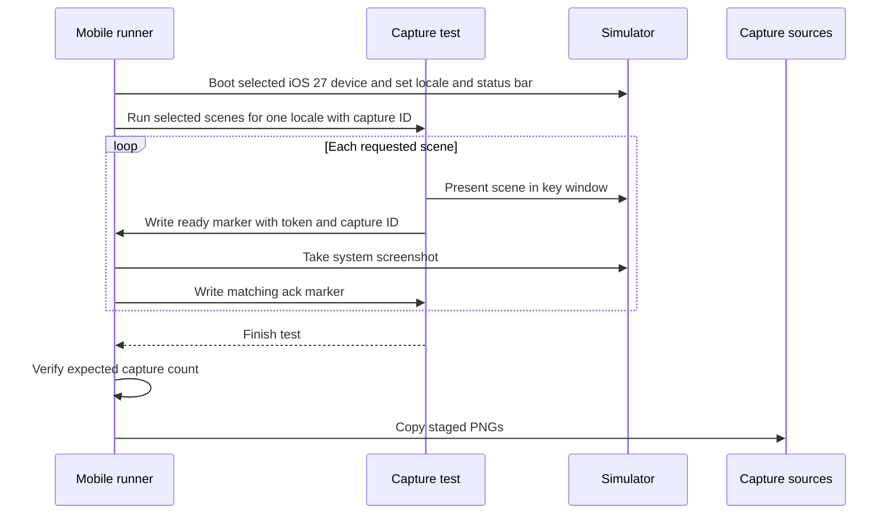
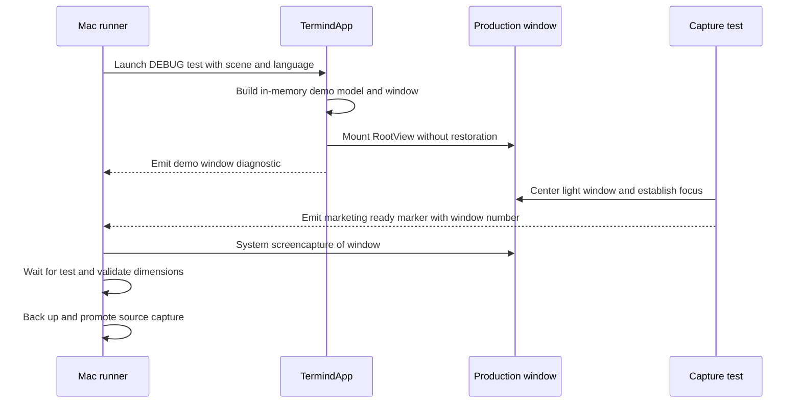

# Marketing Assets and App Icons

Marketing fixtures may mount real views with in-memory data, but must never change production behavior or contact a real Host, account, or network merely to make a screenshot easier. Keep source captures, derived device frames, Figma compositions, final App Store exports, and app icons as distinct artifact classes.

## Asset map and invariants

- `Marketing/Screenshots/Captures/<feature>/<device>-<locale>.png` contains full-resolution source captures. Treat them as immutable during framing and export, and back them up with a SHA-256 manifest before recapture.
- `Marketing/Screenshots/DeviceFrames/<feature>/<device>-<locale>-framed.png` contains reproducible MockUPhone-derived frames. Keep feature-first paths; do not reorganize by device.
- `Marketing/AppStore/<locale>/<platform>/` contains final Figma-exported JPG boards. The supported filename locales are `en`, `zh-hans`, and `zh-hant`; features include workspace, ssh, sftp, metrics, assistant, vault, and command-generator.
- Missing platform captures do not authorize fabricated UI. Mobile status bar, navigation, toolbars, and home indicator must be real system UI; Mac captures must be active/key, with colored traffic lights and the focused Workspace pane blue.
- Localize chrome and product copy while keeping terminal commands and output in English. Traditional Chinese uses Taiwan terminology such as `伺服器` and PingFang TC; Simplified Chinese uses PingFang SC; English uses SF Pro.
- `LandingPage/src/lib/marketingImages.ts` is the website allowlist. Astro imports DeviceFrames and optimizes them; do not copy captures or frames into `LandingPage/public`.

## Mobile capture workflow

`TFITests/MobileMarketingScreenshotTests.swift` is opt-in: without `TERMIND_MARKETING_SCREENSHOTS=1`, its serialized capture test returns without producing images. It selects all five scenes by default or the comma-separated `TERMIND_MARKETING_SCENES` subset, then mounts production feature views in system windows with in-memory services. With `TERMIND_MARKETING_SYSTEM_CAPTURE=1`, ready/ack markers coordinate simulator capture; a unique `TERMIND_MARKETING_CAPTURE_ID` prevents stale markers from satisfying the runner. The test times out if no acknowledgment arrives. The runner stages output in DerivedData and copies it into the source tree only after that device/locale test and its expected image-count check succeed. A direct test invocation without system capture instead writes rendered PNGs to its app Documents directory, not to `Marketing/Screenshots/Captures`.


The mobile system-capture handshake stages images before promotion into source captures.

```sh
Scripts/run-mobile-marketing-screenshots.sh
TERMIND_MARKETING_SCENES=assistant TERMIND_MARKETING_DEVICES=ipad \
  Scripts/run-mobile-marketing-screenshots.sh
```

| Device | Orientation and raw size | Scenes per locale |
| --- | --- | --- |
| iPhone 17 Pro Max | Portrait, 1320×2868 | vault, sftp, ssh, metrics, assistant |
| iPad Pro 13-inch (M5) | Landscape, 2752×2064 | vault, sftp, ssh, metrics, assistant |

Three locales produce 30 captures. The runner requires iOS/iPadOS 27 and defaults to the 27.0 runtime. `TERMIND_MARKETING_RUNTIME` may select another 27.x runtime, but never a different major version or a silently newer same-name device. iPad-only runs do not require an iPhone. Each locale uses a separate process with matching Apple language, region, locale, and fixture language. Status is deterministic at 9:41 with 80% battery in the discharging state, plus fixed Wi-Fi and cellular indicators. iPhone uses scene-requested portrait plus `simctl` capture; iPad uses `devicectl` landscape capture and dimension validation without rotation.

Fixtures preserve the production Vault/Metrics/Workspaces/Assistant/Settings order. iPad Metrics uses top tabs, Vault and Assistant use an expanded sidebar, and SSH/SFTP use `MobileRootView` plus production Workspace pages with in-memory connection services, Workspaces selected, and the sidebar collapsed. Do not use legacy iPhone wrappers for iPad. The approved baseline command is:

```sh
TERMIND_MARKETING_SCENES=ssh,sftp TERMIND_MARKETING_DEVICES=ipad \
TERMIND_MARKETING_RUNTIME=com.apple.CoreSimulator.SimRuntime.iOS-27-0 \
  Scripts/run-mobile-marketing-screenshots.sh
```

Recapture an affected scene in every locale and regenerate only its matching frames and boards. Vault, Metrics, and Assistant feed mobile boards 04–06; SSH and SFTP feed 02–03. Board 01 additionally uses iPhone Assistant and iPad SFTP, so either source affects all nine first boards.

## Mac capture workflow

`ScreenshotDemoConfiguration` is a **DEBUG-only app launch mode**, not a replacement view or an XCTest-only fixture. `--termind-demo=<scene>:<en|zh-Hans|zh-Hant>` is parsed as one scene/language pair; missing argument means ordinary launch, while malformed, duplicate, or unsupported values abort demo launch. `Scripts/run-screenshot-demo.sh` opens a debug app for manual review; the automated runner passes the same argument into the TFM test launch. Only the runner's five supported marketing scenes are exported; `metrics-detail` and `app-settings` remain available for development review.

On demo launch, `TermindApp.init()` selects the requested language and an in-memory SwiftData container even outside XCTest. It builds demo hosts, AI, unrestricted test access, frozen metrics, and one `WindowModel`, then **returns before normal persisted settings, Keychain-backed secrets, sync/coordinator and live model assembly**. Startup still sets up the scrubber and cleans the previous attachment session before this return; the isolation guarantee applies to the store and live model assembly, not every launch side effect. No demo argument means the ordinary startup path (subject to the separate XCTest in-memory branch); screenshot data does not become a user's saved workspace. `makeWindow(requestID:)` supplies that same demo window to the real `RootView` in `WindowGroup(id: "main")` for the initial nil request; explicit new-window requests use normal window creation. In DEBUG, the main scene stays auto-launchable for the demo even under XCTest and disables restoration for tests or demos. `AppDelegate` centers and sizes the visible window, applies light appearance and emits a `TERMIND_DEMO_READY` window diagnostic. This is not the capture-ready signal: `TFMTests/MacMarketingScreenshotTests.swift` independently waits for the production window, prepares it and writes `TERMIND_MAC_MARKETING_READY` only after focused rendering.


The app's demo initialization supplies data; the test proves the focused native window is ready before the runner exports it.

The test moves the pointer outside content, temporarily ignores mouse events to prevent hover highlights, requires an active app and key window throughout the capture interval, waits 300 ms for focused rendering, and requires native 2× backing scale. The runner requires macOS 27.x and backs up replaced sources under `.build/screenshot-backups/<timestamp>/`.

```sh
Scripts/run-mac-marketing-screenshots.sh
TERMIND_MAC_MARKETING_SCENES=hosts,metrics,command Scripts/run-mac-marketing-screenshots.sh
TERMIND_MAC_MARKETING_SCENES=agent TERMIND_MAC_MARKETING_LOCALES=zh-Hant \
  Scripts/run-mac-marketing-screenshots.sh
```

Scene mapping is hosts → vault/mac, workspace → workspace/mac, agent → assistant/mac, command → command-generator/mac, and metrics → metrics/mac-overview. Metrics detail is a development demo, not a marketing export. Locale selectors are `en`, `zh-Hans`, and `zh-Hant`. The pipeline is pinned build → serial locale launch → stdout key-window marker → system capture by window number → removal of only an optional two-pixel transparent edge → completion and dimension validation. Raw size is 2360×1480, except Command Generator at 2044×1280. SFTP chrome and file metadata localize; terminal transcripts do not.

The Workspace fixture keeps the navigation sidebar visible. Its content area is a 50/50 horizontal split: the left half stacks two equal-height SSH terminals, while the right half is one full-height SFTP browser. The top-left terminal remains the focused pane through capture. The SFTP browser uses eleven deterministic `/etc/nginx` entries and keeps `nginx.conf` selected, so every locale has a populated full-height file list without contacting a remote Host.

## Device frames and website

Run `Scripts/generate-mockuphone-assets.py` with Python/Pillow. Its templates are iPhone 15 Pro Max Black Titanium portrait, iPad Pro 13-inch Space Gray landscape, and MacBook Pro 16-inch front, credited through MockUPhone to Apple Design Resources. A full run emits 15 iPhone frames, 15 iPad frames, and three Mac Workspace frames.

Mac windows sit on deterministic Termind-owned blue/cyan artwork at approximately 91% screen width and 88% height. Do not use Apple wallpaper, third-party photography, Dock/user data, or duplicated title bars/traffic lights. Output sizes are iPhone 1530×3036, iPad 2960×2290, and MacBook 4340×2860. Preserve these dimensions in website metadata, intrinsic aspect ratio, and `object-fit: contain`.

The formal site routes are `/`, `/zh-hans/`, and `/zh-hant/`; `/zh/` and descendants redirect to Simplified Chinese. Automatic language selection occurs only at the English root and respects the manual `termind.locale` choice. Use `正體中文` for Taiwan and `繁體中文` for Hong Kong, Macau, and generic Hant. The App Store CTA uses the Apple silhouette, never an emoji or text/CSS substitute.

Messaging describes a capable, permission-aware remote workspace—not device count. Preserve “Your terminal, with judgment.” / “你的终端，自有判断。” Present SFTP as a file workflow, Metrics as diagnosing and continuing over SSH, Assistant as controlled action, and Vault as private iCloud data with separate Keychain protection. Mac-only MCP remains prominent with tool controls, loopback default, and audits. Keep sync exclusions in FAQ/Privacy rather than feature pitches; website sources own the exact localized copy.

## Figma authoring and App Store exports

Use Figwright MCP with its plugin connected to the **Termind** Figma file. Before writing: `ping`, `list_files`, claim Termind when more than one file is open, then inspect existing variables, components, styles, fonts, and pages. Stop if the file is wrong or unclaimed. Reuse the existing design system; author English first, review screenshots, then produce both Chinese locales.

Pages are Foundations, Components, App Store Mac, App Store iPhone, App Store iPad, and Promo. Revalidate IDs before use: Foundations `25:54`, Components `25:96`; Mac locales `25:106`, `25:308`, `25:374`; iPhone `25:173`, `25:440`, `25:511`; iPad `25:236`, `25:582`, `25:653`. Platform labels remain MAC, IPHONE, and IPAD.

The delivery contains 54 boards: three locales × three platforms × six. Sizes are Mac 2880×1800, iPhone 6.5-inch 1284×2778, and iPad 13-inch 2752×2064.

| Board | iPhone and iPad | Mac |
| --- | --- | --- |
| 01 | Mac Workspace + iPhone Assistant + iPad SFTP | same |
| 02 | SSH | Workspace |
| 03 | SFTP | Metrics |
| 04 | Metrics | Assistant |
| 05 | Assistant | Vault |
| 06 | Vault | Command Generator |

Every mobile board uses MockUPhone. Only Mac board 01 uses it; Mac 02–06 show native windows with one consistent soft shadow and no extra frame. All three devices on board 01 remain fully visible.

Export opaque, high-quality sRGB JPG at 1× with Figwright `save_screenshots` using `format: "JPG"` and `scale: 1`; `get_screenshot` is for size-capped review only. Keep helper and temporary exports outside delivery. If a JPG lacks ICC metadata, add sRGB without recompressing and verify decoded RGB equality. On targeted replacements, compare Figma image bytes to sources and verify unchanged copy, fonts, geometry, FIT, and shadows. Review every board at 100% plus platform/locale contact sheets.

```sh
test "$(find Marketing/AppStore -type f -name '*.jpg' | wc -l | tr -d ' ')" = 54
test -z "$(find Marketing/AppStore -type f ! -name '*.jpg' -print -quit)"
for platform in mac iphone-6.5 ipad-13; do
  find Marketing/AppStore -path "*/$platform/*.jpg" -print0 \
    | xargs -0 identify -format '%wx%h %[colorspace] %[channels] opaque=%[opaque]\n' \
    | sort | uniq -c
done
```

Expect 18 opaque sRGB RGB images at each platform size, and inspect embedded ICC profiles rather than trusting colorspace alone. Do not deliver `.DS_Store`, manifests, previews, or temporary PNGs.

## Shared UI artwork versus layered app icons

`Frameworks/Resources/Assets.xcassets` holds shared UI resources, not the App Store icon: `AccentColor.colorset` and `LinuxDistributions/` vector image sets. Each distribution image set preserves its SVG vector representation and uses template rendering; the bundled Linux distribution catalog maps detected distro IDs (including like-IDs) to those named assets. `HostDistributionIcon` tints the selected asset using the host color, distro brand color, or accent-color fallback; `HostSystemIcon` falls back to `server.rack` when no asset is selected. Changing a host-row screenshot may therefore require checking the shared asset and catalog as well as the marketing fixture. Do not confuse these runtime icons with the layered platform app icons.

`TFM/Resources/AppIcon.icon` and `TFI/Resources/AppIcon.icon` are the platform icon sources selected by `ASSETCATALOG_COMPILER_APPICON_NAME = AppIcon`. Each `icon.json` composes the SVG layers in order: Terminal, FrontWindow, MiddleWindow, BackWindow. Preserve that order, the shared-square platform declaration, individual lighting, disabled glass/specular/translucency, zero Terminal shadow, and the subtle 0.08 neutral shadow on the three window layers.

Icon Composer and Xcode own padding, masks, and compatibility output. Do not reintroduce a competing PNG appiconset or hand-maintained generated sizes; the former flattened `Artwork.png` flow is obsolete. Build both platform icons with resolved dependencies. When visually validating macOS, a temporary bundle identifier can bypass the icon cache. Local compilation cannot prove App Store processing, so inspect the uploaded TestFlight icon as separate release evidence.

The website's `LandingPage/public/app-icon.png` is a **separate exported rendition**, not the app's icon source. `Design/Brand/README.md` documents an `ictool --export-image` command, but its example still points at `Termind/Resources/AppIcon.icon`, a legacy path: select the current `TFM/Resources/AppIcon.icon` instead and check the output visually after export. Keep website brand marks and favicon in `LandingPage/public` distinct from both this exported PNG and the runtime distribution icons. For RevenueCat's remote Pro paywall image component, run `swift Scripts/render-pro-paywall-icon.swift` from the repository root; its SwiftUI renderer writes light/dark `pro-hero-*.png` into `Design/Brand/ProPaywall` at 4× an 80×72 point canvas. These are **handoff assets for remote paywall authoring**, not layered app icons, not marketing screenshot captures, and not images loaded by the native `ProPaywallView` or `MobileProView` (those host `RevenueCatUI.PaywallView`). Re-export/re-upload intentionally after changing the symbol or colors; generating the files does not publish a RevenueCat paywall.

`TFITests/MobileIconRenderingTests.swift` is a separate opt-in **in-app icon and UI-label rendering** check, not the layered app-icon asset compiler or the App Store marketing capture pipeline. Set `TERMIND_ICON_SCREENSHOTS` to `en`, `zh-Hans`, or `zh-Hant` in the test environment to emit temporary `icon-screenshots` PNGs for light/dark navigation, pickers, forms, and large-type cases; without it, the screenshot-producing tests return early. Its terminal keyboard height and SF Symbol availability assertions still run independently of that environment variable. Do not count these temporary images toward the 30 mobile marketing captures or 54 App Store boards.

## Verification and historical caveats

```sh
(cd LandingPage && npm run build)
Scripts/check-zh-localization.sh
xcrun swift-format lint --strict TFITests/MobileMarketingScreenshotTests.swift TFMTests/MacMarketingScreenshotTests.swift
zsh -n Scripts/run-mobile-marketing-screenshots.sh Scripts/run-mac-marketing-screenshots.sh
python3 -m py_compile Scripts/generate-mockuphone-assets.py
git diff --check
```

Visually check formal and compatibility routes, the Apple CTA, unclipped real device chrome, current SFTP/navigation UI, Mac key-window appearance, owned background, Chinese fonts and terminology, and all 54 exports. Capture success is not a full regression-suite pass; never alter production behavior or unrelated assertions to satisfy a marketing fixture.

The 2026-09-22 macOS 27 refresh recorded 15 recaptured Mac sources, three regenerated Mac Workspace frames, 24 replaced Figma image nodes, and 24 affected App Store exports: all 18 Mac boards plus all six iPhone/iPad first boards. All 54 retained their required dimensions, and the 24 changed files were opaque RGB JPGs with embedded sRGB profiles. Vault no longer displayed “Host key changed.” Treat this as historical evidence, not a guarantee about later files.

Local `.build/marketing-forwarding-refresh/` and `.build/marketing-topbar-refresh/` directories, when present, are disposable history rather than repository evidence. The earlier 2026-09-19 topbar record counted 45 captures, 33 frames, and 54 JPGs; 23 untouched baseline JPGs lacked ICC profiles. Its capture/build/localization/format checks passed, but TFM and TFI full suites each retained one unrelated failure and Xcode diagnostic collection required stopping a stalled `simctl diagnose` child. Rerun affected checks and perform a fresh profile audit before making current blanket claims.

See [Commerce, Localization, and Product Surfaces](/openwiki/concepts/commerce-localization-and-product-surfaces.md) for runtime ownership, [App Store Commerce Configuration and Release Verification](/openwiki/operations/storefront-commerce-release.md) for storefront metadata, and [Build, Validation, Localization, and Dependency Release Operations](/openwiki/operations/build-test-and-release.md) for the ordinary build gates.
