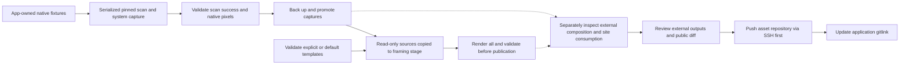
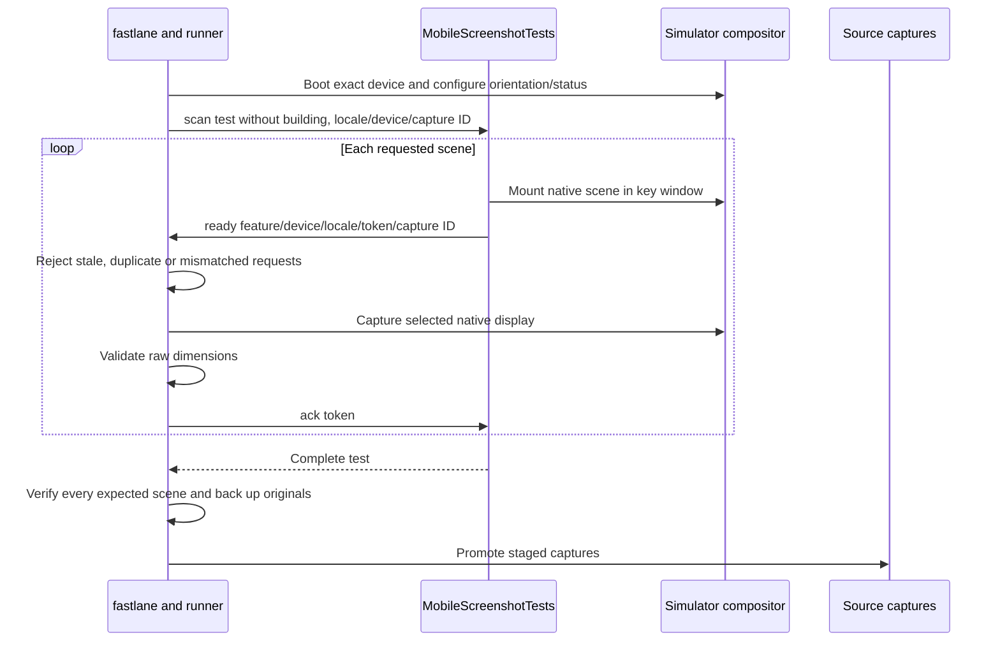

# Marketing Assets and App Icons

This is the operational home for Termind's asset workflow. Capture tooling and native fixtures belong to the application repository; `AGENTS.md` assigns the public website and marketing/brand assets to the independent `com.akinokaede.termind` submodule. Native builds do not require that checkout.

**Verification boundary:** at baseline `20f67cdc0b0e88115415c20af2cda7e12f51dfa6`, the available submodule directory is empty. Its asset/template READMEs, image files and website source cannot be inspected here. This is an uninitialized checkout, not evidence that those assets were removed. Paths and dimensions below describe parent tooling contracts, not an inventory of existing external files. No focus-taking captures or visual artwork approval were performed for this documentation repair.

The former MockUPhone pipeline, feature-first `Marketing/` layout, `LandingPage/` project and Pro Max captures are obsolete. The current pipeline uses **fastlane `run_tests` (scan)** with hosted Swift Testing fixtures, **frameit** plus local Apple templates, locale/device-first asset paths, iPhone 18 Pro and optional Duo displays, and native 14-inch Mac Workspace captures. This is not XCUITest `snapshot` automation.

## Ownership and publication

Run capture, framing and icon-rendering commands from the application repository root:

```sh
git submodule update --init com.akinokaede.termind
```

Ordinary pinned native builds do not need the website/assets checkout. Default capture and framing operations check for its Git metadata and asset directory before writing or starting a capture build. `plan:true` only prints the selected jobs; explicit external review directories remain supported. Do not silently recreate an absent submodule as an ordinary directory.

| Artifact | Owner and current location | Lifecycle |
| --- | --- | --- |
| Full-resolution app captures | `com.akinokaede.termind/assets/captures/<locale>/<device>/` | Replaced only by a successful validated capture batch; read-only to framing. |
| Derived device PNGs | `com.akinokaede.termind/assets/device_frames/<locale>/<device>/` | Reproducible from captures and local licensed templates. |
| External final artwork and design masters | Submodule-owned marketing/brand assets according to `AGENTS.md` | Inspect the initialized checkout separately for actual folders, filenames, compositions and image profiles. |
| Platform Icon Composer sources | `TFM/Resources/AppIcon.icon`, `TFI/Resources/AppIcon.icon` | App-owned, compiled by Xcode independently of public assets. |
| Tooling, tests, Ruby lockfile | `fastlane/`, `Scripts/`, `TFMTests/Screenshots/`, `TFITests/Screenshots/`, `Gemfile.lock` | Application-owned orchestration and fixtures. |

Tool-generated filenames use lowercase underscore-separated words. Locale directories are `en`, `zh-hans`, `zh-hant`, `ja`; lane locale options are `en`, `zh-Hans`, `zh-Hant`, `ja`. Capture/frame directories are `iphone-6.3`, `ipad-15`, `mac-14`, `iphone-duo-outer`, `iphone-duo-inner`. Command selectors remain `iphone`, `ipad`, `mac` and the two explicit Duo selectors. Final store canvas naming must be verified separately.

Commit and push reviewed asset changes **first**, via SSH, then commit the updated gitlink in the application repository. Keep the public HTTPS clone URL in `.gitmodules`; use an SSH push URL rather than changing that clone URL. Deployment configuration is not verified by the parent repository. Keep credentials, internal release records and licensed source downloads out of public changes.


The solid production stages are parent-owned tooling; dotted edges mark external consumption that requires separate inspection.

Capture success does not regenerate downstream compositions or verify website deployment.

## Tool setup and safe preview

Install Ruby 3.3 or newer, **below 4.0**, and the locked gems. One Homebrew setup is:

```sh
brew install ruby@3.3 imagemagick
export PATH="$(brew --prefix ruby@3.3)/bin:$PATH"
bundle config set --local path .build/bundle
bundle install
bundle exec fastlane mac screenshots plan:true
bundle exec fastlane ios screenshots plan:true
bundle exec fastlane frames plan:true
```

`Gemfile` pins fastlane; `fastlane/Framefile.json` pins the downloaded frame asset version. frameit downloads that version on first use. The parent runner expects five custom template paths; their presence, provenance notes and checksums require inspection of the initialized asset checkout. ImageMagick is required for masks, Mac framing and optional camera-strip padding.

Mac capture opens and focuses the real Termind window and moves the pointer. Run it only when desktop focus is available. Planning and framing do not open app windows. Do not enable screenshot or visible-window gates for routine verification.

## Capture matrix and commands

Both platform lanes build for testing once, then invoke scan serially with modified `.xctestrun` files for each locale/scene or locale/device. The runner preserves other test targets and host settings, sets Apple language/region/locale, disables parallel testing and keeps package resolution pinned with `-onlyUsePackageVersionsFromResolvedFile`. There are no automatic test retries hiding capture failures.

```sh
bundle exec fastlane mac screenshots scenes:hosts,workspace,agent,command,metrics
bundle exec fastlane ios screenshots
bundle exec fastlane mac screenshots scenes:agent locales:zh-Hant
bundle exec fastlane ios screenshots scenes:ssh,sftp devices:ipad locales:zh-Hans,zh-Hant
bundle exec fastlane ios screenshots devices:ipad runtime:com.apple.CoreSimulator.SimRuntime.iOS-27-0
bundle exec fastlane ios screenshots scenes:ssh devices:iphone locales:en output:/absolute/review/captures
```

Mac defaults to **Workspace only**, in four languages. Mobile defaults to all five scenes on iPhone and iPad in four languages: 40 captures. Each opt-in Duo display also has five scenes × four languages when unfiltered. `Scripts/run-mac-screenshots.sh` and `Scripts/run-mobile-screenshots.sh` delegate to these lanes and accept the same options.

Environment defaults are `TERMIND_MAC_SCREENSHOT_SCENES`, `TERMIND_MAC_SCREENSHOT_LOCALES`, and `TERMIND_SCREENSHOT_{SCENES,DEVICES,LOCALES,RUNTIME}`. Explicit lane options win. Invalid, duplicate and empty comma-separated members fail before building; use explicit script/lane options rather than the retired `TERMIND_*MARKETING*` selectors.

| Mac selector | Capture filename under `<locale>/mac-14/` | Content |
| --- | --- | --- |
| `hosts` | `vault.png` | Vault and two demo workspaces. |
| `workspace` | `workspace.png` | Full-screen Workspace; source accepted by Mac framing. |
| `workspace-window` | `workspace_window.png` | Ordinary 2360×1480 Workspace window; downstream board usage is unverified. |
| `agent` | `assistant.png` | Workspace with contextual Assistant. |
| `command` | `command_generator.png` | Command Generator; ordinary-size native window. |
| `metrics` | `metrics_overview.png` | Metrics overview only. |

Mobile selectors/filenames are `vault`, `sftp`, `ssh`, `metrics`, `assistant`. Metrics detail and app Settings are manual development demos, not lane-supported marketing exports.

Logs and products live under `.build/fastlane-screenshots/<mac|ios>/`; each invocation gets its own run/log directories. Both capture platforms share a nonblocking file lock: a second runner fails instead of racing shared products or presentation state. Before replacing existing captures, promotion backs up their exact bytes and appends SHA-256 hashes under `.build/screenshot-backups/<run>/SHA256SUMS`.

A failed scan, absent scene, duplicate request or incorrect native image size blocks promotion of the affected batch. Mobile validates the complete selected scene set after that device/locale test; Mac validates each scene/locale capture after its test. Later batches failing do not undo earlier successful ones. Destination files use temporary-copy-and-rename replacement; validation before publication is not a crash-atomic transaction over the entire run. `output:/absolute/path` stages review captures outside the asset tree without changing the default destination.

## Mobile devices, runtime and display posture

The capture lane requires an iOS/iPadOS **27.x** runtime. Duo-only selections default to 27.1 and other selections to 27.0; explicit runtime overrides remain supported. Installed runtime/device availability must be checked locally, and Duo displays should be captured in separate posture-specific batches. The runner matches the exact simulator name **and model identifier** and verifies raw pixels; renaming a Pro Max simulator or resizing an old capture cannot satisfy it.

| Selector | Device/orientation | Native pixels | Asset directory |
| --- | --- | --- | --- |
| `iphone` | iPhone 18 Pro, 6.3-inch portrait | 1206×2622 | `iphone-6.3` |
| `iphone-duo-outer` | iPhone Duo Closed, portrait | 1398×2034 | `iphone-duo-outer` |
| `iphone-duo-inner` | iPhone Duo Open, landscape | 2853×2007 | `iphone-duo-inner` |
| `ipad` | iPad Pro 13-inch (M5), landscape | 2752×2064 | `ipad-15` |

Create missing exact simulators once:

```sh
xcrun simctl create "iPhone 18 Pro" com.apple.CoreSimulator.SimDeviceType.iPhone-18-Pro com.apple.CoreSimulator.SimRuntime.iOS-27-0
xcrun simctl create "iPhone Duo" com.apple.CoreSimulator.SimDeviceType.iPhone-Duo com.apple.CoreSimulator.SimRuntime.iOS-27-1
xcrun simctl create "iPad Pro 13-inch (M5)" com.apple.CoreSimulator.SimDeviceType.iPad-Pro-13-inch-M5-12GB com.apple.CoreSimulator.SimRuntime.iOS-27-0
```

Duo uses one simulator with two displays. In Device Hub select **Closed** before the outer batch and **Open** before the inner batch; run them separately:

```sh
bundle exec fastlane ios screenshots devices:iphone-duo-outer
bundle exec fastlane ios screenshots devices:iphone-duo-inner
bundle exec fastlane frames devices:iphone-duo-outer,iphone-duo-inner
```

The runner rejects an inactive display before starting its capture tests. It passes the device/display selection through the ready handshake, using `simctl --display=primary` for the outer display and the validated `devicectl` display unique ID for inner landscape capture. iPad also uses landscape `devicectl` capture; ordinary iPhone uses portrait `simctl` capture. There is no substitute-device or post-capture resizing fallback. An iPad-only selection builds and runs on the iPad and requires no iPhone simulator.

### Native mobile rendering and handshake

`MobileScreenshotTests` is serialized and opt-in under `TERMIND_SCREENSHOTS=1`. Scan enables `TERMIND_SCREENSHOT_SYSTEM_CAPTURE=1`, sets one locale, device, selected scene set and unique capture ID, and mounts feature views with in-memory data. SSH and SFTP use the **real `MobileRootView` workspace shell** with injected connection services, not an isolated terminal/browser mock. The workspace scene phase is explicitly active. The selected fixture tab installs `mobileToolbarEnvironment()` so toolbar layout is derived from the native shell instead of falling back to a detached view's defaults. iPad Vault and Assistant show their sidebar; Metrics, SSH and SFTP hide it for the capture.

For SSH, disconnect the simulator hardware keyboard, dismiss first-use keyboard tips, and return to the Home Screen before starting a batch. The fixture requires a focused terminal, the native software keyboard and attached keyboard accessory; an accessory-only hardware keyboard strip is rejected. It scopes an English/ASCII QWERTY input-mode override to the opt-in capture, restores it afterward, and localizes app chrome separately from terminal commands/output.

System captures use 9:41, **100%** battery in the discharging state, three Wi-Fi bars and four cellular bars. Status override is cleared after the batch, including failure. Capture launch arguments are isolated in the test configuration, not persistent user settings.


The mobile handshake validates identity and native dimensions before acknowledging scenes; promotion follows successful scan completion and complete-set validation.

The runner rediscovers the app container while waiting because XCTest can reinstall the host between locales. Each scene has a token and the whole batch a capture ID; missing acknowledgment times out the test. A direct fixture invocation **without** system-capture mode writes rendered PNGs to the host's `Documents/screenshots/<feature>/<device>-<locale>.png`, not the public capture tree. Those review renderings are not the release compositor pipeline.

## Mac native capture and fixtures

Mac capture requires macOS **27.x**, native 2× backing and the real focused production `WindowGroup`. Workspace alone goes full-screen on the built-in display, currently **3024×1964**. Other scenes, including Command Generator, use **2360×1480** ordinary-window captures. The full-screen export captures only the app window; an excluded camera strip of at most 160 pixels is padded black at the top, without stretching content or capturing personal desktop/menu/Dock UI. Framing separately requires the exact 3024×1964 Workspace source.

`ScreenshotDemoConfiguration` is a DEBUG-only launch mode with one `--termind-demo=<scene>:<en|zh-Hans|zh-Hant|ja>` argument. Missing means normal launch; malformed, duplicate and unsupported values abort demo launch. `Scripts/run-screenshot-demo.sh` supports manual review, including `metrics-detail` and `app-settings`; scan accepts only the six export scenes above.

Demo startup chooses its requested locale and in-memory SwiftData container, creates demo Hosts, AI, unrestricted test access, frozen Metrics and a demo `WindowModel`, then returns before ordinary persisted Settings, Keychain, sync and live model assembly. Scrubber setup and previous-session attachment cleanup still occur before that return; this isolation is not a promise of zero startup side effects. The initial nil-request main scene receives the demo window; explicitly requested new windows use ordinary creation. Tests/demos disable main-scene restoration; demo test windows are not suppressed by the ordinary XCTest host-window gate.

The app delegate's `TERMIND_DEMO_READY` diagnostic is not capture readiness. `MacScreenshotTests` prepares the actual window, uses light appearance, validates active/key focus and 2× backing, and emits **`TERMIND_MAC_SCREENSHOT_READY`** with scene, locale, native window number, token and pixel dimensions. The runner captures by window number, then waits for scan completion before validating and promoting the image. Focus must remain active through the five-second capture interval. Scan injects `-showStatusBar YES` and `-statusBar.expanded YES` in the process argument domain so captures show the expanded status bar without changing the user's saved preference.

Before export, the test delivers a pointer move **inside** the window to clear stale SwiftUI row hover, moves it outside content, waits for stable focused rendering, then temporarily ignores mouse events. Moving directly outside can leave a row highlighted. Normal input and the pointer are restored afterward.

Fixture-specific checks:

- Vault has two live-looking demo workspaces and exactly matching connected Host indicators; other Hosts are disconnected and no SFTP transfers are seeded for that scene.
- Workspace keeps Navigator visible, two equal-height terminals in the left half and one full-height SFTP browser in the right half. The top-left terminal is focused; the eleven deterministic `/etc/nginx` rows select only `nginx.conf`.
- Command Generator is a single-terminal workspace with inserted-command feedback, not the old smaller capture size.
- Assistant is a live-looking workspace plus contextual Assistant, not a second root mounted over the same native surfaces.
- Metrics contains frozen values; detail remains a development demo. Never contact real Hosts/accounts or change production behavior just to produce an image.

## Frame generation

After recapture, regenerate the matching device frames:

```sh
bundle exec fastlane frames
bundle exec fastlane frames devices:iphone scenes:vault locales:en
bundle exec fastlane frames devices:ipad scenes:ssh,sftp locales:zh-Hans,zh-Hant
bundle exec fastlane frames devices:iphone-duo-outer scenes:assistant
bundle exec fastlane frames devices:iphone-duo-inner scenes:sftp
bundle exec fastlane frames devices:mac locales:en
```

The default is 28 jobs: iPhone Assistant/SSH/Vault, iPad Metrics/SFTP/Vault, and Mac Workspace, in four locales. **Duo remains opt-in**; explicit Duo selectors default to all five mobile scenes. `WEBSITE_SCENES` is the parent selection policy, not proof of current site consumption. Mac frames support Workspace only.

`input:` and `output:` support review directories; supply **both** to work without the submodule. `plan:true` lists jobs without importing templates or changing images. Every selected source/template size is checked before rendering. The lane stages copies, masks their screen apertures, renders all selected jobs, verifies each PNG, then publishes `<locale>/<device>/<feature>.png`. A frameit action that only logs an error and omits an output still fails publication. Validation prevents a failed render batch from replacing existing frames; per-file rename does not make the final publication loop crash-atomic. Raw captures are never masked or resized.

### Local licensed templates

The parent runner defaults to five template paths under `assets/device_templates/`, with explicit frame-path overrides. The table records enforced dimensions and composition offsets, **not verified existing files or provenance**. Initialize and inspect the checkout, confirm usage rights and source/checksum records independently, or provide reviewed templates via overrides. Public access alone grants no additional rights. Download references below are unverified preparation guidance, not proof of template provenance. Do not reconstruct templates from composed screenshots.

| Frame | Local template | Portrait template and opening | Result/orientation |
| --- | --- | --- | --- |
| iPhone 18 Pro Silver | `com.akinokaede.termind/assets/device_templates/iphone-18-pro.png` | 1350×2760; 1206×2622 at (72,69) | Portrait, native scale. |
| Duo Outer Star White | `com.akinokaede.termind/assets/device_templates/iphone-duo-outer.png` | 1574×2194; 1398×2034 at (88,80) | Portrait, native scale. |
| Duo Inner Star White | `com.akinokaede.termind/assets/device_templates/iphone-duo-inner.png` | 2247×3093; 2007×2853 at (120,120) | Clockwise `landscape_right`, 3093×2247. |
| iPad Pro (M5) 13-inch Space Black | `com.akinokaede.termind/assets/device_templates/ipad-pro-13-m5.png` | 2300×3000; 2064×2752 at (118,124) | `landscape_left`, 3000×2300. |
| MacBook Pro M5 14-inch Space Black, narrow | `com.akinokaede.termind/assets/device_templates/macbook-pro-14-template.png` | Prepared 3860×2320; 3024×1964 at (418,68) | Native full-screen Workspace, no desktop composition. |

**iPhone:** download [iPhone 18 bezels](https://devimages-cdn.apple.com/design/resources/download/Bezel-iPhone-18.dmg), copy `PNG/iPhone 18 Pro/iPhone 18 Pro - Silver - Portrait.png`, or pass `iphone_frame:/absolute/path/to/frame.png`. Old 1320×2868 Pro Max captures are rejected and must be recaptured rather than scaled.

**Duo:** download [iPhone Duo bezels](https://devimages-cdn.apple.com/design/resources/download/Bezel-iPhone-Duo.dmg). Copy `PNG/iPhone Duo - Star White - Outer Closed Portrait.png` and `PNG/iPhone Duo - Star White - Inner Open Portrait.png` to the matching local paths. Override with `iphone_duo_outer_frame:` / `iphone_duo_inner_frame:`. The inner frame and mask rotate clockwise; the screenshot remains upright, and the volume buttons sit along the top edge near the right corner.

**iPad:** download [iPad Pro (M5) bezels](https://devimages-cdn.apple.com/design/resources/download/Bezel-iPad-Pro-(M5).dmg). Copy `PNG/iPad Pro (M5) 13" - Space Black - Portrait.png`, or pass `ipad_frame:/absolute/path/to/portrait.png`. The pinned frameit library has no built-in M5 frame, so the lane registers this custom device at runtime. Neither screenshot nor bezel is resized.

**Mac:** accept the MacBook Pro M5 license locally, then remove only the 220-pixel transparent top margin of the official 3860×2540 image:

```sh
mkdir -p com.akinokaede.termind/assets/device_templates
magick "/Volumes/Bezel-MacBook-Pro-M5/PNG/MacBook Pro M5 14-inch Space Black.png" \
  -crop 3860x2320+0+220 +repage com.akinokaede.termind/assets/device_templates/macbook-pro-14-template.png
```

Override with `mac_frame:/absolute/path/to/frame.png`. The native screen fills the prepared aperture without resampling; no wallpaper, Dock or personal system UI is added. Missing or incorrectly sized templates fail before publication.

### Screen masks and regeneration

The mask algorithm expects transparency both outside the device and inside its display, separated by an opaque bezel. The lane extracts the enclosed screen aperture, flood-fills the exterior away, validates that the bezel encloses the screen, crops to the exact source opening and rotates the mask with landscape templates. It applies the mask only to a staged copy so rectangular capture corners and notches cannot leak outside thin bezels. Opaque screen pixels and native scale are retained. An open bezel fails validation. After mask/template changes, regenerate frames **and** replace their Figma layers and final marketing exports.

## External composition, website and store delivery

`AGENTS.md` identifies the submodule root as an independent Astro project and documents `npm run build` as type-checking and emitting `dist/`. That parent guidance does not verify current website imports, responsive Hero composition, routes, copy, image renditions or deployment settings.

Before publishing, initialize and inspect the external repository separately:

- Read its current asset and template documentation and inspect actual images. Establish board inventory, filenames, canvas sizes, opacity and embedded profiles from those files rather than capture dimensions.
- Inspect site consumers and styles to determine which frames are used and whether changed aspect ratios affect responsive layouts. Do not infer consumption from the Ruby `WEBSITE_SCENES` constant.
- Inspect any design master and handoff instructions before replacing layers or exporting. No Figma node IDs, plugin/export requirements, board geometry, fonts or locale-specific typography are verified here.
- Review all selected locales at 100% and in contact sheets. Native chrome, keyboard, clipping and focused Mac appearance need visual review beyond dimension checks.
- Check [Apple's screenshot specifications](https://developer.apple.com/help/app-store-connect/reference/app-information/screenshot-specifications/) for intended uploads. Transparent device-frame PNGs are intermediates; frame success is not store acceptance.

This page makes no current claim about a 96-board inventory, Overview filenames, header/search artwork, Hero device selection, public icon contents or template checksums. After capture/frame changes, downstream composition and site consumption require intentional review; tooling does not automatically publish them.

## Brand, layered app icons and Pro handoff

External brand masters and website variants must be inspected in the initialized submodule before editing; their contents and styling are not verifiable here.

Platform `AppIcon.icon` documents remain app-owned and selected as `AppIcon` by Xcode. Their SVG groups are Terminal, FrontWindow, MiddleWindow, BackWindow; preserve order, shared-square platform declaration, lighting, disabled glass/specular/translucency, no Terminal shadow and the subtle 0.08 neutral window shadows. Icon Composer/Xcode own platform padding, masks and compatibility renditions. Do not introduce another flattened appiconset or manually generated size matrix. Build both platform sources with pinned dependencies; TestFlight processing is a separate release check, and a temporary macOS bundle identifier can bypass local icon cache during manual review.

A separate website rendition can be exported from the Mac source to an initialized, reviewed external checkout. The following is a manual export example, not verification that `public/app_icon.png` exists or matches either native source:

```sh
"/Applications/Xcode.app/Contents/Applications/Icon Composer.app/Contents/Executables/ictool" \
  "$PWD/TFM/Resources/AppIcon.icon" --export-image \
  --output-file "$PWD/com.akinokaede.termind/public/app_icon.png" \
  --platform macOS --rendition Default --width 1024 --height 1024 --scale 1
```

Shared `Frameworks/Resources/Assets.xcassets` instead owns runtime AccentColor and vector/template Linux-distribution icons. The distribution catalog resolves IDs/like-IDs; host icons use host/brand/accent tint or `server.rack` fallback. These are not marketing device frames or the compiled app icon.

```sh
swift Scripts/render-pro-paywall-icon.swift
```

The renderer checks the initialized asset checkout and writes `design/paywall/pro_hero_light.png` and `pro_hero_dark.png`, at 4× an 80×72-point SwiftUI canvas. These are remote RevenueCat image-component handoffs. Native `ProPaywallView` / `MobileProView` embed `RevenueCatUI.PaywallView`; rendering files neither updates native app icons nor publishes a remote paywall. Review/re-upload intentionally after symbol/color changes.

`MobileIconRenderingTests` is a separate opt-in in-app icon/UI-label rendering suite under `TERMIND_ICON_SCREENSHOTS=<locale>`. Its temporary PNGs are not release captures, App Store boards or Icon Composer output.

## Validation and release checklist

Quiet tooling checks do not open screenshot windows:

```sh
bundle exec ruby Scripts/Tests/test_screenshots.rb
ruby -c fastlane/lib/screenshots.rb
ruby -c fastlane/lib/screenshot_frames.rb
zsh -n Scripts/run-mobile-screenshots.sh Scripts/run-mac-screenshots.sh
Scripts/check-appstrings.sh
python3 Scripts/check-cjk-localization.py
git diff --check
```

The Ruby regression suite covers absent-submodule fail-before-write behavior, external review paths, selector validation, pinned scan configuration, native-device rejection, capture failures/backup hashes, camera-strip padding, container reinstalls, Duo display selection, native-scale composition, aperture masks and all-render-before-publish failure handling. Native fixtures and Figma/website rendering still need their own opt-in/manual validation; this guide does not claim a fresh capture or visual approval.

The Ruby suite uses temporary repositories, mocked scan/system commands and synthetic PNGs/templates. Its failure-propagation, byte-preservation and mask-pixel checks establish orchestration behavior, not correctness of real Apple templates, final artwork or the live site. Neighboring native fixtures enforce focused-window and software-keyboard conditions only when explicitly enabled. The suite was inspected, not executed, for this repair.

For website work after initialization:

```sh
(cd com.akinokaede.termind && npm ci && npm run build)
```

Confirm prerequisites, actual routes, redirects, responsive layouts and deployment settings from the external checkout before publication. For store delivery, derive an inventory from the inspected files and intended upload requirements rather than asserting a fixed board count. Check embedded profiles, not merely colorspace labels. Preserve per-run failure output and back up originals; do not alter unrelated assertions or production behavior to satisfy marketing fixtures.

See [Supporting Systems](../architecture/supporting-system-directories.md) for repository boundaries, [Commerce and Product Surfaces](../concepts/commerce-localization-and-product-surfaces.md) for runtime/copy ownership, [Storefront Commerce Release Checks](storefront-commerce-release.md) for store validation, and [Build, Test, and Release](build-test-and-release.md) for ordinary application gates.
