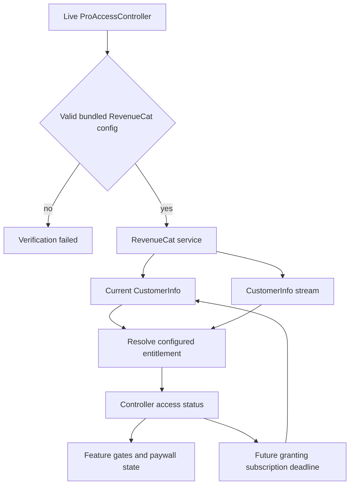
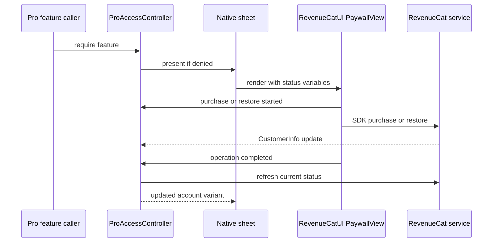

# Storefront and Commerce Release

**Three separate authorities:** `StoreKit/Termind.storekit` is a local catalog fixture, App Store Connect defines the live Apple products and introductory offer, and RevenueCat supplies the configured `termind_pro` entitlement and remotely configured paywall. A fixture product or signed CloudKit capability does not grant Pro. Check the RevenueCat dashboard, Apple storefront and native app together before shipping; do not treat local test prices, screenshots or UI strings as production purchase evidence. See [Commerce, localization and product surfaces](../concepts/commerce-localization-and-product-surfaces.md) for the broader gate and copy ownership map.

## Product and configuration checks

| Local fixture field | Annual | Lifetime |
| --- | --- | --- |
| Product ID | `com.akinokaede.termind.pro.annual` | `com.akinokaede.termind.pro` |
| Reference / English name | Termind Pro Annual | Termind Pro Lifetime |
| US fixture price and type | 3.99, yearly auto-renewable | 9.99, non-consumable |
| Simplified Chinese name | Termind Pro 年度订阅 | Pro终身版 |
| Traditional Chinese name | Termind Pro 年度訂閱 | Pro終身版 |
| English description | Annual access to unlimited hosts & iCloud sync. | Lifetime access to unlimited hosts & iCloud sync. |
| Simplified Chinese description | 年度订阅，畅享无限主机与iCloud同步。 | 终身畅享无限主机与iCloud同步。 |
| Traditional Chinese description | 年度訂閱，享有無限主機與iCloud同步。 | 終身享有無限主機與iCloud同步。 |

The fixture marks both products Family Shareable and puts annual in the `Termind Pro` subscription group with one two-week free introductory period. The former local commerce catalog/trial test files are removed; the fixture is for manual development. Local unit tests do not prove live offerings, eligibility or purchases. Validate prices by territory, group, offer eligibility (fresh versus previously used account), Family Sharing and the intended billing grace policy in App Store Connect and Sandbox separately. The local file does not specify a production grace-period length.

Both targets obtain `TermindRevenueCatAPIKey` and `TermindRevenueCatEntitlementID` from their `Info.plist` build substitutions; the project-level Debug and Release settings both specify a public `appl_` key and the `termind_pro` entitlement. Check **resolved values in the signed release build**, not only source settings: `RevenueCatConfiguration` trims whitespace, rejects missing/placeholder entitlement or invalid/private keys, and accepts `test_` keys only in DEBUG. Invalid configuration gives `.verificationFailed` and an unavailable fallback, not a StoreKit access bypass. The RevenueCat dashboard must map both Apple products to the correct entitlement, configure offerings, remote paywall variants, copy, legal links and restoration, and use the matching Apple app/store credentials. The service uses StoreKit 2, informational entitlement verification, anonymous RevenueCat IDs (not device/iCloud IDs), disabled automatic device-ID collection and the stored app language as preferred RevenueCat UI locale. Test universal Apple purchases across Mac and iOS via explicit restore; anonymous IDs may be aliased through restoration rather than being identical between devices.

Signing is a different check: the targets have distinct `TFI/TFI.entitlements` and `TFM/TFM.entitlements`. Both declare the CloudKit container, webcredentials domain and bundle-derived keychain group; Mac also has App Sandbox with device, network and selected-file permissions. Both app targets use automatic signing. Their source Debug settings select `APS_ENVIRONMENT = development` and `ICLOUD_CONTAINER_ENVIRONMENT = Development`; Release selects `production` and `Production`. The Mac Release configuration still specifies `CODE_SIGN_IDENTITY = "Apple Development"`: a configuration named Release is not evidence of a distribution-signed artifact. Check provisioning and production iCloud/push environment on signed builds, but do not read StoreKit products, introductory offers or Pro access from these capability declarations. See [CloudKit Release Readiness](cloudkit-release-readiness.md) for the separate capability and environment checks.

### Inspect the release artifact, not just the project

For each platform, retain the build-settings output for the actual archive invocation and inspect the app that will be delivered (again after export if signing changes). Check:

- Bundled `TermindRevenueCatAPIKey` and `TermindRevenueCatEntitlementID`: no unresolved `$(...)` macros, the intended public Apple SDK key and `termind_pro`, and no DEBUG-only `test_` key. The `appl_` key is a client configuration identifier, **not a private RevenueCat management credential**; do not place private dashboard/API or Apple signing credentials in these substitutions.
- Signed identity, team, bundle identifier, provisioning profile and effective entitlements: compare the actual signed values with the intended distribution channel rather than assuming automatic signing or source macros resolved as intended.
- Push and CloudKit environments, the CloudKit container and keychain group: inspect the resolved signature as well as the bundled `TermindCloudKitEnvironment`. A correct source file alone is insufficient.

For an extracted iOS app, the plist is at `Termind.app/Info.plist`; for Mac it is at `Termind.app/Contents/Info.plist`. Useful inspection commands (replace the path with the actual delivered app) are:

```sh
plutil -p /path/to/Termind.app/Info.plist
codesign -dvv /path/to/Termind.app
codesign -d --entitlements :- /path/to/Termind.app
```

Use the Mac plist path for the first command when inspecting the Mac app. Record artifact inspection separately from dashboard review and Sandbox transaction results; none of these commands validates live offerings, eligibility or storefront acceptance.

## Access and refresh lifecycle

`ProAccessController.live()` builds a `RevenueCatProPurchaseService` if bundled configuration is valid. The observable main-actor controller is the gate: `canUse` tests current `hasProAccess`, while a denied `require(feature)` presents the paywall. The current `ProFeature` set is Vault sync, unlimited Hosts, Tailscale and optional SFTP/port-forwarding multi-connection acceleration. Ordinary Workspace composition and SSH terminal uploads are free when their normal connection and destination gates pass. Tests and screenshot setups can create `.unrestrictedForTesting`; production must use RevenueCat status. Do not treat product descriptions as the complete paid-feature contract: `.assistant`, `.remoteMCP`, `.mcpServer` and `.unlimitedMetrics` are not current Pro feature cases.

Host access is a separate admission check: free access permits three ordinary Hosts, selected deterministically by creation date then UUID; Pro unlocks all ordinary Hosts. Additional saved Hosts are locked rather than deleted. Over-limit operations during `.loading` or `.verificationFailed` report unresolved/failed verification rather than treating that state as a resolved free account. Check purchase, expiry and verification failure with more than three Hosts, not just with an empty library. See [Commerce, localization and product surfaces](../concepts/commerce-localization-and-product-surfaces.md) for the detailed Host policy.

The Mac built-in MCP server is constructed without a Pro predicate and its settings toggle calls `setEnabled` directly. Mobile remote MCP Add and Import actions likewise have no `.remoteMCP` gate. This does not establish a built-in server on mobile: validate remote-client messaging separately from Mac server availability. [Source: `ProAccessTypes.swift`](../../Frameworks/TermindDomain/Commerce/ProAccessTypes.swift), [Host policy](../../Frameworks/TermindDomain/Hosts/HostAccessPolicy.swift), [mobile MCP settings](../../TFI/Features/Settings/MobileMCPSettings.swift).

For Mac release verification, inspect the **composition root**, not the `AppModel` initializer default: `AppModel` defaults to `.unrestrictedForTesting()`, but `TermindApp` explicitly injects `.live()` for normal launches and `.unrestrictedForTesting()` when running tests. The DEBUG screenshot-demo branch also explicitly injects unrestricted access and returns early. Neither a screenshot nor a directly constructed default `AppModel` demonstrates production entitlement enforcement.

On mobile, `TermindIOSApp` selects `MobileAppDependencies.live()` for normal launches and `.testing()` when `XCTestConfigurationFilePath` is present. Neither dependency factory explicitly injects `proAccess`: `.live()` supplies `hosts: nil` and `inMemory: false`, while `.testing()` sets `inMemory: true`. `MobileAppModel` honors an explicitly injected `proAccess` first; only when it is absent does the model choose unrestricted access for in-memory or supplied-host fixtures and `.live()` otherwise. Thus the production entitlement controller is selected by the model's fallback, not by an explicit controller assignment in the live factory. Validate the normal launch path on iPhone and iPad, not just a fixture-created model. `MobileRootView` binds the paywall sheet directly to `app.pro.isPaywallPresented`; its URL routing is unrelated to purchase authorization.

Mac entitlement changes also reconcile runtime services: `accessDidChange` updates Host admission, sync, Tailscale, Metrics and effective SFTP/port-forwarding connection preferences without requiring a visible settings surface. `RootView` also observes status changes to reconcile Host admission and sync; this no longer reconciles a Pro-gated built-in MCP server. SFTP integration tests verify that gaining access restores the saved concurrency strategy and losing access uses the free effective strategy without rewriting saved preferences or opening a paywall. Include access gain/loss in release checks, not just initial paywall presentation.



The diagram separates the RevenueCat entitlement path from the remote UI and local StoreKit fixture.

`RevenueCatEntitlementResolver` rejects failed CustomerInfo or entitlement verification and ignores unrelated entitlements and product IDs without the configured entitlement. An active entitlement without an expiration grants purchased lifetime access, including Family Sharing. An active subscription grants Pro during an unexpired trial or paid period; with a detected billing issue it grants grace only while an active grace deadline is in the future. Refund maps to revoked, an expired billing issue to billing retry and otherwise an expired period to expired. Canceling renewal leaves an unexpired subscription active. A stale cached `isActive` flag alone cannot extend access past its date; unlike the former StoreKit code, there is no post-expiry `.subscribed` fallback. Validate the actual RevenueCat ownership, trial, refund and grace responses from Sandbox before promising these transitions in storefront copy.

The service requests `customerInfo(fetchPolicy: .fetchCurrent)` rather than relying on SDK cache for deadlines, resolves cached CustomerInfo if the request fails, and throws when no cache exists. It listens to `customerInfoStream`; the controller coalesces concurrent refreshes and gives newer stream updates priority over older in-flight responses. Initial failure becomes `.verificationFailed`, while a later failed refresh retains an established status; therefore an offline refresh is **not** proof of a newly processed revocation. On a non-test store, if a valid initial status lacks access, the service attempts `syncPurchases()` once per anonymous user to import older Apple purchases and records successful migration in defaults; this is not the remote paywall's user-initiated Restore action. An applied granting subscription with future `expiresAt` replaces a cancellable deadline task; wakeup calls `refresh()` rather than revoking locally. App activation on Mac and active scene transition on iOS also request refresh. Check an already-open app through trial expiry, renewal, cancellation and grace expiry in Sandbox, including offline/reconnect behavior.

## Remote paywall contract and review

Mac `ProPaywallView` and iOS `MobileProView` embed **RevenueCatUI `PaywallView`**, not a shared native `ProPaywallContent` or `ProOfferPresentation`. While access is `.loading`, each shows a localized progress view; if RevenueCat is unconfigured, it shows an unavailable message and close action. Otherwise each passes `ProPaywallState` into remote paywall variables: `pro` (access), `manage` (purchaser-owned subscription only), `family`, `dated`, locale-formatted `date` (empty if unknown), and the protocol `state` (`trial`, `renewing`, `ending`, `active`, `grace`, `retry`, `expired`, `revoked`, `lifetime`, `free`, `unverified`, etc.). These codes are dashboard rules, **not localized visible strings**. A canceled-but-unexpired subscription can have `ending` while retaining `pro`; a family-shared subscription or lifetime purchase has no manage flag. The dashboard—not the app's obsolete native formatters—owns tiles, plan selection, price/trial/renewal disclosure, feature rows, buttons, legal links, accessibility layout and localized copy. Do not infer mobile/Mac-specific MCP messaging, a Metrics limit callout, a hard-coded 14-day label or reload-prices UI from `AppStrings.Pro` entries or the fixture. Review the actual dashboard variants in English, zh-Hans and zh-Hant on both platforms, especially that mobile does not promise the built-in Mac MCP server and that the trial claim appears only for eligible accounts.



Purchase and restore callbacks refresh the controller's entitlement status while the native sheet can remain open on the account variant.

Both wrappers refuse purchase initiation if access already exists, mark operations processing on purchase/restore start and clear processing on completion, cancellation or failure. Completion refreshes entitlement without closing the sheet: the first RevenueCat dismissal request after purchase is suppressed so the account variant remains visible; the close button or subsequent dismissal can close it. Disappearance clears the processing flag. Mac chooses one owner window for the sheet; iOS presents it from `MobileRootView`. Confirm purchase/restore failures and recovery in real UI rather than assuming controller unit tests exercise SDK purchases.

## Language changes are presentation changes

On Mac, the language picker persists `AppLanguage` and displays a relaunch notice when it differs from the launch language. `AppLanguage.store` updates the app setting and Apple's `AppleLanguages` override; Follow System removes that override. RevenueCat reads the stored locale when its SDK is first configured, while the native paywall formats its `date` variable with the view's locale. Relaunch before reviewing a changed language; do not assume changing the setting reconfigures an already-running RevenueCat SDK.

This path does **not** change entitlement resolution, purchase authorization or restore callbacks, and is not a way to reset introductory-offer eligibility. Keep language/copy review separate from account eligibility and transaction validation: verify the actual remote paywall after relaunch, then use the appropriate Sandbox accounts for purchases and restores. The manual StoreKit fixture's English and Chinese strings do not prove RevenueCat dashboard locale coverage.

## App Store review invitation is not purchase evidence

The user-facing review link opens `https://apps.apple.com/app/id6805856690?action=write-review` through SwiftUI `openURL`. `AppReviewController` records `.openedReview` only when the URL-open completion is accepted; this records **intent to review**, never a submitted rating, successful purchase or Apple review approval. A rejected open leaves the invitation available. Decline and accepted-open responses persist in device-local defaults and suppress later invitations; they are not synced commerce or entitlement state.

Normal invitation eligibility requires an enabled controller, no prior response, at least one host and seven elapsed days since first use. `AppReviewInvitationVisit` captures eligibility on page entry so time passing or a newly synced host cannot insert it mid-visit; filtering or losing the last host hides it without consuming it. Developer preview bypasses eligibility but neither opens the external URL nor changes the real saved response. `FrameworkTests/AppReviewControllerTests.swift` covers these gates, persistence, rejected opens, shared-window suppression and preview isolation. Release review should separately check the actual destination and user-initiated open on each platform; neither preview nor a successful URL handoff verifies App Store transaction delivery.

## Release validation

1. Reconcile product IDs, types, group, Family Sharing, introductory eligibility and grace settings in App Store Connect **and** entitlement-to-product mapping, offering/paywall rules and localized disclosure in RevenueCat. Test new versus used-offer accounts, trial-to-paid renewal, cancellation through expiry, billing retry with and without grace, refunds, Family Sharing and lifetime restoration across Mac, iPhone and iPad. Record Sandbox results separately from the fixture and production configuration review.
2. Run the default shared/macOS tests as described in [Build, Test, and Release](build-test-and-release.md). `FrameworkTests/RevenueCatCommerceTests.swift` tests key validation, configured-entitlement resolution, expiration/grace/refund/verification, completion, stream updates, refresh races and failure recovery using decoded CustomerInfo and fake services. `FrameworkTests/ProPaywallStateTests.swift` tests dashboard variable mapping; `TFMTests/ProAccessTests.swift` tests gate semantics. There is no current `ProOfferPresentationTests`, `ProPaywallPresentationTests`, `TFMTests/ProPaywallRenderingTests` or `TFITests/ProPaywallRenderingTests` to validate remote paywall rendering. Check both native remote paywalls visually with live Sandbox metadata and dynamic type; unit and fixture tests do not cover a real SDK purchase, restore or the dashboard layout.
3. Check final localized **storefront imagery** separately from the paywall. The parent screenshot runner supports and defaults to all seven locale keys: `en`, `zh-Hans`, `zh-Hant`, `ja`, `ko`, `de`, and `fr`; `locales` options or `TERMIND_MAC_SCREENSHOT_LOCALES` / `TERMIND_SCREENSHOT_LOCALES` can narrow the selection. It sets test language, region and Apple locale for each capture. This is capture-tool coverage, not proof of localized remote paywalls or final exported boards. Initialize the independent website/assets checkout with `git submodule update --init com.akinokaede.termind`, then read its current asset documentation and delivery contract and inspect the actual localized files. The checkout available for this repair is empty, so no current board count, filenames, final canvas dimensions or image profiles are verified here. Establish the release inventory from the inspected checkout; verify locale coverage, filenames, canvas sizes, opacity and embedded RGB/sRGB profiles against its current delivery contract and intended uploads. Review language, composition, platform promises and offer claims against the native app and current App Store requirements, then confirm acceptance for the intended App Store upload slots. Parent screenshot-tool dimensions describe native capture inputs—not proof of final board dimensions or upload acceptance—and captures/device frames are not final storefront artwork. See [Marketing Assets and App Icons](marketing-assets-and-app-icons.md) for checkout inspection, capture/framing, composition/export review and SSH-first publication; do not substitute a historical inventory for that release review.
4. Keep evidence separate: the StoreKit fixture verifies catalog *shape*; resolver tests verify local policy; signed-build checks verify credentials/capabilities; Sandbox and dashboard checks verify actual product delivery, eligibility, purchase, restore, legal copy, accessibility and Family Sharing. Coordinate changed app strings, website claims and imagery with remote paywall copy without silently changing product IDs or entitlement mapping.
