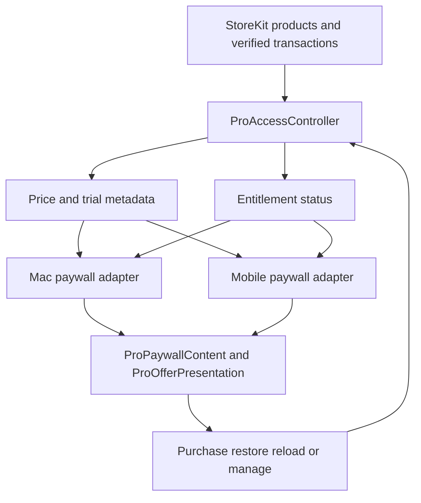

# Storefront Commerce Release Checks

App Store Connect is the production authority for products, offers, localized metadata, Family Sharing, grace period, and review behavior. `StoreKit/Termind.storekit` is a **local development/test fixture**, not a storefront deployment. Keep the product IDs stable and test with the local configuration, Sandbox, and the review environment rather than granting demo or App Review entitlement overrides. Separate evidence for local behavior from evidence for the live storefront.

## Product and offer matrix

| Field | Annual | Lifetime |
| --- | --- | --- |
| Product ID | `com.akinokaede.termind.pro.annual` | `com.akinokaede.termind.pro` |
| Reference / English name | Termind Pro Annual | Termind Pro Lifetime |
| Local US fixture price and type | $3.99/year, auto-renewable | $9.99, non-consumable |
| Simplified Chinese name | Termind Pro 年度订阅 | Termind Pro 永久版 |
| Traditional Chinese name | Termind Pro 年度訂閱 | Termind Pro 永久版 |
| English description | Annual AI, MCP & iCloud sync access. | Lifetime AI, MCP & iCloud sync access. |
| Simplified Chinese description | 按年使用AI、MCP与iCloud同步功能。 | 永久使用AI、MCP与iCloud同步功能。 |
| Traditional Chinese description | 按年使用AI、MCP與iCloud同步功能。 | 永久使用AI、MCP與iCloud同步功能。 |

The fixture marks both products Family Shareable; annual is in the `Termind Pro` subscription group with a one-year renewal and **one two-week free introductory period**. Verify the actual offer and eligibility with a fresh Sandbox account: prior use of an introductory offer can make the badge disappear without changing the configured offer. Billing Grace Period is controlled in App Store Connect, not represented by this fixture: confirm the intended 16-day, paid-to-paid-only production policy and exercise the actual grace state before relying on it. Do not treat fixture prices as a universal storefront price.

## Shared paywall contract

`ProAccessController` loads both products, accepts only a family-shareable non-consumable lifetime product and a family-shareable yearly auto-renewable annual product, and reports StoreKit display prices, billing period, free-intro duration, and intro eligibility. `canStartTrial` requires the purchasable annual product, an eligible account, and an actual zero-price free-trial offer; annual remains purchasable without an offer. The Mac `ProPaywallView` and iPhone/iPad `MobileProView` feed these values and their controller status into the same `ProPaywallContent` through `ProPaywallPresentation`. Both reload products on presentation and select lifetime if annual metadata is unavailable but lifetime metadata exists. Mac supports the built-in MCP server in feature copy and opens the App Store subscriptions URL; mobile advertises remote MCP only and opens the system manage-subscriptions sheet.

This is the release-facing boundary: platform adapters supply live commerce values and actions; shared presentation supplies the localized offer and status UI.

`ProOfferPresentation` formats the annual trial badge and the selected-plan detail in the effective locale. StoreKit's `weekOfYear` introductory period is converted to days before formatting, so the local two-week offer displays its full **14 days**, not a guessed duration. Eligible annual offers use **Start Free Trial** and “free, then [StoreKit price] per [billing unit]. Auto-renews until canceled.” Ineligible/no-offer annual purchases use **Subscribe Annually** and the price/renewal disclosure without a free claim. Lifetime uses **Buy Lifetime Access** and “One payment. No subscription or automatic renewal.” Missing annual price or billing period suppresses the annual detail; missing trial duration suppresses its badge, not the eligibility-based button title. `Frameworks/Resources/Localizable.xcstrings` contains the Simplified and Traditional Chinese offer strings; inspect the native resolved text rather than deriving it from the StoreKit product description. Do not hard-code fixture prices or the two-week duration into UI or access rules.

The shared view presents access state and dates, plan cards, feature disclosure, restore, legal links, and recovery controls. Plan cards and purchase buttons are disabled when that plan is unavailable or a purchase is processing; a missing price offers **Reload App Store Prices**. Restore remains available even with existing access; manage subscription is offered only for an account-owned subscription, not Family Shared or lifetime access. Purchase actions stay visible for progress or errors but cannot initiate another purchase when access already exists. At accessibility text sizes, purchase controls move into the scroll content and plan cards stack vertically instead of relying on a cramped bottom inset. Verify the feature list and free/Pro boundary against [Commerce, Localization, and Product Surfaces](/openwiki/concepts/commerce-localization-and-product-surfaces.md): free Workspace composition is not a Pro benefit; paid gates include assistant, file upload, Metrics limits, remote MCP, Mac-only MCP server, and Vault iCloud sync.

## Entitlement and failure checks

- A verified, non-revoked lifetime entitlement wins over annual status. A verified annual introductory trial, active subscription, or grace period grants Pro; cancellation keeps access through verified expiry. Billing retry without grace, expiration, upgrade-away, revocation/refund, and unverified transactions must not unlock Pro. Retired standalone trials are not an access source.
- Entitlement refresh and product metadata fetch are independent. Catalog or network failure can clear available product prices and show recovery, but must **not** erase verified access. On launch the controller observes `Transaction.updates`; purchase and restore refresh status, finish verified transactions, and handle deferred Ask to Buy approval without duplicate requests.
- Product validation prevents a misconfigured annual period or non-family-shareable product from appearing purchasable. Recheck actual StoreKit and App Store Connect configuration when a plan unexpectedly vanishes instead of adding a UI fallback price. A local test-only unrestricted status is not a production entitlement override.

## Localized storefront and release gate

1. Reconcile the product matrix, trial, Family Sharing, and intended grace settings in **App Store Connect** for English, Simplified Chinese, and Traditional Chinese; compare the actual Sandbox display prices and subscription group, not only `StoreKit/Termind.storekit`. Verify new-account trial eligibility and used-offer ineligibility; trial-to-paid renewal, cancellation-through-expiry, billing retry/grace, refund/revocation, restore, Ask to Buy, and lifetime precedence on Mac, iPhone, and iPad. Verify the same Apple account across devices and Family Sharing with a separate family account.
2. Inspect both native paywalls with live StoreKit metadata: annual and lifetime selection, 14-day fixture trial disclosure when eligible, renewal/no-renewal language, status/date, restore/manage links, localized legal/disclosure text, disabled/missing-product and retry states, and readable layouts at accessibility sizes. Run `FrameworkTests/ProOfferPresentationTests.swift` and `FrameworkTests/ProPaywallPresentationTests.swift` for duration/locale/eligibility and status behavior; `TFMTests/ProPaywallRenderingTests.swift` and `TFITests/ProPaywallRenderingTests.swift` render en, zh-Hans, zh-Hant in regular and accessibility text, free and subscribed states. Mobile key-window rendering is opt-in via `TERMIND_MOBILE_UI_TESTS=1` with parallel testing disabled; the fixtures do not contact StoreKit or prove production pricing. Run the opt-in `TFMTests/StoreKitTrialTests.swift` with `TERMIND_STOREKIT_TESTS=1` for local purchase, trial, precedence, pending approval, invalid catalog, and metadata-failure behavior. See [Build, Validation, Localization, and Dependency Release Operations](/openwiki/operations/build-test-and-release.md) for the general test invocation playbook.
3. Confirm the final localized **storefront imagery**, separately from paywall screenshots: `Marketing/AppStore/en`, `Marketing/AppStore/zh-hans`, and `Marketing/AppStore/zh-hant` each have Mac, iPhone 6.5-inch, and iPad 13-inch sets of six JPG boards. Review language, device/platform sizing, readable native chrome, and offer/product messaging against the current storefront metadata before uploading to App Store Connect. These are final boards, not the capture or device-frame inputs used by the website. For the generation and review workflow see [Marketing Assets, Screenshot Production, Figma Exports, and App Icons](/openwiki/operations/marketing-assets-and-app-icons.md).
4. Record App Store Connect/Sandbox checks independently of local tests and artwork export checks. Local rendering and `SKTestSession` cannot establish production metadata, approval behavior, cross-device delivery, or Family Sharing. Coordinate any changes to marketing and free-Workspace copy without silently changing the product IDs, offer terms, group, or grace policy.
