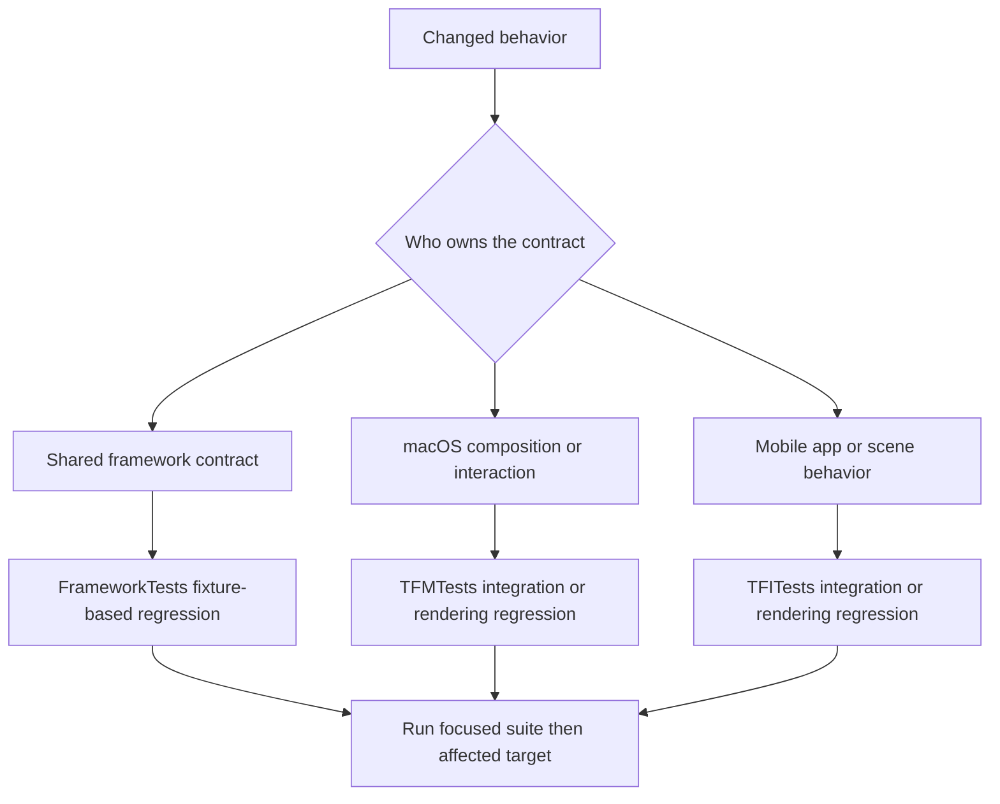
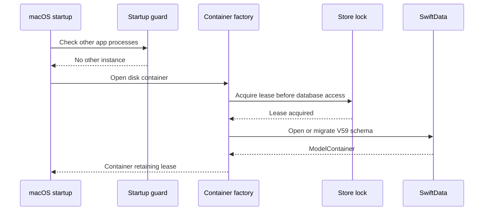
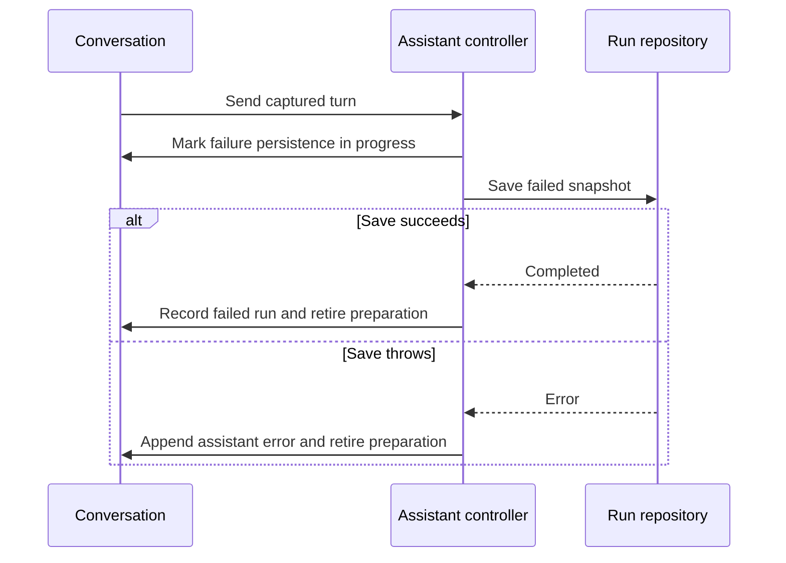
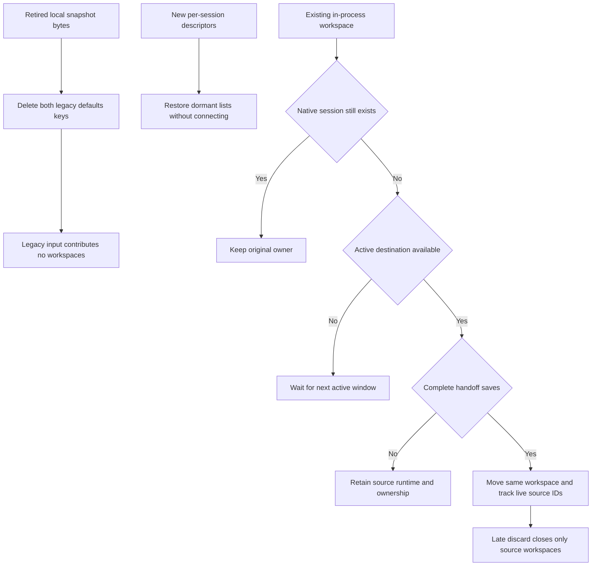
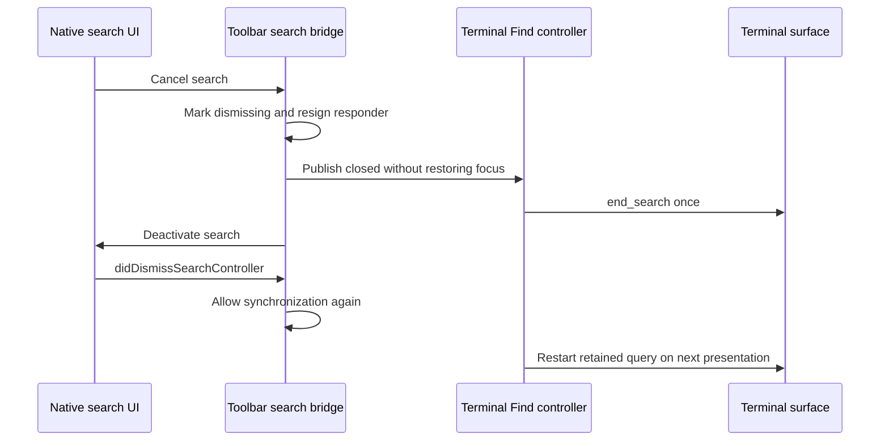

# Behavioral Boundaries and Test Fixtures

Termind uses Swift Testing to test a behavior at the layer that owns it, rather than treating the test tree as a second implementation. `FrameworkTests/` protects portable framework contracts; `TFMTests/` exercises macOS composition, native interaction, and remote-session behavior; `TFITests/` protects iPhone/iPad composition, scene behavior, and mobile presentation. The targets use `@Suite`, `@Test`, and `#expect`.

A useful regression test establishes an observable invariant at an integration seam: what is persisted and migrated, which credentials and prompts may cross a connection boundary, when a resource remains alive after a UI owner disappears, or which state is shared versus scene-local. Avoid testing private mechanics merely because they exist. Test real transports or windows only when the contract requires them; otherwise inject a small in-memory repository, secret store, responder, client, or actor-backed harness.



This flow selects the narrowest test target that owns the behavior, then expands validation only as the affected product surface requires.

## Behavioral boundaries: start with the prohibited side effect

For the highest-risk lifecycle changes, start with this task-to-test map; these fixtures are default tests unless explicitly marked opt-in.

| Task | First regression | Controlled boundary |
| --- | --- | --- |
| Change assistant cancellation or history edits | `AssistantExecutionControllerTests` | Hold memory preparation, truncation or save independently; assert stale edits never mutate history and cancellation joins admitted work. |
| Change preparation-failure persistence | `AssistantExecutionControllerTests`, `AssistantConversationOperationsTests` | Separate a save attempt from completion, preserve staging on failure, and keep archive/delete behind the save barrier. |
| Change lazy mobile restoration | `MobileTerminalRestorationTests`, `MobileWorkspaceSessionTests` | Load descriptors without connecting, retain cold ownership, and fail handoff without releasing sources. |
| Change close or Quit | `SessionPersistenceTests`, `WorkspaceCloseConfirmationTests` | Distinguish explicit best-effort remote cleanup from passive disconnect and theme/SFTP vetoes. |
| Change native presentation | Offscreen policy first, then `.requiresVisibleWindow` or `.requiresKeyWindow` cases | Native focus and UIKit presentation require deliberate opt-in; mobile runs must be narrow and nonparallel. |

| Boundary | Focused deterministic regression | What passing establishes |
| --- | --- | --- |
| Admission without aborting active work | `HostOperationAdmissionTests` | Expiry blocks a new directory read before raw I/O, does not disconnect an admitted upload, and renewed access permits reads again. |
| Discovery cancellation | `LocalNetworkLifecycleTests` | A replaced scan or dismissal cannot publish late SSH/Telnet results; permission denial, unavailable and failure remain distinct. Draft MAC lookup neither saves credentials nor auto-wakes. |
| PTY activation | `SSHPTYActivationTests` | Activation waits for client detection and synchronized resize; stale focus/input/client requests cannot activate an obsolete viewport. |
| Registered engines and backends | `ResumableTerminalEngineTests`, `RemoteMultiplexerTests` | Unknown registrations fail before bootstrap or remote commands; lifecycle coordination stays separate from protocol engines and multiplexer dialects. |
| Context tickets | `TerminalContextCoordinatorTests` | Displayed directory is not authority to execute: input, command lifecycle, context switches and capability loss invalidate operation tickets. |
| Sync compatibility | Cloud safety/lifecycle/persistence suites | Unsupported records remain fenced across retry and reopen while compatible peers progress; local checks do not establish live CloudKit delivery. |
| Native workspace restoration | `MobileTerminalRestorationTests`, `MobileWorkspaceSessionTests` | Retired keys stay retired, but the new descriptor store can restore dormant resumable/tmux lists without connecting or silently replacing a missing remote shell. |

Admission is checked at operation entry, not used as a retroactive cancellation signal. The controlled upload in [HostOperationAdmissionTests](../../FrameworkTests/HostOperationAdmissionTests.swift) stays held while entitlement becomes free; the rejected read must not reach the underlying channel. This is not a live SFTP throughput test.

<!-- openwiki: broken internal link [../workflows/local-network-discovery-and-wake.md] file "../workflows/local-network-discovery-and-wake.md" does not exist. Fix the href or restore the target, then delete this comment. -->
Discovery tests deliberately resume old continuations after a newer scan finishes and after cancellation. The physical-open tests cancel inside `beforeConnect` for SSH, Telnet, Mosh and Eternal Terminal, proving wake ordering and cancellation before dialing, not successful network discovery or delivery of a Wake-on-LAN packet. See [Local Network Discovery and Wake](../workflows/local-network-discovery-and-wake.md).

PTY activation is a separate boundary from connection success. `SSHPTYActivationTests` holds resize at `LIBSSH2_ERROR_EAGAIN`, queues a newer viewport, and only permits activation after both sizes drain. Failed resize cannot authorize activation against an unapplied size. Blur, input, detach and connection replacement invalidate outstanding requests; ordinary live grid changes do not schedule an activation exec for every resize. Identity tests reject malformed process fields, process groups, server PIDs and mismatched terminals. These are state-machine tests, not native focus or server-signal acceptance.

`ResumableTerminalEngineTests` injects a registered engine into the real coordinator/client. Recovery reuses it without replaying startup or route construction; suspension blocks new writes, drains the admitted write before checkpointing, and applies the latest deferred size on resume. Late engine events cannot reopen a suspended or closed lifecycle. Missing registration consumes facade secrets before wake/bootstrap, incompatible checkpoint envelopes never construct an engine, and failed start rolls back and closes once. `RemoteMultiplexerTests` independently requires registered dialect IDs to match advertised backends and unknown backend operations to execute zero commands. When extending transports or persistence backends, test both registration failure and shared lifecycle behavior rather than adding concrete protocol branches to Features.

## Suite ownership and seams

### Shared frameworks: durable rules and ports

Use `FrameworkTests` for behavior intended to remain identical across macOS and mobile: value/rule behavior, repository and persistence adapters, migration compatibility, settings synchronization, host-key policy, and presentation-independent controllers. These tests should normally run with deterministic in-memory state or a temporary directory and should not import an app target.

Persistence tests are compatibility tests, not just encode/decode checks. `PersistenceCompatibilityTests` opens historical fixture stores through `TermindPersistence.makeContainer`, verifies retained records, checks migration outcomes, and confirms independent in-memory containers expose the full shared schema. The seam is the public `@MainActor` container factory in Persistence: it configures the V59 schema with the migration plan and `cloudKitDatabase: .none`, taking either a disk URL or `inMemory: true` (not both). The platform entrypoint chooses the storage and retains the container; tests should create a fresh container for independent in-memory state and a temporary disk URL for reopen checks. When changing a SwiftData model, migration, or repository behavior, cover the old-store input and the post-migration contract; do not limit coverage to a newly created store.

There is no `FrameworkTests/Fixtures/README.md`, checked-in `V1.store`, `V14.store` or `V28.store`, or `Scripts/generate-v28-fixture.swift` in the current tree. Retire the former provenance/checksum claims: original app-module V1/V14 identity and installed V28 store compatibility are not established by absent assets. V28 remains a migration-plan endpoint, but that is not a frozen-store regression test.

Current migration tests construct temporary disk stores programmatically using historical `Schema(versionedSchema:)` and selected historical model types, save, release the old container, then open through the common factory. `PersistenceCompatibilityTests` covers V16 template defaults, V25 startup-snippet defaults, V26 environment defaults, V27 charset/protocol/Known Hosts retention, V30 host and safety defaults, V31-to-V34 device backfill and Identity metadata continuity, V35 importer removal and V41 collaboration sidecars. Do not call every case a reopen test: V31/V34 retired-journal inputs are verified twice and V35 native Device/account state is checked on two opens; several other cases assert only the first migrated open. The current-store group test separately saves and reopens. These establish constructed-schema compatibility, not independent shipped-binary provenance.

`MCPServerMetadataTests` adds a constructed V58 disk-store regression through the current factory: the historical server retains its identity and tool access policy, initially has no description, then saves a description and verifies it after reopening. Separate tests check rediscovery replaces or clears descriptions without resetting tool access policy and older synced payloads decode without the optional description. Do not assert a hard-coded latest version in unrelated tests; assert retained data after reopening, as required by `AGENTS.md`.

V29, V32 and V33 remain absent as migration endpoints. Frozen pre-color Snippet models preserve the V50 input shape; `SnippetColorTests` constructs V50 disk data, checks content, package/target relations and ordering through the current factory, saves color and reopens. A V41 migration retains its group with empty message-origin, conversation-origin and receipt sidecars; separate collaboration fixtures test monotonic receipts across contexts and creation relations after disk reopen.

On macOS, a separate `PersistentStoreLockTests` seam checks the **lifetime around** that factory, not merely successful SwiftData open. For a disk configuration `makeContainer` acquires an advisory lock on a stable `.lock` sibling **before** `ModelContainer` can open or migrate the store; a failed lease throws `PersistentStoreAccessError.inUse` without touching even a sentinel store or creating its WAL. A canonicalized URL (including symlink aliases) shares one process-local lease across simultaneously open containers; Objective-C association keeps it alive until the last container closes. The lock file stays on disk; closing the descriptor releases the kernel lock, including after forced termination. The tests hold and release real containers, use an independent Python `flock` process to simulate contention and forced exit, reopen to verify Vault host/key records, and check that other store URLs and in-memory containers do not contend. The desktop `DatabaseStartupGuardTests` exercises the separate compatibility guard: before opening a real store, the app refuses another running instance of its bundle even if that older instance does not acquire the new lock. These tests do not simulate a true crash during migration or guarantee that other platforms implement the macOS lock.



The two desktop startup checks precede database access; in-memory containers bypass the file lease.

Agent replay persistence demonstrates the same principle for durable runtime state: an in-memory `SwiftDataAgentRunRepository` must restore frozen context and tool result projection without duplicating replay backing across subsequent snapshots, and deletion must remove that backing. A fixture should deliberately model the timing boundary it protects—for example, recording a tool result before the following run snapshot—rather than requiring a live provider. Replay tests additionally verify that a queued cancellation adopts an edited staging turn with its authored text, images, attachments and frozen context in a fresh SwiftData context; a captured configuration failure adopts only after the failed snapshot saves. A synthetic V15 store reloads without inventing historical context or replay rows.

Two narrower replay fixtures protect result recovery and secret lifetime. `crashRecoveryUsesFrozenStructuredFallbackOnlyForMalformedEnvelopes` simulates a historical truncated structured envelope: recovery uses the frozen structured projection for malformed content but retains ordinary plain output, preserving result identity and error state. `secretResultPersistenceExpiresHandlesBeforeStructuralRedaction` checks that persisted `request_user_secret` output marks the handle expired and contains neither the `secret_handle` field nor its UUID. These are constructed recovery/writer checks, not a process-crash or live secret-service test.

Hardware-key compatibility belongs at both the shared and mobile seams. `WebAuthnVaultMetadataTests` uses a `NoKeychain` that throws on secret access: connection preparation resolves destination and jump security-key metadata without Keychain reads; an in-memory Vault save and V2 envelope round-trip apply into a **second** in-memory container, retaining external storage and editable verification preference. Legacy hardware storage decodes as external, while a software key cannot claim external storage. A throwing persistence port verifies failed upserts/deletes leave the prior key untouched; a synthetic V44 disk software-key store migrates through V45 to the current schema and reopens twice. These tests do not exercise a physical authenticator or CloudKit delivery. `MobileVaultFeatureTests` covers the actual mobile editor and app assembly: WebAuthn generation/import, invalid reference rejection, Keychain-independent metadata versus software-key private material and saved passphrases, host duplicate/group cleanup and forwarding edit behavior. Use its in-memory app fixtures for mobile editor semantics, the shared metadata suite for wire/schema/security invariants, and add a focused key-window regression if native editor interaction changes: `MobileHardwareKeyEditorRenderingTests` is no longer in the tree. Removing that fixture does not remove hardware-key support.

### Assistant history: compare live state, backing rows and restore

Start with `captureFreezesTurnContextAndConfigurationAcrossMemoryPreparation`: hold memory preparation, then mutate the pane, permission mode, planning state, skills and provider configuration. The submitted snapshot retains the original host/pane, plan contract, tool availability and skill catalog; cancellation persists the captured permission mode. `credentialAddedAfterCaptureDoesNotReviveTheTurn` separately ensures a late credential cannot rescue an already captured missing-credential turn. These are capture and cancellation contracts, not live-provider checks.

A message edit inside one run needs a fixture such as `opening → assistant/tool batch → steering → assistant/tool batch`, not just one user turn per run. The regression boundary spans several owners:

- `AgentPersistenceTests.sameRunTruncationPreservesThePrefixAndAtomicallyAdoptsTheReplacement` uses equal timestamps and deliberately reversed UUID order. It restores a compacted conversation through the production store and operations, then checks the retained prefix, neutral completed summary, title, attachments, replay rows, invocations/results/reviews and compaction bases. A legacy prefix invocation has no stored source ID and a later timestamp; its known call ownership must still preserve it and restore its source message ID. This fixture does not seed an unknown native-tool-like invocation at the cutoff; do not infer that coverage from the prefix case. Real running/completed snapshots must adopt staging once without changing historical owners, and late old snapshots/events must not regrow the suffix.
- `editingALaterRunOpeningKeepsAnEarlierEmptyRunBeforeTheReplacement` checks an earlier retained run with no messages and a replacement clock older than the retained run. Live and restored staging order must agree. Ordinary replay fixtures give genuinely later runs a later start time instead of relying on random UUID tie order.
- Shared `AgentReplayPersistenceTests` parameterizes the first real replacement snapshot as `.failed` or `.interrupted`. It checks the single surviving message/run/replay backing and reloads with a new `ModelContext` and repository over the same in-memory container to verify provenance, terminal state, failure and frozen context. This is fresh-context visibility, not a disk-relaunch test.
- `ChatComposerStateTests.editingSteeringKeepsCompactedSameRunPrefixAndLegacyToolOwnership` checks full visible-prefix retention even when model history is compacted, alongside tool cards, title, plans, compaction records/marks and run-summary chronology through `runStarted`/`runFinished`. Mobile's `swiftDataRestoreAndEditPreserveASameRunPrefixOnMobile` exercises the same repository/store/operations path and compares live and restored message ownership.

Application error and timing fixtures complement those real SwiftData checks. `AssistantConversationOperationsTests.invalidReplacementNeverCallsPersistence` rejects a non-user replacement without invoking truncation; `truncationFailureLeavesInMemoryHistoryUnchanged` throws from a rejecting repository and keeps both visible messages and transcript unchanged. In `AssistantExecutionControllerTests`, `manualCompactionIsRefusedWhileRunPreparationIsActive` holds the memory snapshot barrier and verifies no compaction activity starts; `editFailurePreservesHistoryButUsesTheSynchronouslyCapturedReplacement` checks that rejected truncation preserves history while the attempted replacement retains captured host and plan context. `cancellationAfterSuccessfulEditAdoptsTheInterruptedRunProvenance` holds memory preparation after the edit commits, then checks that the interrupted real run owns the replacement rather than its staging ID. These port-level failure seams do not inject disk-full or read-only failure into a real SwiftData transaction; its rollback path must not be described as fault-injection tested. The repository's truncation catch does call `context.rollback()`, restores its previous `deletedRunIDs` fence and rethrows. `AgentPersistenceTests.truncationRejectsAMessageOutsideThePersistedConversation` separately checks a real persisted-target rejection leaves the original message intact; it is not a failing-save test.

Use the boundary that the assertion needs as its wait condition. `beginFailedRunPersistence` constructs a failed snapshot and starts a repository-save task, but keeps preparation active and does **not** project `.failed` into the live conversation until `save` succeeds; on save failure it appends an error message instead. `missingModelFailureStaysOwnedUntilSaveAndAllCancellationPathsJoinIt` and `missingCredentialAfterMemoryPreparationProjectsOnlyAfterSaveCompletes` block the first save and verify stop, cancellation, and projection ordering. `credentialAddedAfterCaptureDoesNotReviveTheTurn` and `selectingAnotherConversationDoesNotCancelPreparation` check live `.failed` after preparation and additionally wait for the recording repository's failed snapshot. The fixture's `waitUntilSnapshot(state:)` checks existing snapshots or suspends an actor-owned continuation; `save` records the attempt before resuming matching waiters. A recorded attempt is **not** proof of a completed save: use `completedSnapshots` or the joined preparation where completion is the contract. This does not prove durability across the separate queued-runtime immediate-stop handoff.



The captured preparation-failure boundary is the repository save, not merely entry into the recording fixture's `save` method. The real SwiftData queued-cancellation fixture additionally asserts **zero provider calls**, one `.cancelled` real run, removal of the staging summary, captured payload restoration and `.fullAccess` persistence. Both queued cancellation and captured configuration failure check that the real run starts no earlier than staging, finishes no earlier than its start, and bounds the replacement's message clock. Wait on `stopAndWait()` before constructing the fresh repository; a live cancellation flag alone does not establish completed persistence.

`archiveAndDeleteWaitForCapturedFailurePersistence` additionally waits on the blocked save before mutating metadata or deleting the conversation. `capturedFailureSaveOutlivesReleasedControllerAndConversationHandles` releases both external references while the save is held, then checks completion before they deallocate. These tests protect ownership through the persistence handoff, not process-crash durability. The controller's `failedReplacementSaveCannotBeSupersededOrMutatedBeforeItCompletes` holds a failed-run save after truncation: edit/fork cannot bypass the pending preparation, and after release the failed real run takes the replacement's ownership. `failedSnapshotSaveRetiresPreparationWithoutAdoptingStaging` injects a save error at the repository port instead: the staging owner remains, no failed summary is adopted, an assistant error appears, and no save completes. When changing edit/cancel ordering, also run `invalidatedPreparedEditCannotEnterHistoryMutation` (both `cancelled` and `superseded` arguments), `cancellationDuringEditJoinsHistoryWorkBeforeRecordingInterruption`, and `supersededPreparationIgnoresAnOlderCancellationCompletion` to keep stale operations from mutating the new history.

### CloudKit compatibility: test prohibited uploads, not just decoding

The safety fixture substitutes only the CloudKit transport. It uses the production Vault, History/Device, Settings and Metrics coordinators, journals, record coding, synchronous batches and final record providers. The same cases run for all five record families (Vault, History, Device, Settings and Metrics):

- Receive a future-format record with a pending local edit and verify its original bytes and pending intent survive, while a compatible peer still reaches the outgoing batch.
- Feed already-queued saves and deletes through the batch seam; neither may bypass the record restriction. Physical deletion, tombstone re-observation and recreation races have separate cross-category coverage in `CloudSyncPhysicalDeletionTests`: keep handed-off incarnations distinct from newly created ones, avoid stale acknowledgements, and persist delete-handoff causality through a disk reopen.
- Return an unsupported `serverRecordChanged` record, then retry and pause/restart without removing the restriction.
- Compare fetched winners with older or same-version losing records: only a winning fetch clears the pending journal, engine queue and stale batch snapshot. Inject a pre-save failure to prove that data/journal mutation and quarantine removal roll back together.
- Distinguish malformed payloads from recognized newer formats in status hints. Ignore unknown record types on ordinary fetch, but validate a conflict returned for an attempted known record ID.

Disk-backed `CloudSyncSafetyPersistenceTests` separately create synthetic V30 and V39 stores and open them through the current V59 container, traversing V40 retirement of per-category quarantine tables. V30 retains an existing group and adds the scoped quarantine schema; V39 inserts retired per-category rows and a current scoped block, then checks group, scoped block and cloud-presence state after migration. It does **not** assert import of legacy quarantine payloads into scoped quarantine. The interrupted-fetch fixture runs all five record categories: it begins a fetch, receives an unsupported record and stops before `didFetchChanges`; a fresh disk container must still find the original quarantined bytes, recovery fence and pending journal intent. The blocked record stays out of outgoing entries while one compatible peer remains uploadable. Deletion-handoff sidecars are also reopened. The five-category journal test checks that identical upload acknowledgements and system-field updates do not dirty SwiftData, but actual state transitions do; redundant writes should not be mistaken for progress. Scope tests vary container, environment, account, zone and owner independently.

`CloudSyncLifecycleTests` is a separate deterministic **port-level** fixture, not a disk store or live CloudKit test. Its `LifecycleFixture` wires `CloudSyncLifecycle` to an in-memory journal, fake `CloudSyncTransport`/`CloudSyncEngineSession`, injectable save/lookup failures and continuation gates. `start` first commits a recovery fence, checks account and zone, creates the engine, reconciles pending mutations, then completes a fetch before authorizing sends; a failed first fetch retains the fence, and retry on the same engine only sends after a successful fetch. Overlapping explicit fetch/send transitions retain recovery until both finish; automatic fetch-failure callbacks likewise keep uploads closed. Retirement invalidates late operations and delegate callbacks; failed persistence or lookup must not turn into an authorized upload. The suite additionally verifies detached fetch/send and cancellation do not inherit the CloudKit delegate task-local context, a shared 250-item limit across saves and deletes, refusal of unjournaled deletes, and no quota consumption by invalid pending changes. These are controllable contract checks, not evidence of delivery by iCloud. For zone purge or encrypted-data reset, start with `CloudSyncPhysicalDeletionTests.destructiveZoneReasonsPurgeOnlyTheActiveReplicaAndCannotResendOldSnapshot`: it checks active-scope projection/safety cleanup and no resend while preserving another account's fence. `assetPurgeFailureRetiresSyncAfterDurableProjectionPurge` covers the failed-cleanup boundary.

Connection-history coverage adds a V31-to-V34 disk migration, History native-field/merge/tombstone tests, event start/end lifetime checks, stable local-device filtering and deterministic retention of 250 stored events. Migration and sync tests also verify the independent generic device directory: old events receive the installation ID, a separate `DeviceRecord` is created, and changing that record's name updates resolution without rewriting events. Desktop tests distinguish local Welcome Recents from the 100-row all-device sidebar projection. Mobile tests distinguish local per-Host Recents and host-only quick actions from the 50-event Vault History page, including preferred SSH/Telnet activation, disabled protocol actions and device-name search. The former multilingual card screenshot fixture is absent; these model tests do not establish localized rendering. Serial remains outside the connection-history enum and mobile workspace routes. `MobileConnectionPickerTests` is serialized. Picker model, latest-five local-host deduplication, protocol availability, disabled historical events, 50-event page and Telnet workspace assertions do not make a key window. The multi-host picker navigation test explicitly gates on `TERMIND_MOBILE_UI_TESTS`; the toolbar navigation tests also create a key window through `withNavigation` but currently have no such test condition, so do not assume the whole suite is skipped by default. Test notification-preference behavior independently in `NotificationPreferencesTests`: a held authorization request is made only once across concurrent scenes and reactivation, disabled or bell-only preferences avoid the initial system authorization request, and failed preference load must not request permission using defaults. Its in-memory Settings sync fixtures check notification-record round-trip, remote update without echo, stale-version rejection and tombstone reset; a synthetic V40 store upgraded through V41 reopens with new notification preferences while retaining prior workspace preferences. These do not request production notification permission or test CloudKit delivery.

The same direct V31-to-V34 fixture verifies that removing Identity usage metadata preserves Identity configuration and its independent Vault journal modification date, and that workspace preferences bootstrap with defaults. The V35 store fixture confirms retired importer removal and native History/Device continuity on repeated open. V32 and V33 are not distributed migration endpoints.

These tests do not prove unknown-field round trips through an actual historical binary, Production schema deployment, or signed-device delivery. Keep those checks in [CloudKit Release Readiness](../operations/cloudkit-release-readiness.md); a fake transport passing is not evidence that iCloud has delivered a record.

### macOS: composition, security, and resource lifetime

`TFMTests` owns desktop composition and native interaction seams. `ArchitectureBoundaryTests` is an executable source-boundary check, not a compiler-enforced dependency graph. Its restrictions are **per module**: Domain excludes platform UI, storage, networking, security and commerce imports; `TermindApplication` excludes implementation-framework imports, SwiftData and concrete I/O construction; macOS `Features` excludes persistence/transport imports and concrete constructors. Mobile `Application` excludes UI, SwiftData, GRDB and Persistence; mobile `UI` excludes Persistence and RemoteInfrastructure; mobile `Features` excludes concrete I/O construction. Shared frameworks cannot import app targets or platform-only APIs, `TermindPersistence` cannot import infrastructure, and `TermindPresentation` stays clear of platform, storage, StoreKit and implementation imports. Apply the corresponding rule when adding a module or relocating code, rather than assuming one blanket prohibition applies everywhere.

The suite also keeps backend-neutral session policy free of concrete multiplexer services, registries, commands, runtime implementations and tmux/zellij/zmx/herdr dialects in Domain, Application, Presentation and platform Features; `SSHPTYChannel` must retain `StartupPreparation` instead of constructing a multiplexer service. It checks resumable engine registration too: neither `SSHPTYChannel` nor `ResumableTerminalClient` may depend directly on Mosh/Eternal engine or vendor-session implementations. It prohibits `TailscaleKit`/`CTailscale` imports in Domain, Application, Presentation and Persistence. The suite also keeps `StoreKit` out of the Infrastructure commerce adapter, confines Firebase SDK imports to Infrastructure, and checks production plists start with diagnostics collection disabled. Its targeted source checks keep forwarding/authentication ownership out of broad UI/app layers and require additional-connection owners to retain reference-only snapshots rather than full connection configurations. It additionally scans for `@Model` outside Persistence and uses the SwiftSyntax-backed `Scripts/swiftdata-repository-declarations.sh` parser to reject **declarations** of `SwiftData*Repository` elsewhere without mistaking references, strings or comments for ownership violations. It checks app-local `AppStrings` redeclarations and a bounded list of AgentKit-owned type names, limits `ListViewKit` imports to approved native-list workloads, and keeps the forwarding benchmark independent of the app/test target. It scans CloudKit delegate files for lifecycle batch/provider/quarantine/conflict calls, and checks that `CloudSyncLifecycle` keeps its 250-record boundary without SwiftData or Persistence imports. These are source-level guardrails (mostly literal import/token checks), not proof of runtime behavior: run the CloudKit safety and lifecycle fixtures for blocked uploads and recovery. Run this suite when moving code, changing dependencies or persistence ownership, or crossing AgentKit and CloudKit boundaries.

Security-sensitive tests should make the boundary explicit with a memory secret store and an authentication responder, never production secrets. `AgentHostAuthenticationTests` verifies that one-use credentials can configure an SSH/SFTP attempt without mutating the Vault unless saving was requested; it also covers route-order prompting for a jump host and destination, prompt/connection coalescing for concurrent work, cancellation before SFTP opens, rejected-credential retry, and stale authentication generations. These are safety contracts: a future refactor must not persist an ephemeral secret, merge unrelated challenges, or let an old callback erase newer authentication state.

`RemoteSessionAuthenticationContinuationTests` covers shared SSH/proxy continuation ordering: credentials stage before the model’s save policy, failed saves never connect, proxy submissions use the entered trimmed username, and disconnect clears one-use maps. `RemoteSessionConnectionControllerTests` holds retry sleep to check teardown before journey/retry, cancellation on disconnect, route → library → temporary-destination host lookup, and rejection of progress from replaced or cleared attempts. These deterministic tests do not open real connections.

The complementary shared `SSHInteractionPolicyTests` covers noninteractive follow-on connections. An `SSHAdditionalConnectionSnapshot` retains route and authentication references rather than credential material, and an interaction-forbidden request must not surface host-key or keyboard-interactive UI. Protected-key credentials become an interaction-required marker while a password fallback remains usable; runtime `SSHSecret` values are consumable once and clearing a copied connection configuration invalidates every credential copy.

SFTP transfer tests use a controlled `TransferChannelHarness`, a `TransferChannelClient`, and temporary files instead of a real server. They establish lifecycle and scheduling behavior that is easy to regress in UI work:

- Closing a desktop pane releases its UI ownership but lets queued transfers retain the authenticated connection until work completes; cancellation releases the final connection.
- A silent independent connection is donated when available. If it requires interaction, upload falls back to the PTY connection; it must not fall back after cancellation or a retired generation.
- Scheduler capacity remains bounded across contexts for the same host. Fallback from extra connections to sibling channels does not increase capacity, and a PTY fallback does not retry independent connections for large files.
- Additional connections use the forbidden interaction policy, so detached/background work cannot open an authentication prompt.

Those tests are intentionally actor-driven and use polling only to wait for observable harness state. Prefer this style for races: hold the transfer at a known point, make the ownership transition, then release it and assert the terminal state and disconnect count.

### Tool presentation: projection authority is not remote metadata

For tool-card changes use `AgentToolPresentationTests`: the registered tool's argument projection appears in approval detail (including submitted command/input, not a claimed secret-redaction guarantee), while unknown tools get generic fields. Check the composed AgentKit-plus-Termind presenter ID catalog for collisions, restored cards for presenter-ID-directed detail and cards without presenter IDs for generic fallback (not equivalent detail), and old descriptor metadata for safe defaults before relying on a new presentation field. Batch and long-output fixtures cover mixed lifecycle states, Unicode preview bounds and full-copy content; avoid replacing structured detail with an untested JSON string.

Use the following focused assertions rather than treating “tool presentation” as one security or visual guarantee:

| Changed contract | Focused regression and asserted boundary |
| --- | --- |
| Trusted MCP projection versus remote-selected code | `AgentToolPresentationProfileTests.explicitMCPPresenterIsUsedButRemoteMetadataCannotSelectLocalCode` gives an MCP descriptor the SSH built-in ID and expects registry lookup to return `nil`. An explicitly supplied presenter still renders `Projected: 42` with its compact layout; without it the same payload renders generic `Value: 42`. Rejecting metadata-selected local code does **not** mean rejecting a trusted presenter passed by the caller. |
| Profile identity and extension hooks | `registeredProfileFollowsItsIDNotTheToolName` keeps “Connecting” for a renamed tool with the registered SSH ID, but an unknown ID or missing presentation yields generic summaries and no pending detail. `injectedProfileControlsPhasesPendingDetailsApprovalAndTruncation` separately checks injected phase text, pending content, hidden result detail, required argument projection and hidden truncation notices; the unconfigured renderer behaves differently. |
| Privacy when projection is unavailable | `missingChatApprovalPresenterNeverFallsBackToPromptOrMessageFields` expects empty approval items for local create/send chat without a presenter. `chatFallbacksNeverExposeMalformedErrorOrUnprojectedBodies` expects “Chat details unavailable” for malformed output, error output and a missing presenter. `chatCompactPreviewAndFullCopyContainOnlyProjectedBoundedFields` excludes message bodies and creator titles/IDs from both preview and full copy, while retaining the last projected chat in full copy. These are chat-specific suppression assertions, not a general redaction promise. |
| Knowledge summaries and approval content | `AgentKnowledgeToolPresentationTests` repairs old memory semantics across nine states in English and both Chinese variants, checks mode-specific actions and mixed read/write failures, rejects unknown/remote presenter selection, and prevents failed install results from drawing success messages. Its approval fixture keeps the body out of the title but includes the complete 1,000-line content in detail; title shortening leaves the original query unchanged. |
| Shared preview/state versus native detail layout | Knowledge tests preserve `fullItems`/full text while sharing the compact budget across blocks and five rows across lists. Detail expansion is independent of tool expansion, survives reconfiguration and is removed when its timeline ID is pruned. `TranscriptListViewBridgeTests.compactToolExpansionKeepsBothButtonTitlesLeftAligned` in `TranscriptListViewTests.swift` checks native “Show more” and “Show less” at widths 360 and 900, left alignment, the truncation notice before the button, and the final collapsed detail state. These are separate model and offscreen AppKit assertions, not cross-platform screenshot equivalence. |

The application composes profiles in [TermindToolPresentationProfiles](../../Frameworks/TermindPresentation/TermindToolPresentationProfiles.swift): MCP descriptors receive an empty profile; ordinary semantic selection uses `presenterID`. Local pane/chat privacy is deliberately selected independently of presenter availability, so do not remove that exception while eliminating tool-name-based semantic recovery. Approval visibility is a separate contract: the general fallback fixture explicitly displays `Password: hunter2`, and SSH approval displays the submitted command. The SSH control-result fixture instead excludes secret input and its opaque handle while retaining the command ID and formatted byte count.

Start with these non-window projection suites:

```sh
xcodebuild -project Termind.xcodeproj -scheme TFM -destination 'platform=macOS' -onlyUsePackageVersionsFromResolvedFile test \
  -only-testing:TFMTests/AgentToolPresentationTests \
  -only-testing:TFMTests/AgentToolPresentationProfileTests \
  -only-testing:TFMTests/AgentKnowledgeToolPresentationTests
```

For native expansion changes, additionally select the containing native-row suite in `TranscriptListViewTests.swift`; keep offscreen checks enabled normally. Tests that actually show windows or activate the app must retain `.requiresVisibleWindow` and require `TEST_RUNNER_TERMIND_WINDOW_TESTS=1` (host `TERMIND_WINDOW_TESTS=1`), with a narrow `-only-testing:TFMTests/<Suite>` filter. A default green run with gated cases skipped is not visible-window validation. See [UI Design Principles](../concepts/ui-design-principles.md) for rendering responsibilities and [Build, Test, and Release](../operations/build-test-and-release.md) for broader validation.


For Ghostty menu changes, `TFMTests/TerminalContextMenuTests.swift` checks AppKit blank-space and selection menus, Paste on Right Click/Option behavior, live upload availability and late pane teardown. `MobileTerminalUploadMenuTests` has been removed; do not claim current mobile editing/Upload/AutoFill ordering coverage from it. Add a focused regression for that contract when changing the mobile hooks; test removal alone is not evidence that the production menu behavior was removed.

Package gesture/selection validation remains a separate **upstream-package step**, not locally inspected or executed coverage here. Ghostty comes directly from `Lakr233/libghostty-spm`; there is no local maintenance submodule to initialize. Inspect the selected package's source/tests for direct-touch, indirect-pointer and dispatch behavior rather than assuming the removed fork's paths. Termind owns grouping/localization through separate `touchMenuItems(for:)` / `touchSelectionMenuItems(for:)` overrides; app composition tests do not establish package internals. See [Ghostty Terminal Integration](../concepts/ghostty-terminal-integration.md) and [Build, Test, and Release](../operations/build-test-and-release.md#ghostty-direct-upstream-dependency).

For MCP upload changes use `MCPUploadTests` with the real coordinator and streaming operation, a fake SFTP client and controlled clock. Protect ticket/run scope and capacity, acknowledged-offset resume and full digest, bounded streaming/backpressure, timeout/cancellation and cleanup residue, revocation on disable, conflict policy and queryable terminal status. `actualHTTPRouteStreamsAboveTheMCPBodyLimit` additionally runs a loopback HTTP server for fresh and resumed bodies larger than the ordinary MCP limit; a passing fake SFTP upload does not establish interoperability with a real remote server.

### Remote session persistence and terminal-context boundaries

`SessionPersistenceTests` separates backend-neutral policy from tmux mechanics. New Host and Tailscale preferences default to disabled persistence; wire tests reject lossy older-format writes, and a V52 disk fixture opens twice through the current factory. Plain-shell policy never probes. Managed creation runs an explicit startup command once; restoring an attachment does not replay it. Manual attachment does not acquire managed ownership, stale choices are ignored, and missing/ended/unsupported references require a choice rather than silently creating a replacement. Explicit close queues only managed references without waiting for cleanup; application termination, suspension, remote exit and detach enqueue no termination. `closeFailureIsBestEffortAndDoesNotRetry` asserts one attempt and an idle coordinator after failure. Batch cleanup deduplicates owned identities and continues after one failure; cancellation before background work starts opens no connections, and timeout cancels cleanup without retrying. These fixtures establish best-effort cleanup, not a remote-close veto on local UI dismissal.

`TerminalContextCoordinatorTests` protects active-context identity independently of the pane that emitted an event, generation/input/capability ticket invalidation, replay suppression, and sequence-gap refusal to complete commands. Independent panes retain distinct completion events; a command between polls invalidates a draft ticket even if the prompt appears unchanged. A backend-neutral adapter fixture also rejects an older context sequence. Pair these tests with [Shell Integration](../concepts/shell-integration.md) changes rather than relying only on terminal output snapshots.

For controlled wire acceptance, [ssh-tmux-session-fixture.py](../../Scripts/ssh-tmux-session-fixture.py) creates disposable Debian/OpenSSH in a running Lima VM with nerdctl, a loopback-published port, ephemeral key and pinned fingerprint metadata; it never mounts the user's SSH configuration. Run separate `--max-sessions 1` refusal/degradation and `--max-sessions 8` runtime-context passes. `RemoteSessionWireTests` and `TerminalContextRuntimeTests` are serialized and gated by host `TERMIND_TMUX_FIXTURE` (the script documents `TEST_RUNNER_TERMIND_TMUX_FIXTURE`). Wire assertions cover multi-client attach, resize, detach/reconnect, one-shot startup and refusal to terminate an unowned attachment. These opt-ins require real local infrastructure and are not ordinary unit tests or arbitrary-server proof.

[ssh-authentication-fixture.py](../../Scripts/ssh-authentication-fixture.py) instead uses `paramiko==4.0.0`, loopback sockets, in-memory keys and per-connection in-memory SFTP files; it never executes submitted client commands and removes metadata on exit. Supply its metadata through `TEST_RUNNER_TERMIND_SSH_FIXTURE` for the gated SSH authentication/forwarding suites. Do not substitute it for the tmux fixture: simulated authentication and real remote shell execution establish different contracts. See [SSH Session Lifecycle](../workflows/ssh-session-lifecycle.md).

### Evidence tiers: do not exchange one proof for another

| Tier | What a passing test establishes | What it does not establish |
| --- | --- | --- |
| Deterministic policy/port fixtures | Admission, cancellation, generation fencing, registry selection and controlled ordering | Real transport interoperability or UI focus |
| Temporary disk migration/reopen | Retained data across the explicitly asserted opens | Historical shipped-binary provenance or crash-during-migration recovery |
| SSH fixture integration | Local wire behavior against the chosen Python peer or disposable OpenSSH/multiplexer environment | Arbitrary-server compatibility |
| Offscreen rendering/menu construction | Projection, layout and action composition without taking focus | Native presentation/responder lifecycle |
| Visible macOS window | Deliberately gated native focus/window interaction | Production shutdown or live cloud delivery |
| Mobile key window | Deliberately serialized UIKit presentation integration | Real SSH or OS process relaunch |
| Live services | Separately arranged CloudKit or RevenueCat/App Store Sandbox validation | Nothing is implied by a skipped local opt-in |

The Lima fixture also supports activation acceptance: run `TerminalActivationWireTests` with `--max-sessions 8` against both `--debian-release bookworm` and `trixie`; `TerminalActivationWindowTests` additionally requires the macOS window opt-in. Supplying `--multiplexer-binaries` with Linux `zellij`, `zmx` and `herdr` enables the separately documented `TERMIND_MULTIPLEXER_FIXTURE` runtime/smoke suites. These are real container-shell checks, unlike `RemoteMultiplexerTests`' controlled command executor.

### Host artwork, forwarding persistence and managed networks

Use `RemoteSystemInfoTests` to distinguish unavailable Linux metadata from a resolved non-Linux host, and `HostIconTests` for Darwin detection, manual override precedence without corrupting detected facts, automatic fallback to the latest probe, unknown-ID retention and no reconnect on artwork edits. `MobileWorkspaceSessionTests.artworkRefreshesForOpenWorkspacesWithoutReconnecting` checks the same live workspace survives local override and remote Vault changes.

`SSHAgentForwardingPersistenceTests` opens a V43 disk Host with forwarding disabled, enables forwarding and reopens, retains the startup-snippet reference, and rejects writing enabled forwarding as Host V1. Use it alongside authentication and mobile scene interaction tests, not as proof of live signing. `TailscaleSyncSafetyTests`, `TailscaleHostIdentityTests` and `TailscaleProfileCleanupTests` remain the focused managed-identity, sync-exclusion and durable-cleanup seams; `MobileAppTests.memoryCompositionCannotStartOrEraseLiveTailscaleProfiles` additionally protects isolation of in-memory app composition.

### Mobile: app state, scenes, and device-local retirement

`TFITests` owns `MobileAppModel` composition and mobile scene behavior. Mobile app tests build `MobileAppModel(inMemory: true)` or supply dependency seams, which permits assertions over the actual shared schema and repositories without using the user's database or Keychain. Representative tests verify that scenes share durable conversations while navigation, selected conversation, and composer drafts stay scene-local; shared SwiftData history is observable from fresh repositories over the same container.

`MobileAppTests.startupUsesTheSharedSchemaAndEmptyRepository` checks in-memory startup against the shared schema and feature registry. There is no current V28 startup/relaunch test or bundled V28 fixture to cite; disk migration/reopen assertions belong to the programmatically constructed persistence tests described above.

External connection URLs are another ownership boundary: opening one creates an ephemeral workspace and does not create a Vault host or saved workspace descriptor. Conversely, closing all workspaces disconnects each live workspace and is repeatable. Background-expiration tests provide a controlled connection service and cover resume intent, foreground recovery, and rejection of retired callbacks. A lifecycle change must preserve the appropriate one of these contracts rather than merely asserting that a view updates.

`MobileWorkspaceStoreTests` now protects **retirement**, not a restoration codec. `MobileWorkspaceStore.retire(in:)` removes `mobile.workspaces.v1` and `mobile.recentlyClosed.v2` without decoding or migrating them into another cache. Parameterized assertions cover broken bytes, an empty legacy array and a v2 object, repeat retirement, and preserve an unrelated `connection-history` value. At the app boundary, `MobileWorkspaceSessionTests` asserts that legacy array/v1 inputs disappear and both newly bound scenes remain empty, with no connection-history events. Despite its historical name, `oldSnapshotsAreClaimedOnceWithIdentityAndOrderPreserved` asserts deletion and empty state, not identity-preserving restoration.

The retired snapshots remain **separate from the new native restoration channel**. `MobileWorkspaceStore` now reads/writes versioned per-session descriptors under `mobile.restorableWorkspaces.v1`; invalid or unknown input disables saves on that store instance so the original bytes are not overwritten. `MobileTerminalRestorationTests` restores dormant Mosh, Eternal Terminal and tmux descriptors in their original session lists with zero live workspaces or connection calls. Missing host discovery leaves the descriptor intact. `coldLaunchKeepsRecordsWhenOldNativeWindowIsDiscarded` now covers SSH, SFTP, Telnet, Mosh and Eternal Terminal descriptors: cold records survive an old native-window discard before or after handoff, remain dormant until activation, and persist under the receiving session. Existing native owners keep their records until binding and explicit close; orphaned cold windows transfer as one complete snapshot and ignore late discard callbacks. This is distinct from deleting the retired legacy inputs.

Opening a restored resumable descriptor requires its compatible transport checkpoint. Missing or incompatible checkpoints show recovery failure and repeated selection/retry cannot bootstrap a new shell. A saved tmux reference survives missing transport state and returns to explicit session selection with no pending initial command. An activity recovery fixture checks one connection with the saved username, no target SSH credentials/jumps, no startup writes, and consumed recovery state. This is in-process reconstruction with an injected recovery store and connection services, not OS relaunch or live Mosh/Eternal interoperability. Activity URLs still omit opaque references and reject extra command parameters, while the content budget preserves whole entries and prioritizes the focused reference.

In-process ownership is deliberately different. `reconcileWorkspaceSessions(openSessionIDs:activeSessionID:)` only hands off a missing native session's live workspaces after the native open-session set establishes its absence. Tests compare object identity and unchanged connection history: the destination receives the same workspace without reconnecting. If both native sessions still exist, a disconnected view retains ownership; if no active destination exists, handoff waits. The complete descriptor handoff must save before any source releases its runtime. `failedHandoffKeepsTheSourceRuntimeAndOwnership` supplies unreadable restoration bytes: saving is fenced, both source objects and owners remain unchanged, the destination stays empty, and the app reports an error without overwriting the bytes. For windows used in this process, `recoveredWorkspaceIDs` tracks provenance so a **late discard** removes only the disappearing window's transferred workspaces, records that window as recently closed, and prevents the discarded session from opening more workspaces. Unbound cold-restored sources deliberately do not acquire this late-discard authority.

`unopenedManagedReferenceIsPreservedOnlyForPassiveWindowClose` separately compares discarding a window with explicitly closing a dormant managed workspace. Only passive window discard retains the remote reference in the reopen record; explicit close queues cleanup and strips that reference. The test removes retained in-process state before reconstruction, then verifies no pending initial command. `endedLiveSessionDoesNotResurrectItsDescriptorReference` prevents an ended attachment from leaking back through its old descriptor.

Recently closed state is shared within one app process, not persisted for a new app. Tests cover grouped-window reopen, once-only consumption, failed new-window requests preserving remaining records, a 15-entry limit, fresh workspace/history objects on reopen, external connections remaining transient, and no replay of one-shot commands. Native close requests retain workspaces until the discard callback: rejected closes keep the same workspace and selection without an alert; a missing native session reports `sessionNotFound` without discarding work, and Close All snapshots the native session set while retaining rejected windows.



Retired disk snapshots do not restore native scenes; the new descriptor/checkpoint channel is tested separately. Live in-process handoff preserves object identity and late-discard provenance.

`MobileWorkspaceSessionTests` isolates scene-session routing with an injected app fixture: assistant notification targets prefer a matching active scene and otherwise keep a hidden owning scene rather than hijacking another scene's selection; transfer clicks wait for scene activation and are consumed once. Additional router cases check that newer assistant clicks win and that stale activation-failure callbacks cannot reset a newer request. A matching owner can be activated without displaying its conversation prematurely; these are routing/model checks, not UIKit presentation assertions. Use these model/router tests for navigation ownership before reaching for a key-window test. `MobileBackgroundControllerTests` replaces UIKit's background-task platform to drive expiration synchronously. The tests check stale/repeated callbacks end each lease at most once, reentrant expiration during `begin` retires the returned old identifier without overwriting a newly begun lease, and an invalid identifier expires once without an `end` call. Use these for lease mechanics; `MobileAppTests` covers foreground recovery and retired workspace callbacks at the app boundary.

`MobileCardTests` exercises offscreen card/model policy: bounded tag display, row-confirmation selection isolation, disconnected/busy connection indicators, saved-host timestamps, and host/identity/key draft-color persistence through an in-memory app. It does not currently assert brand contrast, adaptive column thresholds or measured stable card heights, and has no optional snippet export path. `MobileCardRenderingTests` is absent from the current tree; `TERMIND_CARD_SCREENSHOTS` is not a runnable route to that removed fixture. Use the current marketing capture workflow for marketing assets, and add a focused presentation regression when card visuals change rather than treating model tests as visual validation.

### Terminal Find and mobile search: cancellation is a lifecycle contract

For desktop Find routing, start with `WindowToolbarFindTests`: it exercises `WindowModel` without presenting a native window. Vault destinations resolve their own Find target, Welcome requests its content search instead of adding a titlebar field, and terminal-theme light/dark/custom queries remain independent across settings navigation. This policy coverage complements, rather than replaces, native focus tests.

Start with always-on `FrameworkTests/TerminalFindControllerTests.swift`. It injects binding-action and focus closures rather than Ghostty or UIKit. The retained-query test checks the actual search/navigation/end action sequence and one focus return across dismiss/reopen. Empty-query navigation opens Find without issuing a navigation action. The shared native-dismissal regression calls `dismiss(restoringFocus: false)` twice: Find closes, emits exactly one `end_search`, and never requests terminal focus. Reopening restarts the retained query; a later ordinary dismissal returns focus once. This protects idempotence and responder ownership, not just fixture values. Resize tests suspend engine search while retaining UI state, edit the query during suspension, resume only the latest query and ensure closing during resize cannot reopen search. The controller also guards navigation while suspended; the current resize tests do not explicitly invoke navigation during that interval.

The production seam is `TerminalFindController`: it retains query independently of presentation, restarts a nonempty query on a closed-to-open transition, and ignores dismissal when already closed. `MobileWorkspaceSearchModifier` binds SSH/Mosh/Eternal Terminal/Telnet search to that controller and translates native closure into `dismiss(restoringFocus: false)`; SFTP binds directly to `sftpChannel.query` instead. The workspace supplies Ghostty binding execution and terminal focus through closures.

UIKit's `MobileToolbarSearchController` owns one `UISearchController`. Configuration defers synchronization out of the SwiftUI update; during dismissal it blocks presentation synchronization and text/submission callbacks until `didDismissSearchController`. Cancel resigns the search responder and publishes closed presentation before deactivation. This prevents a SwiftUI update from reopening the integrated toolbar mid-dismissal or erasing the retained query. Keep that lifecycle boundary intact rather than replacing search controllers to reset them.



Native dismissal owns the responder transition; shared Find ends search without competing for terminal focus.

Run the separately **serialized, opt-in** `MobileTerminalSearchIntegrationTests` (declared in `TFITests/MobileTerminalSearchTests.swift`) only for the UIKit seam:

- SSH Find is opened and closed three times for native Cancel, programmatic dismissal, and terminal-focus-then-native Cancel. Assertions check active state, first responder, retained text and model presentation; clearing text must leave Find presented before re-entering the query.
- SFTP filtering closes and reopens three times with its retained filter. Clearing the filter must not deactivate search, and cancellation must release the responder without clearing `sftpChannel.query`.
- SSH and SFTP journey begin/hide transitions keep the **same** search controller, active text while the journey appears, and closed state after cancellation. SSH additionally retains the same attached terminal view and can reopen Find with its query after the journey hides.

Full-root cases additionally leave SSH or SFTP search for Vault, update the hidden workspace query, resize and return: the retained workspace search must remain closed while Vault navigation stays available. An explicit compact-to-regular case checks sidebar and tab-bar availability after leaving workspace search.

Its fixture uses an in-memory app, a standalone workspace and a key `UIWindow`, mounts the production search modifier and SSH terminal surface (or `MobileRootView` for navigation cases), restores the prior key window and disconnects on teardown. The journey fixture simulates its overlay and uses a text projection for SFTP, not the full file browser. A separate full-`MobileWorkspaceView` SSH fixture repeatedly reopens Find with empty, matching and missing queries and checks native surface, output and upload generation retention. Cancel is invoked through the search-bar delegate and UIKit settling uses timed waits. These are native presentation regressions, not real SSH/SFTP connection or physical button-tap tests.

`MobileWorkspaceMenuTests` is no longer checked in. Its former native-menu assertions are not current coverage, nor does their removal establish removal of workspace ordering, unread indicators or lifecycle actions. Use scene/model tests for ownership and add a narrowly gated native-menu test when changing presentation. See [Mobile UI](../architecture/mobile-ui.md) for presentation ownership and [Engineering Invariants](../architecture/engineering-invariants.md) for safe-change rules.

### Native Metrics connection journey: distinguish policy from presentation

For a keyboard-interactive Metrics change, run the shared `FrameworkTests/MetricsJourneyTests.swift` and `MetricsKeyboardInteractiveTests.swift` for connection/prompt ownership before spending a native window run. `TFITests/MobileMetricsJourneyTests.swift` instead mounts the real `MobileRootView` and Metrics detail in a **key** `UIWindow`, using an injected actor `MetricsSampling` implementation to issue a two-field PAM-style challenge without opening SSH. It checks that the prompt stays in Metrics across detail navigation and compact/regular widths, does not become a segmented control or a separately presented controller, retains its challenge through navigation, survives accessibility text, and on field submission returns to live Metrics with exactly one connect and the submitted answers. It captures English and both Chinese locales at multiple widths and large type into attachments and a temporary directory. The corresponding macOS `MetricsJourneyRenderingTests` is explicitly `.requiresVisibleWindow` and checks the local Metrics route versus external authentication, detail resizing and Escape cancellation in a key `NSWindow`.

The mobile Metrics suite is `.serialized` and **key-window-gated** through `.requiresKeyWindow`. First use deterministic shared tests, then explicitly run `TFITests/MobileMetricsJourneyTests` with `TEST_RUNNER_TERMIND_MOBILE_UI_TESTS=1`, an available simulator and parallel testing disabled. Without `TERMIND_MOBILE_UI_TESTS=1` in the host these cases are skipped; default green results do not establish native presentation. `MobileConnectionJourneyRenderingTests` is no longer present; its former `TERMIND_JOURNEY_SCREENSHOTS` gate is not current test coverage. These native tests validate presentation and injected challenge handoff, not real SSH/CloudKit delivery.

### Mobile settings ports: prove propagation and rollback without a cloud engine

`MobileSettingsPortTests` constructs `MobileAppModel(inMemory: true)` and tests that changing shared SFTP preferences updates transfer limits and strategy immediately—even without opening Settings—and that an applied remote snapshot updates the same coordinator. The small direct `SFTPTransferCoordinator` test verifies invalid limits clamp to usable values. The test app's active scene must not start Vault, History, Device or Settings cloud engines. For provider editing, injected `AISecretStoring` and `AIConfigurationPersisting` failures show that a failed secret write leaves the draft and avoids metadata persistence, and a metadata failure restores the previous secret. A concurrent model refresh survives editing, remote deletion cannot be resurrected by an open draft, and controlled discovery ignores a late response after cancellation or provider deletion. Run these ordinary, no-key-window tests before any settings UI rendering suite.

### Context accounting: compare an incremental projection with its reference

Run `AgentTokenUsageTests` when changing provider usage parsing or the context gauge. Cached input is a subset of the total for OpenAI/Google, but Anthropic's input total adds cache-read and cache-creation counts. Empty-choice or absent-candidate usage chunks must still parse; streaming Chat Completions requests ask for usage while buffered requests omit `stream_options`. Cumulative usage merges by per-field maximum rather than summing chunks.

The estimator separates system prompt, schemas, conversation, tool results and attachments. Measured input-plus-output rescales the parts to sum exactly to the displayed total; unknown context windows produce no share and overfull shares clamp to one. `incrementalTrackerMatchesTheReferenceEstimator` compares streaming/upsert, measurement and removal against the reference estimator. `conversationSnapshotTracksAttachmentsHistoryEditsAndUsage` checks the production `ConversationModel` projection after attachments, tool completion, edits, compaction, usage and fork. `composerDraftEditsNeverRebuildTheContextEstimate` protects a different contract: 100 draft revisions over 300 historical messages neither rebuild nor change the estimate. These are accounting and invalidation regressions, not tokenizer accuracy or live-provider billing validation.

### Language migration: verify stored policy and resolved copy separately

Use `AppLanguageTests` without a window gate. Explicit choices write canonical `de`, `en`, `fr`, `ja`, `ko`, `zh-Hans` or `zh-Hant` to `AppleLanguages`; Follow System removes that override. Legacy Simplified Chinese identifiers migrate both the preference and override to `zh-Hans`. Unknown values and legacy Traditional Chinese preference identifiers remain unchanged and follow system; this differs from **system locale resolution**, where Traditional Chinese regional locales resolve the Traditional catalog. The suite checks separate Chinese fallback, Japanese interpolation, selected-language relaunch notices, ordered forwarding arguments and catalog plural rules. A catalog-only check is not evidence that an already-running native view changes language without relaunch.

### Localization resources: validate every supported language

Run [Scripts/check-localization.py](../../Scripts/check-localization.py), not the removed CJK-only checker. By default it checks the shared `Frameworks/Resources/Localizable.xcstrings` and `InfoPlist.xcstrings`, not AgentKit's separately maintained catalog. It requires finished translations in `zh-Hans`, `zh-Hant`, `ja`, `ko`, `de` and `fr`, preserves format-argument positions/types and literal percent signs, and checks canonical formatting/manual extraction state through the catalog normalizer. Nontranslatable entries are exempt. Plurals require only `other` for Chinese/Japanese/Korean, `one` and `other` for German/French, with optional French `many`. Chinese punctuation/spacing and Japanese mixed-script spacing rules do not apply to Korean or European word spacing.

<!-- openwiki: broken internal link [../../Scripts/Tests/test_localization.py] file "../../Scripts/Tests/test_localization.py" does not exist. Fix the href or restore the target, then delete this comment. -->
[Scripts/Tests/test_localization.py](../../Scripts/Tests/test_localization.py) protects those distinctions, including reordered interpolation, metadata's English source values, every plural branch and narrowly scoped `Type %@` spacing exceptions. `AppLanguageTests` additionally checks German/French/Korean regional resolution, selected-language relaunch notices, localized authentication separators, and demo prose that changes without translating tool names, addresses or paths. Resource validation and resolved-copy tests complement each other; neither establishes live native-view language switching.

```sh
python3 Scripts/check-localization.py
python3 -m unittest discover -s Scripts/Tests -p 'test_localization.py'
```

### Inline review invitations: eligibility is not a completed rating

Start with `FrameworkTests/AppReviewControllerTests.swift`: an isolated defaults suite and injected clock cover seven elapsed days plus at least one host, retained first-use time, clock rollback and ignored legacy attempt budgets. Eligibility is captured on entering a visit; time passing or adding a host cannot insert the invitation mid-visit. Filtering or deleting the last host hides it without consuming it. Decline and an accepted review-URL open persist across controller reconstruction and hide other windows' invitations; a rejected open leaves it eligible. These responses do not claim that the user submitted a rating. Developer preview bypasses eligibility but cannot open the URL or change the real response; disabled controllers leave defaults untouched.

The desktop Swift suite is named **`AppReviewInvitationTests`**, although its file is `TFMTests/AppReviewControllerTests.swift`. It tests accepted/rejected `OpenURLAction` handoff, offscreen localized layout and exclusion of the invitation from blank-canvas marquee selection. `MobileAppReviewTests` checks disabled in-memory defaults, injected controller sharing, and offscreen `ImageRenderer` layout at phone/tablet widths with dark/accessibility variants. `TERMIND_REVIEW_PREVIEW=1` adds PNG attachments; it is not a key-window gate or a live App Store test.

```sh
xcodebuild -project Termind.xcodeproj -scheme TFM -destination 'platform=macOS' -onlyUsePackageVersionsFromResolvedFile test -only-testing:FrameworkTests/AppReviewControllerTests -only-testing:TFMTests/AppReviewInvitationTests
```

### Attachment and transcript projections: keep payload and presentation distinct

For attachment changes, run `ChatComposerStateTests` before native rendering: conversation-owned file import must finish with its filename intact, enforce capacity before starting tasks, consume images into both visible and model-facing turns, and allow attachment-only sends. Skill directives reach model text without becoming authored bubble text; legacy file references expose extracted text rather than pretending to recover original bytes. Pair these with replay/restore fixtures when changing durable payloads, not just chip layout.

`FrameworkTests/AssistantTranscriptPresentationTests.swift` protects independent tool/batch disclosure IDs, reader choices across default transitions, viewport-delayed work collapse, denial versus failure, injected presenter detail and bounded previews with full copy output. `MobileAssistantTranscriptTests` adds offscreen bubble/image alignment and native-list row retention during streaming/disclosure updates and historical scrolling. Its scanning-motion check alone uses `TERMIND_ASSISTANT_SCREENSHOTS`; ordinary sizing/list checks do not require a key window. These are projection and invalidation contracts, not provider or transport checks.

### Mobile navigation parity: policy before key-window adaptation

`MobileNavigationParityTests` runs without a key-window gate. It freezes destination order as Vault → Metrics → Workspaces → Assistant → Settings, tests Metrics columns against available width rather than orientation, checks desktop-compatible key-generation defaults and matching passphrases, and rejects a mismatched certificate import without replacing the prior draft. For actual resizing, tab round trips and retained navigation/forms, use the narrowly filtered, serialized `.requiresKeyWindow` cases in `MobileAdaptiveLayoutTests`; policy parity alone does not validate UIKit hierarchy retention.

### Window close and Quit: independent scopes, independent vetoes

`WorkspaceCloseConfirmationTests` is serialized but **offscreen**: it creates `NSWindow` and invokes delegate methods without making a key or visible window. Do not opt it out merely because it uses AppKit. Populated and empty windows close without a live-connection confirmation; the forwarded native delegate can still veto, unrelated callbacks forward, and detach restores the original delegate. Theme edits flush on close and across registered windows for Quit; an unsaved theme draft that cannot be flushed remains protected by a discard decision. Passive window close disconnects a managed session without ending its recovery identity, and a reconstructed closed record retains that attachment. Explicit workspace close without an app-owned cleanup coordinator likewise keeps its recovery reference.

Production Quit is owned separately by `TermindApp.applicationShouldTerminate`: it returns `.terminateLater`, saves terminal-theme changes and asks about any remaining unsaved theme, then rechecks pending SFTP edits and may veto before starting shutdown. Open connections alone do not trigger a workspace confirmation. A window-close delegate test does not exercise that app termination path. For shutdown ordering, `AppTerminationTests` holds terminal persistence and verifies cancellation of every stored conversation before waiting, then background-command and connection closure after drains, with repeated cleanup occurring once. `SheetApplicationTerminationTests` checks offscreen mounting/moving/removal restores each window's original modal termination policy. Only `SheetQuitInteractionTests` deliberately makes windows key, focuses sheet fields and sends native Command-Q; it is serialized and `.requiresVisibleWindow`, using a cancelling delegate so the test host does not terminate. Use that opt-in for native Quit reachability, not as proof of real production shutdown or remote paywall layout.

## Focused additions: drafts, confirmations and resource retirement

- `SnippetColorTests` checks tolerant legacy JSON, unsaved draft isolation, duplicate color, V1/V2 wire/tombstone behavior and a real V50 upgrade through V51 to the current V59 schema followed by saved-color reopen.
- `RetiredTerminalHighlightingTests` opens V46/V51 disk stores, upgrades/reopens to verify other preferences survive while retired tables and uploads disappear, and ignores malformed legacy conflict/deletion records without blocking active Settings.
- `HostEditorBindingsTests` exercises creation callbacks without changing existing selections, independent SSH/Telnet custom/none choices, proxy default-port transitions and no recreation of a removed proxy.
- `MobileWorkspacePresentationTests` parameterizes importer result consumption before and after dismissal, consumes the target once, and replaces cancelled requests on reopening. Preview export waits for `previewDidDismiss()` whether staged before or during dismissal; a new preview discards an older pending export. These are state-machine tests without UIKit windows.
- `MobileOperationConfirmationTests` is serialized and mobile-UI gated; English and both Chinese fixtures compare row anchoring against window-centered arrowless popovers, action order, animated transitions and post-dismissal action timing. It uses temporary windows and restores their predecessor; these are not a real destructive business-operation run.
- `SSHPTYChannelLifecycleWireTests` requires `TERMIND_PTY_LIFECYCLE_FIXTURE` with the Python SSH peer. The peer deliberately leaves exec CLOSE unacknowledged. Tests observe transport closure after explicit disconnect and owner release, and prove a retained SFTP sibling survives PTY release until the final subsystem closes. These are opt-in local wire fixtures, not arbitrary-server coverage.

## Fixture design rules

1. **Inject at the owner boundary.** Use `MobileAppDependencies.testing`, in-memory repositories, `MemoryHostSecretStore`, a responder closure, or a protocol test client to replace I/O while retaining the production coordinator/model. Do not duplicate production policy inside a mock.
2. **Keep fixtures isolated.** Create a unique `UserDefaults` suite and remove its persistent domain in `defer`; use a UUID-named temporary directory/file and delete it in `defer`. In-memory containers must be newly created when isolation matters.
3. **Make adverse timing controllable.** Actor-backed harnesses should count opens, prompts, disconnects, active work, and release signals. This lets a test assert cancellation, coalescing, or teardown deterministically instead of sleeping against a real network.
4. **Assert both state and prohibited side effects.** For security and persistence, verify not only a successful configuration or migration but also that the Vault, original bytes, secret store, prompt queue, or connection count did not change when policy forbids it.
5. **Test boundaries, not file names.** A regression belongs beside the narrowest suite with authority over its observable contract. Add a higher-level target test when framework correctness alone cannot prove platform assembly, lifecycle, or UI behavior.

## UI and visible-window policy

Offscreen layout and logic tests remain ordinary tests. A macOS test that **presents a window or takes application focus** (including Dock actions, external authentication and Launch Services alerts) must opt in with `.requiresVisibleWindow` on its suite or individual test. The trait is a Swift Testing `ConditionTrait`: it enables the test only when the test host sees `TERMIND_WINDOW_TESTS=1`; otherwise that test is skipped. For example, `ChooserInteractionTests` is gated as a suite because it makes its window key, whereas individual integration tests may carry the trait without skipping their offscreen neighbors. Do not mark all rendering tests as visible-window tests: offscreen tests remain enabled under repository policy. The former `KnowledgeToolRenderingTests` and `MemorySettingsRenderingTests` files are absent and must not be used as current routing examples. There is currently **no checked-in macOS or mobile Pro paywall rendering test file**; do not route regressions to `TFMTests/ProPaywallRenderingTests` or `TFITests/ProPaywallRenderingTests`. Conversely, creating a key window or changing focus requires the gate even if the test does not save a screenshot.

Run a named visible-window suite only when its interaction contract changed, for example:

```sh
TEST_RUNNER_TERMIND_WINDOW_TESTS=1 xcodebuild -project Termind.xcodeproj -scheme TFM -destination 'platform=macOS' -onlyUsePackageVersionsFromResolvedFile test -only-testing:TFMTests/ChooserInteractionTests
```


### Screenshot fixtures and tool ownership

Marketing capture is a separate opt-in from ordinary offscreen rendering and native interaction suites. App-owned `TFMTests/Screenshots/MacScreenshotTests.swift` uses `TERMIND_MAC_SCREENSHOTS=1`; `TFITests/Screenshots/MobileScreenshotTests.swift` uses `TERMIND_SCREENSHOTS=1`. Both are serialized. The desktop fixture captures the production demo window rather than mounting a second terminal/transcript hierarchy; mobile scenes use in-memory fixtures without network connections. Prefer the fastlane lanes over hand-setting these flags: `fastlane/lib/screenshots.rb` selects the suite, pins package resolution and disables concurrent testing. Mac capture requires a matching active/key-window ready marker and native dimensions; mobile capture requires a unique request/token ready–ack handshake, the exact selected scene set and native device dimensions before promotion. A passing offscreen rendering test establishes none of these capture prerequisites.

<!-- openwiki: broken internal link [../../Scripts/Tests/test_screenshots.rb] file "../../Scripts/Tests/test_screenshots.rb" does not exist. Fix the href or restore the target, then delete this comment. -->
[Scripts/Tests/test_screenshots.rb](../../Scripts/Tests/test_screenshots.rb) tests orchestration rather than the live app: target-local `.xctestrun` settings, locale/region mappings (including Japanese, Korean, German and French), pinned/nonparallel scan options, container rediscovery after reinstall, source backups with SHA-256 manifests, native-size rejection and frame publication withheld when any output is missing. Frame tests preserve source bytes and check aperture/mask composition. Default asset paths require the initialized website/assets submodule; explicit external paths permit isolated review without it. Some image tests invoke ImageMagick and the Ruby bundle, so they are not Swift test cases.

```sh
bundle exec ruby Scripts/Tests/test_screenshots.rb
```

Keep capture/frame commands and template requirements in [Marketing Assets and App Icons](../operations/marketing-assets-and-app-icons.md). `Scripts/Tests` also owns focused Python version/resource and forwarding-runner checks; the standalone `Benchmarks/PortForwarding` workload is deliberately outside app/test-host execution, with source-boundary protection in `ArchitectureBoundaryTests`. Use [Forwarding Benchmarks](../operations/port-forwarding-benchmarks.md) for measurement rather than interpreting a unit-test pass as throughput evidence. `Scripts/check-mcp-bridge.py` is a separate built-bridge/local-HTTP protocol check, not a substitute for desktop MCP server or SFTP fixtures.

### Pro paywall: distinguish entitlement state, SDK adapter, and rendering gaps

The desktop `ProPaywallView` and mobile `MobileProView` mount RevenueCatUI `PaywallView` when `ProAccessController.usesRevenueCat` is true, show loading and unavailable alternatives, and pass data-only `ProPaywallState` fields (`pro`, `manage`, `state`, `family`, `dated`, localized `date`) as remote paywall custom variables. Purchase initiation resumes only when the controller reports no Pro access. Purchase and restore completion refresh access; purchase completion also suppresses the next RevenueCat dismissal request so the account variant remains visible. The views do not forward start, cancellation or failure events to the controller. Neither view renders a shared `ProPaywallContent` or builds a shared offer presentation. The RevenueCatUI dashboard owns the appearance; changing its actual mobile/desktop layout requires new targeted rendering coverage.

`FrameworkTests/ProPaywallStateTests.swift` verifies the shared data contract: lifetime access has no expiry or manage action; purchased versus family-shared subscription ownership and renewal flags determine management and remote state codes; trial and grace retain access, retry/expired/revoked do not; unverified access does not unlock. `FrameworkTests/RevenueCatCommerceTests.swift` constructs synthetic decoded `CustomerInfo` and a fake `ProPurchaseService`. It checks the configured entitlement alone grants access, a stale cached active flag cannot prolong expiry, grace has its own deadline, refunds/unverified information cannot unlock, and test-store keys cannot silently enable production. Controller tests drive update streams, overlapping refreshes, errors and remote paywall completion: a newer update must beat an older response, concurrent refreshes share a request, and completion updates access without dismissing the paywall. These are not RevenueCatUI layout or live checkout tests.


## Change-to-regression matrix

| Change type | Primary regression seam | Required behavior to protect |
| --- | --- | --- |
| Framework dependency or data-owner change | `ArchitectureBoundaryTests` plus affected framework suite | Respect each module's import/construction rules; no app import from shared code, local shadow of guarded AgentKit types, or SwiftData model/repository outside Persistence. |
| SwiftData schema, migration, or durable agent record | Persistence compatibility/replay fixtures; `PersistentStoreLockTests` and `DatabaseStartupGuardTests` for macOS store access | Old stores open, records retain intended values, interrupted timing remains recoverable, and deletes clean backing rows; another instance cannot open or migrate a locked disk store. |
| Hardware-key metadata, Vault wire format, or mobile key editor | `WebAuthnVaultMetadataTests` plus `MobileVaultFeatureTests`; add native editor coverage when interaction changes | External hardware metadata works without Keychain, failed writes preserve state, V44 software keys survive V45, and mobile drafts keep private material out of Vault records. |
| Assistant message-boundary edits or replacement provenance | Agent persistence/replay, conversation operations/controller, composer and mobile Assistant fixtures | Same-run prefix and graph survive, suffix backing is removed, staging adopts once, chronology remains stable, live/restore agree, and late retired writes cannot resurrect history. |
| CloudKit format, upload scheduling, conflict or recovery behavior | Shared lifecycle, coordinator-safety, physical-deletion and on-disk safety fixtures | Unsupported IDs never upload, compatible peers progress, restrictions survive retry/reopen, and failed reconciliation cannot unblock data; stale deletion acknowledgements cannot erase a new incarnation. |
| Notification authorization or synced preferences | `NotificationPreferencesTests` and affected platform settings tests | Concurrent initial authorization is coalesced, disabled/bell-only settings avoid unwanted permission, failed load does not use defaults, remote updates do not echo, and V40 preferences survive V41 migration/reopen. |
| Terminal Find cancellation, retained query, SFTP filter, or search during connection journeys | Always-on `TerminalFindControllerTests`, then opt-in `MobileTerminalSearchIntegrationTests` | Repeated dismissal ends once, native dismissal avoids terminal focus, empty queries stay presented, retained queries reopen, and journey overlays do not replace search or the SSH terminal. |
| Mobile workspace/conversation switchers or lifecycle menus | Scene/model tests first; add a gated native-menu regression | The former `MobileWorkspaceMenuTests` is removed; model ownership checks do not prove native menu presentation. |
| Ghostty touch menu customization | Desktop `TerminalContextMenuTests`; add mobile hook coverage and validate the pinned upstream package separately | The removed mobile menu suite no longer proves editing/Upload/AutoFill ordering; app tests do not establish upstream touch-selection mechanics. |
| Metrics keyboard-interactive navigation or native layout | Shared Metrics journey/prompt tests, then narrowly filtered native Metrics journey suite | Prompt ownership survives navigation/size changes, secure challenge stays inline, single connection submits answers, and key-window runs are deliberate, serialized and nonparallel. |
| SSH credentials, prompts, host trust, or agent authentication | Authentication and interaction-policy fixtures | Ephemeral secrets stay ephemeral, prompt scope/order/coalescing is correct, forbidden work stays noninteractive, and secrets are invalidated after use. |
| SSH/SFTP transfer scheduling or pane/session teardown | `SFTPTransferContextTests` with a controlled channel harness | Concurrency bounds hold, background transfer ownership survives UI teardown, cancellation cleans up, and fallback does not invite interaction. |
| Mobile workspace, scene, restoration, or background lifecycle | `MobileAppTests`, `MobileWorkspaceSessionTests`, `MobileWorkspaceStoreTests`, `MobileTerminalRestorationTests`, and `MobileBackgroundControllerTests` | Legacy keys stay retired; new dormant descriptors preserve native lists without auto-connecting, missing checkpoints never create replacement shells, in-process handoff retains identity, late discard targets its source, and leases retire once. |
| Mobile cards or visual presentation | `MobileCardTests` for layout policy plus focused rendering/key-window suite if needed | Tag/indicator/confirmation and draft-persistence policy stays offscreen; localized native capture is explicitly opted in and serialized. |
| Tool approval, transcript cards, or presenter metadata | `AgentToolPresentationTests` and affected platform rendering suites | Registry IDs stay unique, restored presenter IDs select detail while missing IDs stay generic, and structured detail, preview and copy behavior survive. |
| MCP upload ticket, stream, or HTTP route | `MCPUploadTests` plus affected server/session suite | Authenticated tickets remain scoped; offset/digest/commit and cancellation/cleanup state remain correct through loopback HTTP. |
| Pro paywall status, commerce adapter, catalog or layout | `ProPaywallStateTests` and `RevenueCatCommerceTests`; add focused UI coverage for either platform's layout | Entitlement gates, management variables, refresh ordering and catalog metadata remain correct; no checked-in paywall rendering or live checkout fixture establishes remote dashboard layout, translated copy or button interaction. |
| macOS rendering or focus behavior | Focused offscreen test plus `.requiresVisibleWindow` suite when needed | Offscreen rendering remains default; tests that present windows or take focus are explicitly opted in. |

## Execution strategy

Start with the smallest deterministic regression named in the matrix (for example, `-only-testing:TFMTests/ArchitectureBoundaryTests` for an import move, `-only-testing:FrameworkTests/CloudSyncSafetyTests` for a quarantine change, `-only-testing:FrameworkTests/PersistenceCompatibilityTests` for a schema change, or `-only-testing:TFITests/MobileSettingsPortTests` for mobile preference propagation); then run the affected product target using the resolved package graph. Add physical-deletion, lifecycle and disk-reopen suites when changing CloudKit handoff or recovery. Do not enable window, mobile key-window gates for ordinary framework tests. The default macOS entrypoint runs macOS and shared Swift tests:

```sh
xcodebuild -project Termind.xcodeproj -scheme TFM -destination 'platform=macOS' -onlyUsePackageVersionsFromResolvedFile test
```

For assistant edit, restore and accounting changes, begin with these ordinary suites (no native-window opt-in):

```sh
xcodebuild -project Termind.xcodeproj -scheme TFM -destination 'platform=macOS' -onlyUsePackageVersionsFromResolvedFile test -only-testing:FrameworkTests/AgentReplayPersistenceTests -only-testing:FrameworkTests/AssistantConversationOperationsTests -only-testing:FrameworkTests/AssistantExecutionControllerTests -only-testing:TFMTests/AgentPersistenceTests -only-testing:TFMTests/ChatComposerStateTests -only-testing:TFMTests/AgentTokenUsageTests
xcodebuild -project Termind.xcodeproj -scheme TFM -destination 'platform=macOS' -onlyUsePackageVersionsFromResolvedFile test -only-testing:TFMTests/AppLanguageTests -only-testing:TFMTests/WorkspaceCloseConfirmationTests -only-testing:TFMTests/SheetApplicationTerminationTests -only-testing:TFMTests/AppTerminationTests
xcodebuild -project Termind.xcodeproj -scheme TFM -destination 'platform=macOS' -onlyUsePackageVersionsFromResolvedFile test -only-testing:TFMTests/RemoteSessionAuthenticationContinuationTests
```

Filter further to the named test method for the first regression iteration. For real sheet focus and native Quit reachability, deliberately enable the host's `TERMIND_WINDOW_TESTS` gate:

```sh
TEST_RUNNER_TERMIND_WINDOW_TESTS=1 xcodebuild -project Termind.xcodeproj -scheme TFM -destination 'platform=macOS' -onlyUsePackageVersionsFromResolvedFile -parallel-testing-enabled NO test -only-testing:TFMTests/SheetQuitInteractionTests
```

A skipped opt-in case is not a validated native interaction; verify the test host receives the flag. For mobile changes, build/test the `TFI` scheme against an installed iPhone or iPad simulator. Keep ordinary framework tests separate from key-window opt-ins. For example, run `-only-testing:FrameworkTests/TerminalFindControllerTests` without a UI environment flag first, then deliberately opt in to the native search suite:

```sh
TEST_RUNNER_TERMIND_MOBILE_UI_TESTS=1 xcodebuild -project Termind.xcodeproj -scheme TFI -destination 'platform=iOS Simulator,id=<SIMULATOR-UDID>' -onlyUsePackageVersionsFromResolvedFile -parallel-testing-enabled NO test -only-testing:TFITests/MobileTerminalSearchIntegrationTests
```

Replace `<SIMULATOR-UDID>` with an installed simulator's identifier. Use the same narrow invocation for `TFITests/MobileEditorToolbarTests` when its interaction contract changes; the former workspace-menu and hardware-editor rendering suites are not available. `AGENTS.md` documents the `TEST_RUNNER_TERMIND_MOBILE_UI_TESTS` invocation convention; the suites read `TERMIND_MOBILE_UI_TESTS` in the test host. The checked-in `TFI.xcscheme` includes TFITests and FrameworkTests and uses launch-scheme arguments/environment, but contains **no explicit environment-forwarding entry** for this flag. In Xcode, set `TERMIND_MOBILE_UI_TESTS=1` in the test action environment; verify host visibility if an intended opted-in run skips.

Serialization is suite-local, not permission to run all native suites concurrently. Keep `-parallel-testing-enabled NO` and narrow filters: the currently ungated picker-toolbar tests need an intentional narrow nonparallel run or a new gate before a default full-suite run is quiet; Metrics journey tests already use `.requiresKeyWindow`. Retain `-onlyUsePackageVersionsFromResolvedFile`: validation should use the revisions in `Package.resolved`, not silently resolve a different dependency graph. Run strict formatting for Swift changes:

```sh
xcrun swift-format lint --strict --recursive Frameworks TFM TFI FrameworkTests TFMTests TFITests TermindMCPBridge
```

This page complements [System Boundaries and Dependency Ownership](../architecture/system-boundaries.md), [Assistant, Agent Runtime, Skills, and Memory](../concepts/agent-runtime-and-assistant.md), and [Build, Validation, Localization, and Dependency Release Operations](../operations/build-test-and-release.md). The operational page defines the full build and release commands; this page defines what a focused regression must prove before those broader checks are meaningful.

## History split and per-kind evolution

`HistorySyncTests` exercises native CloudKit fields and optional-field removal, independent History/Device selection even in the shared zone, terminal tombstones, ignoring retired Vault importer state, retry after a failed initial fetch, and restoring a missing Device projection without rewriting its journal version. The V35 migration test independently verifies that the retired importer checkpoint is dropped. History sync verifies structured Logging without raw record/account data and treats expected cancellation as lifecycle control; use `CloudSyncLifecycleTests` for overlapping explicit and automatic fetch readiness. `SyncRecordEvolutionTests` freezes literal V1 Host bytes and exercises a test-only Host V3 reader/writer while other kinds remain V1, malformed and unknown formats, throwing encoders, and aggregate status. Persistence tests additionally construct and reopen V31/V34/V35 stores through the current V59 factory; there is no fixed V28 store coverage in the current tree. These are local protocol and transaction tests, not evidence of deployed schemas or signed-client delivery.

`SessionHistoryTests` verifies snapshot merging, close rejection of late loads and historical store migration after removal of durable command/SFTP history. `SFTPHistoryTests` verifies per-session isolation and late transfer callback rejection. `TailscaleSyncSafetyTests`, `TailscaleHostIdentityTests` and `TailscaleProfileCleanupTests` cover managed identity boundaries, sync exclusion and durable cleanup retry.
