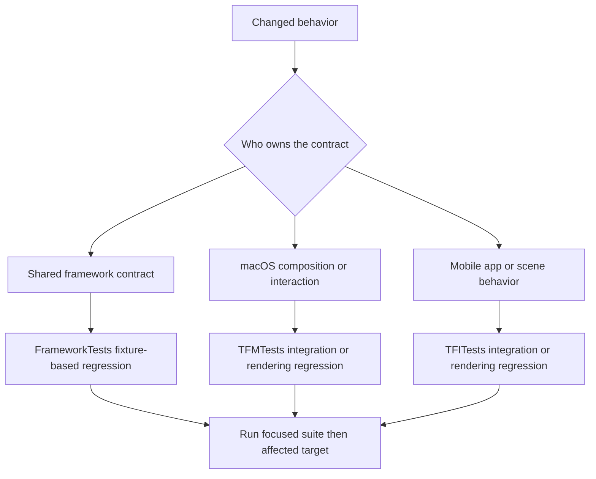

# Testing Strategy and Behavioral Boundaries

Termind uses Swift Testing to test a behavior at the layer that owns it, rather than treating the test tree as a second implementation. `FrameworkTests/` protects portable framework contracts; `TFMTests/` exercises macOS composition, native interaction, and remote-session behavior; `TFITests/` protects iPhone/iPad composition, scene behavior, and mobile presentation. The targets use `@Suite`, `@Test`, and `#expect`.

A useful regression test establishes an observable invariant at an integration seam: what is persisted and migrated, which credentials and prompts may cross a connection boundary, when a resource remains alive after a UI owner disappears, or which state is shared versus scene-local. Avoid testing private mechanics merely because they exist. Test real transports or windows only when the contract requires them; otherwise inject a small in-memory repository, secret store, responder, client, or actor-backed harness.



This flow selects the narrowest test target that owns the behavior, then expands validation only as the affected product surface requires.

## Suite ownership and seams

### Shared frameworks: durable rules and ports

Use `FrameworkTests` for behavior intended to remain identical across macOS and mobile: value/rule behavior, repository and persistence adapters, migration compatibility, settings synchronization, host-key policy, and presentation-independent controllers. These tests should normally run with deterministic in-memory state or a temporary directory and should not import an app target.

Persistence tests are compatibility tests, not just encode/decode checks. `PersistenceCompatibilityTests` opens historical fixture stores through `TermindPersistence.makeContainer`, verifies retained records, checks migration outcomes, and confirms independent in-memory containers expose the full shared schema. When changing a SwiftData model, migration, or repository behavior, cover the old-store input and the post-migration contract; do not limit coverage to a newly created store.

Agent replay persistence demonstrates the same principle for durable runtime state: an in-memory `SwiftDataAgentRunRepository` must restore frozen context and tool result projection without duplicating replay backing across subsequent snapshots, and deletion must remove that backing. A fixture should deliberately model the timing boundary it protects—for example, recording a tool result before the following run snapshot—rather than requiring a live provider.

### macOS: composition, security, and resource lifetime

`TFMTests` owns desktop composition and native interaction seams. `ArchitectureBoundaryTests` is a source-level regression suite: it rejects forbidden imports and concrete infrastructure construction in layers that must stay abstract, confines SwiftData models to `TermindPersistence`, prevents shared frameworks from importing application targets, and prevents local declarations from shadowing types owned by AgentKit. Run it whenever moving code, changing framework dependencies, adding persistence types, or crossing the AgentKit boundary.

Security-sensitive tests should make the boundary explicit with a memory secret store and an authentication responder, never production secrets. `AgentHostAuthenticationTests` verifies that one-use credentials can configure an SSH/SFTP attempt without mutating the Vault unless saving was requested; it also covers route-order prompting for a jump host and destination, prompt/connection coalescing for concurrent work, cancellation before SFTP opens, rejected-credential retry, and stale authentication generations. These are safety contracts: a future refactor must not persist an ephemeral secret, merge unrelated challenges, or let an old callback erase newer authentication state.

The complementary shared `SSHInteractionPolicyTests` covers noninteractive follow-on connections. An `SSHAdditionalConnectionSnapshot` retains route and authentication references rather than credential material, and an interaction-forbidden request must not surface host-key or keyboard-interactive UI. Protected-key credentials become an interaction-required marker while a password fallback remains usable; runtime `SSHSecret` values are consumable once and clearing a copied connection configuration invalidates every credential copy.

SFTP transfer tests use a controlled `TransferChannelHarness`, a `TransferChannelClient`, and temporary files instead of a real server. They establish lifecycle and scheduling behavior that is easy to regress in UI work:

- Closing a desktop pane releases its UI ownership but lets queued transfers retain the authenticated connection until work completes; cancellation releases the final connection.
- A silent independent connection is donated when available. If it requires interaction, upload falls back to the PTY connection; it must not fall back after cancellation or a retired generation.
- Scheduler capacity remains bounded across contexts for the same host. Fallback from extra connections to sibling channels does not increase capacity, and a PTY fallback does not retry independent connections for large files.
- Additional connections use the forbidden interaction policy, so detached/background work cannot open an authentication prompt.

Those tests are intentionally actor-driven and use polling only to wait for observable harness state. Prefer this style for races: hold the transfer at a known point, make the ownership transition, then release it and assert the terminal state and disconnect count.

### Mobile: app state, scenes, and device-local restoration

`TFITests` owns `MobileAppModel` composition and mobile scene behavior. Mobile app tests build `MobileAppModel(inMemory: true)` or supply dependency seams, which permits assertions over the actual shared schema and repositories without using the user's database or Keychain. Representative tests verify that scenes share durable conversations while navigation, selected conversation, and composer drafts stay scene-local; shared SwiftData history is observable from fresh repositories over the same container.

External connection URLs are another ownership boundary: opening one creates an ephemeral workspace and does not create a Vault host or saved workspace descriptor. Conversely, closing all workspaces disconnects each live workspace and is repeatable. Background-expiration tests provide a controlled connection service and cover resume intent, foreground recovery, and rejection of retired callbacks. A lifecycle change must preserve the appropriate one of these contracts rather than merely asserting that a view updates.

`MobileWorkspaceStoreTests` protects the device-local restoration format. The store contains connection intent only—workspace descriptor identity, host reference, title, kind, and duplicate index—not credentials, commands, or live session state. It migrates legacy arrays into the versioned snapshot while allocating missing duplicate indices deterministically by host and kind. If bytes are malformed, unknown-version, or invalid, loading and later saving fail while the original bytes remain untouched; a successful load is required before replacement. Add a fixture for every format transition and for corruption behavior, because silently replacing unreadable restoration data with an empty list loses recoverable user state.

## Fixture design rules

1. **Inject at the owner boundary.** Use `MobileAppDependencies.testing`, in-memory repositories, `MemoryHostSecretStore`, a responder closure, or a protocol test client to replace I/O while retaining the production coordinator/model. Do not duplicate production policy inside a mock.
2. **Keep fixtures isolated.** Create a unique `UserDefaults` suite and remove its persistent domain in `defer`; use a UUID-named temporary directory/file and delete it in `defer`. In-memory containers must be newly created when isolation matters.
3. **Make adverse timing controllable.** Actor-backed harnesses should count opens, prompts, disconnects, active work, and release signals. This lets a test assert cancellation, coalescing, or teardown deterministically instead of sleeping against a real network.
4. **Assert both state and prohibited side effects.** For security and persistence, verify not only a successful configuration or migration but also that the Vault, original bytes, secret store, prompt queue, or connection count did not change when policy forbids it.
5. **Test boundaries, not file names.** A regression belongs beside the narrowest suite with authority over its observable contract. Add a higher-level target test when framework correctness alone cannot prove platform assembly, lifecycle, or UI behavior.

## UI and visible-window policy

Offscreen layout and logic tests remain ordinary tests. A macOS test that presents a window or takes application focus must opt in with `.requiresVisibleWindow` on its suite or test. The trait is enabled only when the test host has `TERMIND_WINDOW_TESTS=1`; without it, those tests are skipped. Rendering and interaction suites use this convention so routine macOS validation remains headless and does not steal focus or depend on a display.

Run a named visible-window suite only when its interaction contract changed, for example:

```sh
TEST_RUNNER_TERMIND_WINDOW_TESTS=1 xcodebuild -project Termind.xcodeproj -scheme TFM -destination 'platform=macOS' -onlyUsePackageVersionsFromResolvedFile test -only-testing:TFMTests/ChooserInteractionTests
```

In Xcode, set `TERMIND_WINDOW_TESTS=1` in the Test action environment. Existing screenshot suites can retain their dedicated gates. A visual change still needs behavior-appropriate coverage: an offscreen test for state/policy, a visible-window test for focus/presentation when applicable, and screenshot/marketing capture only where that workflow owns the deliverable.

## Change-to-regression matrix

| Change type | Primary regression seam | Required behavior to protect |
| --- | --- | --- |
| Framework dependency or data-owner change | `ArchitectureBoundaryTests` plus affected framework suite | No reverse import, concrete implementation leak, duplicate AgentKit type, or SwiftData model outside Persistence. |
| SwiftData schema, migration, or durable agent record | Persistence compatibility/replay fixtures | Old stores open, records retain intended values, interrupted timing remains recoverable, and deletes clean backing rows. |
| SSH credentials, prompts, host trust, or agent authentication | Authentication and interaction-policy fixtures | Ephemeral secrets stay ephemeral, prompt scope/order/coalescing is correct, forbidden work stays noninteractive, and secrets are invalidated after use. |
| SSH/SFTP transfer scheduling or pane/session teardown | `SFTPTransferContextTests` with a controlled channel harness | Concurrency bounds hold, background transfer ownership survives UI teardown, cancellation cleans up, and fallback does not invite interaction. |
| Mobile workspace, scene, restoration, or background lifecycle | `MobileAppTests` and `MobileWorkspaceStoreTests` | State is shared or local at the intended scope, external sessions remain ephemeral, restoration is safe, and callbacks cannot revive retired state. |
| macOS rendering or focus behavior | Focused offscreen test plus `.requiresVisibleWindow` suite when needed | Default tests stay headless; opted-in tests prove the user-visible interaction. |

## Execution strategy

Start with the test that names the invariant, then run the affected product target using the resolved package graph. The default macOS entrypoint runs macOS and shared Swift tests:

```sh
xcodebuild -project Termind.xcodeproj -scheme TFM -destination 'platform=macOS' -onlyUsePackageVersionsFromResolvedFile test
```

For mobile changes, build/test the `TFI` scheme against an installed iPhone or iPad simulator. Retain `-onlyUsePackageVersionsFromResolvedFile`: validation should use the revisions in `Package.resolved`, not silently resolve a different dependency graph. Run strict formatting for Swift changes:

```sh
xcrun swift-format lint --strict --recursive Frameworks TFM TFI FrameworkTests TFMTests TFITests TermindMCPBridge
```

This page complements [System Boundaries and Dependency Ownership](../architecture/system-boundaries.md), [Assistant, Agent Runtime, Skills, and Memory](../concepts/agent-runtime-and-assistant.md), and [Build, Validation, Localization, and Dependency Release Operations](../operations/build-test-and-release.md). The operational page defines the full build and release commands; this page defines what a focused regression must prove before those broader checks are meaningful.
