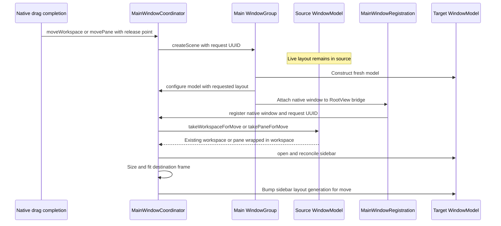

# Desktop workspace drag and drop

TFM drag behavior spans SwiftUI row interaction, AppKit's native tracking loop, temporary layout previews and live session ownership. Changing one of these layers can break another without changing the final model operation. In particular, **Workspace rows retain the native SwiftUI List drag source**; the separate Pane source is not a replacement for it.

Start with [Desktop UI Architecture](../architecture/desktop-ui.md) for the window shell and persistent deck. This page explains internal layout and conversation-list dragging. File uploads and remote-file transfers have separate payloads and owners; see [SFTP Transfer and External Edit](sftp-transfer-and-external-edit.md).

For Assistant file attachments, SSH terminal uploads, SFTP file drops, Key import, and the shared Overlay UI, use [File Drag and Drop Across TFM and TFI](file-drag-and-drop.md).

## Interaction matrix

| Source and destination | Result | Boundary |
| --- | --- | --- |
| Workspace row → Navigator List | Reorder the existing workspace. | Pointer positions clamp to Workspace insertion boundaries; the List does not merge workspaces. |
| Workspace row → occupied pane edge | Insert the source workspace's complete split tree beside that pane. | Different workspaces in the same window; source and destination must support combining. |
| Workspace row → empty pane | Replace the slot with the source split tree. | The source workspace is removed after its layout joins the target. |
| Pane title → another pane edge or empty slot | Rearrange that live pane. | The drop controller permits moves within the same workspace. |
| Pane title → Navigator List | Lift the pane into a separate workspace at the insertion position. | A pane already alone in its workspace is a no-op here. |
| Workspace row or eligible Pane title → unaccepted release outside source window | Request a new window and transfer live ownership when it registers. | Workspace completion requires macOS 26+; the Pane source has no equivalent OS-version gate. |
| Assistant conversation → Pinned or Chats list | Reorder and optionally change pin status. | Separate conversation payload and persistence path; no tear-off request. |

Layout receivers resolve the **owning window's** drag state. They are not a general mechanism for importing a pane into an already-open different window. An unaccepted release over another Termind window still qualifies as outside the source and can create a new window. Within one window, moving a pane into a different workspace uses two deliberate gestures: detach it into the Navigator, then merge that workspace into the destination pane area.

Evidence: [Navigator source and receiver](../../TFM/Features/Workspaces/WorkspaceNavigatorView.swift#L144-L301), [pane drop policy](../../TFM/Features/Workspaces/PaneLayoutDropController.swift#L12-L76), [model operations](../../TFM/Features/Workspaces/WindowModel.swift#L1046-L1172).

## State owners and the native tracking loop

`WindowModel.dragging` projects a window-local `WorkspaceDragState.payload`: `.workspace(UUID)`, `.pane(UUID)` or `.assistantConversation(UUID)`. All three sources write a UUID string, so the string alone does not define its meaning. Layout receivers require both a layout payload from their live owner and a matching pasteboard UUID; Assistant payloads cannot become layout drops.

| Layer | Owner and responsibility |
| --- | --- |
| Workspace gesture and row preview | SwiftUI `List` and its row `.draggable` / `.onDrag`; `WorkspaceNavigatorDragSession` observes the List session. |
| Pane title gesture and completion | `WorkspaceLayoutDragSourceNSView`, attached through the title's background bridge. |
| Native layout destination and feedback | `WorkspaceLayoutDropNSView`: registration, hit participation, payload validation, preview drawing and native callbacks. |
| Placement policy | Navigator insertion geometry or `PaneLayoutDropController` for pane edges/empty slots. |
| Live layout mutation | `WindowModel` and the owning `Workspace`. |
| New-window request and ownership handoff | App-owned `MainWindowCoordinator`, consumed when the native destination registers. |

AppKit can enter its nested tracking loop immediately after drag state changes, before SwiftUI renders again. Receivers therefore mount and register **before** the gesture and use closures that read the current model in `draggingEntered`, `draggingUpdated` and `performDragOperation`. Caching the dragged ID or eligibility in `updateNSView` can leave the entire drag with stale state.

`WorkspaceLayoutDropNSView` registers for `.string` even when its workspace is parked. At each callback, its controller checks current destination visibility and pane identity. Its transparent overlay passes ordinary clicks, scrolling and pointer movement through; a stale drag pasteboard must not intercept normal interaction. An unrelated UUID, text or file drag fails payload validation even if old model drag state remains.

Evidence: [drag state](../../TFM/Features/Workspaces/WindowModel.swift#L132-L146), [payload cases](../../TFM/Features/Workspaces/WindowModel.swift#L1580-L1597), [native receiver](../../TFM/UI/Components/WorkspaceLayoutDropTarget.swift#L10-L113), [UUID validation](../../TFM/UI/Components/WorkspaceLayoutDropTarget.swift#L137-L153).

## Workspace source: preserve the native List contract

On macOS 26+, the row's `.draggable(workspace.id.uuidString)` stays outside the measurement modifier so the List sees its drag trait. It supplies the existing `ItemDragPreview`. A row being renamed has no drag modifier. Earlier macOS uses the original `.onDrag` writer and preview.

The macOS 26+ observer belongs on the **List**, not on a row: the List owns the native drag session. Only its `.active` phase reads `NSPasteboard(name: .drag)`, checks that the UUID belongs to this window's workspaces, begins cancellation tracking and sets `.workspace(id)`. List can request pasteboard writers after an ordinary click; querying a writer must not select a merge preview or mark a drag active. The older `.onDrag` path sets drag state in its writer and has no Workspace tear-off completion observer.

Keep single-click selection, double-click rename, close controls, the row preview and the List's gesture recognition intact. The new-window extension is session configuration plus completion policy, not a new Workspace gesture recognizer.

Evidence: [row modifiers](../../TFM/Features/Workspaces/WorkspaceNavigatorView.swift#L157-L175), [List observer](../../TFM/Features/Workspaces/WorkspaceNavigatorView.swift#L357-L415), [click/writer/native-session tests](../../TFMTests/WorkspaceNavigatorDropTests.swift#L11-L208).

## Destination geometry and temporary previews

### Navigator insertion

The layout receiver overlays the List's native rows. A target behind the List or only on a SwiftUI ancestor can lose the native responder path as a drag crosses from terminal content into the sidebar.

Rows and the Workspace header measure in SwiftUI global coordinates because named coordinate spaces do not propagate reliably across native List hosting boundaries. The overlay translates the pointer into that space and translates the resulting insertion rectangle back. Preserve this conversion when changing sidebar insets, titlebar layout or scrolling.

`WorkspaceSidebarDropGeometry` keeps two indices:

- `visibleBoundaryIndex` locates the insertion line among the displayed rows, including the source row.
- `insertionIndex` counts after excluding the dragged workspace, matching the collection after removal.

The overlay covers the List. Pointer positions above or below the Workspace rows clamp to the first or last insertion boundary; `workspaceDropBounds` establishes available section geometry, not a pointer-containment restriction. Hovering a collapsed Workspace section expands it. Switching the sidebar away from Navigator makes the live `draggedLayoutID` nil immediately, without waiting for a render.

On drop the Navigator dispatches `move` for a workspace or `detachPane` for a pane, then clears drag state. `detachPane` requires more than one source pane, so lifting a lone pane here does not create an extra workspace or perform a disguised reorder.

### Pane edges and split preview

When the selected combinable workspace is dragged, `displayedWorkspace` temporarily reveals an adjacent merge-capable workspace: next first, then previous. This is derived presentation, not a committed selection change or a scan for any distant candidate.

A dragged pane remains mounted with its stable identity while `omittedPaneID` collapses its branch's temporary geometry. Removing that native source view during the drag can end the session before the pointer reaches the Navigator. The model split tree remains unchanged until a drop commits.

`PaneLayoutDropController` checks the current displayed workspace and the exact target pane instance on every callback. It excludes the omitted source pane, allows a different combinable workspace to merge, and accepts individual panes only from the same workspace. Occupied panes choose the nearest proportional edge; an empty slot previews and replaces its whole area.

Mutation precedes clearing the preview state. Restoring an omitted source first could briefly mount the same terminal surface under both old and new parents. A participating but invalid inner target can finish the drag without a layout mutation and clear transient state; hidden or unrelated destinations reject participation altogether.

Evidence: [Navigator geometry](../../TFM/Features/Workspaces/WorkspaceNavigatorView.swift#L215-L301), [boundary indices](../../TFM/Features/Workspaces/WorkspaceNavigatorView.swift#L418-L443), [adjacent preview](../../TFM/Features/Workspaces/WindowModel.swift#L489-L513), [mounted pane preview](../../TFM/Features/Workspaces/WorkspaceContentView.swift#L99-L116), [pane controller](../../TFM/Features/Workspaces/PaneLayoutDropController.swift#L12-L123).

## Pane source and competing input

Only an eligible pane's **title** installs `WorkspaceLayoutDragSource`; terminal content remains available for text selection. The background view itself returns nil from hit testing, while its pan recognizer attaches to the window content view and restricts the initial event to the title's visible bounds. It rejects double-clicks, hidden/clipped sources, buttons and text editors, and refuses parked panes through `displayedWorkspace`. It does not delay ordinary mouse events and permits simultaneous recognizers.

The recognizer retains the actual `mouseDragged` event because AppKit may schedule its action after `NSApp.currentEvent` has changed. Before beginning the native session, the source captures the live model and payload, sets drag state and installs Escape tracking. The session allows `.move` inside the application and no operation outside it: its UUID is internal routing data, not text to paste into another app.

Pane content drops use a separate **outermost** `NativeDropTarget` above the terminal/table native content, outside the `WorkspaceLayoutDropTarget` overlay. It is enabled only for an active supported pane while `window.dragging == nil`: SSH accepts files, SFTP items and terminal paths; SFTP accepts files and SFTP items; Telnet and Serial accept terminal paths only; an empty pane has no such receiver. File/SFTP payloads dispatch to the pane's upload/copy requests, whereas terminal paths are pasted into a terminal. None of these content drops merges or transfers a workspace; do not replace the distinction with a generic `.string` drop target on the root.

Evidence: [title handle](../../TFM/Features/Workspaces/WorkspaceContentView.swift#L724-L761), [gesture lifetime](../../TFM/UI/Components/WorkspaceLayoutDragSource.swift#L79-L214), [retained event](../../TFM/UI/Components/WorkspaceLayoutDragSource.swift#L290-L305), [overlay ordering and payload types](../../TFM/Features/Workspaces/WorkspaceContentView.swift#L424-L483), [content dispatch](../../TFM/Features/Workspaces/WorkspaceContentView.swift#L546-L610).

## Outside release, cancellation and responsiveness

An outside release requests a new window only after these checks:

1. The native operation was unaccepted. Pane completion checks an empty `NSDragOperation`; Workspace observes `.cancel` or `.forbidden` from SwiftUI.
2. The primary mouse button is released and Escape was not recorded.
3. The source still owns the relevant live payload; Pane completion explicitly compares it with its captured payload.
4. The screen-space pointer is outside the **source window frame**. Workspace requires the coordinator to know that frame.

Do not reject a release merely because it is inside *some other* application window. A successful drop already wins via its returned operation, while an unhandled release over another Termind window is still a valid tear-off. Do not infer cancellation solely from an empty operation: Escape and an outside release can report the same result.

Workspace cancellation is latched by `WorkspaceDragCancellationTracker`. It observes local Escape events and samples Escape key state in both common and event-tracking run-loop modes, because the native drag loop can consume the event before a local monitor sees it. Repeated `.active` callbacks do not reset the latch. Ending the session or removing the observer view releases tracking. Pane completion combines its Escape monitor/current event with current button state and clears only the payload belonging to that session.

Responsiveness depends on **when** AppKit animation is configured:

- Pane creation disables `animatesToStartingPositionsOnCancelOrFail` when the native session begins.
- Workspace uses `WorkspaceNavigatorDragAnimation` to wrap the existing `NSOutlineViewDataSource`. The proxy forwards all existing behavior, invokes the original `willBegin` callback first, then disables the failed-drop return animation for this window's Workspace payload. Doing this only at completion misses the point where AppKit may start the return animation.
- The background marker identifies the nearest unambiguous outline viewport covering its center. It observes data-source replacement, rewraps after SwiftUI's assignment, and restores the forwarded source on unbind only if its own proxy is still installed. It never overwrites a newer replacement while tearing down.
- When a request carries a release point, destination registration sets `NSWindow.animationBehavior = .none` to avoid an additional window-opening animation.

Escape still cancels the operation; suppressing the return animation also suppresses its visual snapback. The tests verify session configuration and behavioral outcomes, not a fixed mouse-up-to-window latency.

Evidence: [release policy](../../TFM/UI/Components/WorkspaceLayoutDragSource.swift#L51-L75), [Pane completion](../../TFM/UI/Components/WorkspaceLayoutDragSource.swift#L216-L269), [Workspace completion](../../TFM/Features/Workspaces/WorkspaceNavigatorView.swift#L357-L415), [Escape tracker](../../TFM/UI/Components/WorkspaceDragCancellationTracker.swift#L11-L61), [animation adapter](../../TFM/UI/Components/WorkspaceNavigatorDragAnimation.swift#L47-L149).

## New-window transfer preserves the live owner until registration



Scene creation and native registration are distinct phases; the diagram's transfer happens at registration, not at the drop or initial SwiftUI layout.

Request-to-registration transfer keeps the live session in its source until the destination has a native window.

`TermindCommands` installs the `openWindow(id: "main", value: id)` scene factory for the UUID-valued main `WindowGroup`. On the normal workspace scene path (after the diagnosis-consent gate), `TermindApp.makeWindow` creates a fresh `WindowModel` and applies the request's sidebar presentation and preferred width before constructing `RootView`. Its `MainWindowRegistration` bridge calls `register` only after AppKit attaches the native window; the registration view establishes full-size content coordinates before sizing. This keeps scene creation separate from live ownership transfer.

Live layout ownership changes only when the requested destination window registers.

The request stores a weak source, the move identity, a layout snapshot (ordinary content size, sidebar width and presentation, fullscreen state and source-screen center), and an optional release point. Repeated requests for the same source and move reuse the pending request ID; different pane requests may register in reverse order. A closed source, missing scene factory, nonexistent workspace, nonexistent or noncombinable pane cannot initiate a move. If the source or pane disappears before registration, the pending request cannot recreate it. `register` rejects a closed destination and duplicate native/model pair, then removes the pending request when a new destination consumes its ID, **even if extraction finds no live layout**. A late scene may therefore register empty; registering the same destination again cannot transfer a second copy.

Registration consumes the request once. A whole Workspace moves as the same object, including its complete split layout. A pane from a split workspace is extracted into a newly named workspace around the **same Pane object**; the remaining source tree repairs focus, group naming and broadcast eligibility through `Workspace.closePane`. A lone pane moves its original workspace, retaining its name and template identity.

These are move operations, not close/reopen: they do not disconnect transports, end connection-history events or populate the reopen stack. Destination `open` installs its lifecycle router and shared services; history configuration skips a pane that already has an active event. The source refreshes its focused-session context and sidebar state. If its last workspace moved away, it returns to Welcome. On an actual window close, by contrast, `closeForWindow` disconnects the panes still owned there, not those already transferred.

Closing the source window removes its pending requests. A pane closed before registration cannot be resurrected by a late destination; an already-created scene may remain empty. A restored scene with no pending request retains its restored geometry and does not replay the move.

New windows use the source's last valid ordinary AppKit **content** size, not its fullscreen frame; if no source size was recorded, the shared default applies. During scene construction `configure` applies sidebar presentation and preferred width; registration reapplies them (and invalidates initial sidebar layout if they differ), sizes the native window, then bumps `sidebar.initialLayoutGeneration` for a move to rebuild the split view at the transferred width. For a release point, `applySize` selects the screen containing that point, centers the frame horizontally on it and places its top at the point's Y coordinate, then `fittingFrame` clamps its size and origin inside that screen's visible frame. The minimum content dimensions are enforced before fitting, so a release near a screen edge may shift the resulting window rather than leave it exactly centered on the cursor. Destination registration disables native opening animation for requests with a release point; the tests' `nativeWindow` fixture already has `.none` set and checks placement and layout rather than verifying that assignment separately. If the source was fullscreen, the destination also defers fullscreen activation until it becomes key. A restored scene without a pending request is left at its system-restored frame.

Evidence: [request and layout snapshot](../../TFM/Platform/MainWindowCoordinator.swift#L214-L265), [request consumption and registration](../../TFM/Platform/MainWindowCoordinator.swift#L291-L350), [placement, fullscreen and close](../../TFM/Platform/MainWindowCoordinator.swift#L352-L436), [frame fit and registration bridge](../../TFM/Platform/MainWindowCoordinator.swift#L517-L576), [scene factory](../../TFM/App/TermindCommands.swift#L29-L32), [scene construction and consent gate](../../TFM/App/TermindApp.swift#L221-L249), [RootView bridge](../../TFM/App/RootView.swift#L75-L89), [model extraction and close](../../TFM/Features/Workspaces/WindowModel.swift#L1363-L1409), [move regressions](../../TFMTests/WorkspaceWindowMoveTests.swift#L11-L249).

## Assistant conversation reordering

Assistant uses a SwiftUI `.onDrag` row over a ListViewKit-backed native list. It writes `.assistantConversation(id)` to the same window-local drag state and provides a conversation-title preview. Active conversations can move while running, waiting for approval or compacting; archived rows and rename editors cannot start a drag. Search results disable the list's reorder receiver and move callback.

`AssistantConversationDropResolver` maps native row frames to `(section, beforeID)`. Dropping on a section header inserts before its first conversation; the row midpoint selects before/after, and nil `beforeID` means the section end. Crossing Pinned/Chats changes pin status. The receiver reads `draggedID` at callback time for the same nested-loop reason as Workspace receivers. Its current native gate checks conversation drag state and a `.string` pasteboard type; it does not perform the layout receiver's UUID equality check.

The compact workspace Assistant remains mounted behind the other sidebar presentation. SwiftUI opacity and `allowsHitTesting(false)` alone do not remove native drag participation. `AssistantConversationListContainer.isInteractive = false` both unregisters dragged types and returns nil from native hit testing, clearing its insertion target. Both actions matter: otherwise an invisible list can take the drop and draw feedback behind the visible one. Recycled hosting rows also receive their window, locale and color scheme explicitly rather than relying on an attached SwiftUI environment during AppKit callbacks.

On a successful drop, the view expands the target section, dispatches `WindowModel.moveAssistantConversation` and clears transient drag state. Production commands route through `AppModel` to `AssistantConversationOperations.move`: normalized ordering is persisted before `AssistantLibraryModel.applyOrder` changes visible pin/sort values. Failure leaves the prior order intact and reports an operation error; moving preserves the running conversation and its approvals/transcript. Assistant has no Workspace/Pane new-window completion path.

Evidence: [active list routing](../../TFM/Features/Assistant/AssistantView.swift#L413-L496), [resolver](../../TFM/Features/Assistant/AssistantView.swift#L700-L754), [native participation](../../TFM/Features/Assistant/AssistantView.swift#L910-L1044), [source eligibility](../../TFM/Features/Assistant/AssistantView.swift#L1260-L1271), [drag guard](../../TFM/Features/Assistant/AssistantView.swift#L1354-L1356), [durable ordering](../../Frameworks/TermindApplication/Agent/AssistantConversationOperations.swift#L44-L60), [order normalization](../../Frameworks/TermindApplication/Agent/AssistantLibraryModel.swift#L170-L225).

## Regression map and change guidance

| Change or symptom | Focused coverage |
| --- | --- |
| Click turns into drag, row cannot start a native session, writer query changes preview | `WorkspaceNavigatorDropTests`: single-click, native mouse drag and writer-query cases. |
| Missing or misplaced Navigator insertion line | `WorkspaceNavigatorDropTests`: immediate callbacks, scrolling/titlebar insets and mode changes; `PersistentWorkspaceDeckLayoutTests`: insertion indices and parked geometry. |
| Split merge/rearrange, empty slots, hidden target or stale payload | `WorkspaceLayoutDropTests`, including Assistant UUID rejection. |
| Outside release, accepted drop, Escape, replaced payload or hidden Pane source | `WorkspaceLayoutDragSourceTests` and `WorkspaceDragCancellationTests`. |
| Return animation or data-source forwarding/replacement | `WorkspaceNavigatorDragAnimationTests`; native split-workspace tear-off also asserts the animation flag at session start. |
| Whole split Workspace fails to tear off | `WorkspaceNavigatorDropTests.draggingASplitWorkspaceOutsideItsSourceMovesTheWholeLayout()`: release over another window, one request, original Workspace and pane IDs. |
| Ownership loss, reconnect, changed history or late request | `WorkspaceWindowMoveTests`: destination delay, duplicate requests, lone-pane identity, closed sources, reversed arrival order and window placement. |
| Assistant hidden receiver or active-row eligibility | `AssistantConversationListDropTests`; `AssistantConversationOperationsTests` covers persistence failure and preserved activity; `WindowStateTests` covers stable manual order. |

Run the offscreen policy, geometry and lifecycle cases without visible-window opt-in first, keeping dependency resolution pinned. The suite selection below also includes three `WorkspaceNavigatorDropTests` mouse/session cases that will be skipped by default; an `NSWindow` fixture alone does not require the gate if it stays offscreen.

```sh
xcodebuild -quiet -project Termind.xcodeproj -scheme TFM \
  -destination 'platform=macOS' -onlyUsePackageVersionsFromResolvedFile \
  -only-testing:TFMTests/WorkspaceNavigatorDropTests \
  -only-testing:TFMTests/WorkspaceLayoutDropTests \
  -only-testing:TFMTests/WorkspaceLayoutDragSourceTests \
  -only-testing:TFMTests/WorkspaceDragCancellationTests \
  -only-testing:TFMTests/WorkspaceNavigatorDragAnimationTests \
  -only-testing:TFMTests/WorkspaceWindowMoveTests \
  -only-testing:TFMTests/AssistantConversationListDropTests test
```

The `WorkspaceNavigatorDropTests` single-click, native mouse-session and split-workspace tear-off cases use `.requiresVisibleWindow` because they call `makeKeyAndOrderFront` (the tear-off case also orders another window and activates the app). The trait skips these cases unless the **test host** sees `TERMIND_WINDOW_TESTS=1`; the Xcode command-line prefix `TEST_RUNNER_TERMIND_WINDOW_TESTS=1` forwards that value. The Debug app also suppresses automatic test-window launch by default, but this does not replace the per-test gate. Opt in only when changing real mouse/List or focus behavior, with `-parallel-testing-enabled NO` and a narrow filter. In Xcode's Test action, set `TERMIND_WINDOW_TESTS=1` directly. Keep parentheses in a Swift Testing single-test filter and verify that the result bundle contains the intended test rather than trusting a zero exit status alone:

```sh
TEST_RUNNER_TERMIND_WINDOW_TESTS=1 xcodebuild -quiet \
  -project Termind.xcodeproj -scheme TFM -destination 'platform=macOS' \
  -onlyUsePackageVersionsFromResolvedFile -parallel-testing-enabled NO \
  '-only-testing:TFMTests/WorkspaceNavigatorDropTests/draggingASplitWorkspaceOutsideItsSourceMovesTheWholeLayout()' test
```

When changing Workspace dragging, keep the row source and preview intact, inspect live callback timing before changing geometry, and verify cancellation independently of an outside release. When changing transfer ownership, use the coordinator request boundary and existing live objects. When changing Assistant presentation, test both visible and retained hidden native lists. Complete the repository's default test and formatting/localization gates after focused regressions; see [Testing Strategy](../testing/behavioral-boundaries-and-fixtures.md) and [Quickstart](../quickstart.md).
