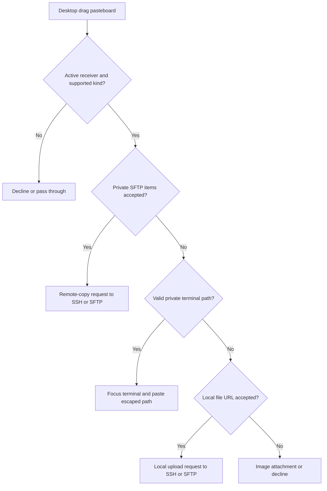
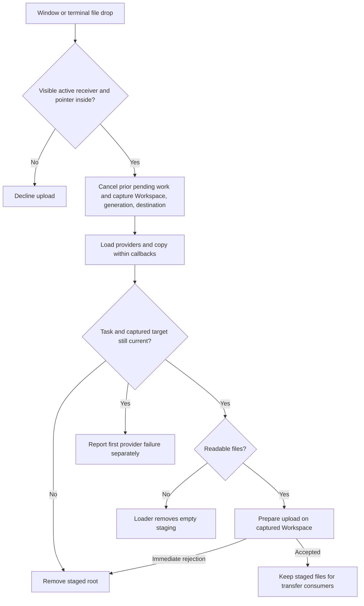
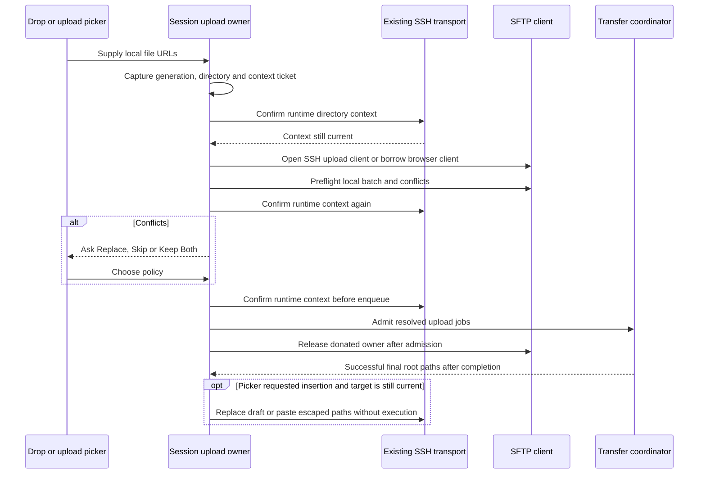
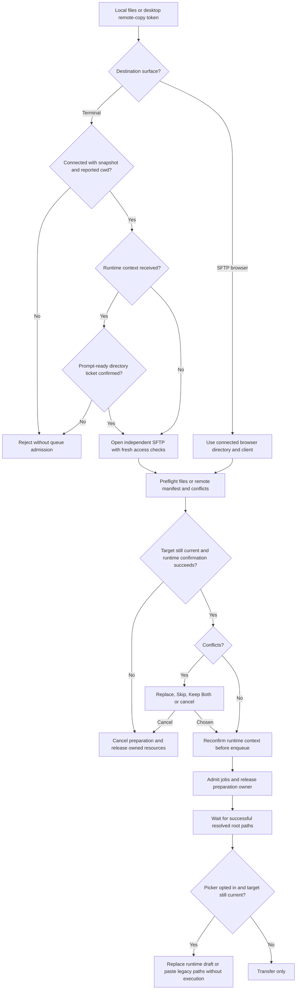
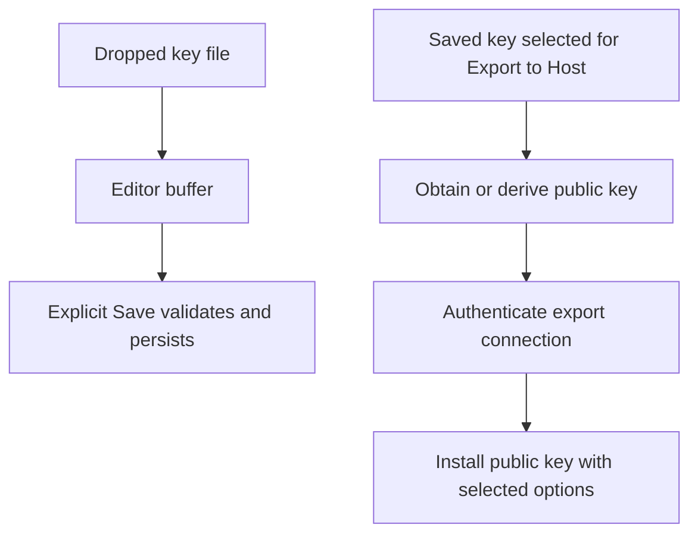

# File Drag and Drop

File dragging crosses three boundaries: native event routing chooses a visible receiver, payload loading chooses a representation, and the destination starts an attachment import or a transfer. A native `.copy` proposal or a successful drop callback means the gesture was accepted; asynchronous loading, validation, conflict resolution, and transfer can still fail afterward.

This page follows those events and ownership transitions. [TFM Drag and Drop](desktop-drag-and-drop.md) covers Workspace/Pane layout moves and Assistant conversation-list sorting, which use different payloads and state. Transfer scheduling and connection leasing are detailed in [SFTP Transfer and External Edit](sftp-transfer-and-external-edit.md).

## Supported routes and destination ownership

| Gesture | TFM | TFI | Destination / operation |
| --- | --- | --- | --- |
| Local file or image → Assistant | Native AppKit receiver. | SwiftUI file-URL/image drop. | Import into the receiving conversation's composer; dropping does not send a message. |
| Local files/folders → SSH terminal | Pane receiver → terminal transfer request. | Window/terminal interaction → staged provider files. | Upload with SFTP to the shell-reported working directory. |
| Local files/folders → SFTP browser | Pane receiver → channel upload preparation. | Visible Workspace receiver → staged provider files. | Upload to the browser's current directory. |
| Local files → Telnet or Serial terminal | No desktop file-upload receiver; the pane receiver accepts only private terminal-path drags. | Workspace reports that Telnet does not support file upload. | No upload destination. Desktop empty panes have no native receiver. |
| Status-bar directory path → SSH, Telnet or Serial terminal | Private terminal-path text → focused terminal input. | No matching private-path receiver. | Insert shell-escaped path text; no file transfer or SFTP copy. An SFTP pane declines this payload. |
| SFTP entries → SSH terminal or another SFTP pane | Private remote-item payload. | The mobile upload receiver does not consume this private payload. | Remote copy to the SSH working directory or SFTP browser directory. |
| SFTP file → Finder / external file consumer | Lazy promised file. | No corresponding drag exporter in the mobile SFTP browser. | Download when the consumer requests the file representation. |
| Key file → Key editor | Native file receiver. | No matching Key drag receiver. | Software mode populates private-key/certificate fields; Security Key mode reads a validated FIDO2 reference. Save persists the chosen key type. |

“Terminal upload” here means **SSH terminal upload**, dependent on the current directory reported through Shell Integration. Telnet cannot use this path. SFTP browser uploads already have an explicit directory and do not require Shell Integration. The SSH convenience is available without Pro on both platforms; it still requires a connected session, transfer configuration and a usable reported working directory. SFTP browser upload uses its own explicit-directory path. For the separate native Upload File menu actions, see [Ghostty Terminal Integration](../concepts/ghostty-terminal-integration.md).

Evidence: [desktop pane routing](../../TFM/Features/Workspaces/WorkspaceContentView.swift#L457-L549), [mobile destinations](../../TFI/Features/Workspaces/MobileWorkspace.swift#L214-L243), [mobile upload entry](../../TFI/Features/Workspaces/MobileWorkspaceView.swift#L643-L674), [desktop SSH availability](../../TFM/Features/Terminal/TerminalUploadModel.swift).

## TFM: AppKit events and representation priority

`NativeDropTarget` embeds `FileURLDropNSView` above native terminal, table, and transcript content. In `WorkspaceContentView` the order is layout receiver, drop decoration, then **native receiver as the outermost pane overlay**. A receiver attached only inside the terminal or Table can be bypassed by their AppKit views. SSH accepts local files, private SFTP items and private terminal paths; SFTP accepts local files and private SFTP items; Telnet and Serial accept **only** terminal paths; empty panes have no native receiver. These pane receivers are enabled only for the active Workspace surface while `window.dragging == nil`, keeping layout drags on their own path. A native copy proposal is not a guarantee that an upload is possible: destination checks occur after routing.

| Event / decision | Behavior |
| --- | --- |
| Construction / `isEnabled` change | Register supported pasteboard types only when enabled; unregister when disabled, including receivers born disabled. |
| `hitTest` → `participates` | Require enabled state, an in-bounds point, a supported payload, and an event other than ordinary pointer/scroll interaction. |
| `draggingEntered` / `draggingUpdated` | Recheck `supportedPayload`, publish its preferred kind for feedback, and propose `.copy`; unsupported or disabled targets clear targeting and decline. |
| `performDragOperation` | Recheck the same gate, pass the filtered payload to the feature, then clear targeting. |
| `draggingExited` / `concludeDragOperation` | Clear targeting. |

Retained invisible Workspaces and Assistant layers are the reason for both registration and callback gates. SwiftUI opacity and `allowsHitTesting(false)` alone do not remove a native destination. Unregistering prevents future destination selection, but an already tracked drag still needs the callback check. The drag pasteboard also retains old contents, so a stale file/image must never make the transparent receiver swallow ordinary clicks, hover, or scrolling.

Representation selection is ordered:

1. If the target accepts `.sftpItems` and the pasteboard contains `UTType.termindSFTPItems`, return that private payload immediately. Do not request the same provider's promised local file: that would trigger an unnecessary download and could turn one gesture into both a remote copy and a local upload.
2. Otherwise, if the pasteboard carries valid nonempty UTF-8 for `TerminalPathDrag.pasteboardType`, select `.terminalPath` before scanning file and bitmap representations. The private type is shell-escaped text, **not** a local file URL or remote-copy token. Ordinary text, malformed/empty private data and file URLs alone do not qualify as path insertions.
3. Otherwise, each item's file URL wins over bitmap data, preserving the original filename of a Finder image. Only `file:` URLs are collected; an image representation is read only when that item has no usable file URL. Finally restrict the result to the target's accepted kinds: Assistant accepts files/images, SSH accepts files/remote items/terminal paths, SFTP accepts files/remote items, Telnet and Serial accept paths only, and Key import accepts files.

`receivePaneDrop` dispatches terminal paths **first**: it focuses the SSH, Telnet or Serial pane and calls its persistent terminal owner's `pasteDroppedPath`. That checks the mounted visible terminal, acquires focus and pastes the escaped text into input, without Shell Integration or an SFTP transfer. The status-bar working-directory and SFTP-directory labels produce the private path provider (with a plain-text representation for other consumers, but no file URL). The embedded `TermindTerminalView` also has a path-only native drop fallback with visibility/window and copy-operation checks; the outer pane receiver is the primary route above Ghostty. For remaining payloads, the pane records a fresh `SFTPRemoteDropRequest` for SSH/SFTP remote items or `LocalFileDropRequest` for file URLs. Request UUID changes drive the terminal/SFTP views even when identical items are dropped again; no request is produced for unsupported/empty payloads.

Desktop representation priority and pane dispatch; accepting a gesture precedes upload availability and transfer preflight.

Evidence: [native receiver](../../TFM/UI/Components/FileURLDropTarget.swift#L223-L285), [overlay and pane routing](../../TFM/Features/Workspaces/WorkspaceContentView.swift#L424-L610), [path producer](../../TFM/Features/Terminal/TerminalPathDrag.swift#L5-L27), [status-bar sources](../../TFM/Features/StatusBar/StatusBarView.swift#L266-L311), [terminal paste fallback](../../TFM/Features/Terminal/PersistentTerminalSurfaceView.swift#L100-L163), [terminal consumption](../../TFM/Features/Terminal/TerminalPlaceholderView.swift#L137-L149), [SFTP consumption](../../TFM/Features/SFTP/SFTPBrowserView.swift#L650-L661).

## TFI: window routing, terminal forwarding, and provider lifetime

Workspace uploads use `MobileWindowDropTarget`, with a noninteractive marker view defining the visible Workspace's bounds and a `UIDropInteraction` installed on its window. Its coordinator rejects hidden/transparent/detached regions, empty bounds, disabled surfaces, and windows with a presented controller. Enter/update track whether the pointer is inside the Workspace; crossing into the sidebar cancels the proposal even though the pointer remains in the same window.

Ghostty also owns a drop interaction. `MobileTerminalDropTarget` temporarily replaces that interaction with a forwarder: uploadable providers go to the Workspace coordinator, while ordinary text and web links go to Ghostty's original delegate. Uninstall restores the original interaction. Reattaching a retained terminal first removes an earlier forwarder rather than wrapping it again.

Two guards handle overlapping window and terminal callbacks: `activeInteraction` prevents a late exit from the old interaction from clearing the new target, and `performedSession` prevents the same native session from being uploaded twice. Leaving, ending, or disabling clears targeting; disabling gates callbacks but does **not** uninstall the interactions. Detaching or moving between windows removes the old window interaction and restores the terminal's original interaction; dismantling the representable uninstalls both routes.

`MobileWorkspaceView` enables the receiver only while `workspaceIsVisible && scenePhase == .active`, and `.id(workspace.id)` gives a changed Workspace a distinct native destination lifecycle. Disappearance clears targeting, unbinds terminal upload-menu callbacks and cancels provider loading; changing Workspace identity clears the captured picker target and cancels loading too. Scene inactivity disables native acceptance, but is not itself a call to `cancelDropLoading()`. These are presentation lifetimes, not instructions to disconnect the Workspace or cancel admitted transfers. See [Mobile UI and Scene Ownership](../architecture/mobile-ui.md) for the session owner.

File pickers have a separate callback lifetime from drop-provider loading. `MobileFileImportState` keeps the captured download/edit target when UIKit first reports dismissal, then consumes it once when the importer result arrives. A new picker request replaces a cancelled request; removing the presentation flag alone must not erase the still-pending target. `MobileWorkspacePresentationTests` exercises both callback orders without a key window.

### Loading files before UIKit releases them

`MobileDropPayloadLoader` distinguishes `.referenced` attachment loading from `.staged` upload loading. For upload, a file URL wins; otherwise it accepts directory/data file representations. A provider advertising a web URL is excluded. Text representations qualify as files only with a filename or an in-place representation, so dragged text selections keep their terminal-input behavior. When image attachments are requested, an image representation retains image semantics instead of becoming an upload file.

For staged files, copying occurs **inside** `loadFileRepresentation`'s callback, before UIKit can remove its temporary URL. Security-scoped access and `NSFileCoordinator` protect the read. Each item gets its own subdirectory, preserving same-named files independently; suggested names are reduced to a last path component, with a type-derived extension when needed. File URLs are copied through the same staging mechanism.

`MobileWorkspaceView.receiveUploadProviders` cancels earlier loading and pending preparation, captures the receiving Workspace object, `uploadConnectionGeneration` and `uploadDestination`, then loads staged providers. Before calling that captured Workspace's `prepareUpload`, it rechecks task cancellation, current Workspace ID, connection generation and destination equality. Disappearance, Workspace changes, destination changes, or connection-generation changes cancel loading, so reconnecting to the same directory cannot reuse a retired load. Cancelled, empty, or immediately rejected payloads remove their staging root. Successful staging must survive navigation because queued transfers still read those files; staging creation also prunes old roots after seven days. Do not describe this as immediate cleanup on transfer completion.

`cancelDropLoading()` only cancels and clears the view's provider-loading task. It does not call `cancelPendingUpload()` and does not cancel a transfer already admitted to the coordinator. A new accepted provider batch explicitly cancels pending Workspace preparation before loading; subsequent preparation and queue ownership are described below.

A failed provider does not discard other successfully loaded files: the payload returns files and failures separately. The view can start the readable uploads and report the first provider failure. Assistant loading uses its own referenced file/image path and collects all provider failures into the composer error.

Mobile payload loading precedes preflight; partial provider failures do not discard readable files.

Evidence: [window delegate and deduplication](../../TFI/UI/Components/MobileWindowDropTarget.swift#L57-L190), [terminal forwarder](../../TFI/Platform/MobileTerminalDropTarget.swift#L4-L69), [payload selection/staging](../../TFI/UI/Components/MobileDropPayload.swift#L29-L229), [view visibility and cancellation](../../TFI/Features/Workspaces/MobileWorkspaceView.swift#L73-L119), [provider completion and handoff](../../TFI/Features/Workspaces/MobileWorkspaceView.swift#L643-L679).

## Assistant: dropping creates composer attachments

TFM's `ConversationAttachmentDropModifier` accepts file URLs and bitmap data; TFI's `MobileConversationAttachmentDropModifier` registers `.fileURL` and `.image` and resolves providers asynchronously. Both surfaces disable attachment drops for archived conversations and while approval or user-interaction cards block the composer. The compact desktop sidebar targets either its selected conversation or its draft and is enabled only when the Workspace surface is focused.

Both adapters call the shared `ConversationModel.importAttachmentFiles` / `importAttachmentImages`. The model creates pending chips, enforces a total of 20 loaded/pending attachments, tracks import tasks, and replaces a pending chip only if its ID still exists. Removing/cancelling that chip prevents a late result from attaching it again. File/image import failures become composer errors; they do not start a transfer or an agent run.

The live `ContextAttachmentLoading` implementation calls `ContextAttachmentImporter`: regular files are read under security-scoped access, with a 25 MiB input limit; text/PDF/modern Office content is extracted and images normalized. Directories, unsupported formats, and legacy Office files fail import. Extracted text is limited to 200,000 characters and normalized image output to 5 MiB. Therefore a native receiver accepting a file URL does not imply that its contents are a supported attachment.

Sending is a separate step. `AssistantExecutionController` refuses submission while attachments are pending, then captures and consumes accepted composer attachments with the submitted turn. First-send promotion and persistence follow the [Assistant runtime workflow](../concepts/agent-runtime-and-assistant.md).

Evidence: [TFM adapter](../../TFM/Features/AI/ConversationTranscriptView.swift#L16-L91), [sidebar target](../../TFM/Features/Assistant/AssistantView.swift#L189-L237), [TFI adapter](../../TFI/Features/AI/MobileAssistantConversation.swift#L9-L83), [TFI gating](../../TFI/Features/AI/MobileAssistantConversation.swift#L556-L560), [pending imports](../../Frameworks/TermindApplication/Agent/ConversationModel.swift#L1800-L1873), [file importer](../../Frameworks/TermindInfrastructure/Agent/ContextAttachmentImporter.swift#L9-L83).

## SSH uploads: shell directory → SFTP preparation → queue

Shell Integration supplies the working directory, but it is not an always-known property of the SSH connection. Desktop `SSHSessionModel` and mobile `MobileWorkspace` use the active `TerminalContextCoordinator` directory once runtime context has been received. Legacy Ghostty OSC 7 observation is accepted only with integration enabled and before runtime context takes over. An unavailable runtime context clears the directory; later unscoped OSC 7 or prompt events cannot restore a stale pane's path. `TerminalUploadAvailability.problem` requires a connected session, transfer configuration and a nonempty directory with directory resolution no longer pending. It asks the user to wait for the shell prompt rather than guessing `/` or home. Desktop passes `homeResolution.isPending` to that gate; mobile passes `workingDirectory == nil`. SFTP browser upload instead uses its explicit browser path. See [Shell Integration](../concepts/shell-integration.md).

### Context validity is stronger than path equality

The displayed cwd is deliberately retained while a command runs: `TerminalContextCoordinator.directory` returns `active?.directory` even when the context is not prompt-ready or lacks `.directory`. This is useful display state, **not authorization to upload**. The preliminary availability check and hover/menu UI can still find a path; preparation must obtain and confirm the capability ticket. Desktop and mobile tests cover this distinction for ordinary shells and `tmux`, `zellij`, `zmx`, and `herdr` contexts.

Desktop native menu actions recheck `canUploadFiles` or `canOpenSFTP` when invoked, rather than trusting the enabled state captured when a menu was built. Status-bar Open with SFTP is a different operation from dragging its path: it calls `confirmDisplayedDirectory`, checking live session state and path equality, then confirming the active runtime context and rechecking it after the await. That display-context check is not the prompt-ready upload-ticket gate. A status-bar path drag remains escaped text insertion only.

Evidence: [display versus capability](../../Frameworks/TermindApplication/Terminal/TerminalContextCoordinator.swift#L36-L71), [desktop running-command tests](../../TFMTests/HostShellIntegrationSessionTests.swift#L12-L44), [mobile running-command tests](../../TFITests/MobileCommandGeneratorAndUploadTests.swift#L97-L132), [menu action rechecks](../../TFM/Features/Terminal/PersistentTerminalSurfaceView.swift#L284-L296), [status-bar open](../../TFM/Features/StatusBar/StatusBarView.swift#L357-L371), [displayed-directory confirmation](../../TFM/Features/Terminal/SSHSessionModel.swift#L396-L427).

Runtime uploads capture a directory ticket containing coordinator generation, revision and active shell identity. A ticket requires a prompt-ready context with the directory capability. Both platforms confirm that context through the existing SSH transport **before opening the transfer client, after preflight, and before enqueueing**. A failed confirmation invalidates a still-current context to unknown. Runtime revision changes cancel pending upload work, including conflict state, even if a newly selected shell has the same directory string. Once runtime mode is active, missing tickets fail closed; legacy mode's confirmation is a no-op, so it must not be described as providing the same identity guarantee.

On TFM, local drops become `TerminalTransferRequest.local` and registered SFTP tokens become `.remote`. The **SSH-session-owned `TerminalUploadModel`**, not SwiftUI view state, checks availability, cancels prior preparation and captures the normalized directory, connection-attempt ID, context ticket and new preparation ID. It prefers an independent SFTP connection; `TerminalUploadConnectionResolver` can fall back to a PTY SFTP channel only while the attempt is current and not cancelled.

The temporary `SFTPChannelModel` prepares a local/remote batch. Cancellation, generation and context confirmation prevent stale publication; conflicts ask Replace / Skip / Keep Both and other batches enqueue immediately. Enqueue releases the temporary owner while admitted transfers retain their coordinator/context references. SwiftUI disappearance unbinds only that view's upload token—it does not cancel session-owned preparation merely because a surface is rehosted. The retained model preserves pending state through pane moves; disconnect/reconnect, runtime context revision changes and explicit cancellation retire it.

On TFI, `MobileWorkspace.prepareUpload` filters to file URLs and rejects an empty result or unavailable transfer snapshot/destination/coordinator, then captures a preparation ID, connection generation, destination and directory ticket. SSH opens an independent SFTP client from the snapshot (without the desktop PTY fallback); an SFTP Workspace borrows its browser client. After connection and home-directory lookup, and again after local upload preflight, it checks cancellation, preparation ID, generation and destination. Runtime context confirmation also surrounds preflight and gates enqueue. It creates a donated transfer context only for the SSH client; the browser uses its existing context. Conflicts leave a pending batch for policy selection; a conflict-free batch enqueues immediately. Cancellation or preparation failure disconnects an owned client, while enqueue and pending-batch cancellation release its donated owner. Admitted queue references retain the transport independently of the Workspace.

Upload preparation, policy selection and queue handoff; runtime confirmation is skipped in legacy mode and browser uploads borrow their own explicit-directory connection. Failure or cancellation before admission releases owned preparation resources rather than admitting a stale batch.

### Access checks are independent of destination selection

A saved transfer snapshot is not a permanent access grant. Before an independent SFTP open, `additionalConnectionRequest(from:)` rechecks access to saved route hosts and resolves current Identity/Key contents into a one-shot silent request. In the mobile username-only upload test, a keyboard-interactive challenge is forbidden: preparation rejects with a notice, opens no authentication sheet, and admits no transfers. “Available without Pro” therefore does not promise that every host or credential can currently be used.

Local filesystem access is separate again: the shared planner starts security-scoped access while enumerating each selected root and records that root with its jobs; the transfer coordinator reacquires scoped access when running the upload. Mobile provider staging additionally coordinates the read before UIKit releases the provider URL. These checks do not substitute for server-side SFTP permission checks; preparation or transfer errors must still be reported.

Evidence: [fresh access and credential resolution](../../Frameworks/TermindApplication/Connections/RemoteSessionHostStore.swift#L318-L335), [silent authentication failure test](../../TFITests/MobileCommandGeneratorAndUploadTests.swift#L721-L754), [root scope and enumeration](../../Frameworks/TermindRemoteInfrastructure/Transfers/SFTPLocalUploadPlanner.swift#L44-L89), [upload scope](../../Frameworks/TermindRemoteInfrastructure/Transfers/SFTPTransferCoordinator.swift#L493-L525).

### Upload admission decision flow

Branching upload/copy admission and optional insertion; desktop may fall back to a current PTY SFTP channel, while legacy and browser routes skip runtime confirmation. Any open, preflight or enqueue error follows the rejection/resource-release path.

### Upload completion versus path insertion

Dropping local files or private remote items uploads/copies them but does **not** insert their uploaded paths. The native terminal Upload File picker captures a target and opts into insertion (`selectedTarget` on desktop, `insertPaths: true` on mobile, including Photos). Desktop rejects a picker result when its captured target—including its context ticket—differs from the current target. Mobile's picker checks Workspace ID, connection generation and destination before preparation; preparation then captures its own runtime ticket. These picker checks are not interchangeable.

`SFTPUploadReceipt` waits for admission to finish and every admitted job to finish, resolves Keep Both names, and excludes failed or skipped roots before delivering paths. The callback rechecks connected state, connection generation and runtime context currency. Runtime mode replaces the current shell draft; legacy mode pastes escaped paths with a trailing space. Neither executes a command. Desktop writes only to the receiving session, not broadcast input. Context changes can therefore suppress insertion even when the coordinator successfully finishes an already-admitted upload.

Post-drop `WorkspaceUploadNotice` reports preparing, queued, or rejected. A queued notice reports admission, not completion. SSH failures use transient notices rather than taking terminal focus with an operation alert; mobile SFTP failures use its browser operation-error path.

Evidence: [availability](../../Frameworks/TermindApplication/Transfers/WorkspaceUploadNotice.swift#L9-L26), [desktop legacy and runtime observation](../../TFM/Features/Terminal/SSHSessionModel.swift#L1411-L1494), [directory tickets](../../Frameworks/TermindApplication/Terminal/TerminalContextCoordinator.swift#L16-L71), [desktop confirmation and insertion](../../TFM/Features/Terminal/SSHSessionModel.swift#L392-L447), [desktop preparation and completion](../../TFM/Features/Terminal/TerminalUploadModel.swift#L101-L307), [view binding and picker](../../TFM/Features/Terminal/TerminalPlaceholderView.swift#L52-L113), [mobile confirmation](../../TFI/Features/Workspaces/MobileWorkspace.swift#L658-L671), [mobile runtime invalidation](../../TFI/Features/Workspaces/MobileWorkspace.swift#L798-L812), [mobile preparation](../../TFI/Features/Workspaces/MobileWorkspace.swift#L2048-L2154), [mobile enqueue/cancellation/errors](../../TFI/Features/Workspaces/MobileWorkspace.swift#L2304-L2403), [mobile picker](../../TFI/Features/Workspaces/MobileWorkspaceView.swift#L575-L603), [completion receipt](../../Frameworks/TermindRemoteInfrastructure/Transfers/SFTPLocalUploadPlanner.swift#L112-L227).

## SFTP uploads and desktop remote-file dragging

Local file drops onto a connected desktop SFTP pane call `SFTPChannelModel.prepareUpload`; mobile routes its staged URLs through `MobileWorkspace.prepareUpload` with the browser path as destination. Both use `SFTPLocalUploadPlanner`: enumerate selected files/folders, retain empty directories, exclude resolved descendants outside the selected root, and preflight remote conflicts before mutation. Directory creation, replacement and enqueue happen after a conflict policy is chosen. Cancelling preflight must not create remote directories.

### Remote source and receiving side

Desktop SFTP rows export `remoteDragProvider(for:)`. It resolves the selection through `menuTargets`, registers an `SFTPRemoteCopySource` with the app's `SFTPTransferCoordinator`, and advertises an own-process `UTType.termindSFTPItems` representation. The encoded `SFTPRemoteItemsPayload` contains a UUID token; source files, host and connection are resolved through the coordinator, not trusted as arbitrary pasteboard paths or credentials.

Dropping this payload onto another SFTP pane prepares a remote copy to its current browser directory. Dropping onto an SSH pane uses the same remote-copy planner with the terminal's reported directory and SSH upload-availability checks. Invalid/missing source tokens fail. Same-host copies into the source itself or a directory's descendants are rejected. Cross-host copies use the transfer coordinator's remote-copy path, with no local promised-file download/upload round trip.

These are the concrete file routes currently wired for terminal/SFTP interaction: **SFTP → SSH and SFTP → SFTP**. The SSH terminal adapter is a receiver here; it does not publish a corresponding private remote-file drag source. Dragging terminal text or moving an SSH Pane is a different interaction, and should not be documented as a reverse SSH → SFTP file-copy implementation. TFI has remote-copy commands, but its Workspace drag loader handles local provider files rather than the desktop private SFTP token.

### External file promises

A desktop non-directory SFTP row also advertises a public file representation. An external consumer requests it lazily, causing a download into a unique temporary `Termind/Drag` directory and completion with a local URL. Directory rows export only the private remote-item payload. The private representation can describe selected items, while the public promise is constructed for the dragged file; do not assume external export has identical selection/folder semantics.

Evidence: [local receive and remote decoding](../../TFM/Features/SFTP/SFTPBrowserView.swift#L1245-L1297), [desktop source and promise](../../TFM/Features/SFTP/SFTPBrowserView.swift#L1118-L1218), [token registry](../../Frameworks/TermindRemoteInfrastructure/Transfers/SFTPTransferCoordinator.swift#L194-L210), [local planner](../../Frameworks/TermindRemoteInfrastructure/Transfers/SFTPLocalUploadPlanner.swift#L32-L160), [remote-copy preflight/enqueue](../../Frameworks/TermindRemoteInfrastructure/Transfers/SFTPRemoteTransferPlanner.swift#L214-L313).

## TFM Key import: drop edits a buffer, Save validates

The Key editor mounts a `.files` native receiver only while private-key editing is permitted and the form is neither loading nor saving. In software mode, `receive(urls:)` calls shared `SoftwareKeyFileImporter.read` and applies the returned private key, certificate, and optional inferred name to form state. A private key can infer the complete filename only when the current name is blank; a certificate does not infer a name. Multiple private-key files resolve to the final one in the supplied order. In Security Key mode, the first dropped file is read as a `termind-fido2-v1:` reference; the reader requires a regular UTF-8 file of at most 1 MiB and validates the decoded credential before filling the reference field.

The importer reads security-scoped UTF-8 regular files up to 8 MiB, recognizing private-key text and OpenSSH user certificates. If any supplied file fails, the view receives an error before applying the result. This initial classification is not cryptographic validation or a save: `refreshPublicMaterial` uses `SSHKeyMaterial.imported` to refresh editor material, and explicit Save imports the software key material, validates certificate matching, and calls the existing persistence path. Metadata-only editing has a separate certificate-validation and metadata-save branch.

Evidence: [receiver enablement](../../TFM/Features/Keychain/KeychainPageView.swift#L686-L692), [drop handler](../../TFM/Features/Keychain/KeychainPageView.swift#L992-L1013), [software importer](../../Frameworks/TermindRemoteInfrastructure/Security/SoftwareKeyFileImporter.swift#L14-L65), [Security Key reference reader](../../Frameworks/TermindRemoteInfrastructure/Security/WebAuthnSSH.swift#L86-L109), [save validation](../../TFM/Features/Keychain/KeychainPageView.swift#L819-L864).

### Key export is a separate explicit operation

Desktop and mobile **Export to Host** use `KeyExportModel` and `KeyExportForm`, not the file-drop upload queue. The model obtains or derives public key material, validates an attached certificate against it, authenticates a separate connection, and calls `install(publicKey:options:)`; it does not upload the private-key file dropped into the editor. Both export detail views cancel their model on disappearance. For storage and secret ownership, see [Persistence and Secrets](../concepts/persistence-and-secrets.md).

Key-file intake and public-key export are separate user operations, not a private-key transfer pipeline.

Evidence: [export model](../../Frameworks/TermindApplication/FeatureModels/KeyExportModel.swift#L221-L328), [desktop export lifecycle](../../TFM/Features/Keychain/KeyExportDetailView.swift#L38-L51), [mobile export lifecycle](../../TFI/Features/Keychain/MobileKeyExportDetailView.swift#L15-L35).

## Shared Overlay UI

Both apps reuse [DropTargetOverlay](../../Frameworks/TermindPresentation/DropTargetOverlay.swift#L3-L113) with `DropTargetPresentation` (title, detail, symbol, accent/unavailable tone). Callers provide attachment/upload/copy/import wording and show it from native targeting state; the component supplies the translucent tint, dashed border, compact card and reduced-motion behavior. It disables hit testing and owns no payload decoding or transfer state. On desktop panes, `.terminalPath` deliberately suppresses this upload/copy overlay and uses the native copy cursor instead; unavailable SSH/SFTP destinations may still show an unavailable hover overlay and reject during preparation. This hover UI is separate from post-drop `WorkspaceUploadNotice` feedback.

## Regression map and change boundaries

| Concern | Focused evidence / tests |
| --- | --- |
| Native precedence, hidden targets, stale pasteboards, filename preservation | [FileURLDropTargetTests](../../TFMTests/FileURLDropTargetTests.swift), especially private SFTP payload versus promised local file, path-only copy proposal without transfer, and disabled registration/callback cases. [TerminalPathDragTests](../../TFMTests/TerminalPathDragTests.swift) checks shell escaping, absence of file-URL advertising, rejection of plain text/malformed private data, and refusal by an unmounted terminal. |
| Provider staging, text/link exclusion, cancellation, duplicate delivery, interaction restoration | [MobileDropTests](../../TFITests/MobileDropTests.swift): `MobileDropPayloadTests` and `MobileWorkspaceDropTests`. Includes late exits, presentation/hiding/detachment and window changes. |
| Shell-reported destination, folder preflight, partial provider failures, queue surviving closure | [MobileCommandGeneratorAndUploadTests](../../TFITests/MobileCommandGeneratorAndUploadTests.swift), including `sshUploadUsesTheReportedWorkingDirectoryAndReleasesPreflightClient` and `cancelledUploadDoesNotCreateRemoteDirectories`. `runtimePaneInvalidationClearsDirectoryAndIgnoresUnscopedEvents` verifies that an unavailable runtime pane clears the directory and rejects later unscoped directory/prompt events. `runningCommandsKeepTheDisplayedDirectoryUntilTheShellReportsAnother` in both this suite and [HostShellIntegrationSessionTests](../../TFMTests/HostShellIntegrationSessionTests.swift) protects retained display cwd without a usable capability ticket. `usernameOnlyTerminalUploadRejectsInteractionWithoutOpeningASheet` protects silent-open failure behavior. |
| Desktop connection fallback and transfer ownership | [SFTPTransferContextTests](../../TFMTests/SFTPTransferContextTests.swift); cancellation cannot fall back, releasing a UI owner cannot invalidate retained transfers. |
| Remote manifests, conflicts, streaming without a temporary file | [SFTPFeatureTests](../../TFMTests/SFTPFeatureTests.swift) and [SFTPRemoteConflictResolverTests](../../FrameworkTests/SFTPRemoteConflictResolverTests.swift). |
| Attachment formats and pending-import/send lifetimes | [ContextAttachmentImporterTests](../../TFMTests/ContextAttachmentImporterTests.swift), [AssistantConversationOperationsTests](../../FrameworkTests/AssistantConversationOperationsTests.swift), [AssistantExecutionControllerTests](../../FrameworkTests/AssistantExecutionControllerTests.swift). |
| Key classification and name inference | [SoftwareKeyFileImporterTests](../../TFMTests/SoftwareKeyFileImporterTests.swift). |
| Upload availability and focus-preserving feedback | [WorkspaceUploadNoticeTests](../../FrameworkTests/WorkspaceUploadNoticeTests.swift), mobile upload tests, and [TerminalUploadNoticeTests](../../TFMTests/TerminalUploadNoticeTests.swift). The last suite requires visible-window opt-in and `TERMIND_SSH_FIXTURE`. |

When changing a drag entrypoint, preserve the existing receiver's private SFTP → private path → file/image representation priority, visibility gates and teardown behavior before changing feature dispatch. A generic text or Finder file URL must not become a terminal-path paste; a path-only drag must not become an upload. Keep staging alive until its consumers no longer need it, and distinguish cancelling a pending preparation from cancelling an admitted transfer. Extend the specific importer/planner for new semantics; a new Overlay label alone does not implement a drop operation. File-drop work does not require replacing the native Workspace List drag source described in the layout guide.
