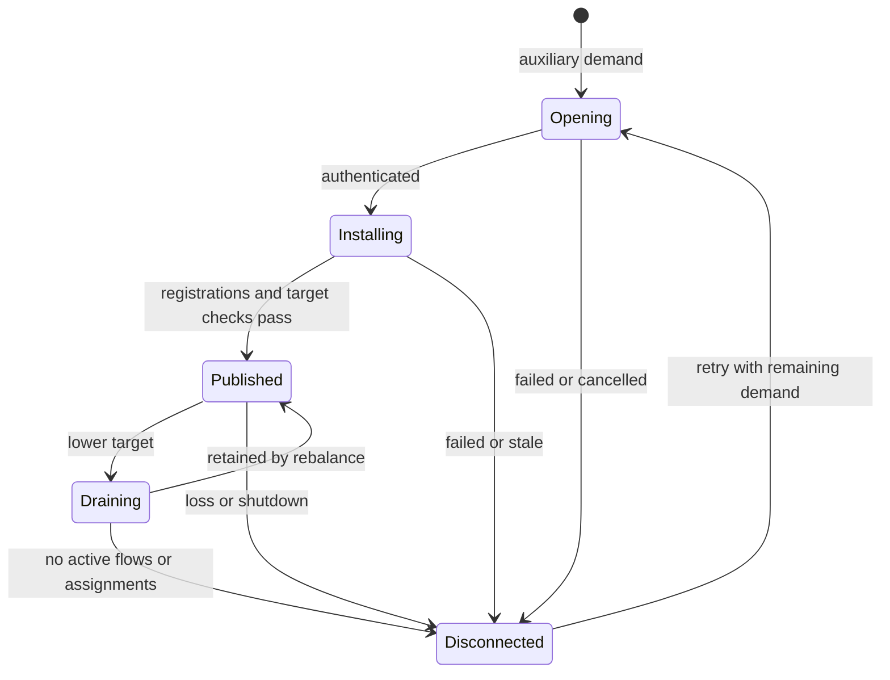
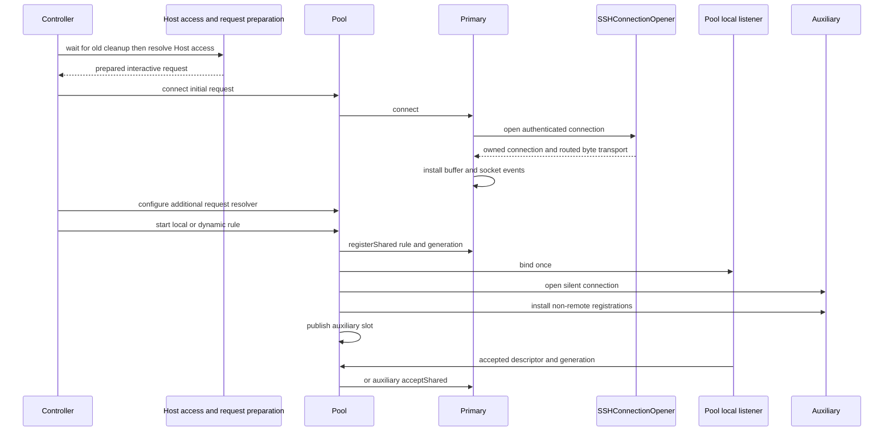
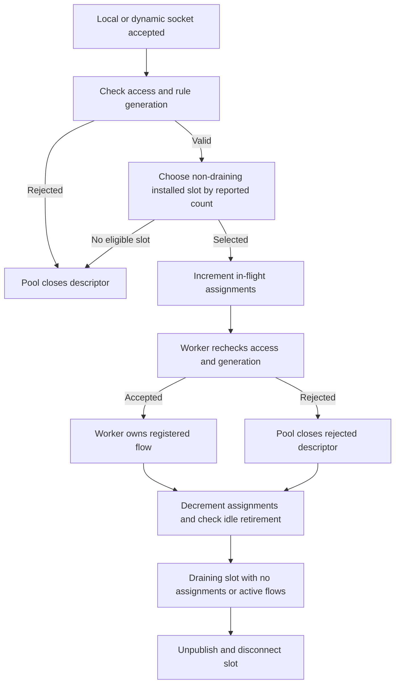
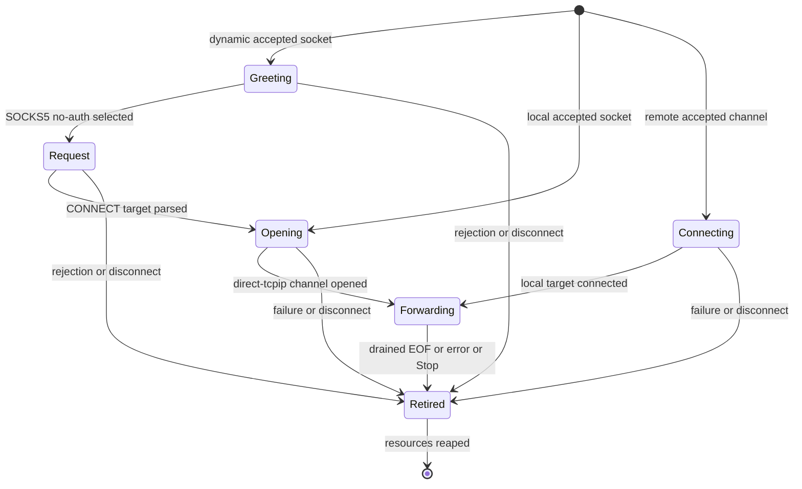
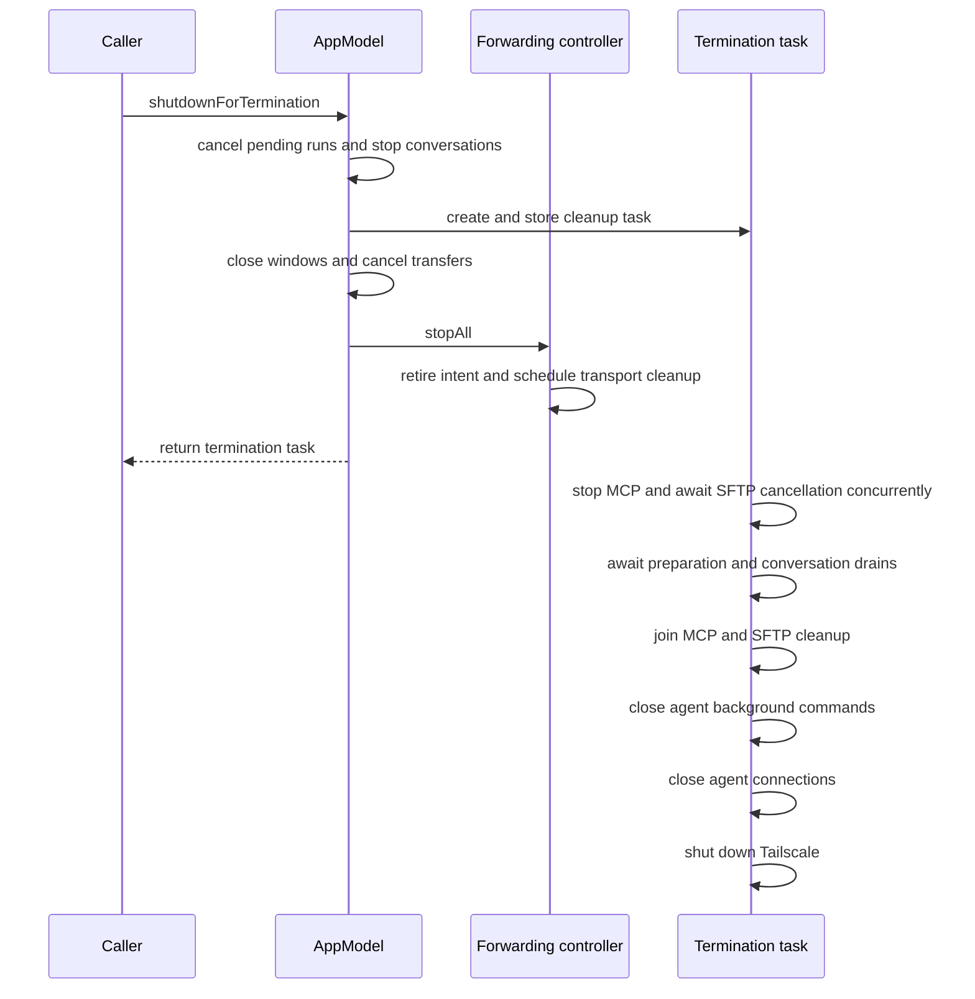

# Forwarding Pool and Dispatch Lifecycle

## Two scheduling decisions, three kinds of rule

Forwarding first decides **which physical SSH connection owns a newly accepted TCP flow**, then decides **when that connection's worker advances each channel**. Increasing the connection target changes the first layer; bounded queues/readiness/fair turns implement the second. Neither is SFTP file admission or SSH session-channel admission.

| Rule | Listener placement | Channel and target | Pool behavior |
| --- | --- | --- | --- |
| Local (`-L` shape) | On this device | `direct-tcpip` to the configured target through SSH | One pool-owned local listener; new accepted flows can use any eligible worker. |
| Dynamic (`-D` shape) | On this device | SOCKS5 request chooses target, then `direct-tcpip` | Same fan-out; the chosen worker handles the SOCKS handshake and ensuing stream. |
| Remote (`-R` shape) | On the SSH server | `forwarded-tcpip` accepted by the SSH worker; local connector dials the configured target from this device | The listener and all its accepted channels stay on the primary worker. |

The pool is **not** several sockets jointly carrying one TCP stream. Every flow keeps one worker/channel until closure; existing flows are not migrated or replayed if that worker fails. Remote forwarding does not become multi-worker just because a Host's maximum is greater than one. Its server-side listener is a libssh2 resource attached to the primary's authenticated session, and `forwarded-tcpip` channels are accepted from that listener on that session. It cannot hand an accepted channel to a different session as the pool can hand a local socket descriptor to a worker. See [Remote Services and Forwarding](../concepts/remote-services-and-forwarding.md) for the broader service boundary.

## Feature dispatch and app-owned lifetime

On macOS, `AppModel.forwarding` owns the runtime controller; `AppModel.forwardings` is the saved-rule library. The Ports UI opens the editor and calls `app.forwarding.start(rule.id)`. Editors in different windows resolve the same controller context, so navigating away or closing editor work does not cancel another window's authentication or stop the transport. Explicit Journey Cancel is different: it calls `stop` and then closes the editor. This separation keeps forwarding lifetime independent of a terminal pane or editor's visibility.

The forwarding controller owns its authentication continuation and reconnect policy. The embedded Journey submits credentials, host-key decisions, and Retry to that controller with captured prompt/request IDs. It does not route forwarding authentication through app-global `ExternalAuthentication` or read app settings itself; architecture boundary tests guard that separation. Interactive Start/Retry and forbidden-interaction recovery remain distinct boundaries, as described below.

## Intent, configuration, and runtime ownership

`PortForwardingController.start` validates a saved rule and SSH-enabled Host. It creates or joins a `PortForwardingConnection` context keyed by Host ID; the context contains the route snapshot, shared Journey/authentication surface, connection attempt, active rule presentations, and an effective maximum computed when the context starts. App-supplied limit changes can update that maximum on a live context without rewriting the saved Host setting. Later rules on the same connected context call `startRule` instead of authenticating again. Stop removes that rule's generation; the last active rule retires the context. Route changes, including jumps, invalidate affected contexts. Saved rules themselves are not live listeners.

### Access is checked at admission, not on every byte

Before preparing/authenticating the primary, `open` waits for prior Host cleanup and calls `hosts.resolveHostAccess(host)`. The Host library checks the route, including jumps, and can await initial entitlement resolution before checking again. The connection configuration carries an access-check closure backed by the library's live operation-access cache; it is not a frozen entitlement decision.

The pool checks that closure when starting a rule and assigning a newly accepted socket. Workers also check when starting/registering rules, accepting shared or single-worker local sockets, and accepting a new remote channel. Denied local sockets are closed; a denied remote channel is registered only to retire it, without dialing the target. Additional physical opens recheck access while resolving their snapshot request. These are **new-operation admission boundaries**: the stream pump does not repeatedly admit an already registered flow, so an access change alone does not terminate its byte forwarding. This is separate from an explicit Stop or route retirement, which closes the resources.

### Physical connection target versus channel budget

macOS `AppModel` selects `.hostConfigured`; Host values normalize to `1...64`, default `1`, and the controller caps that saved value by an app-supplied connection limit. Without Pro multi-connection access the effective limit is one; entitlement changes update the limit on existing contexts without changing the saved Host preference. The `.hostConfigured` factory uses `SSHForwardingConnectionPool` even when its current target is one. Mobile composition uses the controller's default `.singleConnection` policy, so a synchronized Host setting can remain stored on mobile without producing the desktop multi-connection topology.

**Live SSH preferences are a separate path, not forwarding pool configuration.** `AppModel` applies initial `sshSettings.preferences` to `RemoteConnectionCoordinator` and forwards subsequent `sshSettings.didChange` values to it. That updates the shared `SSHMaxSessionsPolicy` and its existing per-connection session-channel budgets. Forwarding is constructed separately: its workers open an `SSHAuthenticatedConnection` through `SSHConnectionOpener` and own their forwarding channels directly, without the multiplexed worker's session-channel budget. Its physical-connection target is controlled by the Host setting and `updateConnectionLimit`, not by the coordinator's MaxSessions policy. Keep this boundary when adding settings: propagating a preference through the coordinator does not by itself configure forwarding or transfer ownership of forwarding authentication/reconnect to it.

Lowering a live limit does not evict streams already using excess published auxiliaries. The pool marks excess auxiliaries draining, excludes them from new assignments, and disconnects them only after the worker reports no active flows and no assignment is in flight. Pending auxiliary opens/installations can be cancelled immediately. Increasing the limit can retain a draining slot again before it becomes idle. If a retained auxiliary fails while other slots are draining, `rebalanceSlots` immediately retains a healthy auxiliary again: otherwise the still-published draining slots could count toward capacity while none admitted new flows.


An auxiliary is eligible for new assignments only while published and non-draining; retry creates a replacement slot rather than reviving old streams.

Three runtime numbers must be read separately:

- `activeConnections`: registered flows for one rule, aggregated across slots; these can include handshake/open/connect phases, not only streams already forwarding bytes.
- `sshConnections`: published connected pool slots, excluding opening/installing slots.
- `targetSSHConnections`: `maximumConnections` only while at least one non-remote rule needs a pool; otherwise `1`.

## Pool warm-up and publication

The pool actor owns `slots`, `primaryID`, rule `registrations`, `opening`, `installing`, per-slot/per-rule `counts`, retry state, and one local-listener manager. Each slot contains an independent `SSHForwardingConnection` and the rule IDs installed on that worker. Each worker has its own authenticated libssh2 session and serial queue. `SSHConnectionOpener` is the shared authentication/routing boundary, not a shared forwarding scheduler: the returned `SSHAuthenticatedConnection` owns the routed byte transport, libssh2 session, and installed encrypted buffer. The forwarding worker retains that owner and performs channel work on its own queue. Connect first disconnects prior state, installs the returned owner's buffer and events, then checks cancellation; failure or cancellation runs disconnect before propagating the error. The actor's `connect` clears request configuration secrets on exit.



The sequence shows access resolution, primary authentication, shared-listener setup, and auxiliary publication. Listener acceptance can already dispatch to the primary while auxiliaries are still opening; warm-up is not a barrier to serving flows.

`connect` first disconnects any previous pool and opens only the primary. Configuring the additional-request resolver calls `fillPool`, but without a local/dynamic registration there is no auxiliary demand. Starting a local/dynamic rule registers it on the current slots, creates **one** listener at the pool level, then fills missing slots. A remote-only rule calls `primary.connection.start` and needs no auxiliaries.

`fillPool` computes:

```text
missing = desiredConnections - slots.count - opening.count - installing.count
launches = min(missing, max(0, 4 - opening.count - installing.count))
```

The four-work cap covers **both authentication and registration installation**. An opened auxiliary moves from `opening` to `installing`, registers the non-remote rules visited by the install pass, then is published in `slots` only after membership/disconnect/target checks. New publication reports pool counts and fills further missing slots. Failed setup disconnects the slot rather than publishing it. These are explicit state checks around actor suspension points, not proof that arbitrary registration races have exhaustive test coverage.

Stopping the last non-remote rule removes auxiliary demand, cancels the retry timer, removes pending opens/installations from pool bookkeeping, and disconnects auxiliaries. If remote rules remain, the primary remains. Pool shutdown closes its local listeners before disconnecting the captured active/pending workers; a late opened slot whose opening ID is gone is disconnected rather than published.

## Accepted-socket dispatch: least reported flows per rule

The pool-local listener accepts up to 32 descriptors in one callback. `assign` then follows this algorithm:

1. Recheck Host operation access, then match the rule's current registration generation; close the descriptor on denial or if obsolete.
2. Select published slots whose installed-rule set contains that rule ID, excluding draining slots.
3. Find the minimum `counts[slotID][ruleID]`, treating absent counts as zero.
4. Sort equal-minimum candidates by UUID string; choose `roundRobin % candidateCount`, then increment the pool-wide counter.
5. Call that worker's `acceptShared`. The worker rechecks connection, rule, generation, non-stopped state and non-remote kind before registering the flow. If it rejects, the pool closes the socket; it does not retry assignment across every slot.

For a rule whose reported counts are `[3, 1, 1]`, the next choice is between the second and third eligible slots, not the first. This is **per-rule live-flow-count balancing**, not bytes-per-second, CPU-load or total-all-rules balancing. Counts arrive asynchronously from worker callbacks, and assignment does not reserve an optimistic count before awaiting the worker. Therefore burst distribution is not an exact equal-share guarantee; the wire test verifies that flows reach multiple physical connections, not a precise 3/3/3/3 split.

### Descriptor ownership and draining across suspension

The pool increments `assignments[slot.id]` before awaiting `acceptShared` and decrements it afterward. This is a **retirement guard**, not an optimistic flow-count reservation for balancing. `retireIfIdle` asks the worker's `hasActiveFlows()` rather than trusting asynchronous count callbacks, then rechecks that the slot is still the same object, still draining, not primary, and has no assignment in flight. Overlapping idle checks request a recheck instead of issuing concurrent queries.

A descriptor remains the pool's cleanup responsibility until the worker accepts it. Access denial, an obsolete generation, no eligible slot, or worker rejection closes it in the pool. Successful `acceptShared` registers and watches a flow on the worker; subsequent flow closure cancels its socket events and closes the descriptor in the cancellation completion. The pool listener also closes accepted descriptors if its weak pool owner is gone.


The decrement and idle check apply only after a selected worker returns; early admission failures simply close the descriptor. Reconnect tests separately verify that retired intent rejects late starts and that replacement opens wait for old cleanup.

## What each worker does after assignment

A local flow begins in `opening`. A dynamic flow begins in `greeting`, then `request`, then `opening`. A remote accepted channel begins in `connecting` while `SSHForwardingConnector` resolves/dials its local target. All successful paths end in `forwarding`.


The per-flow lifecycle stays on its assigned worker; neither draining nor recovery migrates a stream.

For dynamic forwarding, the handshake accepts SOCKS5 **no-authentication** and CONNECT requests with IPv4, domain-name, or IPv6 destinations; unsupported methods/commands/address kinds receive failure replies. Extra bytes after a complete request are preserved for the channel. Handshake buffering is capped at 64 KiB. Treat the bind address as a security choice: this SOCKS listener is not an authenticated application proxy.

The worker keeps separate control queues for remote-listen requests and channel opens, plus a deduplicated FIFO ready queue for flows. It retains one pending `listening` and one pending `opening` operation across EAGAIN. Local accept and remote channel accept each cap a callback/pass at 32. Remote target connection completion rejects retired flows and closes a late socket rather than reinstalling it.

### One bounded pump pass

`SSHForwardingWorker.pump` is ordered for correctness as well as throughput:

1. Begin a 2 ms encrypted-buffer pass and flush. If backpressured, disable flow socket interests and read interest on the transport, leaving transport write interest armed.
2. Advance listener/open control work and accept forwarded-tcpip channels **before** bulk stream I/O spends the receive budget.
3. Pop ready flows while time remains and the encrypted buffer is not backpressured. A flow whose turn yields goes back into the ready queue.
4. Advance opens/listeners and remote accepts **again**: another channel's read/write can have decoded their replies already.
5. Check buffered data/EOF on forwarding channels, reap retired resources, service keepalive, report counts, detect transport loss, flush, and update socket interests.
6. On progress or exhausted receive budget, wake another sweep. If a ready ID remains without that condition, schedule another pump.

This post-I/O sweep is why a reply already buffered inside libssh2 does not have to wait for a new OS socket-read edge. Conversely, when unsolicited bytes are present but no channel/listener operation can consume them, the worker parks read interest to avoid repeatedly waking on the same packet. The one-second timer serves keepalive and pending control/retirement work, not regular data throughput.

`SSHStreamPump` applies per-flow 2 MiB high/1 MiB low watermarks, bounded directional turns and stable write chunks. Socket EOF sends channel EOF only after pending outbound bytes drain; channel EOF shuts down local writes only after returned bytes drain. Both directions can therefore finish independently. The worker reaps a retired channel only after dealing with any pending libssh2 write; a zero-window write can be abandoned without waiting indefinitely for a peer that will never read. See [SSH Multiplexing and Scheduling](../concepts/ssh-multiplexing-and-scheduling.md) for buffer details.

## Failure and recovery: distinguish the two levels

| Event | Pool-local response | Controller consequence |
| --- | --- | --- |
| Transient auxiliary open/install failure or established auxiliary loss | Remove/unpublish failed slot; keep healthy peers; schedule a single retry timer. | Rules can remain running below target. |
| Additional open needs trust/authentication/user presence, or is cancelled | `requiresManualRetry` suppresses scheduling an automatic retry for that error. | No surprise interaction form from an auxiliary; explicit user action may be required to restore capacity. |
| Primary loss with a surviving published slot | Promote `slots.values.first` (not least-loaded election), recreate remote rules there, then refill. | Context can survive if recreation succeeds; prior flows on the lost worker are gone. |
| Primary loss with no replacement, or failed remote-rule recreation | Report pool failure. | Controller handles whole-context recovery/failure. |
| Stop, route retirement, or stale callback | Reject removed IDs/generations; close obsolete resources. | Do not reestablish retired intent. |

Auxiliary retry delays are **1, 2, 5, 10, 30 seconds**, capped at 30. A published auxiliary surviving 60 seconds resets the pool-wide retry progression. This is not an autonomous per-slot backoff: the pool has one `retryTask` and one `retryAttempt`. Other in-flight opens can still finish while a failed open schedules no retry.

Whole-context recovery is a separate path. The controller only recovers after a rule has made the context ready (`markConnected`) and a reusable snapshot exists. It closes the old transport, hides the Journey, marks remaining intent reconnecting, and delegates delay handling to `SessionReconnectController`. It waits for prior Host cleanup before opening the replacement and reinstalls the still-active rules. A listener-local failure can fail that rule without erasing peers' recovery intent.

The first connect may ask for host trust/credentials or Security Key signing. Recovery and auxiliary opens use `SSHAdditionalConnectionSnapshot` and requests with interaction forbidden. The controller captures the snapshot after successful interactive connection, removes one-shot submissions and temporary host keys, and supplies a resolver for later physical opens. “Continue once” trust, temporary passwords, key passphrases, and Security Key presence are not reusable recovery authority; needing them ends silent recovery/degrades the pool instead of reopening a form. An explicit Retry is the new interactive boundary. See [SSH Session Lifecycle](ssh-session-lifecycle.md) and [SSH Security Key Authentication](../concepts/ssh-security-key-authentication.md).

The snapshot freezes target/jump/proxy topology and authentication provenance (Identity/Key IDs), not resolved secrets. `additionalConnectionRequest` reads the current referenced credentials immediately before each open and returns a one-shot forbidden-interaction request; the worker clears its configuration secrets after connecting. Durable trust is captured from known hosts rather than promoting once-only trust. Architecture tests guard reference retention, and `SSHInteractionPolicyTests` verifies that forbidden policy blocks all Security Keys, including keys not requiring a touch and keys on jumps.

## Teardown ordering and stale-result guards

There are several different tokens, none interchangeable:

- Controller **attempt ID + context identity** rejects an old connection's progress/failure/count callback.
- Controller/pool/worker **rule generation** rejects counts, accepted descriptors and listener-start completions from an old start of the same rule ID.
- Worker **generation** invalidates already scheduled pump/timer/socket callbacks after transport cleanup.

`stop` waits for the worker's rule-close completion. Stopping an in-flight remote-listen request retains its completion until the request resolves and the resulting listener is cancelled; otherwise an immediate replacement could race the old remote bind. `reap` retries listener cancellation/channel freeing across EAGAIN. Full disconnect shuts down the transport, retires resources, and waits for socket cancellation completions before returning. Cleanup detaches the authenticated connection from worker state, shuts down its byte socket to unblock disposal, and retains the owner until the transport event cancellation callback calls `connection.close()`. That idempotent close disposes the buffered libssh2 session (or frees it directly if no buffer was installed), then closes the routed byte transport. Failure reporting follows worker cleanup; it does not transfer the failed connection's channels to a surviving slot. Local listeners use `SO_REUSEADDR` for rebinding after closure, not `SO_REUSEPORT` to share a live bind.

This is not stream failover: recovery restores listeners and future connection opportunities, not application protocol state or bytes already sent on failed TCP streams.

### Application termination is not a forwarding drain barrier

`AppModel.shutdownForTermination()` stores an asynchronous cleanup task, then performs synchronous feature shutdown, including `forwarding.stopAll()`, before returning that task. Forwarding is stopped in the calling method, **not** after awaiting MCP or agent cleanup inside the task. `stopAll` immediately removes runtime intent and invalidates generations; rule closure and Host transport disconnect run in controller-owned tasks. The returned termination task does not explicitly join those forwarding cleanup tasks.


The diagram separates synchronous forwarding retirement from the asynchronous agent/MCP cleanup chain; it is not a forwarding-disconnect completion guarantee.

The cleanup task waits for preparation cancellation and conversation drains, joins MCP/SFTP cleanup, closes agent background commands before agent connections, and finally shuts down Tailscale. Repeated termination calls reuse the stored task. See [Platform Runtime](../architecture/platform-runtime.md) for the broader application lifetime boundary.

## Focused tests, limits, and troubleshooting

- `PortForwardingJourneyTests` checks shared authentication across windows, editor navigation without cancellation, jump-host deletion, explicit-only Start, peer-preserving Stop, and rejection of retired forms and callbacks.
- `ArchitectureBoundaryTests.forwardingAndMobileAuthenticationRemainFeatureOwned` guards against controller dependencies on settings/global external authentication and checks forbidden-interaction reconnect wiring.
- `AppTerminationTests` checks conversation drains before agent resource closure, background-command closure before connection closure, and reuse of termination cleanup. Forwarding retirement placement is established by `AppModel` and controller source, not by a forwarding-drain assertion in that suite.
- `SSHForwardingPumpTests` is the deterministic low-level seam: short writes, stable retry bytes, ready-queue order, watermarks, half-close, zero-window wakeups, encrypted-buffer allowance and source cancellation.
- `PortForwardingReconnectTests` uses controlled connections/timers to check shared context recovery, silent authentication, remembered versus once-only trust, rule generations, late results, and cleanup-before-rebind ordering. Its numeric-limit test also checks live limit changes, preservation of the saved Host maximum, and reuse of the effective limit after recovery.
- `SSHForwardingWireTests` is **opt-in** via `TERMIND_SSH_FIXTURE`, a path to the fixture JSON. It covers local/remote/dynamic streams with 1/16/64 concurrency, one/two jump bridges, slow consumers, listener restart, and local pool distribution. It also checks shrink-without-stream-loss, re-expansion, and admission restoration after a retained auxiliary fails while peers drain. That last test closes the real connection and injects the failure callback, so it tests pool recovery rather than network-loss detection. `disconnectReleasesThePortBeforeReturningEvenWithEstablishedStreams` repeatedly checks local/dynamic listener rebinding after disconnect with an accepted flow; separate tests cover backpressured disconnect and stopping an in-flight remote listen before rebinding. These verify cleanup behavior, not live entitlement admission, which is established by the controller, pool, and worker checks above. Source presence or a default suite pass does not mean these wire tests ran.

When investigating low throughput, first inspect whether the pool is actually above one connected slot, whether the rule is local/dynamic, and whether silent extra opens can authenticate. Then inspect stream backpressure and pump progress; increasing the target cannot make one stream span workers. For benchmark fixture setup and interpretation, use [Port Forwarding Benchmarks](../operations/port-forwarding-benchmarks.md). The pool code and current test seams do not establish an exhaustive actor-interleaving proof or a WAN performance guarantee.
