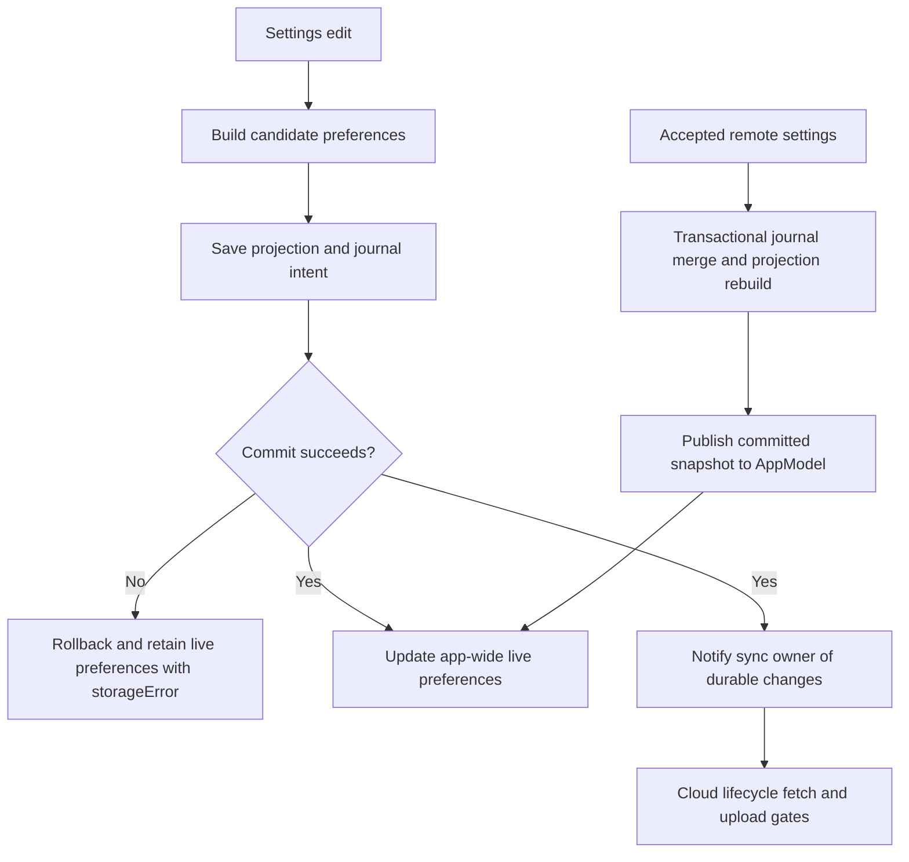
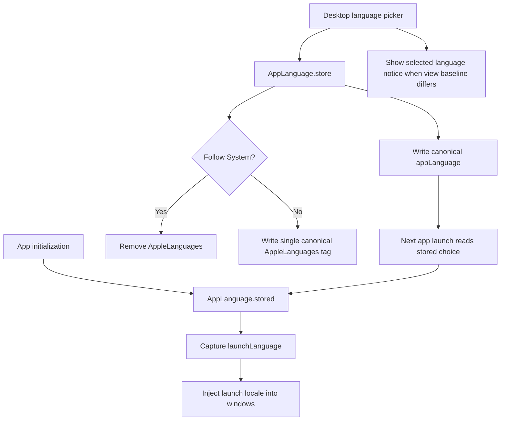
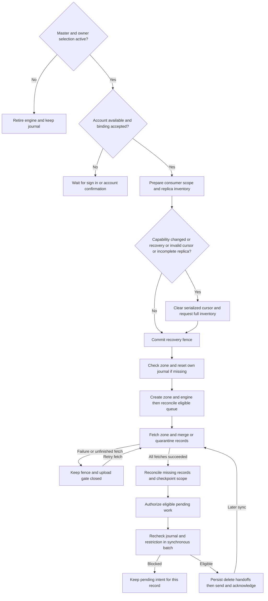
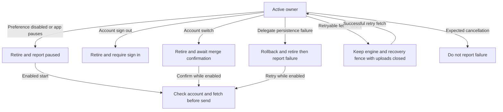
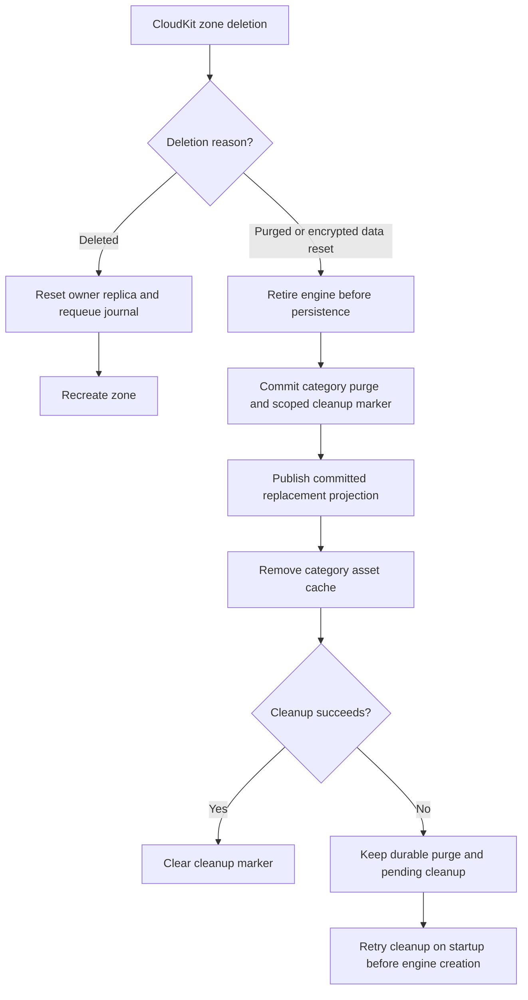
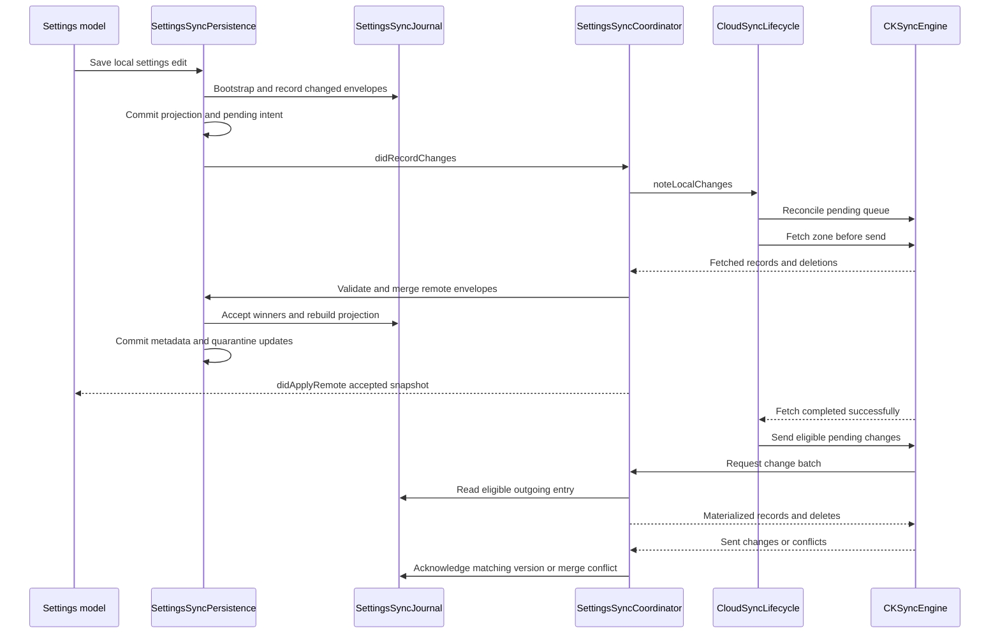
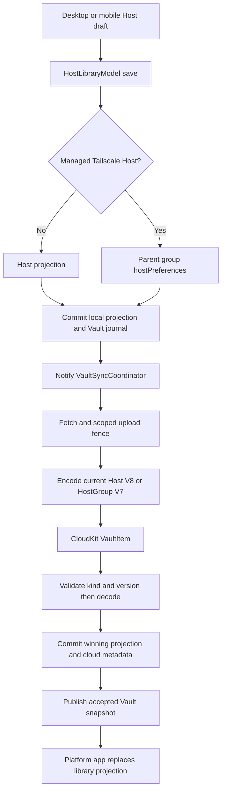
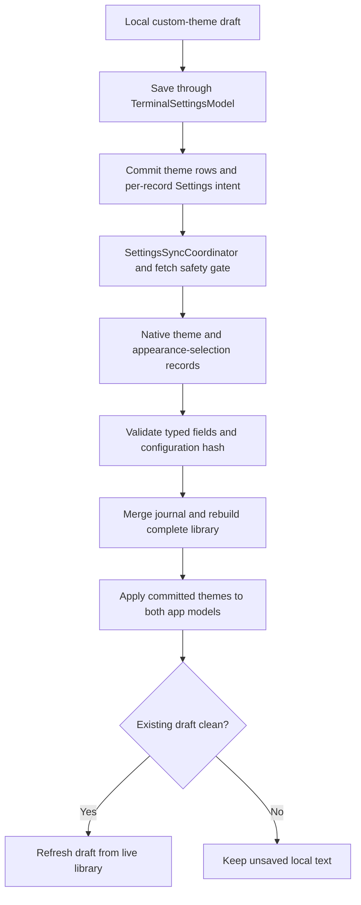

# Settings and Cloud Sync

Termind replicates a SwiftData-backed journal into the private `iCloud.com.akinokaede.termind` CloudKit container; this is **not** SwiftData CloudKit mirroring (`TermindPersistence.makeContainer` uses `cloudKitDatabase: .none`). Five writable owners—Vault, Settings, Metrics, Connection History, and Device—each own an engine, subscription, binding, queue, and lifecycle. History and Device retain the **same deployed zone**, `TermindConnectionHistoryV1`, but use separate subscriptions, kind-filtered journals and state rows, and separate safety scopes (Device's scope has consumer `device`; History keeps the original empty consumer). Neither should consume, reset or acknowledge the other's records. `HistoryRecordSyncCoordinator` shares the record-handling implementation, **not** their engine or account state. The former legacy importer is retired: Vault ignores obsolete History/Device copies in its own zone; it neither imports nor currently schedules physical cleanup of those copies. [CloudSyncJournal](../../Frameworks/TermindInfrastructure/Cloud/CloudSyncJournal.swift), [HistoryRecordSyncCoordinator](../../Frameworks/TermindInfrastructure/Cloud/HistoryRecordSyncCoordinator.swift), [VaultSyncCoordinator](../../Frameworks/TermindInfrastructure/Cloud/VaultSyncCoordinator.swift).

For embedded node enrollment, stable peer IDs, group preferences and device-local profile retirement, see [Tailscale groups, embedded nodes, and SSH](../integrations/tailscale.md).

## Settings routes and ownership

On macOS, `WindowModel` owns a per-window `settingsRoute` separate from app-wide preference models. `SettingsPageView` dispatches index → category → detail: App (including workspace preferences and diagnosis consent), Notifications, Terminal, Connections (SSH/SFTP), AI (providers, models, MCP servers, skills), and Sync. The index opens Pro as a paywall rather than a Settings category; a debug-enabled Logging route hangs directly off the index, and Developer is compiled only in DEBUG builds. `SettingsRoute.parent` drives toolbar back navigation: terminal custom-theme editor → custom themes → Terminal, provider models → provider → AI, and other detail pages → their category; back from index closes Settings and restores the previous destination, falling back to Vault if its workspace vanished. [SettingsPageView](../../TFM/Features/Settings/SettingsPageView.swift#L10-L207), [WindowModel](../../TFM/Features/Workspaces/WindowModel.swift#L596-L632), [SettingsNavigationTests](../../TFMTests/SettingsNavigationTests.swift#L13-L39), [SettingsNavigationTests](../../TFMTests/SettingsNavigationTests.swift#L76-L155).

Leaving a provider draft discards it only if unnamed and unconfigured; a new MCP draft with no valid name/namespace is deleted, whereas a skill with written content but no title is kept as a draft. Navigating between provider and its models does not prematurely clean it up. These route transitions act on shared app models rather than starting CloudKit directly. [SettingsPageView](../../TFM/Features/Settings/SettingsPageView.swift#L107-L113), [SettingsPageView](../../TFM/Features/Settings/SettingsPageView.swift#L213-L245), [SettingsPageView](../../TFM/Features/Settings/SettingsPageView.swift#L343-L365).

`SettingsKey` contains local `UserDefaults` keys for both UI/selection and mirrors of synced preferences; being a key in this enum does **not** imply it is a cloud record. `SettingsSyncSnapshot.recordPayloads` determines what Settings actually journals: AI providers, MCP servers, roles, skills, web search, terminal, per-theme custom themes and per-appearance theme selections, SSH, SFTP, workspace and notification preferences. Retired terminal highlighting no longer participates in that snapshot or active sync. In contrast diagnostic consent (`diagnostics.crashReportingConsent`, retained to avoid resetting earlier choices), debug visibility/logging, review-invitation history and terminal font family/size/follow-theme are device-local. Consent is an optional per-installation choice, not a synced notification preference or a cloud toggle: absence requires a choice and never enables reporting; `DiagnosisController` persists an explicit choice before applying it to the reporter. Terminal theme and integration preferences *do* enter the Settings snapshot even though they are mirrored to defaults. [SettingsKey](../../Frameworks/TermindApplication/SettingsKey.swift#L4-L78), [SettingsSyncStore](../../Frameworks/TermindPersistence/SettingsSyncStore.swift#L7-L55), [DiagnosisController](../../Frameworks/TermindApplication/FeatureModels/DiagnosisController.swift#L9-L32), [DiagnosisTests](../../FrameworkTests/DiagnosisTests.swift#L9-L50).

The desktop Show Status Bar toggle is a separate app-wide, device-local `DesktopSettingsKey.showStatusBar` default, enabled initially and shared by Settings and the View menu. It does not add a Settings sync record or per-window durable preference. The floating root overlay appears only for a selected workspace when enabled; it does not dock below or resize the detail area. Expanded/collapsed state is a separate app-wide local preference. [RootView](../../TFM/App/RootView.swift#L13-L65), [DesktopSettingsKey](../../TFM/App/DesktopSettingsKey.swift#L12-L36).

On mobile, Settings navigation passes the app-wide models to App, Notifications, Terminal, Connections, AI and Sync. App appearance (`mobile.appearance`) and compact cards (`mobile.compactCards`) are local `@AppStorage` choices, as are debug visibility, review state and diagnosis consent. Workspace automatic renaming instead uses `WorkspaceSettingsModel` and displays storage failures in red; Sync delegates selection changes to `MobileAppModel`. [MobileSettingsView](../../TFI/Features/Settings/MobileSettingsView.swift#L16-L59), [MobileAppSettingsView](../../TFI/Features/Settings/MobileAppSettingsView.swift).

## Local mutation, persistence errors, and composition

Settings views bind to app-wide preference models, not CloudKit records. `TerminalSettingsModel`, `SSHSettingsModel` and `WorkspaceSettingsModel` build a candidate value and persist it before replacing the live preferences. A failed save returns `false`, retains the old live value and sets `storageError`; a successful or remote application clears that error. SSH candidates and remote snapshots are normalized, and changed SSH preferences notify the connection coordinator through `didChange`. Workspace automatic-renaming Settings displays its model's storage error in orange. These are **local persistence failures**, distinct from a sync owner's account, fetch or upload status. [TerminalSettingsModel](../../Frameworks/TermindApplication/FeatureModels/TerminalSettingsModel.swift#L11-L59), [SSHSettingsModel](../../Frameworks/TermindApplication/FeatureModels/SSHSettingsModel.swift#L12-L41), [WorkspaceSettingsModel](../../Frameworks/TermindApplication/FeatureModels/WorkspaceSettingsModel.swift#L10-L35), [SettingsPageView](../../TFM/Features/Settings/SettingsPageView.swift#L459-L469), [AppModel](../../TFM/App/AppModel.swift#L422-L448).

Desktop `TermindApp` prepares `SettingsSyncPersistence` before constructing the live models. AI configuration and skills use synced adapters; terminal, notifications, SSH, SFTP and workspace models share the same settings persistence instance. Coordinators are injected through `AppDependencies` and omitted during XCTest, while settings persistence still exists. Store-startup failure is separate again: an in-use database presents the startup guard and exits, while other startup errors fail initialization. App composition does not put secret bytes into the settings projection; the Keychain and sync secret policy below remain separate boundaries. [TermindApp](../../TFM/App/TermindApp.swift#L81-L99), [TermindApp](../../TFM/App/TermindApp.swift#L151-L213).

Local edits persist before updating live models; remote snapshots reach them after commit without replaying a local edit. The cloud lifecycle gate is independent of local save success. [SettingsSyncPersistence](../../Frameworks/TermindPersistence/SettingsSyncStore.swift#L148-L211), [ModelContext.commit](../../Frameworks/TermindPersistence/ModelContext+Commit.swift#L9-L17), [AppModel](../../TFM/App/AppModel.swift#L440-L448).

## Device-local desktop language selection

The App language picker stores a **device-local** preference, not a Settings journal envelope. Its binding writes `SettingsKey.appLanguage` and calls `AppLanguage.store`. Explicit German, English, French, Japanese, Korean, Simplified Chinese and Traditional Chinese choices store canonical `de`, `en`, `fr`, `ja`, `ko`, `zh-Hans` and `zh-Hant` values plus a single-element `AppleLanguages` override. Follow System stores `system` and **removes** `AppleLanguages`, restoring normal Bundle negotiation rather than writing a guessed system language. Missing or unknown preferences resolve to Follow System. Legacy identifiers that Foundation resolves as Simplified Chinese migrate through `store` to canonical `zh-Hans`; unknown and noncanonical Traditional Chinese identifiers are not rewritten. [AppLanguage](../../Frameworks/TermindApplication/AppLanguage.swift#L76-L113), [SettingsPageView](../../TFM/Features/Settings/SettingsPageView.swift#L403-L416), [SettingsSyncSnapshot](../../Frameworks/TermindPersistence/SettingsSyncStore.swift#L7-L55), [AppLanguageTests](../../TFMTests/AppLanguageTests.swift#L51-L127).

`TermindApp` captures `launchLanguage` during initialization (a DEBUG screenshot demo can override it) and injects its locale into main and external-authentication windows. Selecting a new language does not replace that launch-time choice or automatically relaunch the app. `AppSettings` separately captures `AppLanguage.stored()` in its own initial state, also named `launchLanguage`; when its selected value differs, it shows “The new language will be used after Termind relaunches.” The notice resolves through `AppLocalization` with **the selected language's locale**, not the existing window locale. This local view baseline is not the app's immutable launch capture. [TermindApp](../../TFM/App/TermindApp.swift#L40-L52), [TermindApp](../../TFM/App/TermindApp.swift#L238-L271), [SettingsPageView](../../TFM/Features/Settings/SettingsPageView.swift#L403-L456).

Language storage affects the next launch; the current picker only stores the choice and presents a notice, with no automatic relaunch step.

`AppLocalization` chooses the `de`, `en`, `fr`, `ja`, `ko`, `zh-Hans` or `zh-Hant` localization bundle from the supplied locale, falling back to the main bundle if unavailable. Chinese script selection keeps Traditional and Simplified catalogs separate. The Traditional Chinese picker label is `正體中文` only when the device region is `TW` and `DeviceCensorship.canDisplayTaiwanFlag` is true; otherwise it is `繁體中文`. This label policy does not change the `zh-Hant` stored tag. [AppLanguage](../../Frameworks/TermindApplication/AppLanguage.swift#L3-L64), [AppLanguageTests](../../TFMTests/AppLanguageTests.swift#L66-L105). For wider localization/product boundaries, see [Commerce, Localization, and Product Surfaces](../concepts/commerce-localization-and-product-surfaces.md).

## Selection and app ownership

| Owner | Zone and records | Selection |
| --- | --- | --- |
| Vault | `TermindVaultV1` / `VaultItem` configuration | Master iCloud switch |
| Connection History | `TermindConnectionHistoryV1` / `ConnectionHistoryItem` | Master and optional History |
| Device | `TermindConnectionHistoryV1` / `DeviceItem` | Master, independently of History and Vault |
| Metrics | Its own Metrics zone and journal | Master and optional Metrics |
| Settings | `TermindAIConfigurationV1` / `AIConfigurationItem`, `SSHPreferencesItem`, `SFTPPreferencesItem`, `WorkspacePreferencesItem`, `NotificationPreferencesItem`, `TerminalCustomThemeItem`, `TerminalThemeSelectionItem` (legacy highlighting is ignored, not active) | Master and optional Settings |

The migration-only `vault.sync.enabled` participates in deriving the master selection if that switch has not been set. **History does not inherit it**: an unset History preference defaults to enabled, and `migrateSyncPreferences` does not copy the old Vault selection or environment into History. `CloudSyncSettingsContent` supplies the same UI to both platforms: a headerless iCloud toggle and aggregate status/actions, then “Optional Sync” toggles in History → Metrics → Settings order. There is no separate Vault or Device toggle. Enabling master sync is Pro-gated and attempts custom Host password migration to iCloud Keychain. [SettingsKey](../../Frameworks/TermindApplication/SettingsKey.swift), [CloudSyncSettingsContent](../../Frameworks/TermindPresentation/CloudSyncSettingsContent.swift).

Desktop `AppModel` starts **five** owners on setup when Pro permits, and starts or pauses all five when Pro access is reconciled. Mobile constructs all five coordinators only for a persistent store, wires History and Device repository change callbacks to their respective owners, and starts them from `reconcileSync()` only with an active scene and Pro access. Scene activation, preference changes, and scene removal call reconciliation; backgrounding explicitly pauses all five. Both composition roots relay accepted remote changes into app-wide models, rather than making engines window-owned. Settings snapshots update AI, skills, terminal, SSH, SFTP, workspace and notification preferences; Metrics updates its live selections, and History/Device reload their models. Remote Vault changes are planned before replacing the Host projection. Removed Hosts close workspaces and clear related activity; on desktop they also cancel transfers, authentication and host tools. Route changes invalidate desktop forwarding/agent connections through `willDeleteHost`; mobile invalidates SFTP edits, disconnects retained workspaces and cancels transfers. Removed Hosts also invalidate desktop SFTP edits. Both stop affected forwarding rules before snapshot replacement and reconcile forwarding afterward; mobile also updates live activities. Local persistence continues to record changes when an engine is paused. [AppModel](../../TFM/App/AppModel.swift#L332-L420), [MobileAppModel](../../TFI/App/MobileAppModel.swift#L182-L205), [MobileAppModel](../../TFI/App/MobileAppModel.swift#L291-L319), [MobileAppModel](../../TFI/App/MobileAppModel.swift#L454-L551).

## Lifecycle and recovery

Each coordinator adapts its category journal to `CloudSyncLifecycleStore` and delegates CloudKit events to `CloudSyncLifecycle`. On start, it finishes pending asset cleanup, checks account availability and identity, prepares scoped safety and replica state, resets the journal on environment change, and discards a cursor if safety requires refetch, replica reconciliation is incomplete, or serialization is absent/invalid. It **commits the recovery fence before checking/creating the zone or constructing the automatically syncing engine**; a missing zone resets that owner's replica and journal. It reconciles eligible mutations with the engine queue, then fetches before sending. Explicit and automatic fetches may overlap: *all* current fetches must succeed before `isReadyToSend` and Settings secret-upload authorization become true. A fresh inventory compares observed IDs to previously present scoped records, reconciles missing IDs, and checkpoints the replica and decoder capability only after successful fetch/merge; journaled edits survive the fresh cursor. [CloudSyncLifecycle](../../Frameworks/TermindInfrastructure/Cloud/CloudSyncLifecycle.swift#L314-L425), [CloudSyncLifecycle](../../Frameworks/TermindInfrastructure/Cloud/CloudSyncLifecycle.swift#L464-L513), [CloudSyncLifecycleSafety](../../Frameworks/TermindInfrastructure/Cloud/CloudSyncLifecycleSafety.swift#L16-L61), [CloudSyncSafetyPersistenceTests](../../FrameworkTests/CloudSyncSafetyPersistenceTests.swift#L141-L186).

The diagram shows one owner's fetch-before-send and scoped recovery gate; History and Device each run it over their shared zone with distinct consumer scopes. [CloudSyncLifecycle](../../Frameworks/TermindInfrastructure/Cloud/CloudSyncLifecycle.swift), [HistoryRecordSyncCoordinator](../../Frameworks/TermindInfrastructure/Cloud/HistoryRecordSyncCoordinator.swift).

A disabled master/category preference makes `start` pause the owner; disabled `retry` and account-merge confirmation do nothing. `pause` (also used by app Pro/background reconciliation), account sign-out or switch, and fatal delegate persistence failure retire an active engine: `retireEngine` changes the operation ID, cancels the operation task, clears readiness, Settings secret-upload authorization, scope and in-flight state, removes the engine synchronously, then schedules its `cancel()` in a **detached MainActor task**. This matters inside a CloudKit delegate callback: cancellation must not inherit its task-local callback context. Starting, retrying and scheduling local-change sends likewise use detached MainActor tasks. An old operation's late completion cannot change replacement status or authorize sends, and delegate events or batches for the old engine fail the identity check. A fatal delegate error rolls back, retires and reports failure; a normal cancellation (`CancellationError` or CloudKit `.operationCancelled`) is not logged or made a red failure. [CloudSyncLifecycle](../../Frameworks/TermindInfrastructure/Cloud/CloudSyncLifecycle.swift#L218-L314), [CloudSyncLifecycle](../../Frameworks/TermindInfrastructure/Cloud/CloudSyncLifecycle.swift#L621-L689), [CloudSyncEventHandling](../../Frameworks/TermindInfrastructure/Cloud/CloudSyncEventHandling.swift#L85-L130), [CloudSyncLifecycleTests](../../FrameworkTests/CloudSyncLifecycleTests.swift#L11-L74), [CloudSyncLifecycleTests](../../FrameworkTests/CloudSyncLifecycleTests.swift#L383-L435).

Retirement changes engine identity immediately; asynchronous cancellation and late completions cannot reopen the retired upload gate. A retryable fetch failure, unlike retirement, keeps the same engine for retry. [CloudSyncLifecycle](../../Frameworks/TermindInfrastructure/Cloud/CloudSyncLifecycle.swift#L238-L251), [CloudSyncLifecycle](../../Frameworks/TermindInfrastructure/Cloud/CloudSyncLifecycle.swift#L390-L403), [CloudSyncLifecycle](../../Frameworks/TermindInfrastructure/Cloud/CloudSyncLifecycle.swift#L645-L689).

A retryable zone-fetch failure keeps the engine but does **not** reopen uploading or clear the recovery fence; the pending journal remains authoritative and a later successful fetch reauthorizes sending. Network/rate/zone-busy errors report syncing for retry, `notAuthenticated` requests sign-in, and terminal errors report failure. Recovery stays required until outstanding fetch/send work completes safely. The status can separately report uploadable and blocked counts, with an update hint only for unsupported format—not corruption. Logging emits `cloud.sync.failed` with zone, stage and NSError domain/code, not raw records, account IDs or localized descriptions; expected cancellation is not an error. [CloudSyncLifecycle](../../Frameworks/TermindInfrastructure/Cloud/CloudSyncLifecycle.swift#L467-L515), [CloudSyncLifecycle](../../Frameworks/TermindInfrastructure/Cloud/CloudSyncLifecycle.swift#L598-L669), [CloudSyncEventHandling](../../Frameworks/TermindInfrastructure/Cloud/CloudSyncEventHandling.swift).

### Changing replicas and CloudKit deletions

An account mismatch records a pending user and requires explicit merge confirmation **before** any new-account engine exists. Confirmation resets the *owner's* journal before binding the new user, drops old-account tombstones and system fields, and requeues surviving local records. Old-scoped safety rows remain scoped to the old account; no legacy-quarantine preparation runs on confirmation. A changed `TermindCloudKitEnvironment` resets that owner's engine state and system fields and requeues envelopes without moving old-scoped restrictions. A missing zone or ordinary zone deletion recreates and requeues the corresponding replica; Device and History must not reset one another despite sharing a zone. By contrast CloudKit `.purged` or `.encryptedDataReset` retires the owner and purges that scope's local cloud cache and safety/replica state **without recreating the zone or uploading old local data**. Category asset-cache cleanup is tracked durably and finished on restart. [CloudSyncLifecycle](../../Frameworks/TermindInfrastructure/Cloud/CloudSyncLifecycle.swift#L284-L386), [CloudSyncLifecycle](../../Frameworks/TermindInfrastructure/Cloud/CloudSyncLifecycle.swift#L695-L720), [HistorySyncStore](../../Frameworks/TermindPersistence/HistorySyncStore.swift#L35-L64).

### Destructive purge and live projection invalidation

A destructive zone notification is deliberately stronger than an ordinary record deletion or missing zone. The lifecycle retires the engine **before** persistence is touched. The category purge commits the cleared/materialized projection, journal suppression, active-scope safety/replica cleanup and a durable asset-cleanup marker. Settings then mirrors the committed defaults and publishes the replacement snapshot through `didApplyRemote`, not through a local Save action. This keeps live models from retaining and later resending the pre-purge snapshot. Other-account safety rows remain intact, and History/Device retain their category boundary despite sharing a zone. [Settings purge](../../Frameworks/TermindPersistence/SettingsSyncStore.swift#L106-L129), [Coordinator purge](../../Frameworks/TermindInfrastructure/Cloud/SettingsSyncCoordinator.swift#L109-L119), [Physical deletion tests](../../FrameworkTests/CloudSyncPhysicalDeletionTests.swift#L13-L91).

Ordinary zone loss requeues data; destructive purge invalidates projections and never restores the old snapshot merely to retry asset cleanup.

Asset removal happens after the durable projection purge and notification. If removal fails, the owner stays retired and the cleared projection remains committed; restart must finish pending cleanup before creating an engine, even if the account/environment binding has changed. Tests reopen an on-disk store through failed and successful cleanup, assert no stale batch can be materialized, and verify that unrelated asset directories survive. These are fake-transport/persistence tests, not signed-device delivery evidence. [Cleanup failure regression](../../FrameworkTests/CloudSyncPhysicalDeletionTests.swift#L93-L178).

## Durable journals and wire contracts

Settings app models persist through `SettingsSyncPersistence`: configuration, skills and preference changes are compared as per-record snapshot payloads, and the SwiftData `ModelContext.commit` saves the local projection **and** `SettingsSyncJournal` upload intent together, rolling back on failure. `prepare()` migrates legacy role keys and bootstraps the current projection, including subsequently added terminal, SSH, SFTP, workspace and notification singletons, after discarding inactive highlighting journal entries. Its `didRecordChanges` callback notifies `SettingsSyncCoordinator`; a paused or missing engine does not prevent the journal write. Remote batches instead use `applyRemote` to merge envelopes, rebuild the complete projection (including out-of-order roles and providers), and commit journal, system-field and safety updates without echoing an accepted remote value as a local edit. Legacy provider Vertex fields and local skill packages are preserved when a remote envelope lacks them; resulting local differences are recorded as pending changes. [SettingsSyncPersistence](../../Frameworks/TermindPersistence/SettingsSyncStore.swift#L76-L102), [SettingsSyncPersistence](../../Frameworks/TermindPersistence/SettingsSyncStore.swift#L161-L234), [ModelContext.commit](../../Frameworks/TermindPersistence/ModelContext+Commit.swift#L9-L17), [SettingsSyncCoordinator](../../Frameworks/TermindInfrastructure/Cloud/SettingsSyncCoordinator.swift#L212-L275).

The Settings write and receive paths below share a journal but not an app-model edit entrypoint. The same lifecycle gate and scoped safety checks also apply to the other four owners; each supplies its own journal, record decoder and projection. [SettingsSyncPersistence](../../Frameworks/TermindPersistence/SettingsSyncStore.swift#L161-L234), [SettingsSyncCoordinator](../../Frameworks/TermindInfrastructure/Cloud/SettingsSyncCoordinator.swift#L181-L275), [CloudSyncLifecycle](../../Frameworks/TermindInfrastructure/Cloud/CloudSyncLifecycle.swift#L387-L417).

Settings' committed local mutation survives an unavailable engine; the fetch and quarantine fence prevents that mutation from being handed to CloudKit until safe. Received supported records update the live model only after the transactional merge. [SettingsSyncCoordinator](../../Frameworks/TermindInfrastructure/Cloud/SettingsSyncCoordinator.swift#L73-L89), [SettingsSyncCoordinator](../../Frameworks/TermindInfrastructure/Cloud/SettingsSyncCoordinator.swift#L188-L301), [CloudSyncLifecycle](../../Frameworks/TermindInfrastructure/Cloud/CloudSyncLifecycle.swift#L254-L268), [CloudSyncLifecycle](../../Frameworks/TermindInfrastructure/Cloud/CloudSyncLifecycle.swift#L464-L588).

Bootstrap writes baseline envelopes from local projections; subsequent real edits get ordered `VaultVersion` values and durable pending intent, including logical tombstones. Merge chooses the newer version, breaking equal-version payload ties deterministically; a local winner is requeued. Fetched values do not echo merely because they were read. Journal-held system fields preserve CloudKit optimistic-concurrency metadata; successful acknowledgements clear pending only for the **matching sent envelope**, including payload equality when migration seeds retain a baseline version, never a later edit or a quarantined ID. Outgoing eligibility derives from journal and scoped replica sidecars, not a restored CloudKit queue alone. [CloudSyncJournal](../../Frameworks/TermindInfrastructure/Cloud/CloudSyncJournal.swift#L41-L96), [HistorySyncStore](../../Frameworks/TermindPersistence/HistorySyncStore.swift#L222-L320), [CloudSyncRecordStateStore](../../Frameworks/TermindPersistence/CloudSyncRecordStateStore.swift#L112-L148).

Vault, Metrics and ordinary Settings records carry version/kind/entity/clock/deletion envelope metadata and validated payload hashes, storing small payloads inline and larger ones in `CKAsset`. Settings uses separate active SSH, SFTP, workspace and notification preference record types inside its existing zone so old clients filtering on type can skip them before decoding. Its record-type check also validates that the decoded preference kind agrees with the type. Vault normalizes device-local group/package expansion rather than syncing it; the V33 Identity shape has no `lastUsedAt`. Debug/logging, review history and terminal font family/size/follow-theme settings likewise stay device-local. [CloudSyncRecordCoding](../../Frameworks/TermindInfrastructure/Cloud/CloudSyncRecordCoding.swift), [SettingsSyncCoordinator](../../Frameworks/TermindInfrastructure/Cloud/SettingsSyncCoordinator.swift#L309-L355), [SettingsKey](../../Frameworks/TermindApplication/SettingsKey.swift).

Native History/Device writes use **typed CloudKit fields**, not JSON/asset payloads. Frozen V1 and V2 adapters validate metadata, record identity and live fields before interpretation, and clear optional fields when writing. History reads V1/V2 and writes V2: V1 accepts `ssh`, `telnet`, `sftp`, while V2 also accepts `mosh` and `eternalTerminal`. Live events require `hostID` and `connectedAt`, with optional `endedAt` and `sourceDeviceID`; Device remains V1 and requires `displayName`. Tombstones need only metadata. IDs remain `v1/connectionHistory/<uuid>` and `v1/device/<uuid>`, independent of format versions. Events can arrive before Hosts without CloudKit references. [V1](../../Frameworks/TermindInfrastructure/Cloud/HistoryCloudRecordV1.swift), [V2](../../Frameworks/TermindInfrastructure/Cloud/HistoryCloudRecordV2.swift), [History persistence](../../Frameworks/TermindPersistence/HistorySyncStore.swift).

History retains the 250 newest events and journals tombstones for overflow and clear operations while leaving device records intact. Event UUID deletion is terminal even against a delayed update with a later clock; Device, unlike events, can have a later explicit incarnation. Per-scope sidecars remember cloud presence, confirmed deletions and the exact **durable delete handoff before network submission**. Full-inventory reconciliation treats previously present but unseen records as physical deletions; only a newer pending explicit incarnation after a causal deletion handoff is preserved for recreation (not terminal History events). An ambiguous delete retains the handoff for retry; an acknowledgement applies only to the handed-off version, not a newer local edit. This avoids falsely acknowledging a newer device recreation after a crash, while reobserved records and blocked IDs still obey the outgoing fence. Ordinary physical record deletion is not a zone reset or permission to resend the local snapshot: it cancels pending updates and removes the projection unless the durable causal-deletion fence proves a newer pending explicit incarnation. Only that exception clears old system fields and preserves recreation, subject to upload restrictions; terminal History events never use it. [HistorySyncStore](../../Frameworks/TermindPersistence/HistorySyncStore.swift#L66-L113), [CloudSyncRecordStateStore](../../Frameworks/TermindPersistence/CloudSyncRecordStateStore.swift#L123-L170), [CloudSyncRecordStateStore](../../Frameworks/TermindPersistence/CloudSyncRecordStateStore.swift#L177-L256), [CloudSyncLifecycle](../../Frameworks/TermindInfrastructure/Cloud/CloudSyncLifecycle.swift#L480-L512), [CloudSyncSafetyPersistenceTests](../../FrameworkTests/CloudSyncSafetyPersistenceTests.swift#L189-L248).

**Retired Vault History is not imported or physically cleaned by the current owner.** New native History/Device records are written only to `TermindConnectionHistoryV1`. The Vault coordinator filters obsolete History/Device IDs out of decoded records and journal eligibility. It neither imports those payloads nor applies their deletion to local activity, but **does not queue physical deletes of old-zone copies**; do not assume that disabling the importer removes already uploaded legacy records. Old importer state is removed in migrated stores; native History bootstrap starts from current local events/devices, not the old Vault journal's clocks or system fields. Fresh installs read previously uploaded native records in the shared zone. [VaultSyncCoordinator](../../Frameworks/TermindInfrastructure/Cloud/VaultSyncCoordinator.swift#L105-L111), [VaultSyncCoordinator](../../Frameworks/TermindInfrastructure/Cloud/VaultSyncCoordinator.swift#L171-L237), [SwiftDataVaultJournal](../../Frameworks/TermindPersistence/SwiftDataVaultJournal.swift#L215-L239), [HistorySyncTests](../../FrameworkTests/HistorySyncTests.swift#L144-L167), [PersistenceCompatibilityTests](../../FrameworkTests/PersistenceCompatibilityTests.swift#L11-L101).

## Compatibility and upload fence

`SyncRecordFormats` versions records per family and kind; `VaultVersion` is a modification clock, **not** a wire version. SwiftData schema numbers are independent local migration contracts. Before decoding a payload or choosing historical defaults, readers check supported kind/version and field types. Frozen `VaultWireV1` DTOs preserve shipped Host SSH keys/defaults, including disabled session persistence and automatic artwork. V2 adds Host agent forwarding, SSH Key hardware references and Snippet color through separate adapters. Its Host decoder requires `agentForwardingEnabled`; V1 retains historical defaults. V2 SSH Key encoding writes domain `.external` hardware keys as the frozen `thisDevice` spelling and restores `.external` by security-key algorithm; software `.external` keys fail encoding. [VaultWireV1](../../Frameworks/TermindPersistence/VaultWireV1.swift#L126-L216), [VaultWireV2](../../Frameworks/TermindPersistence/VaultWireV2.swift), [VaultSyncCodec](../../Frameworks/TermindPersistence/VaultSyncPersistence.swift#L56-L139).

| Record kind | Read versions | Write version |
| --- | --- | --- |
| Vault Host | V1, V2, V4, V5, V6, V7, V8 | V8 |
| Vault HostGroup | V1–V7 | V7 |
| Vault SSHKey | V1, V2, V3 | V3 |
| Vault Snippet | V1, V2 | V2 |
| Vault WorkspaceTemplate | V1, V2 | V2 |
| Other ordinary Vault kinds | V1 | V1 |
| Native Connection History | V1, V2 | V2 |
| Native Device | V1 | V1 |
| Metrics selection | V1, V2 | V2 |

Host V3 is **not** a production reader. Record names retain their `v1/` identity prefix despite format upgrades, and codec errors throw rather than falling back to lossy encoding. V6 adds Host/HostGroup terminal transports, V7 adds Wake-on-LAN and Host V8 preserves `createdAt`; older encoding rejects values it cannot represent. WorkspaceTemplate V2 adds Mosh and Eternal Terminal panes. These contracts are independent of local SwiftData migrations. The current compatibility suite tests V30→V31 and V31→V34 migration, not the removed V28 reopen fixture or CloudKit delivery. [Format registry](../../Frameworks/TermindDomain/Vault/SyncRecordFormats.swift), [Codec](../../Frameworks/TermindPersistence/VaultSyncPersistence.swift), [Workspace V2](../../Frameworks/TermindPersistence/VaultWorkspaceWireV2.swift), [Compatibility tests](../../FrameworkTests/PersistenceCompatibilityTests.swift#L139-L244).

Unsupported versions/kinds, malformed payloads, invalid native fields and known-ID conflicts are quarantined with reason, received bytes (full secure `CKRecord` archive for native fields) and system fields in the container/environment/account/zone/**consumer** scope. Valid remote records, including `serverRecordChanged` replies, merge in a transaction with system-field updates and quarantine removal; failed persistence rolls back the unblock. Future unknown record types in an ordinary fetch may be ignored, but an unexpected type on a conflicting known ID cannot bypass validation. Scoped restrictions persist across pause, retry, relaunch and normal account/environment/zone resets, retain local pending intent, and do not block unrelated records. History and Device restrictions cannot leak into each other. [CloudSyncLifecycleSafety](../../Frameworks/TermindInfrastructure/Cloud/CloudSyncLifecycleSafety.swift#L49-L90), [CloudSyncSafetyStore](../../Frameworks/TermindPersistence/CloudSyncSafetyStore.swift), [CloudSyncSafetyTests](../../FrameworkTests/CloudSyncSafetyTests.swift).

Three checks protect outgoing changes: the replica sidecar omits blocked IDs when it enumerates journal mutations; reconciliation removes obsolete/blocked restored engine entries; and the synchronous batch checks current engine, fetch readiness, mutation operation and restriction again in each record provider. Each batch admits **at most 250 materialized changes in total (saves plus deletes)**, not 250 saves plus deletes; invalid/blocked entries do not consume that limit. A deletion cannot leave before its causal handoff is saved, and sent-record or delete acknowledgement cannot clear a newer pending incarnation. An unreadable safety/journal state fails closed rather than being read as an empty set. [CloudSyncRecordStateStore](../../Frameworks/TermindPersistence/CloudSyncRecordStateStore.swift#L122-L148), [CloudSyncLifecycle](../../Frameworks/TermindInfrastructure/Cloud/CloudSyncLifecycle.swift#L523-L600), [CloudSyncLifecycleTests](../../FrameworkTests/CloudSyncLifecycleTests.swift#L11-L30).

A changed decoder capability ID in **Vault, Settings and each native History/Device consumer** forces a scoped refetch and checkpoints capability only after a successful fetch/merge; Settings computes its ID from participating record kinds at V1, while Metrics passes its versioned decoder capability ID. Vault's capability string is derived from sorted kind names and their sorted **reading versions**, not the local SwiftData schema or the writing version. Adding V4/V5 readers therefore replays unchanged CloudKit records skipped under earlier capabilities, without discarding pending local edits. No current fence can retrofit a previously shipped unsafe binary; adding silently ignored fields in an existing version without raising the breaking version remains unsafe. [CloudSyncLifecycleSafety](../../Frameworks/TermindInfrastructure/Cloud/CloudSyncLifecycleSafety.swift#L16-L65), [VaultSyncCoordinator](../../Frameworks/TermindInfrastructure/Cloud/VaultSyncCoordinator.swift#L78-L95), [HistoryRecordSyncCoordinator](../../Frameworks/TermindInfrastructure/Cloud/HistoryRecordSyncCoordinator.swift#L61-L98), [SettingsSyncCoordinator](../../Frameworks/TermindInfrastructure/Cloud/SettingsSyncCoordinator.swift#L91-L105), [MetricsSyncCoordinator](../../Frameworks/TermindInfrastructure/Cloud/MetricsSyncCoordinator.swift#L81-L94).

Snippet color is an explicit per-kind wire upgrade, not a consequence of local schema V51. V2 composes color with the frozen V1 fields; V1 encoding rejects colored snippets rather than losing color. A newer remote V1 Snippet clears color to `.none`, and tombstones retain V1/V2 compatibility. `SnippetColorTests` verifies both direct codec and journal/merge behavior. Treat successful historical decoding separately from whether an older writer can round-trip a colored value.

## Host session persistence and icon preferences

These are **Vault Host/HostGroup configuration**, not Settings singleton records. Both desktop and mobile Host editors bind `HostSessionSection` to the draft's session-persistence value; the shared section exposes enablement, backend (tmux, Zellij, zmx or Herdr, preserving unknown backend IDs), and on-connect choices Ask, Create, or Normal Shell. New and legacy Hosts default to disabled persistence with tmux and Ask. The shared `HostOrganizationSection` binds `HostIconPicker` to `iconOverrideID`. These controls change saved host configuration rather than the global terminal preferences. [HostIntegrationSection](../../Frameworks/TermindPresentation/HostIntegrationSection.swift#L4-L30), [Desktop editor](../../TFM/Features/HostEditor/HostEditorView.swift#L296-L307), [Mobile editor](../../TFI/Features/HostEditor/MobileHostEditor.swift#L212-L224), [HostConnectionFields](../../Frameworks/TermindPresentation/HostConnectionFields.swift#L6-L31), [SessionPersistenceTests](../../FrameworkTests/SessionPersistenceTests.swift#L13-L47).

Ordinary Host edits go through `HostLibraryModel.saveHost` and `HostPersistence.save`: projection and changed Vault envelopes are saved together, with context rollback and restoration of the previous library on failure. The V53 local Host shape introduced session-persistence columns; V54 retains those columns and adds `iconOverrideID`. Those schema steps do not select CloudKit wire versions. For Tailscale-managed Hosts, `saveTailscaleHost` stores both choices in the parent group's `tailscale.hostPreferences` keyed by stable Host UUID, then rebuilds the discovered Host projection. Managed peers are not standalone uploaded Host rows. [HostLibraryModel](../../Frameworks/TermindApplication/FeatureModels/HostLibraryModel.swift#L961-L1002), [Tailscale preference projection](../../Frameworks/TermindApplication/FeatureModels/HostLibraryModel.swift#L2485-L2546), [HostPersistence](../../Frameworks/TermindPersistence/SwiftDataVaultStore.swift#L44-L94), [V53 Host](../../Frameworks/TermindPersistence/TermindSchemaV53HostModels.swift), [V54 Host](../../Frameworks/TermindPersistence/TermindSchemaV54HostModels.swift#L35-L115).

V4 wraps the frozen V2 Host or V3 HostGroup shape with session-persistence preferences. V5 wraps V4 with user artwork: a Host's optional `iconOverrideID`, or a sparse HostGroup `iconOverrides` dictionary. Group dictionaries require canonical lowercase UUID keys belonging to existing base host preferences. Encoding below V4 rejects non-default session preferences, and encoding below V5 rejects icon overrides: successful old-version encoding must not silently erase selections. Historical reads restore disabled persistence and automatic artwork. [VaultWireV4](../../Frameworks/TermindPersistence/VaultWireV4.swift#L4-L62), [VaultWireV5](../../Frameworks/TermindPersistence/VaultWireV5.swift#L4-L57), [VaultSyncCodec](../../Frameworks/TermindPersistence/VaultSyncPersistence.swift#L69-L139).

V4/V5 are historical session/artwork layers underneath the current transport, Wake-on-LAN and creation-metadata formats. Saved preferences are **not live recovery state**: `TerminalRecoveryStore` is independent of SwiftData/Vault/CloudKit, keeps encrypted device-local checkpoints under `Termind/TerminalRecovery`, excludes its directory from backup and consumes checkpoints before returning resumable protocol state. Neither Settings nor History moves a live terminal session between devices. [Recovery boundary](../../Frameworks/TermindRemoteInfrastructure/Security/TerminalRecoveryStore.swift#L9-L89).

Host preference edits use the Vault journal and wire contract, while sharing the lifecycle's fetch-before-send protection with Settings.

The Vault coordinator validates and merges fetched records and conflicts through `HostPersistence.applyRemote`, committing metadata and unblock before publishing accepted snapshots. Desktop and mobile replace their library projections through their existing remote-change plans; Tailscale projection rebuilds restore the group-backed choices. Artwork remains separate from system detection: saving a draft preserves the latest detected distribution, choosing Automatic clears the override, unknown icon IDs round-trip, and artwork-only changes do not trigger connection-route callbacks. [VaultSyncCoordinator](../../Frameworks/TermindInfrastructure/Cloud/VaultSyncCoordinator.swift#L172-L209), [HostIconTests](../../FrameworkTests/HostIconTests.swift#L23-L51), [HostIconTests round trips](../../FrameworkTests/HostIconTests.swift#L83-L183), [AppModel](../../TFM/App/AppModel.swift#L505-L534), [MobileAppModel](../../TFI/App/MobileAppModel.swift#L620-L648).

`SessionPersistenceTests` checks historical disabled defaults, backend/policy round trips, refusal of lossy old writes, group preference round trips and V52 disk migration/reopen. `HostIconTests` checks ordinary and Tailscale remote application, clearing and unknown IDs, failed-save rollback, old-format rejection, tombstones, and V53 migration followed by artwork save/reopen. Those cases verify codecs/local stores, not signed-device CloudKit delivery. The suite also exercises runtime session behavior with fake backends: SSH reconnect retains its attachment without replaying the startup snippet, and restoring Mosh/Eternal Terminal skips startup preparation while preserving the attachment. These runtime checks do not make recovery checkpoints synced Settings data. See [Session persistence](../concepts/session-persistence.md) and [SessionPersistenceTests](../../FrameworkTests/SessionPersistenceTests.swift#L14-L79).

## Custom terminal themes: drafts, migration and replication

Custom themes are not one opaque replacement of the whole library. `SettingsSyncSnapshot.recordPayloads` emits one `.terminalCustomTheme` envelope per UUID and one `.terminalThemeSelection` per light/dark appearance. Independent edits to different themes can merge. Selections retain a built-in fallback and may arrive before their theme: the custom ID remains unresolved until that theme arrives. Deleting a selected theme or narrowing its applicability repairs affected choices without changing the unaffected mode. [Settings snapshot](../../Frameworks/TermindPersistence/SettingsSyncStore.swift#L35-L58), [TerminalSettingsModel](../../Frameworks/TermindApplication/FeatureModels/TerminalSettingsModel.swift#L77-L122), [TerminalCustomThemeTests](../../FrameworkTests/TerminalCustomThemeTests.swift#L205-L268).

UI edits live in `TerminalCustomThemeDraft` until a save entrypoint succeeds. Desktop autosaves valid changes and saves before navigation; invalid or remotely deleted drafts remain protected by the discard flow. Only a clean existing draft refreshes from the live library; dirty text is not silently overwritten by a remote edit. Save trims the name and uses `TerminalSettingsModel.saveCustomTheme` → `saveTerminalThemes` → `saveLocal`, committing projection and per-record intent before updating the live library. A failed write leaves the draft dirty/new and the live library unchanged. An existing draft cannot resurrect a remotely deleted UUID; Make Copy assigns a new identity so the content can be saved intentionally. [Draft](../../Frameworks/TermindApplication/FeatureModels/TerminalCustomThemeDraft.swift), [Theme persistence](../../Frameworks/TermindPersistence/TerminalThemePersistence.swift#L53-L99), [Draft tests](../../FrameworkTests/TerminalCustomThemeTests.swift#L61-L112).

The existing Settings owner writes native `TerminalCustomThemeItem` and `TerminalThemeSelectionItem` records in its existing zone. They use typed V1 metadata and fields rather than a JSON payload. Configuration is inline text or a raw UTF-8 `configurationAsset` above the shared inline threshold, with a SHA-256 `configurationHash`; readers reject inconsistent field combinations, corrupt hashes, invalid identities/appearance and unsupported versions. Tombstones clear live fields. Native-field quarantine preserves the record archive for later decoding. Committed remote snapshots reach `applyRemoteThemes` on both app models, not the draft Save path. [Native theme contract](../../Frameworks/TermindInfrastructure/Cloud/TerminalThemeCloudRecordV1.swift), [Settings owner](../../Frameworks/TermindInfrastructure/Cloud/SettingsSyncCoordinator.swift#L242-L295), [Desktop reconciliation](../../TFM/App/AppModel.swift#L468-L477), [Mobile reconciliation](../../TFI/App/MobileAppModel.swift#L448-L457).

Legacy dark/light custom configuration is migrated during preparation and after a remote journal merge. Migration uses deterministic IDs derived from appearance, base and text, and baseline clocks that cannot outrank an explicit newer choice. A selection envelope—including its tombstone—is the per-mode migration marker. Fresh defaults do not publish an empty migration; later legacy cloud settings can still seed the library. Once a native selection exists, old terminal-singleton writes do not erase that library. [Migration](../../Frameworks/TermindPersistence/TerminalThemePersistence.swift#L101-L159), [Remote materialization](../../Frameworks/TermindPersistence/SettingsSyncStore.swift#L174-L222), [Migration tests](../../FrameworkTests/TerminalCustomThemeTests.swift#L114-L160).

Custom-theme content and selection share the Settings transaction and lifecycle, but drafts are not replicated.

`TerminalCustomThemeTests` covers independent per-theme edits, selection-before-theme delivery, tombstones, failed batch rollback, raw UTF-8 assets and corruption, stable legacy migration and V56 store reopening. These tests exercise local persistence and record coding, not signed-device delivery.

## Notification preferences across Settings and app models

`NotificationPreferences` is a synced Settings singleton, not a device-local authorization grant. It carries enabled state, independent assistant/terminal/SFTP delivery modes (`never`, `unfocused`, `always`), terminal system-notification versus bell delivery and a nonnegative terminal minimum duration. The defaults enable notifications, use `unfocused` for all three modes, system delivery and a five-second minimum. `usesSystemNotifications` excludes bell-only terminal delivery and disabled categories; the terminal duration threshold still applies to bell delivery. The decoder defaults a missing SFTP mode to `unfocused` for older payloads, but validates the nonnegative duration. [NotificationPreferences](../../Frameworks/TermindDomain/Settings/NotificationPreferences.swift#L3-L57), [NotificationPreferencesTests](../../FrameworkTests/NotificationPreferencesTests.swift#L55-L75).

`SettingsSyncPersistence.prepare()` bootstraps a missing notifications envelope even for stores already bootstrapped before this preference existed. `saveNotificationPreferences` validates then commits its SwiftData singleton and changed journal envelope together; `materialize()` restores default preferences on a winning remote tombstone. Settings uses `NotificationPreferencesItem` in the existing Settings zone rather than the older `AIConfigurationItem` record type; decoding verifies the envelope kind agrees with the record type. A supported remote winner updates persistence without invoking the local-change callback, then the coordinator notifies the app after commit; both platform composition roots apply the snapshot to their shared `NotificationSettingsModel`. The V40→V41 lightweight schema step adds `PersistentNotificationPreferences`, and the migration/reopen test verifies both the saved notification row and an older workspace setting survive. [SettingsSyncPersistence](../../Frameworks/TermindPersistence/SettingsSyncStore.swift#L76-L102), [SettingsSyncPersistence](../../Frameworks/TermindPersistence/SettingsSyncStore.swift#L172-L235), [SettingsSyncPersistence](../../Frameworks/TermindPersistence/SettingsSyncStore.swift#L368-L382), [SettingsSyncCoordinator](../../Frameworks/TermindInfrastructure/Cloud/SettingsSyncCoordinator.swift#L309-L355), [NotificationPreferencesTests](../../FrameworkTests/NotificationPreferencesTests.swift#L95-L185), [MobileAppModel](../../TFI/App/MobileAppModel.swift#L410-L418), [AppModel](../../TFM/App/AppModel.swift#L393-L401).

Terminal keyword highlighting is **retired**, not another active Settings singleton. V52 removes its historical local model; preparation discards inactive envelopes and excludes it from active bootstrap/capability/upload state. The legacy `TerminalHighlightPreferencesItem` type and `v1/terminalHighlighting/default` key are recognized only to ignore fetched/conflict/deletion records **before** reconciliation and payload validation. Even malformed retired records cannot replace other preferences or create quarantine through that path. Historical server types and old clients require separate rollout review; do not recreate the deleted live models or editor. See [Ghostty Terminal Integration](../concepts/ghostty-terminal-integration.md) and the retirement regression fixtures.

The notification model loads persisted preferences on construction; an invalid or failed edit does not change its live value, whereas a committed remote snapshot replaces it without writing or echoing. An active scene requests initial system authorization at most once per app-level model, only when loaded settings call for system delivery and no load error occurred; disabled notifications and bell-only terminal delivery do not prompt. The shared view modifier runs on active-scene transitions, but the model's one-shot guard deduplicates concurrent scenes and reactivation. [NotificationSettingsModel](../../Frameworks/TermindApplication/FeatureModels/NotificationSettingsModel.swift#L4-L47), [InitialNotificationAuthorization](../../Frameworks/TermindPresentation/InitialNotificationAuthorization.swift#L4-L20), [NotificationPreferencesTests](../../FrameworkTests/NotificationPreferencesTests.swift#L12-L53), [NotificationPreferencesTests](../../FrameworkTests/NotificationPreferencesTests.swift#L77-L93).

## Hardware key metadata at the Vault boundary

Security-key SSH entries are Vault **metadata**, not Keychain private keys: `HostLibraryModel.upsert` validates their credential ID, 65-byte X9.63 public key and lack of certificate, normalizes storage to `.external` and clears `credentialRef`. The V45 persistent key row stores credential ID, public key and verification policy; on load a security-key algorithm normalizes older storage values to `.external`. V2 carries this reference between Vault replicas, so connection preparation can resolve both destination and jump credentials even when Keychain access fails. Availability for these entries comes from the persisted reference, whereas software-key availability still checks Keychain. Failed metadata saves or deletes restore the in-memory library; upgrading a V44 software key store still preserves its keys. This is distinct from syncing software-key private material. [HostLibraryModel](../../Frameworks/TermindApplication/FeatureModels/HostLibraryModel.swift#L1454-L1481), [HostLibraryModel](../../Frameworks/TermindApplication/FeatureModels/HostLibraryModel.swift#L1594-L1650), [TermindSchemaV45KeyModels](../../Frameworks/TermindPersistence/TermindSchemaV45KeyModels.swift#L14-L71), [WebAuthnVaultMetadataTests](../../FrameworkTests/WebAuthnVaultMetadataTests.swift#L19-L76), [WebAuthnVaultMetadataTests](../../FrameworkTests/WebAuthnVaultMetadataTests.swift#L121-L161).

## Settings secrets and operations

Settings synchronizes credential **references**, not secret bytes. After accepting provider or MCP-server references, `SettingsSyncCoordinator` marks them iCloud-backed. It migrates provider, Vertex and MCP references before a send/batch only when the current Settings fetch has authorized uploads and master plus Settings switches remain enabled. An active/failed fetch or engine retirement revokes authorization; `AISecretStore` verifies an iCloud copy before removing the device copy, and saves pending-deletion markers before deleting Keychain values so delayed delivery cannot resurrect a removed secret. [SettingsSyncCoordinator](../../Frameworks/TermindInfrastructure/Cloud/SettingsSyncCoordinator.swift#L120-L155), [SwiftDataAISecretStore](../../Frameworks/TermindPersistence/SwiftDataAISecretStore.swift), [CloudSyncLifecycle](../../Frameworks/TermindInfrastructure/Cloud/CloudSyncLifecycle.swift#L472-L505).

Deploy and verify category record types, zones and subscriptions in both CloudKit environments, especially active `SFTPPreferencesItem` and `NotificationPreferencesItem`; treat legacy highlighting as a separate mixed-version retirement check rather than a new-feature deployment requirement, and run signed multi-device checks for offline edits, master/optional switches, Pro expiration, account change, zone deletion, and delayed Keychain delivery. See [CloudKit Schema Deployment and Signed-Device Release Readiness](../operations/cloudkit-release-readiness.md). When adding an owner, create an independent journal/state, subscription and safety consumer scope (and normally a zone), wire its own lifecycle/delegate and platform Pro/scene gating, and preserve every outbound fence. Do not reuse a sibling's system fields or cursor even if sharing a zone. For persistence and secrets see [Persistent Data, Migrations, and Secret Boundaries](../concepts/persistence-and-secrets.md); for app composition see [Platform Runtime, App Composition, and Lifetimes](../architecture/platform-runtime.md).

## Focused verification

- `SettingsPortTests` exercises the typed boundary: failed terminal saves retain applied preferences, remote terminal application skips the local-write callback, mobile provider edits preserve MCP servers/skills/unresolved roles, and migration preserves optional Settings selection while master is paused. New Vault credential storage requires master selection **and** Pro capability regardless of the legacy Vault toggle. [SettingsPortTests](../../FrameworkTests/SettingsPortTests.swift#L45-L147).
- Migration fixtures in `SettingsSyncTests` reopen a V12 store with the current migration plan and retain providers/endpoints/models, skills, web search and terminal custom text without materializing an optional sync choice or changing local font size. A completed-bootstrap fixture adds a missing terminal baseline without rewriting existing envelopes; the terminal round-trip checks defaults mirroring without a remote echo. These are local migration/merge tests, not signed-device CloudKit tests. [SettingsSyncTests](../../TFMTests/SettingsSyncTests.swift#L89-L181).
- `AppLanguageTests` pins canonical defaults and `AppleLanguages`, Follow System removal, legacy Simplified Chinese migration, unknown-value preservation, region-dependent labels, catalog separation and the selected-language notice. It includes German, French and Korean persistence and system-negotiation restoration, and keeps Follow System first with explicit choices sorted by language code. `SettingsSyncTests` checks settings round-trips, local edits while disabled, no-op version stability, out-of-order roles and invalid-batch rollback. These tests do not require an automatic relaunch. [AppLanguageTests](../../TFMTests/AppLanguageTests.swift#L9-L170), [SettingsSyncTests](../../TFMTests/SettingsSyncTests.swift#L435-L526).
- `SettingsNavigationTests` verifies the Settings parent-route chain, back-to-content return (including a missing workspace), paywall presentation without a Pro route, and navigation through Assistant; `DiagnosisTests` verifies per-installation consent defaults, durable choices and revocation ordering. [SettingsNavigationTests](../../TFMTests/SettingsNavigationTests.swift#L13-L155), [DiagnosisTests](../../FrameworkTests/DiagnosisTests.swift#L9-L75).
- `CloudSyncPhysicalDeletionTests` checks all five categories for remote deletion cancelling pending updates across restart, physical-delete batches and stale acknowledgements, causal recreation versus terminal History deletion, full inventories, active-account purge isolation, projection notification and durable asset cleanup. In particular, an ordinary pending edit is not sufficient evidence to recreate a remotely deleted record. [Physical deletion tests](../../FrameworkTests/CloudSyncPhysicalDeletionTests.swift).
- `CloudSyncLifecycleTests` exercises fetch gating, recovery, overlapping events, account/environment/zone changes, destructive purge, stale-engine rejection and the combined save/delete batch limit. Its delegate-context tests verify detached fetch/send and engine cancellation; late fetch/send and fatal delegate failures cannot revive a retired engine. Disabled selection prevents start, retry and account confirmation.
- `CloudSyncSafetyTests` uses five real owner adapters with fake CloudKit transport to check winner/queue reconciliation, quarantine at each upload boundary, conflict handling, malformed native fields, rollback, and healthy-peer progress; `CloudSyncSafetyPersistenceTests` covers scoped on-disk recovery and migrations.
- `HistorySyncTests` checks typed native fields, independent History/Device scopes and switches, terminal event tombstones and retention, no retired-source import, and error/cancellation diagnostics. `PersistenceCompatibilityTests` checks current local V30/V31 migration cases and dropping retired importer state on V35 reopen.
- `CloudSyncCoordinatorLifecycleTests`, `TFMTests/SettingsSyncTests.swift`, `TFMTests/VaultSyncTests.swift` and `SyncRecordEvolutionTests` cover per-owner gating, Settings secret authorization, journal/metadata exclusions, assets and wire evolution. `WebAuthnVaultMetadataTests` covers Keychain-free connection preparation and Vault round-trip, the frozen V2 `thisDevice` representation, invalid software external storage, metadata rollback, and V44 software-key reopen. `NotificationPreferencesTests` verifies settings record round-trip without echo, invalid remote duration, V40→V41 persistence reopening, edit failure and one-shot authorization across scenes. [HistorySyncTests](../../FrameworkTests/HistorySyncTests.swift), [CloudSyncSafetyTests](../../FrameworkTests/CloudSyncSafetyTests.swift), [PersistenceCompatibilityTests](../../FrameworkTests/PersistenceCompatibilityTests.swift).

Current Vault writers are Host V8, HostGroup V7, SSHKey V3, Snippet V2 and WorkspaceTemplate V2, with the historical readers listed above. Metrics selection writes V2 and reads V1/V2; its capability checkpoint forces refetch without losing newer pending local changes. Tailscale group configuration syncs as HostGroup data; managed peer Hosts and local profile/sign-in/cache/cleanup state are excluded. Command/SFTP browse history is memory-only; History remains solely the connection-event stream.
