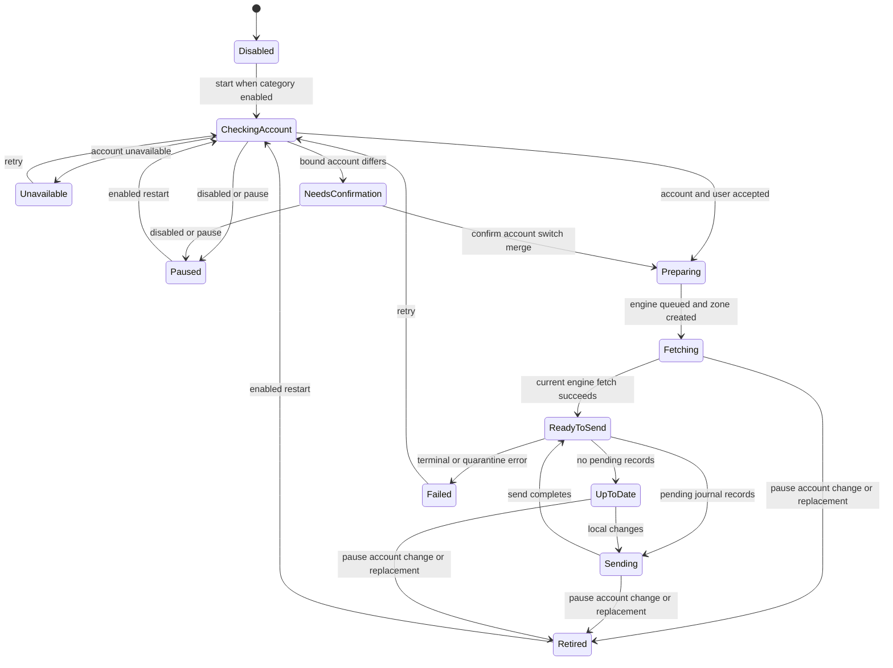

# Settings, Vault, Metrics, and Cloud Sync Workflow

Termind synchronizes three **independent categories** in the private `iCloud.com.akinokaede.termind` container: Vault records, application Settings, and Metrics selections. Each category has its own coordinator, private custom zone, subscription, `CKSyncEngine`, durable journal state, account binding, environment marker, pending queue, and status. The shared `CloudSyncLifecycle` supplies the safety protocol, but it does not make category state shared. Pausing Vault, for example, neither retires Settings/Metrics engines nor revokes Settings’ secret-upload authorization.

This workflow is CloudKit replication built around a SwiftData journal, not SwiftData’s CloudKit integration. `TermindPersistence` owns the journal models and the coordinator applies accepted remote envelopes back through the relevant persistence facade. Platform app models own coordinator lifetime and apply resulting snapshots to their runtime models.

## Categories, switches, and runtime ownership

| Category | Coordinator and zone | Content boundary | Default control |
| --- | --- | --- | --- |
| Vault | `VaultSyncCoordinator`; `TermindVaultV1`; `VaultItem` | Hosts, identities, SSH-key references, known hosts, snippets, forwarding rules, and workspace templates | `vault.sync.enabled` plus `icloud.sync.enabled` |
| Settings | `SettingsSyncCoordinator`; `TermindAIConfigurationV1`; `AIConfigurationItem`, `SSHPreferencesItem`, and `SFTPPreferencesItem` | AI configuration, skills, search, terminal, SSH, and SFTP preferences—not credential material | `settings.sync.enabled` plus `icloud.sync.enabled` |
| Metrics | `MetricsSyncCoordinator`; `TermindMetricsV1`; `MetricsItem` | Persisted metrics selections, not samples or active monitoring | `metrics.sync.enabled` plus `icloud.sync.enabled` |

All master and category switches default on. A category is enabled only when the master `SettingsKey.iCloudSyncEnabled` and that category’s key are enabled; an absent preference uses its category default. `SettingsKey.migrateSyncPreferences(in:)` migrates the old Settings selection and derives an initial master choice without discarding explicit opt-outs.

`AppModel` starts all three coordinators only when the Vault-sync Pro capability is available, pauses all of them when entitlement is absent, and routes accepted remote snapshots to the corresponding app-wide models. On mobile, `MobileAppModel.reconcileSync()` starts them only while at least one scene is active and the same capability is available; otherwise it pauses them. This makes synchronization app-wide and entitlement/lifecycle-controlled rather than window- or scene-owned.

## Lifecycle: fetch before send

Every coordinator adapts its own journal to `CloudSyncLifecycleStore` and implements `CKSyncEngineDelegate`; the lifecycle owns the engine session and operation generation. It first checks the CloudKit account and user record, binds or requests confirmation for the account, resets incompatible CloudKit metadata when needed, creates an engine, restores queued journal record names, ensures its zone exists, and fetches that zone. **No send is authorized until that fetch succeeds for the current engine.** Local edits still enter the durable journal while sync is paused or while the fetch is in progress.

This state diagram shows the per-category fetch-before-send gate and the account-change confirmation path.

A lifecycle runs at most one tracked operation. It gives each operation an ID and only lets that ID clear the operation or publish an error. `pause()` or an account transition retires the engine: it changes the operation ID, cancels the task and engine operations, clears readiness, and removes the engine. Completion handlers and delegate events must also satisfy `lifecycle.accepts(engine)`, which requires identity with the current engine and an enabled category. Thus stale generations cannot publish status, provide a record batch, authorize uploads, or clear a replacement operation.

Retryable CloudKit errors—network failure/unavailability, service unavailable, rate limit, zone busy, and truncated results—leave the category in a syncing state for retry. `notAuthenticated` becomes an unavailable sign-in status; other errors are failed. A journal quarantine reason or terminal outgoing-record error takes precedence over an otherwise up-to-date status, preventing a false successful indication.

## Account, zone, and environment transitions

The journal persists serialized engine state, `boundUserRecordName`, `pendingUserRecordName`, and the last successful sync. Before creating an engine, the lifecycle compares CloudKit’s current user record name with the binding:

- With no binding or a matching account, it stores the current account and proceeds.
- With a different bound account, it records the new user as pending, reports `.accountChangeConfirmationRequired`, and does not create an engine or upload anything.
- `confirmAccountSwitchMerge()` resets journal state **before** binding the pending account, then retires and restarts. The account reset removes deletion tombstones, marks live records for upload, clears CloudKit system fields, serialized engine state, and last-success time. It therefore avoids carrying an old account’s deletions into the new account.
- CloudKit sign-out retires the engine and reports the category’s sign-in message. A different sign-in or switch accounts retires it and requires merge confirmation; a same-user sign-in can continue.

The current `TermindCloudKitEnvironment` bundle value is also compared with a category-specific `UserDefaults` marker. On change, the category keeps envelopes but requeues them, discards system fields/change tags and engine serialization, clears last-success time, saves, and records the new environment. This prevents Development metadata from being reused in Production. If CloudKit reports the category zone deleted or returns `zoneNotFound`, the lifecycle similarly resets/requeues the journal, asks the engine to recreate the zone, and retains the account binding.

## Journal and replication protocol

A journal is the durable outbox and merge authority for each category. Bootstrap creates baseline envelopes for an initial local snapshot. Local persistence writes compute only real differences, assign an ordered version using the installation writer ID, mark changed records `needsUpload`, and retain deletion tombstones. Because journaling happens independent of lifecycle readiness, edits made while disabled are accumulated and sent later; no-op saves do not advance versions.

Each pending envelope is encoded into a CloudKit record with envelope metadata (`formatVersion`, `kind`, `entityID`, `modifiedAt`, `counter`, `writerID`, and `isDeleted`) and a payload hash. The coding layer uses inline bytes below its limit and a local `CKAsset` for larger payloads. Journal-held CloudKit system fields are reused on subsequent saves and updated from fetched/saved records, enabling ordinary CloudKit optimistic concurrency.

On fetch, coordinators process only their zone and accepted record types. They decode and validate envelopes, quarantine malformed or unsupported payloads with their received bytes and reason, merge valid envelopes in a persistence transaction, retain remote system fields, and notify the app only after accepted values are applied. A physical CloudKit deletion is not treated as a user deletion: if a local journal row still exists, it is marked for re-upload. Logical deletion is represented by an envelope tombstone.

Merge is deterministic: newer versions win; an older remote value causes the local value to be requeued. For equal versions whose payloads differ, encoded bytes provide a deterministic tie-breaker. Settings and Metrics additionally collapse multiple fetched versions of one key before deciding, so batch delivery order does not affect the result. A `serverRecordChanged` save failure applies the server envelope and either recognizes an identical local version as uploaded or requeues the winning local result. Successful sends clear `needsUpload` only if the journal still holds the sent version, so a newer local edit cannot be incorrectly acknowledged.

Vault projections deliberately remove device-local presentation/usage metadata from envelopes: group/package expansion is normalized and identity `lastUsedAt` is omitted, while applying a remote identity preserves the local usage timestamp. Settings likewise excludes explicitly device-local defaults such as debug/logging, review history, and terminal font family/size/follow-theme-size. Settings record-type compatibility is intentional: SSH and SFTP preferences use distinct types in the Settings zone so older clients can ignore newer records before decoding.

## Settings references and secret authorization

Settings records carry credential **references**, never secret material. After accepting a remote provider or MCP-server envelope, `SettingsSyncCoordinator` calls `AISecretStore.acceptRemoteReferences`, marking those references as iCloud-backed so an old device-local copy cannot override a delayed iCloud Keychain value.

Secret migration is coupled to the Settings lifecycle, not merely to a preferences toggle:

1. A current Settings engine must successfully fetch its zone.
2. Only then does `CloudSyncLifecycle` invoke the Settings `authorizeUploads(true)` callback and set `isReadyToSend`.
3. Before a send and when its change-batch delegate is asked for records, `SettingsSyncCoordinator` migrates references found in provider, Vertex, and MCP configuration.
4. `AISecretStore` permits new iCloud copies only when that authorization is true and both master and Settings switches remain on. It verifies a copied iCloud value before recording the iCloud location and removing the device copy.
5. Pausing, account retirement, or a failed initial fetch leaves or returns authorization to false. Therefore a stale engine cannot migrate/upload secrets merely because Settings was once enabled.

The store retains pending-deletion markers before deleting Keychain values and never reads them again as live secrets; this prevents late Keychain delivery from resurrecting a deleted credential. Once a reference is known in iCloud, later writes stay there even if a switch is turned off, while newly created secrets under a disabled or unverified workflow remain device-local.

## Operations and extension guidance

CloudKit deployment is separate from a passing local build. Deploy and validate the private container schema in Development and Production, preserving category zone names, record types, and subscription IDs; deploy `SFTPPreferencesItem` before clients upload it. Run signed-device checks across multiple devices on one account and explicitly test offline edits, per-category and master pause/resume, delayed Keychain delivery, account switching, and Pro expiration. See [CloudKit Schema Deployment and Signed-Device Release Readiness](/openwiki/operations/cloudkit-release-readiness.md) for the full release matrix and [Build, Validation, Localization, and Dependency Release Operations](/openwiki/operations/build-test-and-release.md) for ordinary build gates.

When adding a synchronized category, do not share an existing coordinator or journal. Create a category-owned zone/subscription/record type, persistence journal/state/quarantine models, coordinator record coding and delegate handling, independent enable/environment keys, and an adapter to `CloudSyncLifecycle`. Preserve fetch-before-send and current-engine checks in every `nextRecordZoneChangeBatch` implementation. Decide which fields are truly portable before adding them to envelopes; normalize or omit device-local runtime/UI metadata, and keep credentials in Keychain behind references.

When evolving a record, retain decode compatibility and validation. Unsupported or malformed records should be quarantined rather than partially applied, and a migration that changes a record identity must clear incompatible system fields and engine state. Do not turn a physical console deletion into silent data loss; retain tombstone semantics within the envelope protocol.

## Focused verification

- `FrameworkTests/CloudSyncLifecycleTests.swift` verifies fetch gating, accumulated local changes, retry behavior, operation/engine retirement, account confirmation/reset ordering, environment and zone resets, and error-status precedence.
- `FrameworkTests/CloudSyncCoordinatorLifecycleTests.swift` verifies category isolation and confirms that Settings secret authorization follows a successful fetch and is revoked on account retirement.
- `TFMTests/SettingsSyncTests.swift` covers local mirrors, Settings journal/merge behavior, independent toggles, device-local exclusions, wire compatibility, and AI secret migration/deletion behavior.
- `TFMTests/VaultSyncTests.swift` covers stable envelope names, tombstones, deterministic merge/requeue behavior, local metadata exclusion, large payload assets and corruption rejection, and environment resets.

For persistence ownership and Keychain boundaries, see [Persistent Data, Migrations, and Secret Boundaries](/openwiki/concepts/persistence-and-secrets.md). For app-wide coordinator construction and platform lifecycle behavior, see [Platform Runtime, App Composition, and Lifetimes](/openwiki/architecture/platform-runtime.md).
