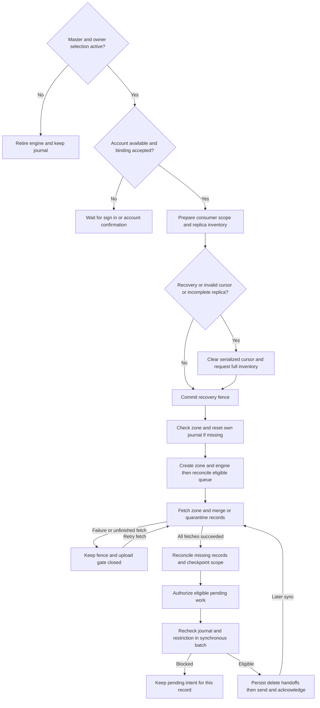

# Settings, Vault, Metrics, History, Device, and Cloud Sync

Termind replicates a SwiftData-backed journal into the private `iCloud.com.akinokaede.termind` CloudKit container; this is **not** SwiftData CloudKit mirroring (`TermindPersistence.makeContainer` uses `cloudKitDatabase: .none`). Five writable owners—Vault, Settings, Metrics, Connection History, and Device—each own an engine, subscription, binding, queue, and lifecycle. History and Device retain the **same deployed zone**, `TermindConnectionHistoryV1`, but use separate subscriptions, kind-filtered journals and state rows, and separate safety scopes (Device's scope has consumer `device`; History keeps the original empty consumer). Neither should consume, reset or acknowledge the other's records. `HistoryRecordSyncCoordinator` shares the record-handling implementation, **not** their engine or account state. The former legacy importer is retired: Vault ignores obsolete History/Device copies in its own zone; it neither imports nor currently schedules physical cleanup of those copies. [CloudSyncJournal](repo://Frameworks/TermindInfrastructure/Cloud/CloudSyncJournal.swift), [HistoryRecordSyncCoordinator](repo://Frameworks/TermindInfrastructure/Cloud/HistoryRecordSyncCoordinator.swift), [VaultSyncCoordinator](repo://Frameworks/TermindInfrastructure/Cloud/VaultSyncCoordinator.swift).

## Selection and app ownership

| Owner | Zone and records | Selection |
| --- | --- | --- |
| Vault | `TermindVaultV1` / `VaultItem` configuration | Master iCloud switch |
| Connection History | `TermindConnectionHistoryV1` / `ConnectionHistoryItem` | Master and optional History |
| Device | `TermindConnectionHistoryV1` / `DeviceItem` | Master, independently of History and Vault |
| Metrics | Its own Metrics zone and journal | Master and optional Metrics |
| Settings | `TermindAIConfigurationV1` / `AIConfigurationItem`, `SSHPreferencesItem`, `SFTPPreferencesItem`, `WorkspacePreferencesItem` | Master and optional Settings |

The migration-only `vault.sync.enabled` participates in deriving the master selection if that switch has not been set. **History does not inherit it**: an unset History preference defaults to enabled, and `migrateSyncPreferences` does not copy the old Vault selection or environment into History. `CloudSyncSettingsContent` supplies the same UI to both platforms: a headerless iCloud toggle and aggregate status/actions, then “Optional Sync” toggles in History → Metrics → Settings order. There is no separate Vault or Device toggle. Enabling master sync is Pro-gated and attempts custom Host password migration to iCloud Keychain. [SettingsKey](repo://Frameworks/TermindApplication/SettingsKey.swift), [CloudSyncSettingsContent](repo://Frameworks/TermindPresentation/CloudSyncSettingsContent.swift).

Desktop `AppModel` starts **five** owners on setup when Pro permits, and starts or pauses all five when Pro access is reconciled. Mobile constructs all five coordinators only for a persistent store, wires History and Device repository change callbacks to their respective owners, and starts them from `reconcileSync()` only with an active scene and Pro access. Scene activation, preference changes, and scene removal call reconciliation; backgrounding explicitly pauses all five. Both composition roots relay accepted remote changes into app-wide models, rather than making engines window-owned. Settings snapshots update AI, skills, terminal, SSH, SFTP and workspace preferences; Metrics updates its live selections, and History/Device reload their models. For a remote Vault Host route change or removal, the app plans runtime teardown before replacing the persisted snapshot: it closes affected workspaces and cancels transfers or forwarding rules, then reconciles forwarding configuration; desktop also revokes host tools, while mobile updates live activities. Local persistence continues to record changes when an engine is paused. [AppModel](repo://TFM/App/AppModel.swift#L332-L420), [MobileAppModel](repo://TFI/App/MobileAppModel.swift#L182-L205), [MobileAppModel](repo://TFI/App/MobileAppModel.swift#L291-L319), [MobileAppModel](repo://TFI/App/MobileAppModel.swift#L454-L551).

## Lifecycle and recovery

Each coordinator adapts its category journal to `CloudSyncLifecycleStore` and delegates CloudKit events to `CloudSyncLifecycle`. On start, it finishes pending asset cleanup, checks account availability and identity, prepares scoped safety and replica state, resets the journal on environment change, and discards a cursor if safety requires refetch, replica reconciliation is incomplete, or serialization is absent/invalid. It **commits the recovery fence before checking/creating the zone or constructing the automatically syncing engine**; a missing zone resets that owner's replica and journal. It reconciles eligible mutations with the engine queue, then fetches before sending. Explicit and automatic fetches may overlap: *all* current fetches must succeed before `isReadyToSend` and Settings secret-upload authorization become true. A fresh inventory compares observed IDs to previously present scoped records, reconciles missing IDs, and checkpoints the replica and decoder capability only after successful fetch/merge; journaled edits survive the fresh cursor. [CloudSyncLifecycle](repo://Frameworks/TermindInfrastructure/Cloud/CloudSyncLifecycle.swift#L314-L425), [CloudSyncLifecycle](repo://Frameworks/TermindInfrastructure/Cloud/CloudSyncLifecycle.swift#L464-L513), [CloudSyncLifecycleSafety](repo://Frameworks/TermindInfrastructure/Cloud/CloudSyncLifecycleSafety.swift#L16-L61), [CloudSyncSafetyPersistenceTests](repo://FrameworkTests/CloudSyncSafetyPersistenceTests.swift#L141-L186).

The diagram shows one owner's fetch-before-send and scoped recovery gate; History and Device each run it over their shared zone with distinct consumer scopes. [CloudSyncLifecycle](repo://Frameworks/TermindInfrastructure/Cloud/CloudSyncLifecycle.swift), [HistoryRecordSyncCoordinator](repo://Frameworks/TermindInfrastructure/Cloud/HistoryRecordSyncCoordinator.swift).

`pause`, account retirement and fatal delegate persistence errors invalidate the operation ID, cancel operations, drop the engine and scope, and revoke send/secret authorization. Callbacks from an old engine are ignored. A retryable zone-fetch failure keeps the engine but does **not** reopen uploading or clear the recovery fence; the pending journal remains authoritative and a later successful fetch reauthorizes sending. Network/rate/zone-busy errors report syncing for retry, `notAuthenticated` requests sign-in, and terminal errors report failure. Recovery stays required until outstanding fetch/send work completes safely. The status can separately report uploadable and blocked counts, with an update hint only for unsupported format—not corruption. Logging emits `cloud.sync.failed` with zone, stage and NSError domain/code, not raw records, account IDs or localized descriptions; expected cancellation is not an error. [CloudSyncLifecycle](repo://Frameworks/TermindInfrastructure/Cloud/CloudSyncLifecycle.swift#L472-L520), [CloudSyncLifecycle](repo://Frameworks/TermindInfrastructure/Cloud/CloudSyncLifecycle.swift#L603-L693), [CloudSyncEventHandling](repo://Frameworks/TermindInfrastructure/Cloud/CloudSyncEventHandling.swift).

### Changing replicas and CloudKit deletions

An account mismatch records a pending user and requires explicit merge confirmation **before** any new-account engine exists. Confirmation resets the *owner's* journal before binding the new user, drops old-account tombstones and system fields, and requeues surviving local records. Old-scoped safety rows remain scoped to the old account; no legacy-quarantine preparation runs on confirmation. A changed `TermindCloudKitEnvironment` resets that owner's engine state and system fields and requeues envelopes without moving old-scoped restrictions. A missing zone or ordinary zone deletion recreates and requeues the corresponding replica; Device and History must not reset one another despite sharing a zone. By contrast CloudKit `.purged` or `.encryptedDataReset` retires the owner and purges that scope's local cloud cache and safety/replica state **without recreating the zone or uploading old local data**. Category asset-cache cleanup is tracked durably and finished on restart. [CloudSyncLifecycle](repo://Frameworks/TermindInfrastructure/Cloud/CloudSyncLifecycle.swift#L284-L386), [CloudSyncLifecycle](repo://Frameworks/TermindInfrastructure/Cloud/CloudSyncLifecycle.swift#L695-L720), [HistorySyncStore](repo://Frameworks/TermindPersistence/HistorySyncStore.swift#L35-L64).

## Durable journals and wire contracts

Settings app models persist through `SettingsSyncPersistence`: configuration, skills and preference changes are compared as per-record snapshot payloads, and the SwiftData `ModelContext.commit` saves the local projection **and** `SettingsSyncJournal` upload intent together, rolling back on failure. `prepare()` migrates legacy role keys and bootstraps the current projection, including subsequently added preference singletons. Its `didRecordChanges` callback notifies `SettingsSyncCoordinator`; a paused or missing engine does not prevent the journal write. Remote batches instead use `applyRemote` to merge envelopes, rebuild the complete projection (including out-of-order roles and providers), and commit journal, system-field and safety updates without echoing an accepted remote value as a local edit. [SettingsSyncPersistence](repo://Frameworks/TermindPersistence/SettingsSyncStore.swift#L54-L98), [SettingsSyncPersistence](repo://Frameworks/TermindPersistence/SettingsSyncStore.swift#L143-L228), [ModelContext.commit](repo://Frameworks/TermindPersistence/ModelContext+Commit.swift#L9-L17), [SettingsSyncCoordinator](repo://Frameworks/TermindInfrastructure/Cloud/SettingsSyncCoordinator.swift#L208-L270).

Bootstrap writes baseline envelopes from local projections; subsequent real edits get ordered `VaultVersion` values and durable pending intent, including logical tombstones. Merge chooses the newer version, breaking equal-version payload ties deterministically; a local winner is requeued. Fetched values do not echo merely because they were read. Journal-held system fields preserve CloudKit optimistic-concurrency metadata; successful acknowledgements clear pending only for the **sent version**, never a later edit or a quarantined ID. Outgoing eligibility derives from journal and scoped replica sidecars, not a restored CloudKit queue alone. [CloudSyncJournal](repo://Frameworks/TermindInfrastructure/Cloud/CloudSyncJournal.swift#L41-L96), [HistorySyncStore](repo://Frameworks/TermindPersistence/HistorySyncStore.swift#L222-L320), [CloudSyncRecordStateStore](repo://Frameworks/TermindPersistence/CloudSyncRecordStateStore.swift#L112-L148).

Vault, Metrics and Settings carry version/kind/entity/clock/deletion envelope metadata and validated payload hashes, storing small payloads inline and larger ones in `CKAsset`. Settings uses separate SSH, SFTP and workspace record types inside its existing zone so old clients filtering on type can skip them before decoding. Vault normalizes device-local group/package expansion rather than syncing it; the V33 Identity shape has no `lastUsedAt`. Debug/logging, review history and terminal font family/size/follow-theme settings likewise stay device-local. [CloudSyncRecordCoding](repo://Frameworks/TermindInfrastructure/Cloud/CloudSyncRecordCoding.swift), [SettingsSyncCoordinator](repo://Frameworks/TermindInfrastructure/Cloud/SettingsSyncCoordinator.swift#L305-L350), [SettingsKey](repo://Frameworks/TermindApplication/SettingsKey.swift).

Native History/Device writes use **typed CloudKit fields**, not JSON/asset payloads. `HistoryCloudRecordV1` validates `formatVersion`, `kind`, canonical `entityID` and record name, `modifiedAt`, nonnegative `counter`, `writerID`, and `isDeleted`; live events also require `hostID`, `connectionKind` (`ssh`, `telnet`, `sftp`) and `connectedAt`, with optional `endedAt` and `sourceDeviceID`; devices require `displayName`. Writes explicitly clear optional fields; tombstones need only metadata. IDs remain `v1/connectionHistory/<uuid>` and `v1/device/<uuid>`, independent of later format versions. An event can arrive before its Host and is persisted without a CloudKit reference. [HistoryCloudRecordV1](repo://Frameworks/TermindInfrastructure/Cloud/HistoryCloudRecordV1.swift), [HistorySyncStore](repo://Frameworks/TermindPersistence/HistorySyncStore.swift#L116-L149).

History retains the 250 newest events and journals tombstones for overflow and clear operations while leaving device records intact. Event UUID deletion is terminal even against a delayed update with a later clock; Device, unlike events, can have a later explicit incarnation. Per-scope sidecars remember cloud presence, confirmed deletions and the exact **durable delete handoff before network submission**. Full-inventory reconciliation treats previously present but unseen records as physical deletions; only a newer pending explicit incarnation after a causal deletion handoff is preserved for recreation (not terminal History events). An ambiguous delete retains the handoff for retry; an acknowledgement applies only to the handed-off version, not a newer local edit. This avoids falsely acknowledging a newer device recreation after a crash, while reobserved records and blocked IDs still obey the outgoing fence. Ordinary physical CloudKit deletion is reconciled against the journal rather than treated as a new user edit: surviving local records can be recreated with cleared system fields, subject to upload restrictions. [HistorySyncStore](repo://Frameworks/TermindPersistence/HistorySyncStore.swift#L66-L113), [CloudSyncRecordStateStore](repo://Frameworks/TermindPersistence/CloudSyncRecordStateStore.swift#L123-L170), [CloudSyncRecordStateStore](repo://Frameworks/TermindPersistence/CloudSyncRecordStateStore.swift#L177-L256), [CloudSyncLifecycle](repo://Frameworks/TermindInfrastructure/Cloud/CloudSyncLifecycle.swift#L480-L512), [CloudSyncSafetyPersistenceTests](repo://FrameworkTests/CloudSyncSafetyPersistenceTests.swift#L189-L248).

**Retired Vault History is not imported or physically cleaned by the current owner.** New native History/Device records are written only to `TermindConnectionHistoryV1`. The Vault coordinator filters obsolete History/Device IDs out of decoded records and journal eligibility. It neither imports those payloads nor applies their deletion to local activity, but **does not queue physical deletes of old-zone copies**; do not assume that disabling the importer removes already uploaded legacy records. Old importer state is removed in migrated stores; native History bootstrap starts from current local events/devices, not the old Vault journal's clocks or system fields. Fresh installs read previously uploaded native records in the shared zone. [VaultSyncCoordinator](repo://Frameworks/TermindInfrastructure/Cloud/VaultSyncCoordinator.swift#L105-L111), [VaultSyncCoordinator](repo://Frameworks/TermindInfrastructure/Cloud/VaultSyncCoordinator.swift#L171-L237), [SwiftDataVaultJournal](repo://Frameworks/TermindPersistence/SwiftDataVaultJournal.swift#L215-L239), [HistorySyncTests](repo://FrameworkTests/HistorySyncTests.swift#L144-L167), [PersistenceCompatibilityTests](repo://FrameworkTests/PersistenceCompatibilityTests.swift#L11-L101).

## Compatibility and upload fence

`SyncRecordFormats` versions records per family and kind; `VaultVersion` is a modification clock, **not** a wire version. Before decoding a payload or choosing historical defaults, readers check supported kind/version and field types. Frozen `VaultWireV1` DTOs preserve shipped Host SSH keys/defaults; new fields an older writer would silently drop need a breaking per-kind version and adapter. The shipped Vault and native History/Device writers remain V1; test-only Host V2 exercises independent evolution. Local V28 Host → V30 SSH/Telnet migration is separate from cloud format: the V28 reopen fixture verifies local SSH settings, default-disabled Telnet, associated state and workspace defaults, **not** CloudKit replica compatibility. [SyncRecordFormats](repo://Frameworks/TermindDomain/Vault/SyncRecordFormats.swift), [VaultWireV1](repo://Frameworks/TermindPersistence/VaultWireV1.swift), [PersistenceCompatibilityTests](repo://FrameworkTests/PersistenceCompatibilityTests.swift#L152-L237).

Unsupported versions/kinds, malformed payloads, invalid native fields and known-ID conflicts are quarantined with reason, received bytes (full secure `CKRecord` archive for native fields) and system fields in the container/environment/account/zone/**consumer** scope. Valid remote records, including `serverRecordChanged` replies, merge in a transaction with system-field updates and quarantine removal; failed persistence rolls back the unblock. Future unknown record types in an ordinary fetch may be ignored, but an unexpected type on a conflicting known ID cannot bypass validation. Scoped restrictions persist across pause, retry, relaunch and normal account/environment/zone resets, retain local pending intent, and do not block unrelated records. History and Device restrictions cannot leak into each other. [CloudSyncLifecycleSafety](repo://Frameworks/TermindInfrastructure/Cloud/CloudSyncLifecycleSafety.swift#L49-L90), [CloudSyncSafetyStore](repo://Frameworks/TermindPersistence/CloudSyncSafetyStore.swift), [CloudSyncSafetyTests](repo://FrameworkTests/CloudSyncSafetyTests.swift).

Three checks protect outgoing changes: the replica sidecar omits blocked IDs when it enumerates journal mutations; reconciliation removes obsolete/blocked restored engine entries; and the synchronous batch checks current engine, fetch readiness, mutation operation and restriction again in each record provider. Each batch admits **at most 250 materialized changes in total (saves plus deletes)**, not 250 saves plus deletes; invalid/blocked entries do not consume that limit. A deletion cannot leave before its causal handoff is saved, and sent-record or delete acknowledgement cannot clear a newer pending incarnation. An unreadable safety/journal state fails closed rather than being read as an empty set. [CloudSyncRecordStateStore](repo://Frameworks/TermindPersistence/CloudSyncRecordStateStore.swift#L122-L148), [CloudSyncLifecycle](repo://Frameworks/TermindInfrastructure/Cloud/CloudSyncLifecycle.swift#L523-L600), [CloudSyncLifecycleTests](repo://FrameworkTests/CloudSyncLifecycleTests.swift#L11-L30).

A changed decoder capability ID in **Vault and each native History/Device consumer** forces a scoped refetch and checkpoints capability only after a successful fetch/merge; Settings and Metrics use their safety/recovery gates but do not currently supply capability IDs. No current fence can retrofit a previously shipped unsafe binary; adding silently ignored V1 fields without raising the breaking version remains unsafe. [CloudSyncLifecycleSafety](repo://Frameworks/TermindInfrastructure/Cloud/CloudSyncLifecycleSafety.swift#L16-L65), [VaultSyncCoordinator](repo://Frameworks/TermindInfrastructure/Cloud/VaultSyncCoordinator.swift#L78-L95), [HistoryRecordSyncCoordinator](repo://Frameworks/TermindInfrastructure/Cloud/HistoryRecordSyncCoordinator.swift#L61-L98), [SettingsSyncCoordinator](repo://Frameworks/TermindInfrastructure/Cloud/SettingsSyncCoordinator.swift#L90-L103).

## Settings secrets and operations

Settings synchronizes credential **references**, not secret bytes. After accepting provider or MCP-server references, `SettingsSyncCoordinator` marks them iCloud-backed. It migrates provider, Vertex and MCP references before a send/batch only when the current Settings fetch has authorized uploads and master plus Settings switches remain enabled. An active/failed fetch or engine retirement revokes authorization; `AISecretStore` verifies an iCloud copy before removing the device copy, and saves pending-deletion markers before deleting Keychain values so delayed delivery cannot resurrect a removed secret. [SettingsSyncCoordinator](repo://Frameworks/TermindInfrastructure/Cloud/SettingsSyncCoordinator.swift#L120-L155), [SwiftDataAISecretStore](repo://Frameworks/TermindPersistence/SwiftDataAISecretStore.swift), [CloudSyncLifecycle](repo://Frameworks/TermindInfrastructure/Cloud/CloudSyncLifecycle.swift#L472-L505).

Deploy and verify category record types, zones and subscriptions in both CloudKit environments, especially `SFTPPreferencesItem`; run signed multi-device checks for offline edits, master/optional switches, Pro expiration, account change, zone deletion, and delayed Keychain delivery. See [CloudKit Schema Deployment and Signed-Device Release Readiness](/openwiki/operations/cloudkit-release-readiness.md). When adding an owner, create an independent journal/state, subscription and safety consumer scope (and normally a zone), wire its own lifecycle/delegate and platform Pro/scene gating, and preserve every outbound fence. Do not reuse a sibling's system fields or cursor even if sharing a zone. For persistence and secrets see [Persistent Data, Migrations, and Secret Boundaries](/openwiki/concepts/persistence-and-secrets.md); for app composition see [Platform Runtime, App Composition, and Lifetimes](/openwiki/architecture/platform-runtime.md).

## Focused verification

- `CloudSyncLifecycleTests` exercises fetch gating, recovery, overlapping events, account/environment/zone changes, destructive purge, stale-engine rejection and the combined save/delete batch limit.
- `CloudSyncSafetyTests` uses five real owner adapters with fake CloudKit transport to check winner/queue reconciliation, quarantine at each upload boundary, conflict handling, malformed native fields, rollback, and healthy-peer progress; `CloudSyncSafetyPersistenceTests` covers scoped on-disk recovery and migrations.
- `HistorySyncTests` checks typed native fields, independent History/Device scopes and switches, terminal event tombstones and retention, no retired-source import, and error/cancellation diagnostics. `PersistenceCompatibilityTests` verifies V28 local reopen as well as dropping retired importer state on V35 reopen.
- `CloudSyncCoordinatorLifecycleTests`, `TFMTests/SettingsSyncTests.swift`, `TFMTests/VaultSyncTests.swift` and `SyncRecordEvolutionTests` cover per-owner gating, Settings secret authorization, journal/metadata exclusions, assets and wire evolution. [HistorySyncTests](repo://FrameworkTests/HistorySyncTests.swift), [CloudSyncSafetyTests](repo://FrameworkTests/CloudSyncSafetyTests.swift), [PersistenceCompatibilityTests](repo://FrameworkTests/PersistenceCompatibilityTests.swift).
