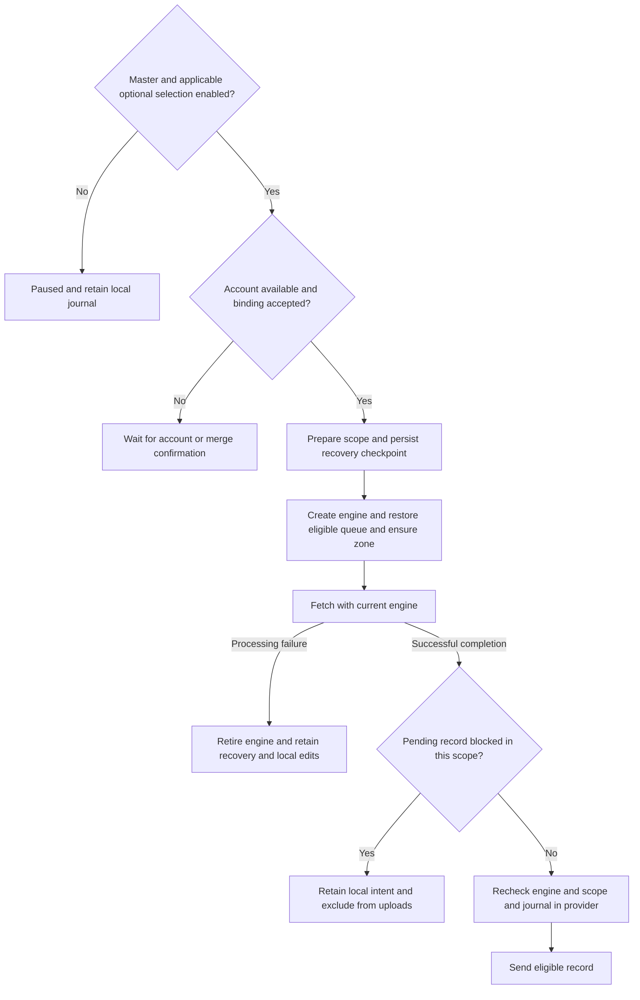

# Settings, Vault, History, Metrics, and Cloud Sync Workflow

Termind synchronizes Vault configuration, History/Device, Settings and Metrics through four independent coordinators in the private `iCloud.com.akinokaede.termind` container. Each owns its zone, subscription, engine, durable journal, account binding and queue while sharing `CloudSyncLifecycle` safety code. History and Device share a transport with per-kind selection.

This workflow is CloudKit replication built around a SwiftData journal, not SwiftData’s CloudKit integration. `TermindPersistence` owns the journal models and the coordinator applies accepted remote envelopes back through the relevant persistence facade. Platform app models own coordinator lifetime and apply resulting snapshots to their runtime models.

## Categories, switches, and runtime ownership

The iCloud master switch and Pro eligibility control all synchronization. Vault
configuration and device records follow that switch; the legacy Vault preference
is read only during preference migration. Optional categories are **History →
Metrics → Settings**, in that order on both platforms. History initially inherits
the previous Vault selection; subsequent preference migrations never overwrite it.
New installations enable History by default. Both apps use
`CloudSyncSettingsContent`: one aggregate status, no category disclosure or footer.
A shared History/Device engine receives at most one retry or account-merge action.

Configuration retains `TermindVaultV1` / `VaultItem`. History and devices use
`TermindConnectionHistoryV1` / `ConnectionHistoryItem` and `DeviceItem`. The shared
History transport filters events independently at read, restored queue and final
upload boundaries. Disabling History does not disable Device or require Vault.
Settings and Metrics retain their existing record formats.

The first shared Section has no header: it contains the iCloud Sync toggle and aggregate status/actions. The next Section is “Optional Sync” with History → Metrics → Settings. Enabling the master switch still attempts custom Host password migration to iCloud Keychain through the platform wrapper.

`AppModel` starts all four coordinators only when the Vault-sync Pro capability is available, pauses all of them when entitlement is absent, and routes accepted remote snapshots to the corresponding app-wide models. On mobile, `MobileAppModel.reconcileSync()` starts them only while at least one scene is active and the same capability is available; otherwise it pauses them. This makes synchronization app-wide and entitlement/lifecycle-controlled rather than window- or scene-owned.

## Lifecycle: fetch before send

Every coordinator adapts its own journal to `CloudSyncLifecycleStore` and implements `CKSyncEngineDelegate`; the lifecycle owns the engine session and operation generation. It first checks the CloudKit account and user record, binds or requests confirmation for the account, prepares scoped safety state, resets incompatible CloudKit metadata when needed, commits a recovery checkpoint, creates an engine, restores only uploadable journal record names, ensures its zone exists, and fetches that zone. **No send is authorized until that fetch succeeds for the current engine.** Local edits still enter the durable journal while sync is paused or while the fetch is in progress.

This diagram shows authorization and per-record eligibility, not a complete UI state machine. Pending edits and restrictions remain durable independently of displayed status; a blocked record does not revoke eligibility for compatible peers.

A lifecycle runs at most one tracked operation. It gives each operation an ID and only lets that ID clear the operation or publish an error. `pause()` or an account transition retires the engine: it changes the operation ID, cancels the task and engine operations, clears readiness, and removes the engine. Completion handlers and delegate events must also satisfy `lifecycle.accepts(engine)`, which requires identity with the current engine and an enabled category. Thus stale generations cannot publish status, provide a record batch, authorize uploads, or clear a replacement operation.

Retryable CloudKit errors—network failure/unavailability, service unavailable, rate limit, zone busy, and truncated results—leave the category in a syncing state for retry. A retryable zone-fetch failure keeps the engine but closes upload and secret authorization until another successful fetch. `notAuthenticated` becomes an unavailable sign-in status; other errors are failed. Terminal errors take precedence; otherwise quarantine yields a partially blocked status with separate uploadable-pending and blocked counts, not a false up-to-date result. A newer-format reason adds an update hint; corrupt data does not promise an update will repair it.

### Recovery before cursor advancement

Local schema V31 adds a recovery row and scoped quarantine storage without changing cloud zones or V1 envelopes. A new safety scope starts with recovery required, so its first preparation discards serialized engine state and fetches afresh. An interrupted operation leaves the same marker. Journal envelopes, local pending edits and restrictions are not discarded with the cursor.

Recovery intent is committed before constructing an automatically syncing engine and before fetch/send work. The lifecycle counts both explicit operations and automatic callbacks; an overlapping completion cannot clear the checkpoint or reopen fetch authorization early. A delegate processing or persistence failure rolls back and retires that engine. Its later successful callback fails the current-engine check rather than reauthorizing uploads. Retry creates a new engine from a fresh cursor when recovery remains required.

## Account, zone, and environment transitions

The journal persists serialized engine state, `boundUserRecordName`, `pendingUserRecordName`, and the last successful sync. Before creating an engine, the lifecycle compares CloudKit’s current user record name with the binding:

- With no binding or a matching account, it stores the current account and proceeds.
- With a different bound account, it records the new user as pending, reports `.accountChangeConfirmationRequired`, and does not create an engine or upload anything.
- `confirmAccountSwitchMerge()` imports legacy quarantine under the prior account/environment, resets journal state **before** binding the pending account, then retires and restarts. The account reset removes old-account journal tombstones and requeues live records. Event deletion remains terminal during normal same-account sync/replay; account-merge confirmation deliberately starts a new account binding. The reset clears CloudKit system fields, serialized engine state, and last-success time. It therefore avoids carrying an old account’s deletions into the new account.
- CloudKit sign-out retires the engine and reports the category’s sign-in message. A different sign-in or switch accounts retires it and requires merge confirmation; a same-user sign-in can continue.

The current `TermindCloudKitEnvironment` bundle value is also compared with a category-specific `UserDefaults` marker. On change, the category keeps envelopes but requeues them, discards system fields/change tags and engine serialization, clears last-success time, saves, and records the new environment. This prevents Development metadata from being reused in Production. If CloudKit reports the category zone deleted or returns `zoneNotFound` from a save, the lifecycle similarly resets/requeues the journal, asks the engine to recreate the zone, and retains the account binding. The new quarantine rows are scoped by container, environment, account, zone and owner: resets neither erase an old replica's restrictions nor apply them to another replica.

## Journal and replication protocol

A journal is the durable outbox and merge authority for each category. Bootstrap creates baseline envelopes for an initial local snapshot. Local persistence writes compute only real differences, assign an ordered version using the installation writer ID, mark changed records `needsUpload`, and retain deletion tombstones. Because journaling happens independent of lifecycle readiness, edits made while disabled are accumulated and sent later; no-op saves do not advance versions.

Vault, Settings and Metrics encode each pending envelope into a CloudKit record with envelope metadata (`formatVersion`, `kind`, `entityID`, `modifiedAt`, `counter`, `writerID`, and `isDeleted`) and a payload hash. The coding layer uses inline bytes below its limit and a local `CKAsset` for larger payloads. Journal-held CloudKit system fields are reused on subsequent saves and updated from fetched/saved records, enabling ordinary CloudKit optimistic concurrency.

On fetch, coordinators process only their zone and accepted record types. They decode and validate envelopes, quarantine malformed or unsupported payloads with their received bytes and structured reason, and merge valid envelopes in a persistence transaction. Valid remote system fields and quarantine removal participate in the same save; rejected records never replace normal outgoing-entry system fields. App notification follows successful application. A physical CloudKit deletion is not treated as a user deletion: if a local journal row still exists, it is marked for re-upload, but a compatibility restriction still prevents that recreation from being sent. Logical deletion is represented by an envelope tombstone.

Merge is deterministic: newer versions win; an older remote value causes the local value to be requeued. For equal versions whose payloads differ, encoded bytes provide a deterministic tie-breaker. Settings and Metrics additionally collapse multiple fetched versions of one key before deciding, so batch delivery order does not affect the result. A `serverRecordChanged` save failure runs the server record through the same validation path as a fetch. A supported envelope either establishes an identical local version as uploaded or requeues the winning local result; an unsupported envelope is quarantined instead of silently retrying a stale local payload. Successful sends clear `needsUpload` only if the journal still holds the sent version, so a newer local edit cannot be incorrectly acknowledged.

Vault projections deliberately remove device-local presentation metadata from envelopes: group and package expansion is normalized rather than synchronized. The live V33 Identity shape no longer contains `lastUsedAt` usage metadata. Settings likewise excludes explicitly device-local defaults such as debug/logging, review history, and terminal font family/size/follow-theme-size. Settings record-type compatibility is intentional: SSH, SFTP and workspace preferences use distinct types in the Settings zone so older clients can ignore newer records before decoding.

**Host schema versus cloud wire format:** `TermindSchemaV28HostModels.PersistentHost` is a frozen *local* SwiftData shape with one SSH `port`, `identityID`, and `charset`; the V28→V30 migration keeps those stored property names in the successor Host model as SSH fields and defaults the new Telnet profile to disabled, port 23 and UTF-8. The live `PersistentHost` projection retains independent SSH and Telnet profiles. This migration does not create a Settings record or a new Vault zone: `HostPersistence` reads the migrated Host into a `VaultSnapshot`, bootstraps or diffs its Vault journal, and the existing `VaultItem` host envelope still uses format V1. The frozen `VaultWireV1` Host DTO keys keep `port`, `identityID`, and `charset` for SSH, while new protocol flags and Telnet fields have backward-compatible decode defaults. Do not treat a successful V28 local-store reopen as proof of mixed-version CloudKit writes or account synchronization.

## Native History V1 fields

New cloud records contain typed CloudKit fields, not a JSON payload, payload hash,
or asset. `HistoryCloudRecordV1` is the frozen field adapter. History's local
journal encoding is an implementation detail and is not the cloud schema.

| Field | CloudKit type | Meaning |
| --- | --- | --- |
| `formatVersion` | INT64 | Breaking format version for this record type/kind |
| `kind` | STRING | `connectionHistory` or `device` |
| `entityID` | STRING | Lowercase UUID matching the stable record ID |
| `modifiedAt` | TIMESTAMP | Logical modification date |
| `counter` | INT64 | Nonnegative logical modification counter |
| `writerID` | STRING | UUID of the writer installation |
| `isDeleted` | INT64 | Protocol tombstone, 0 or 1 |

`ConnectionHistoryItem` adds `hostID` (STRING UUID), `connectionKind` (STRING:
`ssh`, `telnet`, `sftp`), `connectedAt` (TIMESTAMP), optional `endedAt` (TIMESTAMP),
and optional `sourceDeviceID` (STRING UUID). `DeviceItem` adds `displayName`
(STRING). Live records require their nonoptional fields. Tombstones require only
metadata. Optional fields are explicitly cleared on writes. Neither record uses
CloudKit references: history may arrive before its Host and must remain durable.

Record IDs remain `v1/connectionHistory/<uuid>` and `v1/device/<uuid>`. The `v1`
identity namespace does not change when payload/field versions increase. Event
UUIDs are never reused. Deletion is terminal for an event UUID, including against
later-clock updates from an old client. Retention keeps 250 newest events and
retains overflow tombstones. Clearing history leaves the device directory intact.

## Evolution and upload protection

`SyncRecordFormats` declares readable versions and current write version by kind
inside each record family. `VaultVersion` orders modifications; it does not version
the protocol. Readers inspect raw kind and format version before decoding fields
or choosing historical defaults. Unknown kinds, future versions, invalid types
and malformed records cannot be silently rewritten.

Configuration V1 is frozen in `VaultWireV1`, with explicit domain adapters. Do not
extend those DTOs merely because a domain type has gained a property. Add a new
per-kind version and decoder/adapter when old clients could misinterpret or lose
information: field type/meaning changes, enum expansion or a new field that an
old writer would drop. Missing historical fields may use documented V1 defaults;
unrecognized present enum values may not. Encoding throws and participates in the
same transaction as local edits. Never substitute empty Data on encoding failure.

Reading an old record converts it in memory without echoing an upload. Actual
edits use that kind's current writer version. `VersionedRecordDecoder` and the
version tests exercise a test-only Host V2 while other kinds remain V1. Shipping
Vault, native History and Device writers remain V1.

Quarantine retains raw JSON for legacy records or a complete secure CKRecord
archive for native records, plus CloudKit system fields, while preserving local
pending intent. The journal, batch builder and final provider all fence writes.
A source importer restriction also fences the corresponding destination ID.
Failures are isolated per record; healthy records continue. Physical deletions,
conflicts, retries and restarts do not clear a restriction. A supported record must
merge and persist successfully before its quarantine can clear.

Capability fingerprints are scoped by container/environment/account/zone/consumer.
Changed decoder support forces a fresh read. The successful-read checkpoint is
committed only after merges have saved. Enabling previously disabled History forces
both source and destination replays. Recovery flags are committed before readers
can advance their cursors. Compatibility guarantees begin with clients that have
upload protection; an already-installed older unsafe binary cannot be retrofitted.

## Local migration and continuous old-client import

V35 is additive to the distributed V28 → V30 → V31 → V34 chain. It introduces
History journal/state, scoped import state and capability checkpoints without
changing historical schema definitions. Bootstrap copies event/device IDs,
modification versions, raw unreadable entries, tombstones and original account
binding. Old CloudKit system fields never become destination system fields.
Bootstrap, projection changes and deletion intent commit atomically and can retry.
Normal configuration edits do not reconcile History; Host deletion explicitly does.

`LegacyHistoryImporter` independently reads `TermindVaultV1` using its own
subscription and scoped checkpoint. It never creates the old zone or produces a
record batch. Restored database and record mutations are removed from its engine.
Old clients can keep adding events, ending sessions and renaming devices; changes
merge by UUID/version and become destination upload intent. New clients never
write History/Device changes back to Vault. Old cloud data remains untouched.

Both source import and destination read must finish before the first upload.
An absent old zone is a successful empty source. A same-account initial sign-in
notification is normal engine startup; actual account switches retire both engines
and require the normal merge flow. Pausing/master disable/Pro loss stops both.
Late cancellation callbacks cannot replace current status with a red failure.

## Per-record compatibility restrictions

A scoped quarantine entry is an upload restriction, not only a diagnostic. It retains the received payload, encoded system fields, reason and identity. Its scope prevents a block for one account or environment from leaking into another. Legacy category rows are imported under their prior binding/environment before being removed in a successful local save; unknown historical ownership stays in a legacy scope.

There are three outbound checks:

1. **Journal eligibility:** return only unblocked pending names; keep the blocked row's `needsUpload` intent unchanged.
2. **Restored queue and batch:** remove blocked names from the engine's scheduling state, reject physical deletes, and synchronously materialize at most 250 eligible saves per request. Invalid or blocked pending entries do not consume that record limit. A batch uses no suspension between its final checks and handoff.
3. **Final record provider:** check current-engine readiness and the scoped restriction again, including the journal's outgoing-entry lookup. Lookup or persistence failure closes the category gate rather than treating an error as an empty restriction set.

An acknowledgement for an already blocked record does not clear its local intent. Local tombstones and console-deletion recreation follow the same restriction; neither can overwrite unknown remote data. Other records in the category can keep syncing, including while the UI reports a partial restriction. Local editing remains possible, but the pending change is not represented as successfully synchronized.

Only receiving supported data and successfully reconciling it removes a restriction. Merge, journal/system-field changes and quarantine removal commit together; failure restores the restriction. Retry, pause/resume, relaunch and clearing a terminal error do not unblock a record. Ordinary fetches still ignore unknown record types for independent future features; a conflict returned for an attempted known ID must be validated even if its type is unexpected.

### Compatibility baseline

The safeguards cannot retrofit binaries released before upload protection. V1 JSON decoders can silently ignore additional fields, so additions an old writer would lose require that kind’s breaking version to increase. Native fields likewise need version checks rather than assuming CloudKit preserves unknown semantic state. Capability replay handles newly supported formats; signed historical-binary round trips remain a release check.

## Settings references and secret authorization

Settings records carry credential **references**, never secret material. After accepting a remote provider or MCP-server envelope, `SettingsSyncCoordinator` calls `AISecretStore.acceptRemoteReferences`, marking those references as iCloud-backed so an old device-local copy cannot override a delayed iCloud Keychain value.

Secret migration is coupled to the Settings lifecycle, not merely to a preferences toggle:

1. A current Settings engine must successfully fetch its zone.
2. Only then does `CloudSyncLifecycle` invoke the Settings `authorizeUploads(true)` callback and set `isReadyToSend`.
3. Before a send and when its change-batch delegate is asked for records, `SettingsSyncCoordinator` migrates references found in provider, Vertex, and MCP configuration.
4. `AISecretStore` permits new iCloud copies only when that authorization is true and both master and Settings switches remain on. It verifies a copied iCloud value before recording the iCloud location and removing the device copy.
5. Pausing, account retirement, an active or failed fetch, or delegate persistence failure leaves or returns authorization to false. Therefore a stale engine cannot migrate/upload secrets merely because Settings was once enabled.

The store retains pending-deletion markers before deleting Keychain values and never reads them again as live secrets; this prevents late Keychain delivery from resurrecting a deleted credential. Once a reference is known in iCloud, later writes stay there even if a switch is turned off, while newly created secrets under a disabled or unverified workflow remain device-local.

## Operations and extension guidance

CloudKit deployment is separate from a passing local build. Deploy and validate the private container schema in Development and Production, preserving category zone names, record types, and subscription IDs; deploy `SFTPPreferencesItem` before clients upload it. Run signed-device checks across multiple devices on one account and explicitly test offline edits, per-category and master pause/resume, delayed Keychain delivery, account switching, and Pro expiration. See [CloudKit Schema Deployment and Signed-Device Release Readiness](/openwiki/operations/cloudkit-release-readiness.md) for the full release matrix and [Build, Validation, Localization, and Dependency Release Operations](/openwiki/operations/build-test-and-release.md) for ordinary build gates.

When adding a synchronized category, do not share an existing coordinator or journal. Create a category-owned zone/subscription/record type and persistence journal/state, give it an independent scope in the shared quarantine/recovery store, and supply coordinator record coding, delegate handling, enable/environment keys and lifecycle adapters. Preserve fetch-before-send, scoped journal eligibility, queue pruning and final provider checks in every `nextRecordZoneChangeBatch` implementation. Decide which fields are truly portable before adding them to envelopes; normalize or omit device-local runtime/UI metadata, and keep credentials in Keychain behind references.

When evolving a record, retain decode compatibility and validation. Unsupported or malformed records must be quarantined and prevented from uploading rather than partially applied, and a migration that changes a record identity must clear incompatible system fields and engine state. Do not turn a physical console deletion into silent data loss; retain tombstone semantics within the envelope protocol.

## Focused verification

- `FrameworkTests/PersistenceCompatibilityTests.swift` opens a copied V28 store twice through `TermindPersistence.makeContainer`, checking the Host's legacy SSH port/identity/charset, disabled-default Telnet profile, associated Vault data and journal state, and default workspace preferences after Settings preparation; this is a local migration/reopen fixture, not a CloudKit sync test. `FrameworkTests/HostProtocolTests.swift` separately checks live Host protocol defaults and persistence projection.
- `FrameworkTests/CloudSyncLifecycleTests.swift` verifies fetch gating, accumulated local changes, retry behavior, operation/engine retirement, account confirmation/reset ordering, environment and zone resets, and error-status precedence.
- `FrameworkTests/CloudSyncCoordinatorLifecycleTests.swift` verifies category isolation and confirms that Settings secret authorization follows a successful fetch and is revoked on account retirement.
- `CloudSyncSafetyTests` runs all four real coordinators behind fake transport, checking actual batches/providers, conflict quarantine, compatible peers, tombstones/recreation, retry/restart, failed-unblock rollback and status hints.
- `CloudSyncSafetyPersistenceTests` checks scoped isolation, on-disk interrupted-state reopening, V30→V31 migration and legacy quarantine import. Lifecycle cases also exercise recovery checkpoints and overlapping automatic/manual callbacks.
- `TFMTests/SettingsSyncTests.swift` covers local mirrors, Settings journal/merge behavior, independent toggles, device-local exclusions, wire compatibility, and AI secret migration/deletion behavior.
- `TFMTests/VaultSyncTests.swift` covers stable envelope names, tombstones, deterministic merge/requeue behavior, local metadata exclusion, large payload assets and corruption rejection, and environment resets.

For persistence ownership and Keychain boundaries, see [Persistent Data, Migrations, and Secret Boundaries](/openwiki/concepts/persistence-and-secrets.md). For app-wide coordinator construction and platform lifecycle behavior, see [Platform Runtime, App Composition, and Lifetimes](/openwiki/architecture/platform-runtime.md).

## Structured diagnostics

All coordinators receive the existing Logging manager from app composition. Failures emit `cloud.sync.failed` with zone, stage, NSError domain and code, excluding raw records, account IDs, credentials and localized error descriptions. Expected Swift/CloudKit cancellation is lifecycle control, not a failure. Legacy import waits for overlapping explicit and automatic reads to commit rather than synthesizing a persistent-store error; initial same-account sign-in does not cancel startup. See `HistorySyncTests` for these regressions.
