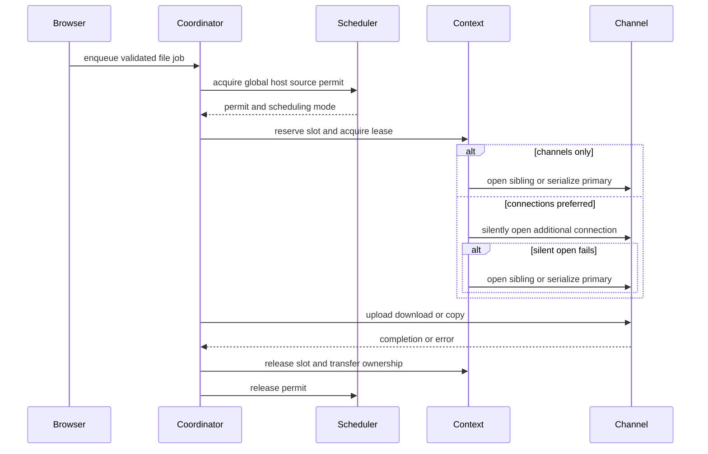
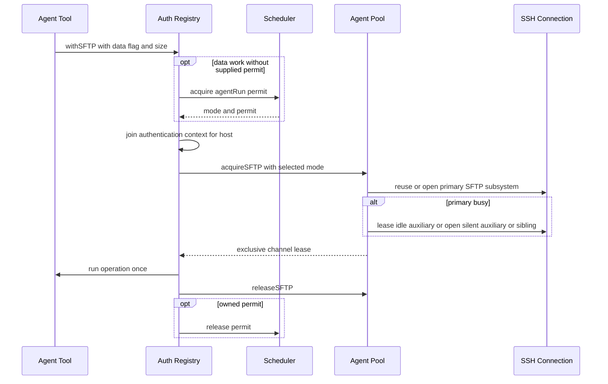
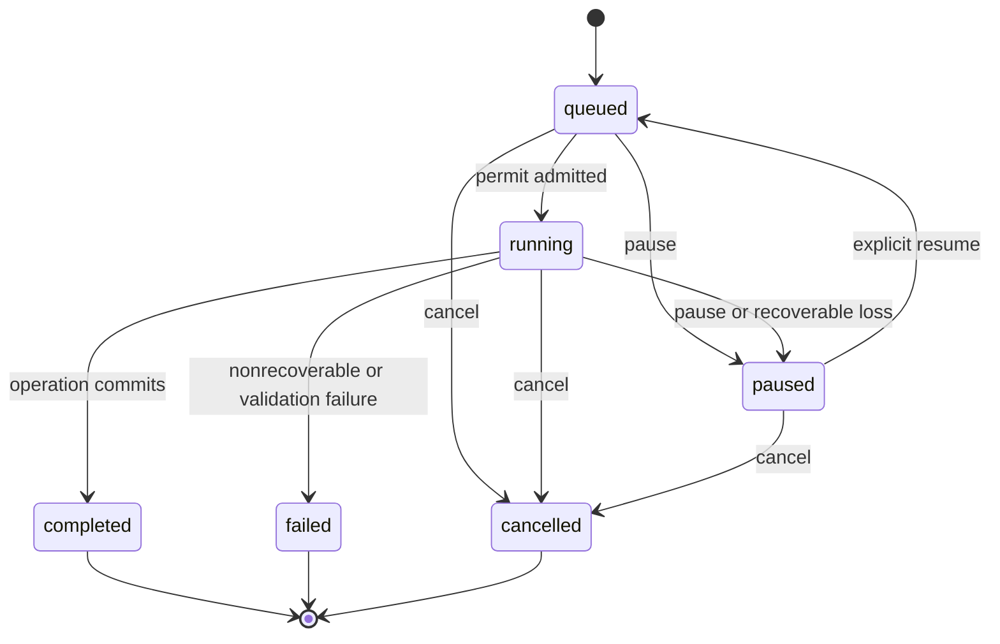
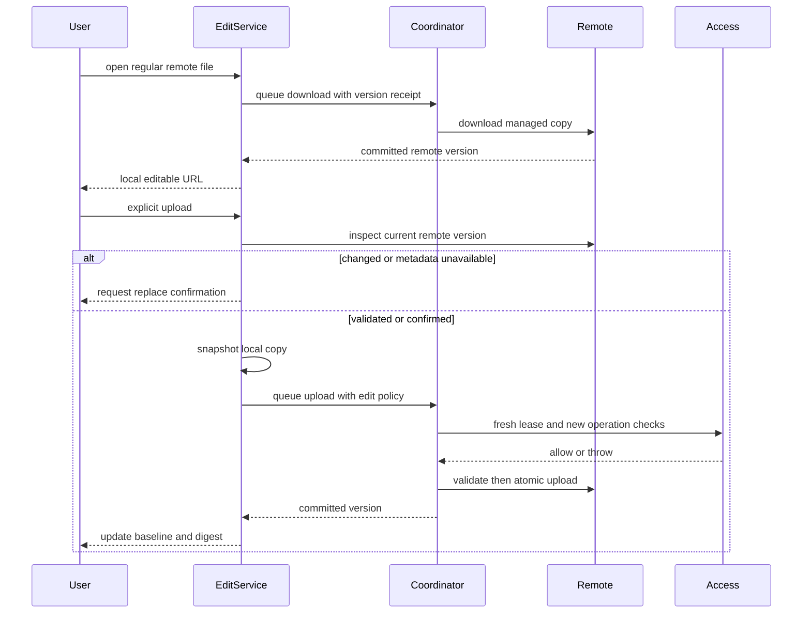

## Scope and operating model

For native drag events, mobile provider staging, SSH versus SFTP drop destinations, and desktop remote-file payloads, start with [File Drag and Drop Across TFM and TFI](file-drag-and-drop.md). That guide follows the gesture up to the transfer preparation and queue boundaries described here.

SFTP file work is split deliberately: browser and application models prepare batches and own UI choices; `SFTPTransferCoordinator` owns queued transfer runtime, admission, progress, cancellation, and completion; `SFTPTransferContext` owns a generation-scoped authenticated primary connection; and `SFTPChannel` implements actual libssh2 file I/O. `SFTPClient` is only the connect/disconnect facade around its primary channel. This division lets standalone SFTP, browser transfers, terminal-drop transfers, and edits share atomic write, resume, and copy mechanics without sharing a pane lifetime. [^client-channel]

The important safety boundary is **no durable staging and no silent replay**. Checkpoints—temporary path, source identity, acknowledged offset, and SHA-256 state—live only in `SFTPResumeState` in the running process. A recoverable connection failure pauses instead of retrying; a user must explicitly resume, at which point the source and already-written prefix are verified. A restart therefore cannot recover or replay work. [^resume-state] [^coordinator-outcomes] [^channel-prefix]

A transfer uses one of two connection forms:

- **Saved** — create a fresh `SFTPClient` from an additional-connection snapshot and disconnect it after the transfer.
- **Context** — acquire a lease from a browser/terminal `SFTPTransferContext`, which can select a sibling channel, an additional silent connection, or the primary channel. The obsolete externally borrowed queue form and its exclusivity identifier were removed. [^connection-forms] [^lease-selection]

## Browser paths: prepare, validate, enqueue

Browser actions are two-phase rather than mutating during drag/drop preparation:

1. An upload planner expands selected local roots into remote directories and regular-file jobs, then performs a remote preflight over all prospective directory and file targets. A remote-copy planner first obtains a remote manifest and performs the analogous preflight at the destination. The UI can show the resulting conflict count before a policy is chosen. [^upload-preflight] [^copy-preflight]
2. On the selected `TransferConflictPolicy`, the enqueue phase resolves directories first, transforms or suppresses descendants, resolves individual targets, and only then calls `enqueue` or `enqueueRemoteCopy`. `skip` suppresses the affected item/subtree; `replace` permits overwrite and recursively removes a conflicting destination directory; `keepBoth` chooses the next available extension-aware name and maps descendants under it. [^conflict-resolution] [^upload-enqueue] [^copy-enqueue]
3. The coordinator persists a queue row in `HostLibraryModel`, retains any managed context for that transfer, retains local security-scoped access while I/O runs, and publishes byte progress only while the row is still the matching running generation. [^enqueue-runtime] [^transfer-progress]

Conflict inspection precedes mutation. Preflight identifies conflicting directories and targets without creating, deleting, or queuing a transfer; directory resolution is the first operation allowed to mutate the destination. Recursive removal validates each listed child’s name and expected path before descending, then removes children before their parent, preventing a malformed server entry from redirecting deletion. [^conflict-preflight] [^safe-recursive-delete]

For a same-host remote copy, planning rejects copying a file onto itself and rejects a directory target within the source subtree before conflict handling. Cross-host work is still a direct SFTP-to-SFTP stream: it does not materialize a local intermediary. When endpoint channels share the same SSH transport, the implementation alternates bounded reads and writes; otherwise it relays bytes through an in-process socket pair while download and upload run together. Both paths validate source size/identity and write a temporary destination before rename. [^self-copy-guard] [^copy-streaming]

Desktop SFTP context menus can open an SSH companion in the current or a new workspace at the browser’s current directory. This creates a normal host session; it does not turn a transfer transport into a terminal. The action resolves the source SFTP pane by session ID, requires its connected state and nonempty path plus a saved host, and selects that pane before current-workspace placement. The reciprocal terminal action opens SFTP at the live terminal’s known working directory. [^companion-source]

When a terminal supplies a `directoryContextTicket`, companion dispatch first awaits `confirmDirectoryContext`, then resolves the source again and checks that its workspace, path, and ticket are still current. A failure or changed context aborts the open. `openSFTPChannel` creates a new pane/model rather than finding an existing same-host browser; current-workspace placement splits to the right only when the focused pane is SSH, otherwise it opens a new workspace. Moving an existing pane is different: it preserves the browser model and connection. [^companion-placement]

### Browser session integration and path context

`SFTPChannelModel` owns the browser's live channel, navigation, and pending batches. It connects through `RemoteConnectionCoordinator.connectSFTP` and the shared `RemoteSessionConnectionController` for authentication, host-key prompts, connection journey, and recovery. Before installing a channel it checks cancellation and the connection-attempt ID, resolves the home directory, and checks the attempt again. A successful attempt creates a fresh control-role `SFTPTransferContext` with an additional-connection snapshot and host store; the model exposes only `.context` for queued transfer work, not its raw control channel. Reconnection retires and clears the old context before retrying, so browser recovery does not silently resume paused queue jobs. [^browser-integration]

An empty configured initial path means **resolve the server's home**, not browse `/`: `/` is only the model's provisional value. Home resolution uses SFTP `REALPATH` on `.` and requires an absolute result. With an explicit initial path, home-resolution failure leaves that path usable but home display unavailable; without one, it fails connection setup. External-resource paths `/~` and `/~/…` are resolved against that authenticated home, never the local user's home; the resource is inspected before deciding to browse it or open a file from its parent. [^browser-path-context]

Listing refresh captures the path, connection attempt, and history object and applies its result only if all still match a connected browser. Upload and copy planners use the browser path as their destination; queued downloads, uploads, copies, promised files, and edit operations also receive `homeResolution.resolvedDirectory` as path context. Actual targets remain the planned remote paths. For basic metadata mutations, the shared `RemoteFileSystem` helpers validate a new leaf name, join it to the remote parent, refuse overwrite on rename, and mask permissions to `0o7777`. [^browser-listing-context]

[^companion-source]: `TFM/Features/Workspaces/WindowModel.swift#L939-L999`.
[^companion-placement]: `TFM/Features/Workspaces/WindowModel.swift#L947-L975`; `TFM/Features/Workspaces/WindowModel.swift#L1129-L1149`; `TFMTests/SFTPChannelTests.swift#L74-L122`.
[^browser-integration]: `TFM/Features/SFTP/SFTPChannelModel.swift#L316-L318`; `TFM/Features/SFTP/SFTPChannelModel.swift#L474-L537`; `TFM/Features/SFTP/SFTPChannelModel.swift#L1212-L1243`.
[^browser-path-context]: `TFM/Features/SFTP/SFTPChannelModel.swift#L202-L233`; `TFM/Features/SFTP/SFTPChannelModel.swift#L670-L729`; `Frameworks/TermindRemoteInfrastructure/SSH/SFTPChannel.swift#L167-L185`.
[^browser-listing-context]: `TFM/Features/SFTP/SFTPChannelModel.swift#L807-L825`; `TFM/Features/SFTP/SFTPChannelModel.swift#L940-L1146`; `Frameworks/TermindApplication/Transfers/RemoteFileSystem.swift#L16-L47`.

## Access admission and fresh connection material

Host access admission is separate from the scheduler's logical-file capacity. `SSHMultiplexedSFTPChannelOwner` checks access when opening a subsystem and returns an `AccessControlledSFTPChannel`. That wrapper checks access before each new metadata or data operation and before sibling creation; remote copy checks both wrapped endpoints before delegating to raw channels. **Entitlement loss blocks new operations without aborting a transfer already delegated to the channel.** It does not disconnect the transport or continuously recheck each chunk of an admitted upload. Restored access permits later operations again. Thus a scheduler permit alone is not permission to start I/O after access changes. [^operation-access]

Additional connections do not replay a retained credential-bearing configuration. The snapshot captures the authenticated destination, route, authentication references and persisted host-key constraints without password, private-key or passphrase bytes. Once-only host trust does not grant trust for extra connections. Immediately before every saved/context silent open, `additionalConnectionRequest(from:)` checks current access and resolves current Identity, Key and proxy secrets from the host store into a one-shot, interaction-forbidden request. Missing ephemeral credentials, required user presence or unavailable silent authentication cannot produce a background prompt. Partially resolved secrets are cleared if request construction fails. [^fresh-request]

Both saved leases and context silent opens bridge the transfer cancellation token and task cancellation to the connection-opening task. They remove the token observer after opening, recheck cancellation before accepting the result, and disconnect the client on failure. Context primary waiters also observe both cancellation paths. A cancelled silent capability probe must propagate cancellation rather than caching channel-only degradation. [^opening-cancellation]

[^operation-access]: [AccessControlledSFTPChannel](../../Frameworks/TermindRemoteInfrastructure/SSH/AccessControlledSFTPChannel.swift#L6-L162); [subsystem opening](../../Frameworks/TermindRemoteInfrastructure/SSH/SSHMultiplexedSFTPChannelOwner.swift#L49-L74); [admission regression test](../../FrameworkTests/HostOperationAdmissionTests.swift#L10-L39).
[^fresh-request]: [snapshot and request construction](../../Frameworks/TermindApplication/Connections/RemoteSessionHostStore.swift#L275-L455).
[^opening-cancellation]: [context opening and waiters](../../Frameworks/TermindRemoteInfrastructure/Transfers/SFTPTransferContext.swift#L208-L259); [saved lease opening](../../Frameworks/TermindRemoteInfrastructure/Transfers/SFTPTransferCoordinator.swift#L669-L699).

## Admission, fairness, and SSH topology

`SFTPConcurrencyScheduler` is process-wide admission for data operations. Capacity counts logical files, not connections or channels: a remote copy consumes one global slot and one per-host slot for each distinct endpoint. Metadata work is outside this data admission path. The scheduler rotates anchor hosts and then sources (`workspace`, `agentRun`, or `batch`), retaining FIFO order within each source queue; it grants only a request whose every endpoint remains below the per-host limit under current global and per-host capacity. [^scheduler-contract] [^scheduler-fairness]

Preferences default to 30 global active files and 10 per host, constrain global to 1–100 and per-host to 1–50/not above global, and select `smart`, `channels_only`, or `connections_preferred`. Updating preferences drains queued work with the new values; an already-admitted permit retains its selected mode. In Smart mode, unknown sizes and sizes through 64,000,000 bytes use channels; only a larger known file prefers an additional connection. Both app composition roots apply `MultiConnectionPolicy` to the saved strategy: without SFTP multi-connection Pro access the effective strategy is `channelsOnly`, while the stored user choice remains intact for later access restoration. A Pro change updates future scheduler admission without changing an already-admitted permit. [^preferences] [^mode-selection] [^preferences-update]



*Admission applies global/per-host fairness before a context chooses the concrete SSH channel topology.*

A context keeps the browser **control** channel independent where possible. `channelsOnly` opens sibling SFTP channels, falling back to a serialized primary lease rather than silently opening another connection. `connectionsPreferred` probes one additional connection without interaction; success marks the context connection-capable, while a non-cancellation failure marks it channel-capable for later jobs and leaves active work untouched. A cancelled probe does not cache that degradation. The special terminal preflight role can donate a successful independent connection to the first job; if independent preflight requires interaction, terminal work uses its PTY transport and fixes the generation to channels. [^context-topology] [^context-probe] [^terminal-preflight]

The coordinator acquires two endpoint leases in stable context-ID order for a remote copy and shares one lease when both endpoints are the same context. This avoids competing acquisition order and needless duplicate use of one transport. [^remote-copy-leases]

## Scheduling algorithm: admission is not transport capacity

The coordinator's `schedule()` creates an admission task for each eligible queued row, waits for any pending preference update, and calls `acquire`. Only after a permit arrives and the row/runtime still exists does it store that permit, reserve context slots, mark the transfer running, and ask for a channel lease. A row can therefore be **running but still waiting for a subsystem or serialized primary**; admitted file count is not the number of sockets currently transferring bytes. The permit remains held through channel acquisition, I/O and lease cleanup. `finish` releases context ownership and the active permit before scheduling again.

`nextEligibleRequest` is a two-level rotation, not one global FIFO:

```text
while active file count < globalLimit:
    visit anchor hosts starting after lastGrantedHost
    within each host, visit sources starting after that host's lastGrantedSource
    inspect only the head request of each source queue
    skip if any endpoint is at its per-host limit
    grant the first eligible head; update host/source rotation cursors
    stop when no eligible head exists
```

Each request normalizes its endpoint set to include the anchor. A copy is anchored to its destination when available, while capacity is charged to both distinct endpoint Hosts. Workspace identity is the managed context's ID (destination context for a copy); otherwise the coordinator uses the batch ID. The Agent supplies an `agentRun` identity for scheduled data work.

This has three consequences:

- FIFO is preserved **within one source queue**. The scheduler can skip a blocked source to consider a different source/host, but does not look past that source's blocked head.
- Rotation is a grant-order fairness policy, not preemption or a bandwidth reservation. Long-running files keep their permits until release. Lowering limits cannot revoke active permits; it only delays future grants until capacity fits again.
- A remote copy consumes one global permit and one slot per distinct Host, regardless of whether it later needs one or two endpoint leases. Channel exclusivity belongs to managed-context lease ownership, not a separate borrowed-resource admission axis.

Tests make the policy concrete: after a workspace used the sole slot, a queued Agent source can precede more work from that workspace; another Host gets a turn before the previous Host; two workspace queues can split five same-host grants 3/2. These are controlled queued examples, not a guarantee that a later-arriving operation displaces an already active file.

### Smart mode is selected at grant time

The request retains its byte count, but `drain()` selects its mode using the **current preferences when admitted**. The returned permit's mode is immutable. The boundary is decimal **64,000,000 bytes** (64 MB), not 64 MiB: equal-to-boundary and unknown sizes use `channelsOnly`; strictly greater known sizes use `connectionsPreferred`. Mode decides the allowed topology preference, not extra file capacity.

## Topology decision table for a managed context

The full sequence lives in `SFTPTransferContext.acquire`; read it in order rather than treating the selected strategy as an unconditional socket-opening command. While an initial capability probe is in flight, other acquisitions wait for its result. After that, primary role and busy state determine reuse.

| Primary role | `channelsOnly` | `connectionsPreferred` |
| --- | --- | --- |
| `control` (browser) | Prefer a sibling subsystem, leaving the browser's control channel free. If sibling opening fails, wait for and serialize on the primary. | Try a silent additional connection unless capability already downgraded to channels; then try a sibling; final fallback serializes the primary. |
| `donatedConnection` (successful independent preflight) | Lease the idle preflight primary first; overlapping work uses siblings. | Lease the idle preflight primary first; overlap can open independent connections, then downgrade to siblings/primary after failure. |
| `ptyConnectionFallback` | Lease the idle SFTP primary on the PTY transport first; overlap uses siblings. | Starts with channel-only capability, so it does not re-probe extra connections for a large file while that primary generation is alive; uses primary/siblings. |

A context's capability is **unknown → connections** on a successful silent open, or **unknown/connections → channels** on a non-cancellation failure. The first unknown probe is serialized, but once connection capability is known later admitted jobs can attempt extra opens concurrently. Browser-context cancellation is checked before caching degradation; a cancelled probe does not condemn the generation to channel fallback. Successful sibling opening does not turn an unknown context into connection-capable.

These fallbacks include two distinct kinds of waiting:

1. `openSiblingChannel` can wait for the per-connection `SSHChannelBudget` before libssh2 ever tries initialization. A full local session budget is not automatically interpreted as failure, and does not cause the context to open a new socket by itself.
2. If sibling initialization actually fails, the context waits on `primaryBusy` and leases the primary serially. Context waiters are a dictionary resumed together by `wakeWaiters`; do not attribute the scheduler's FIFO guarantee to this fallback waiter mechanism.

A browser-context extra connection or sibling is leased for the operation and disconnected on release, rather than kept in a warm auxiliary pool. The context primary is retained by owner/transfer references. If it was closed after detach/pause, a later explicit resume can silently recreate a primary from its snapshot and resets capability; `channelsOnly` cannot conjure an already-authenticated transport that no longer exists. The saved form always opens a fresh client and bypasses the managed-context topology table. Context-owned primary/sibling/extra leases supply the remaining topology; no externally borrowed queue lease remains.

### Worked connection/channel counts

Assume setup succeeds, no other files consume the stated limits, and the SSH session-channel budget permits the requested siblings:

| Scenario | Active logical files | Physical connections and SFTP subsystems |
| --- | --- | --- |
| Browser control primary, three files, Channels Only | 3 | One connection with its browser control subsystem plus three sibling data subsystems; the control channel is not a fourth file permit. |
| Donated primary, two files at exactly 64,000,000 bytes, Smart | 2 | One independent preflight connection; its primary subsystem plus one sibling. |
| Same donated primary, two files strictly above the threshold, Smart | 2 | The donated connection plus one silently opened connection; no sibling is needed on the successful path. |
| PTY fallback, three large files, Smart | 3 | The existing PTY connection with the terminal session channel plus three SFTP subsystems (the fallback primary and two siblings); no new connection probe. |
| Donated preflight, seven files, per-host limit 5, Connections Preferred | At most 5 | Initially the donated connection plus four additional connections; remaining files wait for permits. |

`SFTPTransferContextTests` checks the sibling/open counts, the threshold, a five-file terminal batch, and two contexts sharing a five-file Host limit. With `MaxSessions = 10`, a browser control channel plus ten admitted Channels Only files cannot all have sibling subsystems at once: the extra acquisition waits for a channel lease even though it already holds a file permit. This is an example of independent limits, not permission to silently exceed either one.

## Agent SFTP reuse is related, not identical

Agent SFTP does **not** borrow the browser's `SFTPTransferContext`. `SFTPToolDefinition` validates host and normalized absolute path in preflight, then routes the operation through `AgentToolSupport.withAuthenticatedSFTP` and `AgentSSHAuthenticationRegistry.withSFTP`. `sftp_read` and `sftp_write` request data admission (using bounded read size or UTF-8 write length); list, stat, mkdir, move, chmod and delete use the default metadata path without a file permit. `scratch_pull` and `scratch_push` also request data admission. `withSFTP` acquires a permit from the shared scheduler for `.agentRun(runID ?? invocationID)` only when requested and no permit was supplied, then authenticates and acquires a pool lease **inside** admission, releasing its owned permit on both success and failure. An externally supplied permit is not released by this wrapper. [^agent-tools] [^agent-admission] [^scratch-admission]



*File admission and the Agent pool's exclusive channel lease are separate resources; acquiring a lease never replays the tool operation.*

The Agent pool retains **one primary SSH connection per Host across tool calls, runs and conversations**; exec and primary SFTP share its transport, and simultaneous initial exec/SFTP opens join rather than creating competing primary connections. The primary SFTP subsystem is opened once on that SSH connection. Reuse checks a route fingerprint (host, route hops, login identity, proxy, known-host fingerprints and destination charset); changing or deleting the route retires the old connection. The fingerprint deliberately does not read Keychain secrets: rotating a credential without changing login identity does not break an already authenticated session, but affects the next connection. A pane-backed temporary target stops resolving when its pane disappears. [^agent-primary] [^agent-route] [^agent-pool-tests]

`AgentConnectionPool.acquireSFTP` first obtains the primary and reuses an eligible idle record, preferring the least-recently-used idle one. In `channelsOnly`, only an idle primary record qualifies; overlap opens a sibling on the primary transport. If sibling opening actually fails (not cancellation), it polls until the primary is free and retries acquisition. In `connectionsPreferred`, an unknown Host capability uses a shared, interaction-forbidden extra-connection probe; success stores an auxiliary record and marks connections capable. Further overlap can silently open other auxiliaries. Failed silent setup downgrades to sibling channels, but unlike channel-only fallback, a sibling-opening failure on this path propagates. The initial shared-probe catch records channel capability *before* rethrowing cancellation; browser `SFTPTransferContext` instead checks cancellation before downgrading. No extra credential prompt is allowed for an auxiliary open. [^agent-lease] [^agent-probe] [^context-probe]

On release a pooled primary or auxiliary becomes idle, while an ephemeral sibling disconnects. Idle auxiliaries are swept independently; the primary and exec connection close together only after the Host has no active exec/SFTP leases and the 180-second idle timeout has passed (the app's sweep interval defaults to 30 seconds). Disconnect, route invalidation and `closeAll` cancel active SFTP lease tokens and close channels/connections; `SFTPError.notConnected` or `.connectionLost` evicts the Host after the operation fails, **not** by rerunning it. Authentication can retry a rejected connection attempt before the operation starts; overlapping attempts share a short-lived authentication context that is discarded after its last lease, not a persistent cache of custom passwords. [^agent-release] [^agent-sweep] [^agent-auth] [^agent-admission]

For an Agent `sftp_copy`, the tool obtains **one** destination-anchored global permit charged to both endpoint Hosts and passes it into each endpoint's `withSFTP`, so neither endpoint acquires another permit. A same-host copy in channel-only mode uses its one leased channel for both endpoints; other copies acquire source then destination leases and stream through `SFTPRemoteCopyOperation`. This differs from browser coordinator copy leases and from a pair of independent single-host Agent tools. [^agent-copy] [^remote-copy-leases]

MCP uploads are a separate HTTP ticket workflow, **not** browser queue rows or scratch files. `MCPUploadCoordinator` validates target path, byte count and SHA-256, issues a session-bound loopback PUT URL/token, and checks origin, token, body length and resumable offset before claiming the MCP transfer budget. `MCPServerTools` then runs `SFTPStreamUploadOperation` through the same Agent authentication/pool lease and scheduler with `schedulesDataTransfer: true`; cleanup uses another SFTP lease without data admission. A disconnected HTTP attempt or recoverable SFTP failure may pause a ticket for an explicit offset-matched retry while it is unexpired; integrity errors and cancellations clean up rather than silently replaying bytes. Ticket status and cancellation belong to the MCP coordinator, not `SFTPTransferCoordinator`. [^mcp-tickets] [^mcp-transfer] [^mcp-failure]

Do not copy browser-context assumptions wholesale into the Agent pool: browser auxiliaries are operation-scoped, Agent auxiliaries remain eligible for reuse, and MCP's HTTP budget/tickets are not scheduler permits. Focused pool tests verify one handshake across repeated execs, concurrent primary opens and exec/SFTP sharing, cancellation of one or the last connection opener, route retirement, idle sweeps and no replay of a command that already started. These tests cover primary reuse rather than exhaustively asserting every SFTP auxiliary-mode branch. [^agent-pool-tests] [^agent-lease]

## From a file lease to libssh2 turns

A sibling channel shares the same driver's transport identity. `SSHMultiplexedSFTPChannelOwner` serializes each raw libssh2 call on its SSH owner's queue, uses the encrypted buffer's bounded pass/backpressure, and returns to an async 2 ms retry sleep on EAGAIN. File fairness above does not imply strict round-robin ordering for every SFTP packet below. See [SSH Multiplexing and Scheduling](../concepts/ssh-multiplexing-and-scheduling.md).

Copy's topology check is driver identity, **not merely equal Host IDs**. If both concrete `SFTPChannel` endpoints share it, `copyOnSharedTransport` alternates reads of at most 64 KiB with destination writes on the shared owner. Otherwise the socket-pair relay runs producer and consumer tasks concurrently; failure cancels the group and stops the relay. Stable lease acquisition order, the shared-driver fast path, and file-admission accounting solve different problems and should not be collapsed.

To compare with port forwarding, use [Forwarding Pool and Flow Dispatch](port-forwarding-pool-and-dispatch.md): forwarding prewarms a Host-level target and assigns accepted TCP flows to retained workers, rather than creating a connection-per-file lease. For terminal-to-SFTP cwd/availability prerequisites, use [Shell Integration](../concepts/shell-integration.md).

## Transfer state, resume, cleanup, and ownership

The visible states are queued, running, paused, completed, failed, and cancelled. Pause before admission cancels the admission task and immediately changes to paused. Pause during I/O cancels the operation; recoverable connection errors also become paused except resume-validation failures, which are failed. Cancelled or failed non-paused work performs cleanup, while completed and paused work retain the checkpoint needed for their respective outcomes. [^transfer-control] [^coordinator-outcomes]



*The coordinator never transitions a paused transfer back to work without an explicit resume request.*

Uploads write to a generated remote `.termind-part-…` path with exclusive creation, validate the edit policy if present, and rename only after length/prefix checks; downloads write a local temporary path and replace/move it only after remote identity validation. Resume verifies the original source identity plus the SHA-256 prefix of the partial local or remote destination. A committed rename interrupted before bookkeeping can be recognized only by checking that the temporary is gone and the destination has the expected size and prefix. These checks make resume safe within the live process, rather than a claim that the remote protocol supplies compare-and-swap. [^channel-atomic-resume] [^channel-commit-recovery] [^channel-prefix]

Cancellation and terminal failure try to delete the local download temporary or remote upload temporary. If cleanup itself fails, the state is failed with `SFTPTemporaryFileCleanupError`, including the partial path; it is not silently hidden. Pausing intentionally retains the partial. [^cleanup]

Closing a pane is not transfer cancellation. `releaseOwner()` merely drops the pane’s ownership; queued and active jobs retain the context connection until their transfer references and active slots are gone. When a pause has released its transfer reference and the owner is gone, the unused primary is disconnected; a later explicit resume reopens silently from the snapshot. Conversely, `retire()` disconnects a failed primary and prevents it from being installed into a replacement browser generation. [^context-ownership] [^context-close] [^pause-ownership]

Cancellation controls have different scopes. `cancelPendingBatch()` only forgets prepared browser batches; `cancelOperation()` signals the browser's recursive-delete token. Neither is queue cancellation. Once enqueued, cancellation belongs to the coordinator: it cancels admission or signals the runtime token, performs partial cleanup, releases retained ownership, and finishes the queue row. `pauseAll()` pauses resumable work and cancels work that cannot pause. Browser disconnect clears pending batches and releases the context owner instead of cancelling those queue rows. [^cancellation-scopes]

[^cancellation-scopes]: `TFM/Features/SFTP/SFTPChannelModel.swift#L619-L641`; `TFM/Features/SFTP/SFTPChannelModel.swift#L909-L938`; `Frameworks/TermindRemoteInfrastructure/Transfers/SFTPTransferCoordinator.swift#L350-L427`.

## External edit lifecycle

`SFTPEditService` is application-scoped and tracks one managed local copy per `(hostID, remote path)`. Opening validates that the target is a regular file, downloads it through the same coordinator into `TemporaryDirectory/TermindEdits/<UUID>/`, records a remote baseline/version and local SHA-256 digest, and returns the existing copy for a compatible repeated open. It stores route identity—not credentials—alongside the copy, and invalidates tracking if the host route or connection destination no longer matches. [^edit-open] [^edit-destination]

The edit service, not the pane, owns an in-flight open: concurrent opens for the same key join one task, and the queued download supplies a version receipt from its own handle. Production completion can therefore register the editable copy after the browser has closed without restatting through a disconnected browser channel. If no receipt exists, the service falls back to a stat through the supplied client. A plain open without an edit service instead downloads to `TemporaryDirectory/Termind/Open/<UUID>/` and invokes the opener only on completion; it does not establish a managed edit round trip. [^edit-pane-lifetime]

[^edit-pane-lifetime]: `Frameworks/TermindRemoteInfrastructure/Transfers/SFTPEditService.swift#L78-L139`; `TFM/Features/SFTP/SFTPChannelModel.swift#L988-L1023`.

The service observes local copies and rechecks their digests. It uses file observation plus a one-second pass, with a forced full hash every 30 ticks, so editor atomic-save replacement and preserved timestamps are detected. Clean records remain reusable; cards represent dirty state rather than ownership of the copy. [^edit-monitoring]



*An edit upload snapshots local content and validates the remote version before the transfer is admitted; it is never an automatic save.*

External editing uses the same operation-level access boundary, not a separate entitlement bypass: initial attribute inspection, upload conflict inspection, and the queued download/upload each reach access-controlled channels. Already delegated transfer I/O can finish after access expires, but a later inspection or explicit upload must be admitted anew. This differs from route invalidation, which explicitly cancels attached edit uploads. [^operation-access] [^edit-open] [^edit-conflict]

Upload is explicit. Before taking an immutable local snapshot, the service hashes the current local copy and returns without work if its digest equals the last uploaded digest. It then reads the remote attributes: a changed baseline, a missing modification time, or an unconfirmed replacement returns `true` so the UI can request confirmation. Confirmation is tied to exactly the observed remote version and expires if it changes again. [^edit-conflict]

The upload’s `SFTPEditUploadPolicy` carries the expected version and original permissions. The channel validates the destination before creating its temporary file, preserves permissions on that file, validates again before rename, and fails closed for a non-file destination. On success, only the uploaded snapshot digest becomes acknowledged; an edit saved during the upload remains dirty and needs another explicit upload. [^edit-policy] [^edit-snapshot]

Discard is intentionally non-destructive to user work: it stops tracking and forgets digest observation but never deletes the editable copy. An active/preparing upload cannot be discarded. A paused upload is cancelled and cleaned first; if cleanup fails, the record remains so the error/partial path stays visible. Host invalidation cancels attached uploads and prevents new uploads while retaining the local copy. [^edit-discard] [^edit-invalidation]

## Operational guidance and focused verification

- Treat `SFTPPreferences` changes as future admission policy, not a way to tear down active transfers. Choose Channels Only for servers/routes where extra connections are undesirable, Connections Preferred for independent transfers when silent credentials are available, and Smart for the size-based default. [^preferences] [^preferences-update]
- Never add persistence for `SFTPResumeState`, transfer contexts, channel leases, or edit route credentials. The intended recovery behavior is a visible paused/failed state and an explicit user decision, not launch-time replay. [^resume-state]
- When changing planner or resolver code, preserve the sequence **preflight → user policy → directory resolution → target resolution → enqueue**. Moving deletion or directory creation into preflight would violate conflict validation before mutation. [^upload-preflight] [^upload-enqueue]
- When changing connection lifetimes, test both owner release and terminal transport fallback: a pane close must not interrupt retained work, but a last unused context primary must disconnect. [^context-close] [^pause-ownership]

Focused tests cover the materially risky cases: scheduler fairness across hosts/sources, cross-host capacity accounting, and the Smart threshold; topology fallback, cancellation of a silent probe, pane-close continuity, and resume after release; conflict mapping, cancellation points, and safe recursive delete; and edit confirmation, immutable snapshots, loss-to-pause, invalidation, observation of atomic saves, discard, and cleanup. [^scheduler-tests] [^context-tests] [^resolver-tests] [^edit-tests]

[^agent-tools]: `Frameworks/TermindRemoteInfrastructure/Agent/AgentBuiltInSFTPTools.swift#L26-L75`; `Frameworks/TermindRemoteInfrastructure/Agent/AgentBuiltInSFTPTools.swift#L79-L348`.
[^scratch-admission]: `Frameworks/TermindRemoteInfrastructure/Agent/AgentScratchTransferTools.swift#L49-L61`; `Frameworks/TermindRemoteInfrastructure/Agent/AgentScratchTransferTools.swift#L124-L146`.
[^agent-admission]: `Frameworks/TermindRemoteInfrastructure/Agent/AgentConnections.swift#L989-L1057`; `Frameworks/TermindRemoteInfrastructure/Agent/AgentBuiltInSFTPTools.swift#L626-L657`.
[^agent-primary]: `Frameworks/TermindRemoteInfrastructure/Agent/AgentConnections.swift#L1131-L1141`; `Frameworks/TermindRemoteInfrastructure/Agent/AgentConnections.swift#L1462-L1527`.
[^agent-route]: `Frameworks/TermindRemoteInfrastructure/Agent/AgentConnections.swift#L522-L557`; `Frameworks/TermindRemoteInfrastructure/Agent/AgentConnections.swift#L1709-L1737`.
[^agent-lease]: `Frameworks/TermindRemoteInfrastructure/Agent/AgentConnections.swift#L1234-L1296`; `Frameworks/TermindRemoteInfrastructure/Agent/AgentConnections.swift#L1359-L1386`.
[^agent-probe]: `Frameworks/TermindRemoteInfrastructure/Agent/AgentConnections.swift#L1298-L1365`.
[^agent-release]: `Frameworks/TermindRemoteInfrastructure/Agent/AgentConnections.swift#L1368-L1386`; `Frameworks/TermindRemoteInfrastructure/Agent/AgentConnections.swift#L1529-L1562`.
[^agent-sweep]: `Frameworks/TermindRemoteInfrastructure/Agent/AgentConnections.swift#L1154-L1157`; `Frameworks/TermindRemoteInfrastructure/Agent/AgentConnections.swift#L1564-L1605`.
[^agent-auth]: `Frameworks/TermindRemoteInfrastructure/Agent/AgentConnections.swift#L912-L926`; `Frameworks/TermindRemoteInfrastructure/Agent/AgentConnections.swift#L1059-L1128`.
[^agent-copy]: `Frameworks/TermindRemoteInfrastructure/Agent/SFTPCopyTool.swift#L93-L156`.
[^agent-pool-tests]: `TFMTests/AgentConnectionPoolTests.swift#L43-L186`; `TFMTests/AgentConnectionPoolTests.swift#L200-L342`.
[^mcp-tickets]: `TFM/Application/MCPServer/MCPUploadCoordinator.swift#L7-L28`; `TFM/Application/MCPServer/MCPUploadCoordinator.swift#L94-L195`.
[^mcp-transfer]: `TFM/Application/MCPServer/MCPServerTools.swift#L37-L81`.
[^mcp-failure]: `TFM/Application/MCPServer/MCPUploadCoordinator.swift#L231-L280`; `TFM/Application/MCPServer/MCPUploadCoordinator.swift#L329-L388`.

[^client-channel]: `Frameworks/TermindRemoteInfrastructure/SSH/SFTPClient.swift#L293-L387`; `Frameworks/TermindRemoteInfrastructure/SSH/SFTPChannel.swift#L120-L160`.
[^resume-state]: `Frameworks/TermindRemoteInfrastructure/Transfers/SFTPResumeState.swift#L5-L75`.
[^channel-prefix]: `Frameworks/TermindRemoteInfrastructure/SSH/SFTPChannel.swift#L985-L1031`.
[^connection-forms]: `Frameworks/TermindRemoteInfrastructure/Transfers/SFTPTransferCoordinator.swift#L12-L24`.
[^lease-selection]: `Frameworks/TermindRemoteInfrastructure/Transfers/SFTPTransferCoordinator.swift#L669-L704`.
[^upload-preflight]: `Frameworks/TermindRemoteInfrastructure/Transfers/SFTPLocalUploadPlanner.swift#L88-L103`.
[^copy-preflight]: `Frameworks/TermindRemoteInfrastructure/Transfers/SFTPRemoteTransferPlanner.swift#L221-L260`.
[^conflict-resolution]: `Frameworks/TermindRemoteInfrastructure/Transfers/SFTPRemoteConflictResolver.swift#L64-L118`.
[^upload-enqueue]: `Frameworks/TermindRemoteInfrastructure/Transfers/SFTPLocalUploadPlanner.swift#L106-L161`.
[^copy-enqueue]: `Frameworks/TermindRemoteInfrastructure/Transfers/SFTPRemoteTransferPlanner.swift#L267-L314`.
[^enqueue-runtime]: `Frameworks/TermindRemoteInfrastructure/Transfers/SFTPTransferCoordinator.swift#L237-L269`.
[^transfer-progress]: `Frameworks/TermindRemoteInfrastructure/Transfers/SFTPTransferCoordinator.swift#L531-L614`.
[^conflict-preflight]: `Frameworks/TermindRemoteInfrastructure/Transfers/SFTPRemoteConflictResolver.swift#L29-L62`.
[^safe-recursive-delete]: `Frameworks/TermindRemoteInfrastructure/Transfers/SFTPRemoteConflictResolver.swift#L121-L139`.
[^self-copy-guard]: `Frameworks/TermindRemoteInfrastructure/Transfers/SFTPRemoteTransferPlanner.swift#L221-L230`.
[^copy-streaming]: `Frameworks/TermindRemoteInfrastructure/SSH/SFTPChannel.swift#L575-L705`.
[^scheduler-contract]: `Frameworks/TermindRemoteInfrastructure/Transfers/SFTPConcurrencyScheduler.swift#L29-L53`; `Frameworks/TermindRemoteInfrastructure/Transfers/SFTPConcurrencyScheduler.swift#L123-L153`.
[^scheduler-fairness]: `Frameworks/TermindRemoteInfrastructure/Transfers/SFTPConcurrencyScheduler.swift#L141-L206`.
[^preferences]: `Frameworks/TermindDomain/Transfers/SFTPPreferences.swift#L3-L46`.
[^mode-selection]: `Frameworks/TermindRemoteInfrastructure/Transfers/SFTPConcurrencyScheduler.swift#L123-L139`.
[^preferences-update]: `Frameworks/TermindRemoteInfrastructure/Transfers/SFTPTransferCoordinator.swift#L149-L165`.
[^context-topology]: `Frameworks/TermindRemoteInfrastructure/Transfers/SFTPTransferContext.swift#L99-L188`.
[^context-probe]: `Frameworks/TermindRemoteInfrastructure/Transfers/SFTPTransferContext.swift#L212-L233`; `TFMTests/SFTPTransferContextTests.swift#L232-L263`.
[^terminal-preflight]: `Frameworks/TermindRemoteInfrastructure/Transfers/SFTPTransferContext.swift#L4-L16`; `TFMTests/SFTPTransferContextTests.swift#L23-L61`.
[^remote-copy-leases]: `Frameworks/TermindRemoteInfrastructure/Transfers/SFTPTransferCoordinator.swift#L624-L695`.
[^transfer-control]: `Frameworks/TermindRemoteInfrastructure/Transfers/SFTPTransferCoordinator.swift#L349-L413`.
[^coordinator-outcomes]: `Frameworks/TermindRemoteInfrastructure/Transfers/SFTPTransferCoordinator.swift#L545-L579`; `Frameworks/TermindRemoteInfrastructure/Transfers/SFTPTransferCoordinator.swift#L720-L740`.
[^channel-atomic-resume]: `Frameworks/TermindRemoteInfrastructure/SSH/SFTPChannel.swift#L354-L404`; `Frameworks/TermindRemoteInfrastructure/SSH/SFTPChannel.swift#L416-L483`.
[^channel-commit-recovery]: `Frameworks/TermindRemoteInfrastructure/SSH/SFTPChannel.swift#L807-L909`.
[^cleanup]: `Frameworks/TermindRemoteInfrastructure/Transfers/SFTPTransferCoordinator.swift#L399-L424`; `Frameworks/TermindRemoteInfrastructure/Transfers/SFTPResumeState.swift#L62-L68`.
[^context-ownership]: `Frameworks/TermindRemoteInfrastructure/Transfers/SFTPTransferContext.swift#L64-L97`; `Frameworks/TermindRemoteInfrastructure/Transfers/SFTPTransferContext.swift#L266-L272`.
[^context-close]: `TFMTests/SFTPTransferContextTests.swift#L63-L108`.
[^pause-ownership]: `TFMTests/SFTPTransferContextTests.swift#L280-L298`.
[^edit-open]: `Frameworks/TermindRemoteInfrastructure/Transfers/SFTPEditService.swift#L66-L140`.
[^edit-destination]: `Frameworks/TermindRemoteInfrastructure/Transfers/SFTPEditService.swift#L16-L45`; `Frameworks/TermindRemoteInfrastructure/Transfers/SFTPEditService.swift#L305-L325`.
[^edit-monitoring]: `Frameworks/TermindRemoteInfrastructure/Transfers/SFTPEditService.swift#L142-L184`.
[^edit-conflict]: `Frameworks/TermindRemoteInfrastructure/Transfers/SFTPEditService.swift#L236-L303`.
[^edit-policy]: `Frameworks/TermindRemoteInfrastructure/SSH/SFTPChannel.swift#L836-L909`.
[^edit-snapshot]: `Frameworks/TermindRemoteInfrastructure/Transfers/SFTPEditService.swift#L267-L295`; `TFMTests/SFTPEditTests.swift#L105-L120`.
[^edit-discard]: `Frameworks/TermindRemoteInfrastructure/Transfers/SFTPEditService.swift#L205-L234`; `TFMTests/SFTPEditTests.swift#L232-L269`.
[^edit-invalidation]: `Frameworks/TermindRemoteInfrastructure/Transfers/SFTPEditService.swift#L186-L203`.
[^scheduler-tests]: `TFMTests/SFTPConcurrencySchedulerTests.swift#L7-L150`.
[^context-tests]: `TFMTests/SFTPTransferContextTests.swift#L129-L364`.
[^resolver-tests]: `FrameworkTests/SFTPRemoteConflictResolverTests.swift#L9-L167`.
[^edit-tests]: `TFMTests/SFTPEditTests.swift#L12-L269`.

Browser history belongs to one live session in memory. Successful fresh listings and local opens record into that session’s `SFTPHistoryModel`; closing clears it and late transfer callbacks are ignored. Additional connections resolve the current Tailscale network from the first saved route node when building their one-shot request. If the snapshot requires Tailscale and no network is available, request construction fails rather than falling back to the system network. `SFTPTransferContext` retains a weak host-store reference for this fresh resolution, not secret bytes. [^fresh-request]
tions without storing secret bytes.
