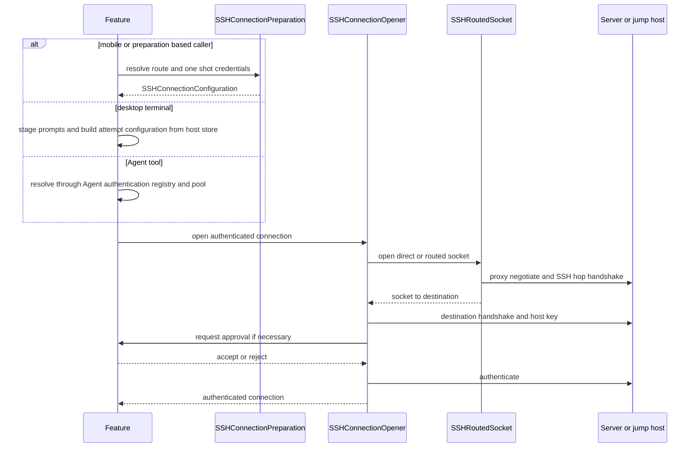
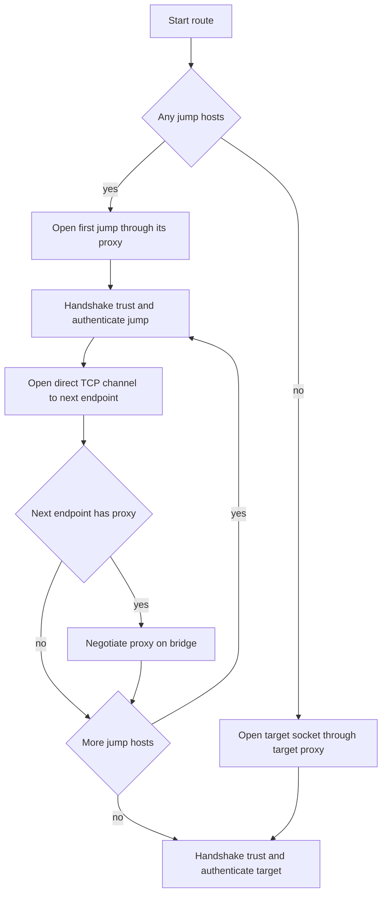
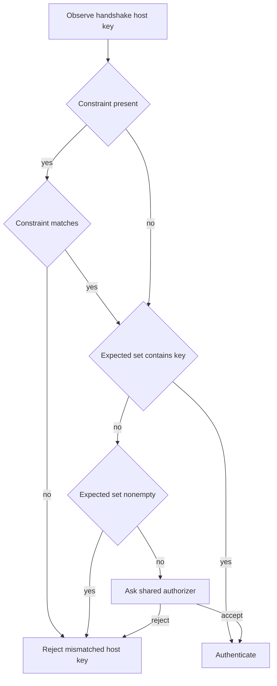
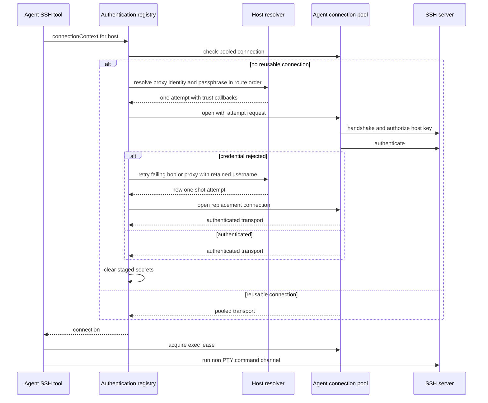
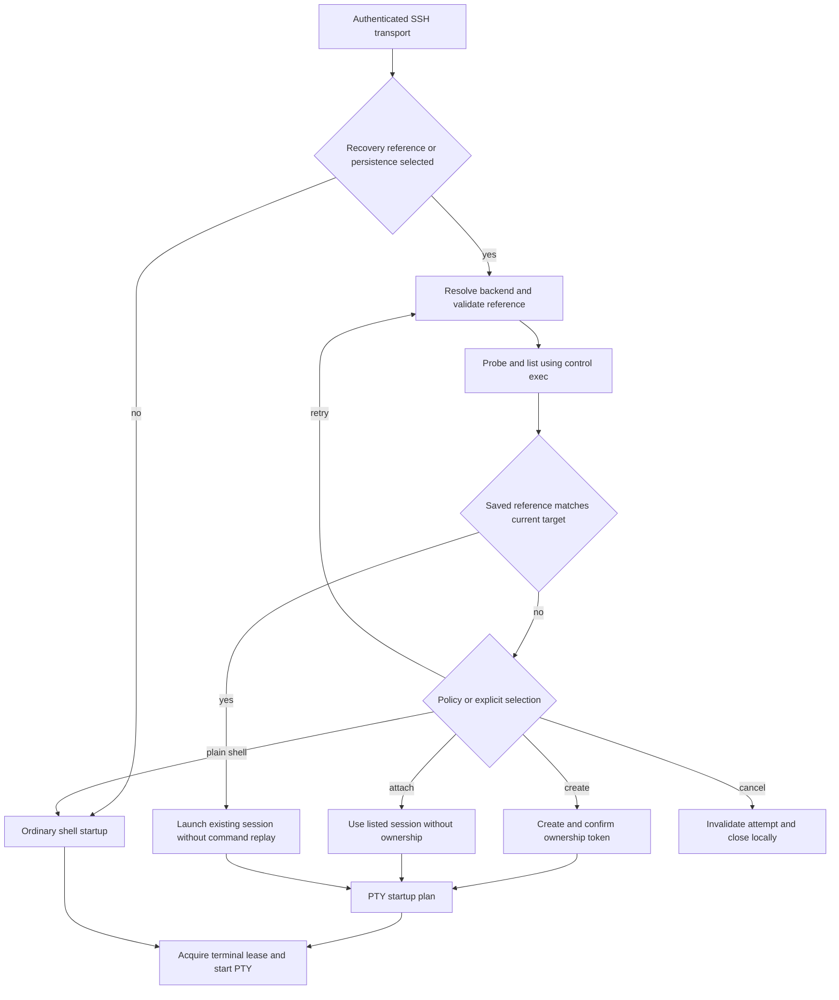
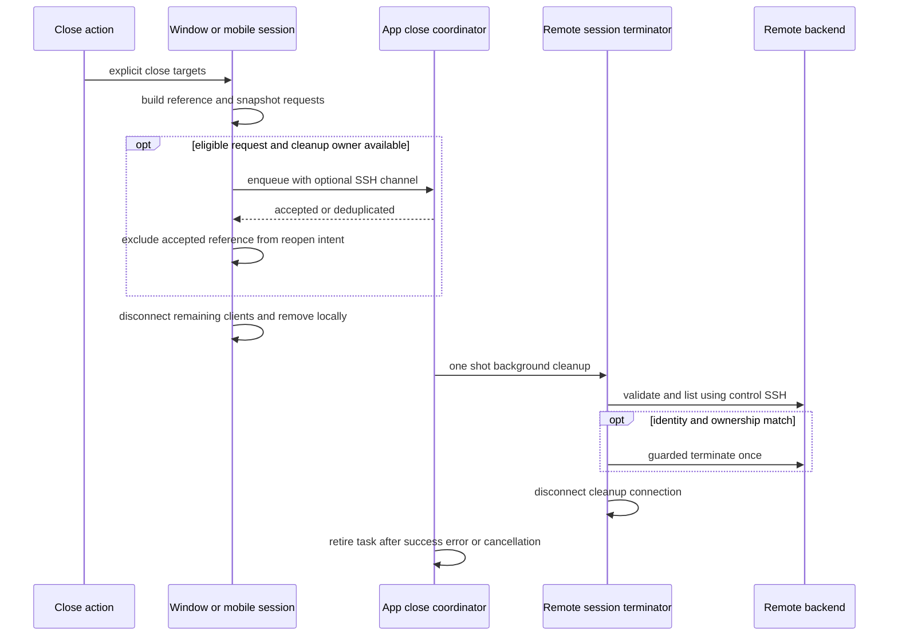
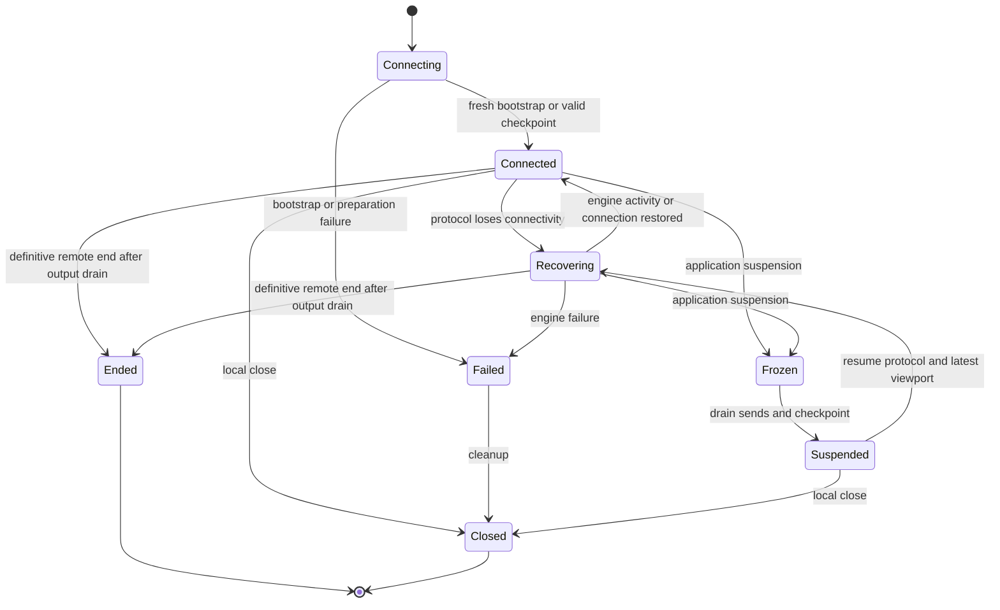
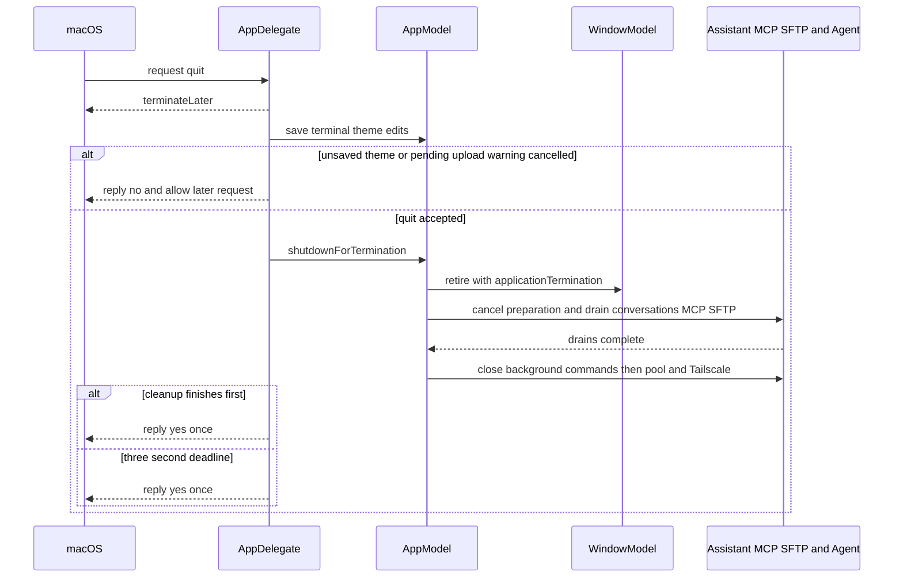
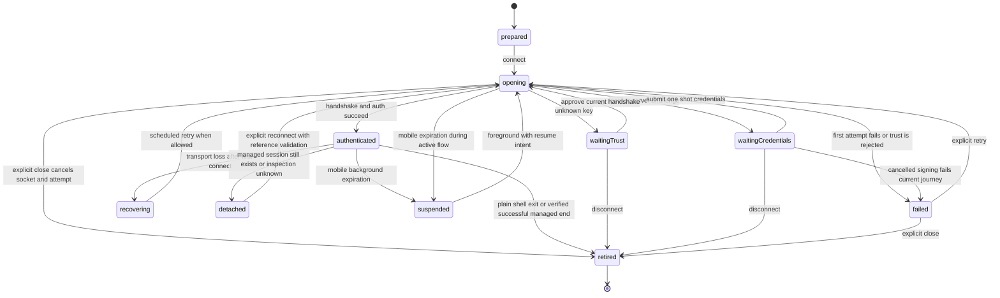

# SSH Session Lifecycle

Terminal lifetime has three independent dimensions: the local pane/workspace owner, the remote shell or multiplexer session, and the network transport. SSH reconnection authenticates a new transport; a managed backend can preserve the shell across that replacement. Mosh and Eternal Terminal (ET) instead recover their protocol session, optionally with a managed multiplexer running inside it. Neither a transport checkpoint nor a display name grants permission to terminate a remote session.

For group-bound networking, managed Tailscale SSH, stable Host IDs and enrollment cleanup, start with [Tailscale groups, embedded nodes, and SSH](../integrations/tailscale.md).

## Scope and ownership

A remote session is deliberately assembled in layers. `RemoteSessionHostStore` can snapshot a route, identity choices, known-host expectations, and transient submissions into `SSHConnectionPreparation` for mobile workspaces and other preparation-based callers; the desktop terminal also has its own prompt-first path that builds `SSHConnectionConfiguration` from the store and staged credentials for each attempt. On desktop `AppModel.open(_:as:in:)` dispatches a saved Host to a window pane; `SSHSessionModel.connectIfNeeded(using:)` starts its pending mounted session, while explicit `connect(using:)` handles retry. On mobile `MobileWorkspace.connect()` takes one-use submissions, resolves preparation with `.allowChallenge`, installs trust, keyboard-interactive and Security Key callbacks on the request, then opens a PTY or SFTP client. Agent tools instead use the app-owned resolver, authentication registry and pool: their interactive connection preparation is not a desktop pane's `SSHSessionModel` path. Remote Infrastructure opens the routed socket, completes each libssh2 handshake and authentication, then gives the feature an authenticated transport or protocol-specific client. `RemoteConnectionCoordinator` is the application-facing factory and one-shot connection boundary: it produces PTY, multiplexed SSH, or SFTP owners and disconnects an owner if its initial connect fails, so callers never receive a half-open session.

The session feature—not the coordinator—owns user-facing `ConnectionJourney`, host-key and keyboard-interactive queues, retry timing, and the decision to keep or discard a workspace. This separation is important: a terminal, an SFTP browser, Metrics, forwarding, or an Agent tool can share preparation and transport policy without sharing UI lifetime or an interactive prompt. On desktop, `TermindApp` builds one `AppModel` for shared host data and services, but `WindowGroup` constructs a separate `WindowModel` for each window's dynamic workspaces and selection. Agent SSH connections are **not** borrowed from those workspace sessions: `AppModel` constructs `AgentHostServices.live` with the shared coordinator and registers its resolver, authentication registry, connection pool, and background-command owner with Assistant and MCP. Agent sessions can therefore survive a window's workspace closure until their own pool eviction or app cleanup. A temporary pane-backed Agent target is different: the resolver rechecks that its pane still exists before reusing a pooled connection, and a vanished pane makes the target invalid.

*Desktop and mobile workspace attempts and Agent tool attempts have distinct state owners; all authorize the server on the handshake path, not during host listing.*

### Admission and access checks

Host selection is not permission to open indefinitely. Desktop `AppModel.open` admits the Host before creating the pane; `SSHSessionModel` resolves access again for the destination, explicit route and source Host IDs. The attempt configuration carries `accessHostIDs`, an `accessCheck`, and a `beforeConnect` wake action alongside routing/provenance metadata. Preparation-based callers carry these hooks through detached secret resolution. At the authenticated opening boundary, infrastructure checks access, awaits wake, checks cancellation, then opens the route. Exec and SFTP owners also retain access checks for subsequent operations. A denied access check must not be bypassed by retry or reuse. Wake policy is supplied through the connection hook, not inferred by the transport.

## Prepare the route and attribute proxies correctly

`SSHConnectionPreparation` is a MainActor-safe value snapshot whose potentially blocking Keychain resolution happens in a detached task before socket work begins. Cancellation cancels that worker; if it has already returned a configuration, the awaiting task checks cancellation and clears its secrets before throwing. Partial resolution also clears any collected jump/target credentials and proxy passwords on failure. It requires a nonempty target route, resolves every jump before the target, and creates an `SSHRouteHopConfiguration` for each jump. A strict `.requireKnownHost` preparation fails if any route node has no expected key; `.allowChallenge` defers that decision to the live handshake. Credential lookup distinguishes an unavailable secret-store error from an absent credential, permits username-only identities to reach server authentication, and avoids reading a protected key before a required passphrase has been supplied. Desktop `SSHSessionModel.startConnection` instead checks missing proxy password, host password, protected-key passphrase, and username **before** taking one-shot submissions. It resolves selected or saved credentials, proxies, ordered jumps and expected keys from the host store, then opens a PTY with host-key and keyboard-interactive callbacks; credential errors route back to the failing host or proxy prompt rather than installing a failed transport.

Each node may carry a separate proxy configuration and proxy identity/submission. The proxy password is resolved independently from SSH credentials and becomes an `SSHTransportProxy` with `ownerHostID` set to the host whose proxy it is. This preserves a key UI and retry invariant:

- A proxy is **not** a `ConnectionJourney` endpoint.
- The first proxy belongs to **Local**; a proxy used after a jump belongs to the preceding authenticated SSH host.
- Proxy connect, proxy authentication, failure, and retry are displayed against that preceding endpoint. Only the subsequent host's SSH connection advances the route.

`SSHRoutedSocket` enforces the same physical order. It connects to the first jump through its proxy, authenticates that jump, opens a `direct-tcpip` channel to the next proxy or host, and repeats. A proxy after a jump negotiates over the bridge before the next SSH handshake. Proxy errors retain the owning host ID, letting the feature request the correct proxy-specific credentials rather than mislabeling the destination as the failing endpoint.

*Each proxy is negotiated before the SSH session for the host it leads to, while journey attribution remains at the preceding endpoint.*

## Host-key authorization: persistent trust is independent of a Host

Known-host entries are endpoint trust records, not properties of a `Host` record. Editing or deleting a Host must not move or remove shared trust; multiple identities can be trusted for an endpoint. A temporary approval is held only in the live connection controller and is added to that attempt's expected identities without writing Known Hosts. A persistent approval writes the known-host entry **before** the pending attempt is resumed.

After each handshake, infrastructure observes the negotiated key algorithm and SHA-256 fingerprint. Authorization has a fixed precedence:

1. An optional URI-style `SSHHostKeyConstraint` is checked first. Its legacy MD5 match is an additional out-of-band constraint, not durable trust.
2. A matching expected Known Hosts identity succeeds with no authorizer call.
3. A mismatch against a nonempty expected set fails. Even a matching provisional constraint cannot override an existing, conflicting Known Hosts set.
4. For an unknown key, an authorizer may accept or reject an `SSHHostKeyChallenge`; absent an authorizer, unknown trust fails closed.

Thus a matching external-link fingerprint can reject the wrong server and can annotate a first-use prompt, but it cannot create, replace, or override persistent trust. This also means approval is made during the real handshake-to-authentication attempt, rather than by a separate discovery connection that could observe a different peer.

*Known Hosts remains authoritative; provisional URI constraints only narrow what may be accepted.*

`SSHHostKeyAuthorizationCoordinator` exposes one pending decision to a session feature. Continue Once records temporary identity for that host; Trust and Continue persists it; disconnect rejects and clears a pending decision. Keyboard-interactive authentication follows the same ownership pattern: the C callback blocks only its dedicated transport queue while an async handler answers literal server prompts. A request ID and cancellation state ensure that a late responder cannot satisfy a later challenge; cancellation wakes the condition and shuts down the socket so libssh2 cannot continue with empty answers.

## Authentication and secret lifetime

A configuration carries credentials only for one physical connection attempt. Its `SSHSecret` values are shared mutable secret owners, so copies of the configuration can be invalidated together. `SSHConnectionConfiguration.clearSecrets()` clears target credentials, proxy password, and every jump credential. Public entrypoints defer that cleanup on both success and failure, and the authenticated opener also clears at its own transport boundary. Retrying resolves saved material again; a temporary password or key passphrase is not a reusable connection snapshot.

Credentials may be a password, software private key and optional passphrase, Secure Enclave key, FIDO2 Security Key, or the marker `.interactionRequired`. Authentication tries the resolved configuration at the relevant hop or destination. Security Key credentials come from the key's Vault metadata rather than a Keychain private-key lookup, for both jumps and destination. An interactive request supplies a signing callback: the route and destination authentication exchanges use it to sign the SSH public-key challenge, with the current hop's host identity; cancelling the exchange wakes the waiting transport queue and ignores late signing results. When an operation forbids interaction, `SSHConnectionRequest.enforcingInteractionPolicy()` replaces credentials requiring a passphrase or user presence, including all Security Keys, with `.interactionRequired`, clears software secret material, makes host-key authorization throw `SSHInteractionRequired`, and permits only informational keyboard-interactive rounds (no prompts and not a Tailscale browser-approval banner). This is how silent additional connections avoid unexpectedly displaying password, trust, MFA, Touch ID, or device-password UI. See [SSH Security Key Authentication](../concepts/ssh-security-key-authentication.md) for registration, Vault metadata, signing and forwarding limits.

Keyboard-interactive is available to routed hops and the target. It preserves host, port, username, connection ID, and round number in the challenge; answer count must exactly equal prompt count. Time spent waiting for the user extends the libssh2 callback budget, while answers themselves are transient and never a cache.

Desktop terminal and SFTP models share `RemoteSessionConnectionController.continueAuthentication`. It re-resolves the prompt host through route → library → temporary destination and rejects an empty trimmed username without changing the prompt. The continuation has distinct branches:

- **Identity:** the selected identity supplies username and key selection when present; otherwise entered values are used. Stage the one-use SSH submission and model-specific username/route state, clear the prompt and resume the journey, then run the synchronous model-owned save policy if requested. Only a successful policy (or no requested save) invokes explicit connect. A failed credential save does **not** initiate another connection attempt: the model restores an error-bearing authentication prompt.
- **Proxy:** use the entered username rather than the selected identity's username. Save proxy authentication first if requested; only afterward stage the separate proxy submission, clear the prompt, resume and connect. A save failure leaves the original prompt and stages no proxy submission.
- **Protected-key passphrase:** merge through `passphraseSubmission` with the existing SSH submission, optionally saving the key passphrase. Success clears the prompt and connects; failure updates the existing prompt's failure message without connecting.

These synchronous callbacks are never retained. Host-key trust is a separate live-handshake continuation, not an identity submission or a new connection attempt.

`RemoteSessionConnectionController` centralizes journey and recovery state. Its progress callback accepts only the feature's current attempt ID. `scheduleReconnect` runs the feature's teardown before presenting the reconnect journey and scheduling the model-owned retry. The reconnect task does not own the transport or reconstruct secrets.

## Transport and channel ownership

An authenticated SSH connection has one serial libssh2 owner. `SSHConnection` is an actor facade over `SSHConnectionWorker`, whose private dispatch queue serializes all library calls. It can multiplex independent non-PTY exec channels and SFTP channels on the one authenticated session, while a channel budget limits SSH “session” channels. Exec commands use a private channel and an owned, zeroizing input queue, so a command's working directory or stdin does not leak into another command.

The worker's generation token invalidates socket events, timers, and scheduled pumps after cleanup. While a new connection is still opening, cancellation of its route or destination authentication also cancels the keyboard-interactive/Security Key exchange, interrupts its socket, and serializes opening-state cleanup. Disconnect increments that generation, cancels timers, fails outstanding commands, closes multiplexed SFTP channels and the channel budget, and closes the authenticated transport. Connection-level socket failure is reported once, then uses the same cleanup path. The worker also cleans up when its last reference is released: if release happens on its own queue it cleans up inline, otherwise it synchronously enters that queue. This avoids deadlocking on queue reentry while preserving serialized transport teardown. `SSHConnectionWorkerLifecycleTests` covers both release contexts. This establishes two related invariants: libssh2 is never entered concurrently, and a retired connection cannot have a stale event revive or mutate its replacement.

The PTY worker normally preserves its transport after terminal closure only while live SFTP channels remain, not merely because native exec CLOSE is pending. Prepared startup and managed-session inspection can explicitly retain the control connection; this is a separate owner intent, not a pending-exec lifetime extension. Each SFTP driver retains its worker through asynchronous cleanup, with no owner-to-driver cycle. Worker destruction cleans up on its serial queue and avoids synchronous self-reentry. `SSHPTYChannelWorkerLifecycleTests` covers queue release, `SFTPChannelLifetimeTests` covers retained cleanup, and opt-in `SSHPTYChannelLifecycleWireTests` uses an unacknowledged exec CLOSE to check transport retirement and final SFTP-sibling closure.

Feature models apply the same idea at the UI boundary. `RemoteSessionConnectionController.progressHandler(attemptID:isCurrent:)` forwards route progress to `ConnectionJourney` only for the current attempt. Desktop `SSHSessionModel` checks its `connectionAttemptID` after PTY connect and in exit and integration callbacks; if post-connect installation fails it disconnects the new actor. Mobile workspaces replace their UUID generation when connecting, backgrounding, exiting, or retiring work, and guard every asynchronous completion against it. Late connection, transfer-preparation, socket, and timer callbacks therefore cannot attach an obsolete transport, clear newer state, or enqueue work after explicit close.

### Continue into post-authentication mechanics

Authentication answers whether a transport may be installed. The next layer decides how its work progresses and how additional transports are obtained:

- [SSH Multiplexing, Channel Admission, and I/O Scheduling](../concepts/ssh-multiplexing-and-scheduling.md) explains per-connection session leases, serial libssh2 ownership, exec state machines, SFTP retry turns, and buffer backpressure.
- [Shell Integration: Bootstrap, OSC Events, and Terminal State](../concepts/shell-integration.md) follows the PTY-only probe/install exchange, shell hooks, charset-aware event filtering, history, cwd/home, and platform-specific prompt readiness.
- [SFTP Transfer, Scheduling, and External Edit Workflow](sftp-transfer-and-external-edit.md) explains file permits before channel acquisition, independent-connection preference, sibling/primary fallback, and detached transfer ownership.
- [Port Forwarding: Multi-Connection Pool and Flow Dispatch](port-forwarding-pool-and-dispatch.md) follows pool publication, local/SOCKS flow assignment, primary-only remote listeners, and the distinction between auxiliary repair and whole-context recovery.

## Agent SSH connections are not workspace sessions

`list_hosts` exposes public Vault host metadata and live temporary targets from desktop panes; it does not return credentials. Agent SSH and SFTP tools require an SSH-enabled target, and a closed temporary pane fails target resolution rather than legitimizing a lingering pooled connection. The desktop resolver obtains temporary SSH configuration from the pane when needed. Merely listing a connected pane does not give a tool its PTY: `ssh_exec_run` opens a dedicated non-PTY exec channel over an **Agent-owned** connection.

For an unpooled host, `AgentSSHAuthenticationRegistry` leases a per-host `AgentSSHAuthenticationContext` only while overlapping operations connect. The resolver requests missing proxy credentials, identity and protected-key passphrase in route order **before** opening the socket, then uses the attempt's callback to ask for host-key approval at handshake and literal keyboard-interactive answers during authentication. Saved Hosts can persist an explicitly saved identity or trust decision; Continue Once remains attempt-scoped, and temporary targets cannot persist trust from an Agent card. Concurrent exec and primary SFTP openings join one authentication prompt and one pending connection. Cancellation removes an individual waiter and cancels its prompt when no waiters remain; generation checks prevent old failures or late answers from overwriting newer attempts. A rejected credential can prompt again for the failing hop or proxy, but successful authentication consumes the submitted secrets. For a proxy with an unavailable saved password, the prompt keeps `proxy.username` even if its selected password identity is missing; an unsaved answer overrides the proxy only for this attempt, while Save updates the Vault proxy identity and username. Identity and protected-key passphrase are separate prompts: entering a passphrase merges into the staged identity submission, retaining its password fallback. The registry drops the context after its last connecting lease: a later physical connection must resolve saved credentials or ask again, not reuse a previous Custom password.

`AgentConnectionPool` keys reusable authenticated connections by Host ID and an in-memory route fingerprint (route, identities, proxies, known-host keys and destination charset), not by run or window. Fingerprinting reads no Keychain secrets: changing a saved secret without changing identity affects the **next** connection, whereas changing route or trust invalidates reuse. Concurrent misses coalesce into one open; cancelled or superseded opens cannot publish late sockets. The primary SFTP subsystem and exec commands share the pooled transport; exclusive SFTP leases may use silent auxiliary connections or sibling channels as scheduling allows. Idle sweeping defaults to 180 seconds and spares active exec and SFTP leases; host deletion and app termination explicitly close the pool. This is distinct from the feature-owned terminal, SFTP, and forwarding lifetimes described in the linked pages.

*The Agent shares its own transport across tools, not a workspace's interactive session; prompts and one-use secrets belong to the connection attempt.*

`ssh_exec_run` preflight classifies safe commands for parallel execution and asks approval for unproven commands. Foreground execution closes stdin and waits without a runtime timeout. Explicit background execution returns a conversation-scoped handle only after confirmed startup and leaves stdin open. `ssh_exec_output`, `ssh_exec_stdin`, `ssh_exec_cancel` and `ssh_exec_list` operate on those handles; secret stdin uses a one-shot broker handle, not an SSH login credential. Only connection failure before session startup is retryable. Cancellation retires the local handle without claiming remote process termination.

## Managed remote sessions: selection, ownership, and PTY startup

Session persistence is opt-in per Host (also supported by Tailscale host preferences): defaults are disabled, backend `.tmux`, and `onConnect: .ask`. Enabled policies are Ask, Create Managed, and Plain Shell. These settings are not transport persistence: reconnect still authenticates a new SSH connection. The live registry registers **tmux, Zellij, zmx and herdr** through `RemoteMultiplexerService`. The service delegates to registered dialects instead of flattening their native identity contracts. `RemoteSessionBackend` supplies probe, listing, validation/matching, creation, launch and termination; `RemoteMultiplexerDialect` additionally binds runtime inspection and pane identity. Unknown registrations fail as unsupported rather than selecting tmux. Socket-backed references validate their backend/version, absolute socket/root paths, fingerprints and backend-specific identity fields; they are not portable names.

Both platforms configure the PTY startup callback before connecting. After SSH authentication, `SSHPTYChannel.connectPrepared` exposes a generation-bound command executor. The coordinator probes and lists through serial control exec operations **before acquiring the terminal channel lease**, allowing startup with `MaxSessions=1`. A returned `SSHPTYStartupPlan` becomes a PTY exec startup command; a nil plan selects the ordinary shell path. Terminal size, environment and optional runtime integration are configured by the transport, rather than typing attach commands into an already-running foreground application.

`RemoteSessionCoordinator` distinguishes three outcomes:

- **Create:** creates a reference with an ownership UUID only after the backend confirms the same remote owner. Explicit one-shot commands require a new session when persistence is selected. An uncertain create retry reuses its token only for the same launch intent (host, endpoint, username, backend, command, integration and environment).
- **Attach:** accepts a currently listed descriptor but sets no ownership token, even if the remote session was originally created by Termind. Attaching does not acquire permission to kill it.
- **Plain Shell:** clears attachment and creation state. Plain policy without a recovery reference bypasses probing. Unsupported backend, probe/create failure, or missing recovery target offers an explicit choice rather than silently falling back or replacing the session.

A recovery reference is versioned backend data, not a stored command. Before reattachment the coordinator validates the backend representation and requires the saved Host ID, endpoint and username to match the attempt. tmux additionally matches session ID, creation time, server PID and, for managed references, the ownership marker. Missing references force selection even under Create Managed; unsupported reference versions fail before probing. Generation checks prevent late creation from publishing ownership over a newer attempt. Reattachment does not replay the startup command.

*Selection and remote control precede terminal channel admission; recovery never treats a name alone as identity.*

### tmux safety and operating requirements

The current backend requires tmux 3.3 or newer. It distinguishes missing tmux, unsupported version, timeout, malformed/truncated output and ownership mismatch. Session names are encoded as data in the versioned listing response and shell arguments are quoted. Managed names are compact digests of the token, not the ownership credential. Guarded attach uses the exact session ID without `-d` or `-A`, so another client is not evicted. Termination verifies the identity/owner condition remotely and requires the `TERMIND_ENDED` response; a name prefix never authorizes termination.

### Explicit close is not disconnect

Only `TerminalTeardownIntent.explicitClose` attempts to end managed sessions. Explicit close is now a **nonblocking handoff**, not an asynchronous veto of local removal. The app-owned `RemoteSessionCloseCoordinator.enqueue` accepts owned references, deduplicates pending work by recovery identity (not display metadata), and runs one-shot best-effort cleanup independently of the removed workspace. Errors are swallowed without failure UI or termination retries. Its default 30-second deadline cancels the operation; cancellation does not undo local closure. Passive intents (`applicationTermination`, `suspension`, `remoteExit`, `detach`) do not enqueue termination.

Both platforms build a `RemoteSessionCloseRequest` containing the reference, an additional-connection snapshot and optionally a transferred ordinary SSH channel. Mosh and ET clients are **not** reusable SSH control connections. Requests with a live SSH connection are queued first. `RemoteSessionCloseConnection` gives transferred channels one idempotent cleanup owner, including duplicate or rejected requests. Desktop marks `isRemoteSessionClosing` only after enqueue accepts; mobile clears the reference from reopen intent only for accepted workspace IDs. If the closer, matching snapshot or eligible request is unavailable, local close still proceeds **without erasing recovery identity from reopen intent**. Acceptance means cleanup owns the attempt, not that the remote session has ended.

`RemoteSessionTerminator` releases a transferred terminal channel for control, validates the backend reference and lists/matches the remote identity before guarded termination. Connection/preflight failure may fall back to a fresh silent SSH connection, but a termination command is never replayed. Fresh cleanup resolves an additional connection from the snapshot, checks Host ID, endpoint and username, disables wake and agent forwarding, and does not request authentication UI. Every acquired connection is disconnected. Quit and mobile background expiration cancel outstanding cleanup.

*Local removal does not await remote termination; only an accepted cleanup handoff suppresses recovery identity in reopen intent.*

| Event | Managed remote-session behavior |
| --- | --- |
| Explicit pane/workspace close | Enqueue each unique owned session for background cleanup and remove locally immediately. Unowned attachments only disconnect; cleanup cancellation does not prevent removal. |
| Desktop native window dismissal | `closeForWindow()` remembers reopen state and disconnects clients, preserving remote sessions and references. |
| Application termination | Desktop passes `.applicationTermination`; shared service cleanup does not kill managed sessions. |
| Mobile suspension or transport loss | Retain recovery reference, retire transport, and authenticate again when recovery/resume is allowed. |
| tmux detach or unverified exit | Preserve reference and show disconnected/detached state; do not auto-create a replacement. |
| Verified remote end | Clear attachment and require selection next time. Only exit code zero **and** confirmed absence close the local terminal automatically. A nonzero end remains visible. |

On a successful PTY exit with an attachment, both feature models inspect the backend before deciding whether the session ended. Inspection failure is unknown, not absence. Transport failure after prior success instead uses scheduled reconnect, which validates the reference on the next physical connection.

Sources: [coordinator and backend contract](../../Frameworks/TermindApplication/Terminal/RemoteSessionBackend.swift), [close coordinator](../../Frameworks/TermindApplication/Terminal/RemoteSessionCloseCoordinator.swift), [multiplexer service](../../Frameworks/TermindRemoteInfrastructure/SSH/RemoteMultiplexerService.swift), [tmux dialect](../../Frameworks/TermindRemoteInfrastructure/SSH/RemoteTmuxDialect.swift), and [behavioral tests](../../FrameworkTests/SessionPersistenceTests.swift).

## Resumable transports: recovery is not shell persistence

`ResumableTerminalClient` owns shared lifecycle, output/integration filtering and a serialization barrier; registered engines own protocol resources. The immutable coordinator-local live registry maps `.mosh` to `MoshTerminalEngine` and `.eternalTerminal` to `EternalTerminalEngine`. Invalid options, incompatible checkpoint version/transport, unavailable routes or an unregistered engine fail before bootstrap/startup side effects.

For a fresh session the client checks access and wake, opens bootstrap SSH, prepares optional managed startup, prepares and starts the engine, sends startup input/integration once, then disconnects bootstrap SSH. Failure rolls back engine preparation, disconnects bootstrap and closes the client. Mosh launches `mosh-server` over SSH then uses UDP; an open UDP socket alone is not success: startup waits for server operations or a definitive stop, with a 20-second reachability deadline. ET uses SSH bootstrap credentials and a `TerminalTCPBridge` over the configured routed socket. Checkpoint restoration skips fresh target SSH bootstrap and `ResumableTerminalStartup` skips selection, creation and startup replay. ET may still need to reopen its routed connection.

Suspension freezes new writes and waits for in-flight sends before asking the engine for a checkpoint. Resume restores protocol operation and the latest viewport; integration deadlines reset and any deferred integration command is flushed. Maintenance and path monitoring belong to the client and stop on close. Network failure is not a remote shell exit: Mosh drains final operations before reporting `.stopped` as end; silence, suspension and timeout do not imply end. ET requires `.sessionEnded` and waits for the output consumer to drain; output EOF or disconnection alone is insufficient. `.ended` is terminal and emitted once, closes resources without a subsequent `.closed` override, and rejects late events. Features interpret it as successful end, not a numeric process exit status; managed attachments still require backend absence verification.

*Resumable engine recovery preserves the protocol session; a backend reference separately identifies a persistent remote shell.*

## PTY activation after connection

PTY startup and focus activation are distinct. `SSHPTYActivationState` queues optional tmux sizing assistance only when the terminal is active, a validated client identity has been detected, and all requested PTY resizes are synchronized. `SSHPTYChannel` also requires a live PTY, runtime control and concurrent-control channel capacity. It refreshes the exact client through `RemoteMultiplexerRuntimeAdapter`, never by injecting a fallback key. Repeated polls do not repeatedly claim focus. Blur, input, detach and connection replacement invalidate requests; a viewport change invalidates pending/in-flight work, but ordinary live resizing does not create an exec for every grid change. Failed optional activation must not disconnect a usable terminal. `SSHPTYActivationTests` verifies blocked/failed resize ordering, stale requests and rejection of malformed or server/group PID identities.

## Retry, retirement, and workspace behavior

Opening a saved host on desktop goes through `AppModel.open(_:as:in:)`: it installs the window's history callbacks, optimistically sets terminal host status to connecting, and asks that window to create a new SSH, Telnet or SFTP pane/workspace (or a chosen batch layout). The pane's status then drives `HostLibraryModel`'s per-connection status projection: a connected sibling wins over connecting, reconnecting or failed siblings. A connection-history event is recorded **at pane opening**, not after authentication; only saved hosts are recorded, with kind and source device ID. Closing the pane ends that event without deleting it; moving or reparenting a pane does not end its session or history. Recents derive from latest events, deduplicated by saved Host ID, and the local-only projection filters by stable device ID (events with a missing or different device ID are not local). Clearing history leaves Host records and credentials untouched. The history model trims to a global 250 entries, including on load; a failed write reports `storageError` instead of inventing a successful history event. Desktop single-host, batch and snippet openings install the same window history callbacks, so these pane kinds follow the same opening/closing rule.

For a desktop SSH pane, an explicit launch command takes precedence over the Host's startup snippet. Each attempt resolves the current snippet when no explicit command is pending. On the plain-shell path it is submitted once readiness permits; managed creation instead passes it into backend startup, and attachment or reattachment clears local pending commands without typing or replaying them. Disconnect discards both pending commands. Mobile uses the same precedence and startup-plan distinction; reopened connection intent does not replay prior one-shot commands.

A connection failure before the first successful session remains a failed journey requiring an explicit user retry. Once a session has connected, `RemoteSessionConnectionController` can schedule recovery through `SessionReconnectController`; it pauses recovery for trust or authentication interaction and resets recovery state on disconnect. Retiring a session cancels prompt queues and Security Key signing, rejects pending host-key approval, clears temporary trust, stops reconnect work, and hides the journey. Desktop explicit disconnect also invalidates the attempt, drops staged authentication and proxy submissions, cancels the connection task and disconnects its PTY. During transport opening, cancellation shuts down the route/authentication exchanges and socket and disposes of the opening state; the SSH worker's generation guard prevents stale events from reviving a closed connection.

On mobile, each native scene session has an **in-process** `MobileWorkspaceSessionModel`; `MobileAppModel` owns the collection and active history IDs. `addWorkspaces` records saved-Host history, publishes the live object and eligible descriptors, then connects. Descriptor changes persist eligible restoration intent in `mobile.restorableWorkspaces.v1`, not live transports or one-shot commands. Transient external-link workspaces have neither saved descriptors nor saved-Host history. Failure and suspension leave the history event open; local close ends it and removes the live object and descriptor without waiting for remote cleanup. Repeated selection of a live object returns that object, including after a failed first attempt; retry is explicit. Reopen constructs a fresh runtime from connection intent without replaying a one-shot snippet, initial directory or SFTP path. Normal plain-shell exit closes locally; managed exit follows the verified-end rules above.

The platform rules intentionally differ:

| Situation | Desktop macOS | Mobile iOS and iPadOS |
| --- | --- | --- |
| Window or app restoration | Native scene/frame restoration restores window presentation, not live Workspace transports. Dynamic Workspaces are window-owned and are not reconnected simply because a window is restored. | `MobileWorkspaceStore.retire` deletes legacy `mobile.workspaces.v1` and `mobile.recentlyClosed.v2`, including malformed bytes. A separate versioned `mobile.restorableWorkspaces.v1` stores eligible resumable and managed-SSH descriptors in their original scene lists. Cold launch loads descriptors but creates no live workspace, transport or history attempt until selection. Corrupt restoration data blocks subsequent overwriting and reports an error. Recently-closed records remain process-local. |
| Reopen/select and scene ownership | Mounting a preserved desktop workspace does not repeat authentication; explicit retry or reopen may. Moving a workspace preserves its surfaces, transport, splits, and state. | Within the same process, selection reuses the owning scene's live object. Links to another owner activate its native scene. Scene disconnect alone preserves ownership while its native session exists. Reconciliation hands off existing live objects without reconnect or new history, while descriptor mutations persist the changed scene ownership. A late explicit discard still closes only the originating scene's handed-off workspaces. |
| Background/foreground | Native window close can be vetoed before any teardown; accepted closure retires only that window's workspace sessions, not app-wide Agent connections, transfers, or services. Quit checks unsaved themes and pending external edits, not open workspaces, before shared shutdown and a bounded native termination reply. | When all scenes background, resumable workspaces begin checkpoint suspension immediately. Sync, metrics and outbox pause and external-edit monitoring stops; a UIKit background task protects remaining work. Expiration suspends active non-resumable flows, stops forwarding, pauses transfers and cancels Assistant runs, whose drains precede closing Agent background commands/pool. Foreground resumes only recorded intent: a live resumable client waits for checkpoint saving, invalidates its disk recovery and resumes its protocol; ordinary SSH reconnects. Returning before expiration keeps healthy ordinary SSH intact. |
| Explicit close | The owning window closes its own sessions; closing a pane removes empty workspaces without transferring ownership. | Explicit close removes live and saved entries immediately and remembers reopen intent without references accepted for cleanup; deleting a saved Host also removes its live and unopened records across scenes. |

Mobile recently-closed intent is shared across scenes **only in this process**. A native disconnect is not discard: when no active replacement exists, orphan recovery waits. A window close request keeps workspaces until native discard, and a rejected native close retains them.

Live Activity links select an existing workspace ID rather than reconstructing a connection from the card. `MobileSceneModel.open` finds the owning scene, activates another owner when necessary, or selects the local saved/live workspace. Unknown IDs report unavailable; a stale card cannot rebuild an explicitly closed session. Cold launch publishes saved descriptors as disconnected activity entries without creating transports. Selection restores the same descriptor ID and its managed reference, not a new ID or an unconditional `requiresSelection` override. URLs exclude recovery capabilities and commands; the restoration store is the source of connection intent.

Selecting a resumable descriptor requires its transport checkpoint; missing/incompatible checkpoints fail visibly rather than bootstrap a new shell. If a separate managed reference exists, the feature may discard failed transport recovery and require backend selection/identity validation over a new transport, without replaying the command.

These boundaries are asserted by [MobileTerminalRestorationTests](../../TFITests/MobileTerminalRestorationTests.swift), [MobileLiveActivityRestorationTests](../../TFITests/MobileLiveActivityRestorationTests.swift), [MobileWorkspaceStoreTests](../../TFITests/MobileWorkspaceStoreTests.swift) and [MobileWorkspaceSessionTests](../../TFITests/MobileWorkspaceSessionTests.swift). Legacy-cache deletion tests do not imply that the new restoration store is empty.

### Native window close versus application Quit

Window dismissal runs `WorkspaceWindowCloseDelegate.windowShouldClose`, attached through native registration. It respects the forwarded delegate's veto and guards reentrant confirmation, saves terminal theme changes and asks only if unsaved theme edits remain. It does **not** warn merely because connections exist. Actual native closure calls `WindowModel.closeForWindow()`: remember reopen state and disconnect that window's clients while preserving managed references. Metrics policy may keep the application alive after its last window closes.

Quit uses `.terminateLater` with duplicate-admission protection. It saves theme edits, may veto on unsaved themes, then rechecks external edits and may veto on pending uploads. There is no open-workspace warning. Approval starts idempotent `AppModel.shutdownForTermination()`: fence Assistant admission, cancel preparations and conversations, retire window sessions with `.applicationTermination`, stop services, wait for preparation/conversation, MCP and SFTP drains, then close Agent background commands, pool and Tailscale. The native reply happens once after cleanup or the three-second fallback; the fallback bounds the reply, not all drains. `applicationWillTerminate` uses the same cleanup path.

*Native close and Quit preserve managed shells; unsaved edits, not live connections, can veto teardown.*

Telnet is intentionally a separate terminal transport rather than an SSH fallback. `TelnetConnection` opens direct TCP with `NWConnection`, or obtains a proxied socket through `TerminalSocketConnector`; its own UUID generation rejects stale Network and socket callbacks. It performs incremental IAC negotiation, NVT line conversion, terminal type and NAWS support, and applies the configured charset only to application data. Optional username/password automation responds to recognized prompts, consumes and clears the password after use, and falls back to manual interaction when the expected flow does not materialize. It has no SSH host-key verification, jump-host route, SFTP channel, or shell integration.

*The feature owns visible waiting, recovery, and retirement; transport resources are installed only after authentication succeeds.*

## Operational guidance and focused tests

[SessionPersistenceTests](../../FrameworkTests/SessionPersistenceTests.swift) verifies disabled defaults, no-probe plain policy, command-once creation, unowned manual attachment, lost/unsupported references, stale creation/selection rejection, verified-end exit semantics, passive teardown, nonblocking close deduplication, failure without retry, cancellation before cleanup starts and deadline cancellation. These are behavior assertions, not evidence inferred from test names. The opt-in [RemoteSessionWireTests](../../TFMTests/RemoteSessionWireTests.swift) exercises actual multi-client attachment, resize, detach/restore, owned-only termination, abrupt SSH loss without startup replay, and shell configuration loading. [ssh-tmux-session-fixture.py](../../Scripts/ssh-tmux-session-fixture.py) uses a disposable Lima/nerdctl Debian container, loopback SSH, ephemeral keys and pinned fingerprint without editing user SSH configuration. Run with `--max-sessions 1` for admission/degradation and `--max-sessions 8` for runtime acceptance; pass its metadata via `TEST_RUNNER_TERMIND_TMUX_FIXTURE` to `xcodebuild` as shown in the script. These wire tests are opt-in, not assumed to run in ordinary unit coverage.

When changing connection code, preserve these boundaries:

- Build only `SSHConnectionPreparation` snapshots from UI/store state; do not carry plaintext through retry state or reusable snapshots.
- Keep proxy submission and SSH submission separate, and preserve the proxy `ownerHostID` so the Journey stays on the prior endpoint.
- Do not make a URI fingerprint or temporary approval durable trust, and do not bypass authorization on a known-host mismatch.
- Put callbacks from sockets, timers, detached preparation, and authentication behind the current attempt/generation check before touching feature state; clear secrets if preparation is cancelled after resolving them.
- Have the owner that opened a client retire it on every failed connect and on explicit close; do not transfer a half-open client to a workspace. Do not tie the Agent pool's life to a workspace, window, or Assistant turn.
- When changing Agent authentication, preserve the separation between temporary per-opening secrets and reusable route-fingerprinted transports; cancel the final prompt waiter, close late opens, and never replay a command after its channel started.

`WorkspaceCloseConfirmationTests` checks theme-save protection, native delegate veto, passive managed-reference preservation and explicit close without a cleanup owner. `WorkspaceBackgroundCloseTests` checks that pane/workspace/others/all removal finishes before cleanup runs and excludes accepted references from reopen records. `RemoteSessionTerminatorTests` covers transferred-channel ownership, one silent preflight replacement, no retry after uncertain termination, mismatch rejection and once-only release on cancellation or deduplication. `AppTerminationTests` checks repeated shutdown drains resources once, blocks Assistant admission after shutdown, orders background-command and pool closure after drains, and races cleanup against the fallback without duplicate replies. `RemoteSessionAuthenticationContinuationTests` checks identity stage/save/connect ordering and proxy save-before-stage behavior, including no connect on save failure. `DesktopAuthenticationSubmissionTests` runs SSH/SFTP entrypoints against failed saves, blank usernames, selected versus custom credentials, protected-key passphrase continuation and temporary-host saving.

`SSHInteractionPolicyTests` checks silent Security Key blocking on both target and jumps, rejection of trust and prompted keyboard-interactive UI, current-identity additional-connection resolution and one-use secret invalidation. `WebAuthnVaultMetadataTests` proves hardware credentials for both target and jump resolve with a secret store that throws on Keychain access, and checks Vault metadata persistence and sync. `SSHConnectionWorkerLifecycleTests` releases the worker on and off its serial connection queue to catch teardown deadlocks. `ConnectionHistoryTests` checks attempt-time ordering, 250-entry retention, SwiftData persistence and clearing, source-device identity, end-on-pane-close, saved SSH/SFTP opening and deduplicated recents; it also verifies that clearing a host's histories leaves its Host and another host's events intact. `MobileWorkspaceSessionTests` covers independent scene ownership, retirement of old snapshots, in-process live handoff without new history, late discard, and native-session-aware reconciliation. `MobileTerminalRestorationTests` checks descriptor-only cold launch, missing-checkpoint failure, protocol recovery without SSH reconnect and command replay, and managed-reference fallback. `ResumableTerminalExitTests` verifies final-output drain and once-only end versus recoverable silence/disconnect. `SSHPTYActivationTests` verifies focus/client/resize gating and stale-request invalidation. `MobileWorkspaceStoreTests` checks deletion of even malformed legacy data and exclusion of recovery capabilities from URLs. `MobileAppTests` also checks explicit retry, plain SSH exit and background expiration/foreground resume. `MobileCardTests` checks saved SSH/SFTP history starts on open and ends on close. The highest-value regression coverage is concentrated in `SSHConnectionPreparationTests` and `SSHHostKeyAuthorizationTests`: proxy attribution and one-shot proxy submission, missing proxy-password ownership, username-only and passphrase ordering, secret-read accounting, constraint-versus-Known-Hosts precedence, temporary versus persistent trust, and cancellation of pending trust. `ConnectionJourneyTests` validates selected Mosh/ET purpose, Telnet symbols, monotonic endpoint progression, local identity/passphrase waiting, temporary host keys and multi-key trust. `ConnectionJourneyRouteStyleTests` covers proxy-source attribution and failure coloring; `TransportRecoveryJourneyTests` and `TerminalTransportJourneyTests` cover protocol recovery without replaying authentication, retained terminal state and late-event rejection. `MobileWorkspace`'s generation guards cover the platform-specific late-callback and foreground-resume boundary. `AgentHostAuthenticationTests` exercise proxy username retention with a missing password identity, password-plus-protected-key passphrase merging, shared exec/SFTP opens, prompt-waiter cancellation, host-key decisions, stale generation failures, post-success secret consumption, and non-replayed SFTP failures. For mobile expiration, inspect `MobileBackgroundController`'s lease behavior as well: expiration calls cancellation synchronously, retires a valid UIKit task exactly once, and treats a failed or synchronous `beginBackgroundTask` as expiration rather than leaving work assumed protected.

## Related pages

- [Mosh + Eternal Terminal](../integrations/mosh-and-eternal-terminal.md)
- [Session Persistence](../concepts/session-persistence.md)

- [Platform runtime and lifetime ownership](../architecture/platform-runtime.md)
- [Agent runtime and Assistant](../concepts/agent-runtime-and-assistant.md)
- [Persistence and secrets](../concepts/persistence-and-secrets.md)
- [SSH Security Key Authentication](../concepts/ssh-security-key-authentication.md)
- [Remote services and forwarding](../concepts/remote-services-and-forwarding.md)
- [SFTP transfer and external edit workflow](sftp-transfer-and-external-edit.md)

Tailscale-managed peers use the group-bound dialer and control-service host keys. They authenticate a selected remote username through Tailscale SSH, carry no ordinary SSH credential list, and cannot be jump Hosts; failed Tailnet dialing never falls back to system networking. Peer identity is scoped to its group, and sign-in/cache/profile cleanup remain device-local. Command and SFTP browse histories are session-local memory snapshots retained on reconnect and cleared on close. Shared non-PTY exec scheduling now resides in `SSHMultiplexedExecChannelOwner`, used by `SSHConnectionWorker` and PTY-owned history reads under the same queue and channel budget.
