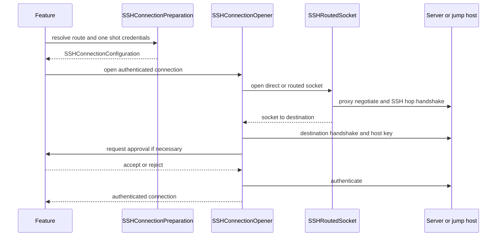
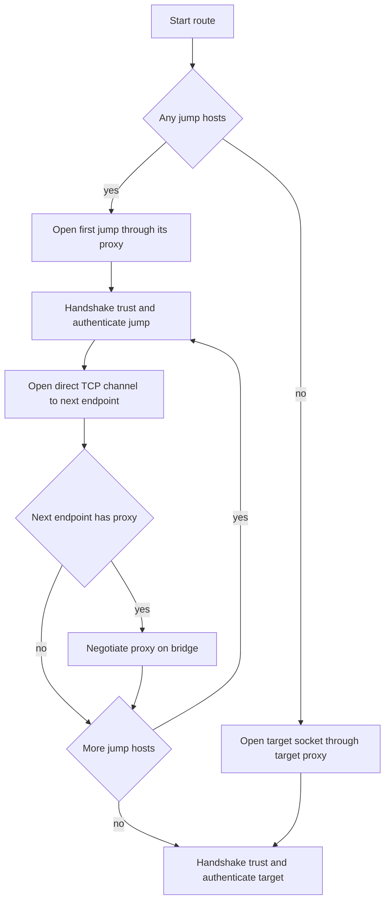
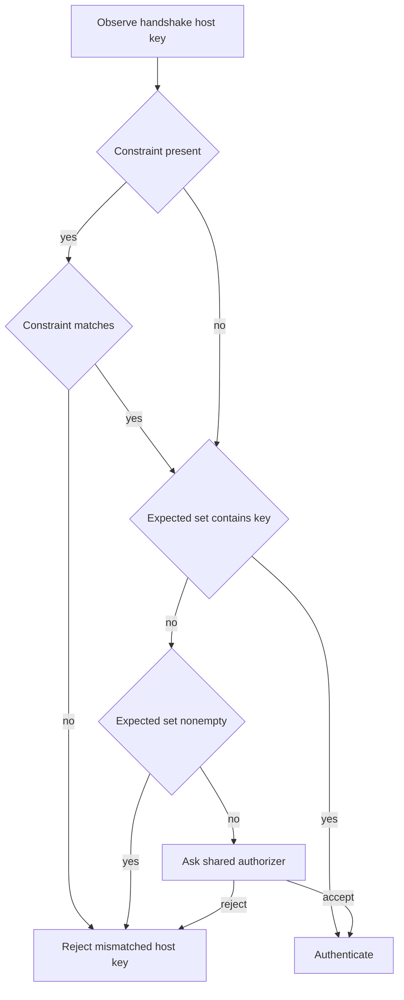
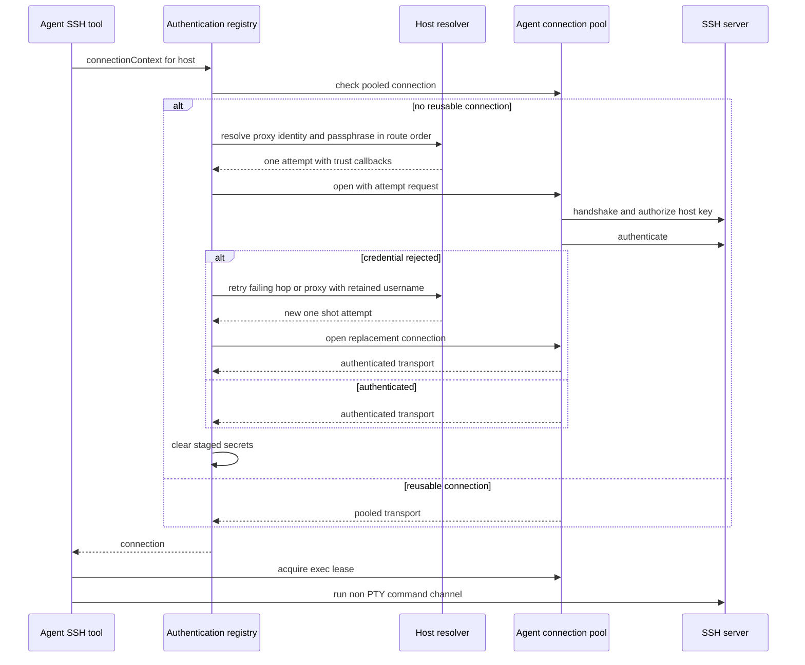
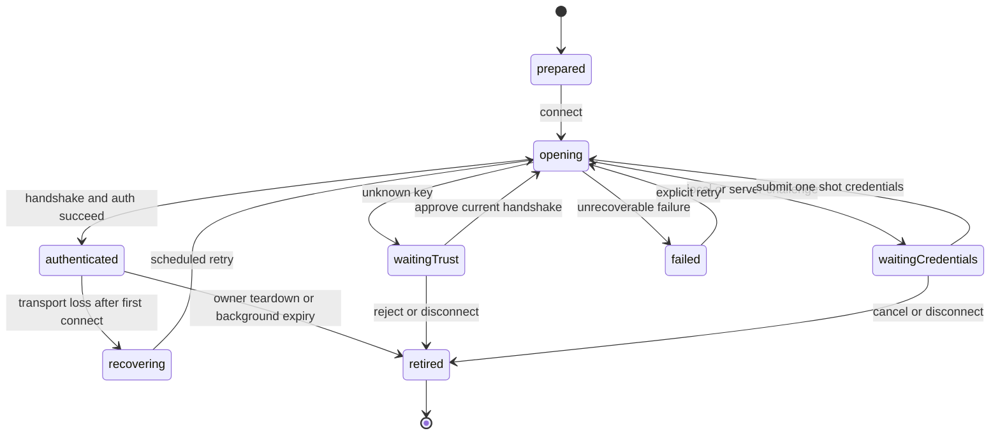

# SSH, Telnet, Trust, and Workspace Session Lifecycle

## Scope and ownership

A remote session is deliberately assembled in layers. Application code snapshots a route, identity choices, known-host expectations, and transient submissions into `SSHConnectionPreparation`; Remote Infrastructure opens the routed socket, completes each libssh2 handshake and authentication, then gives the feature an authenticated transport or protocol-specific client. `RemoteConnectionCoordinator` is the application-facing factory and one-shot connection boundary: it produces PTY, multiplexed SSH, or SFTP owners and disconnects an owner if its initial connect fails, so callers never receive a half-open session.

The session feature—not the coordinator—owns user-facing `ConnectionJourney`, host-key and keyboard-interactive queues, retry timing, and the decision to keep or discard a workspace. This separation is important: a terminal, an SFTP browser, Metrics, forwarding, or an Agent tool can share preparation and transport policy without sharing UI lifetime or an interactive prompt. On desktop, `TermindApp` builds one `AppModel` for shared host data and services, but `WindowGroup` constructs a separate `WindowModel` for each window's dynamic workspaces and selection. Agent SSH connections are **not** borrowed from those workspace sessions: `AppModel` constructs `AgentHostServices.live` with the shared coordinator and registers its resolver, authentication registry, connection pool, and background-command owner with Assistant and MCP. Agent sessions can therefore survive a window's workspace closure until their own pool eviction or app cleanup. A temporary pane-backed Agent target is different: the resolver rechecks that its pane still exists before reusing a pooled connection, and a vanished pane makes the target invalid.

*SSH preparation resolves data before transport opening; trust approval occurs on the actual handshake path.*

## Prepare the route and attribute proxies correctly

`SSHConnectionPreparation` is a MainActor-safe value snapshot whose potentially blocking Keychain resolution happens in a detached task before socket work begins. It requires a nonempty target route, resolves every jump before the target, and creates an `SSHRouteHopConfiguration` for each jump. A strict `.requireKnownHost` preparation fails if any route node has no expected key; `.allowChallenge` defers that decision to the live handshake. Credential lookup distinguishes an unavailable secret-store error from an absent credential, permits username-only identities to reach server authentication, and avoids reading a protected key before a required passphrase has been supplied.

Each node may carry a separate proxy configuration and proxy identity/submission. The proxy password is resolved independently from SSH credentials and becomes an `SSHTransportProxy` with `ownerHostID` set to the host whose proxy it is. This preserves a key UI and retry invariant:

- A proxy is **not** a `ConnectionJourney` endpoint.
- The first proxy belongs to **Local**; a proxy used after a jump belongs to the preceding authenticated SSH host.
- Proxy connect, proxy authentication, failure, and retry are displayed against that preceding endpoint. Only the subsequent host's SSH connection advances the route.

`SSHRoutedSocket` enforces the same physical order. It connects to the first jump through its proxy, authenticates that jump, opens a `direct-tcpip` channel to the next proxy or host, and repeats. A proxy after a jump negotiates over the bridge before the next SSH handshake. Proxy errors retain the owning host ID, letting the feature request the correct proxy-specific credentials rather than mislabeling the destination as the failing endpoint.

*Each proxy is negotiated before the SSH session for the host it leads to, while journey attribution remains at the preceding endpoint.*

## Host-key authorization: persistent trust is independent of a Host

Known-host entries are endpoint trust records, not properties of a `Host` record. Editing or deleting a Host must not move or remove shared trust; multiple identities can be trusted for an endpoint. A temporary approval is held only in the live connection controller and is added to that attempt's expected identities without writing Known Hosts. A persistent approval writes the known-host entry **before** the pending attempt is resumed.

After each handshake, infrastructure observes the negotiated key algorithm and SHA-256 fingerprint. Authorization has a fixed precedence:

1. An optional URI-style `SSHHostKeyConstraint` is checked first. Its legacy MD5 match is an additional out-of-band constraint, not durable trust.
2. A matching expected Known Hosts identity succeeds with no authorizer call.
3. A mismatch against a nonempty expected set fails. Even a matching provisional constraint cannot override an existing, conflicting Known Hosts set.
4. For an unknown key, an authorizer may accept or reject an `SSHHostKeyChallenge`; absent an authorizer, unknown trust fails closed.

Thus a matching external-link fingerprint can reject the wrong server and can annotate a first-use prompt, but it cannot create, replace, or override persistent trust. This also means approval is made during the real handshake-to-authentication attempt, rather than by a separate discovery connection that could observe a different peer.

*Known Hosts remains authoritative; provisional URI constraints only narrow what may be accepted.*

`SSHHostKeyAuthorizationCoordinator` exposes one pending decision to a session feature. Continue Once records temporary identity for that host; Trust and Continue persists it; disconnect rejects and clears a pending decision. Keyboard-interactive authentication follows the same ownership pattern: the C callback blocks only its dedicated transport queue while an async handler answers literal server prompts. A request ID and cancellation state ensure that a late responder cannot satisfy a later challenge; cancellation wakes the condition and shuts down the socket so libssh2 cannot continue with empty answers.

## Authentication and secret lifetime

A configuration carries credentials only for one physical connection attempt. Its `SSHSecret` values are shared mutable secret owners, so copies of the configuration can be invalidated together. `SSHConnectionConfiguration.clearSecrets()` clears target credentials, proxy password, and every jump credential. Public entrypoints defer that cleanup on both success and failure, and the authenticated opener also clears at its own transport boundary. Retrying resolves saved material again; a temporary password or key passphrase is not a reusable connection snapshot.

Credentials may be a password, software private key and optional passphrase, Secure Enclave key, or the marker `.interactionRequired`. Authentication tries the resolved configuration at the relevant hop or destination. When an operation forbids interaction, `SSHConnectionRequest.enforcingInteractionPolicy()` replaces credentials requiring a passphrase or user presence with `.interactionRequired`, clears software secret material, makes host-key authorization throw `SSHInteractionRequired`, and permits keyboard-interactive only when there are no prompts. This is how silent additional connections avoid unexpectedly displaying password, trust, MFA, Touch ID, or device-password UI.

Keyboard-interactive is available to routed hops and the target. It preserves host, port, username, connection ID, and round number in the challenge; answer count must exactly equal prompt count. Time spent waiting for the user extends the libssh2 callback budget, while answers themselves are transient and never a cache.

## Transport and channel ownership

An authenticated SSH connection has one serial libssh2 owner. `SSHConnection` is an actor facade over `SSHConnectionWorker`, whose private dispatch queue serializes all library calls. It can multiplex independent non-PTY exec channels and SFTP channels on the one authenticated session, while a channel budget limits SSH “session” channels. Exec commands use a private channel and an owned, zeroizing input queue, so a command's working directory or stdin does not leak into another command.

The worker's generation token invalidates socket events, timers, and scheduled pumps after cleanup. Disconnect increments that generation, cancels timers, fails outstanding commands, closes multiplexed SFTP channels and the channel budget, and closes the authenticated transport. Connection-level socket failure is reported once, then uses the same cleanup path. This establishes two related invariants: libssh2 is never entered concurrently, and a retired connection cannot have a stale event revive or mutate its replacement.

Feature models apply the same idea at the UI boundary. `RemoteSessionConnectionController.progressHandler(attemptID:isCurrent:)` forwards route progress to `ConnectionJourney` only for the current attempt. Mobile workspaces replace their UUID generation when connecting, backgrounding, exiting, or retiring work, and guard every asynchronous completion against it. Late connection, transfer-preparation, socket, and timer callbacks therefore cannot attach an obsolete transport, clear newer state, or enqueue work after explicit close.

### Continue into post-authentication mechanics

Authentication answers whether a transport may be installed. The next layer decides how its work progresses and how additional transports are obtained:

- [SSH Multiplexing, Channel Admission, and I/O Scheduling](/openwiki/concepts/ssh-multiplexing-and-scheduling.md) explains per-connection session leases, serial libssh2 ownership, exec state machines, SFTP retry turns, and buffer backpressure.
- [Shell Integration: Bootstrap, OSC Events, and Terminal State](/openwiki/concepts/shell-integration.md) follows the PTY-only probe/install exchange, shell hooks, charset-aware event filtering, history, cwd/home, and platform-specific prompt readiness.
- [SFTP Transfer, Scheduling, and External Edit Workflow](/openwiki/workflows/sftp-transfer-and-external-edit.md) explains file permits before channel acquisition, independent-connection preference, sibling/primary fallback, and detached transfer ownership.
- [Port Forwarding: Multi-Connection Pool and Flow Dispatch](/openwiki/workflows/port-forwarding-pool-and-dispatch.md) follows pool publication, local/SOCKS flow assignment, primary-only remote listeners, and the distinction between auxiliary repair and whole-context recovery.

## Agent SSH connections are not workspace sessions

`list_hosts` exposes public Vault host metadata and live temporary targets from desktop panes; it does not return credentials. Agent SSH and SFTP tools require an SSH-enabled target, and a closed temporary pane fails target resolution rather than legitimizing a lingering pooled connection. The desktop resolver obtains temporary SSH configuration from the pane when needed. Merely listing a connected pane does not give a tool its PTY: `ssh_exec` opens a dedicated non-PTY exec channel over an **Agent-owned** connection.

For an unpooled host, `AgentSSHAuthenticationRegistry` leases a per-host `AgentSSHAuthenticationContext` only while overlapping operations connect. The resolver requests missing proxy credentials, identity and protected-key passphrase in route order **before** opening the socket, then uses the attempt's callback to ask for host-key approval at handshake and literal keyboard-interactive answers during authentication. Saved Hosts can persist an explicitly saved identity or trust decision; Continue Once remains attempt-scoped, and temporary targets cannot persist trust from an Agent card. Concurrent exec and primary SFTP openings join one authentication prompt and one pending connection. Cancellation removes an individual waiter and cancels its prompt when no waiters remain; generation checks prevent old failures or late answers from overwriting newer attempts. A rejected credential can prompt again for the failing hop or proxy, but successful authentication consumes the submitted secrets. For a proxy with an unavailable saved password, the prompt keeps `proxy.username` even if its selected password identity is missing; an unsaved answer overrides the proxy only for this attempt, while Save updates the Vault proxy identity and username. Identity and protected-key passphrase are separate prompts: entering a passphrase merges into the staged identity submission, retaining its password fallback. The registry drops the context after its last connecting lease: a later physical connection must resolve saved credentials or ask again, not reuse a previous Custom password.

`AgentConnectionPool` keys reusable authenticated connections by Host ID and an in-memory route fingerprint (route, identities, proxies, known-host keys and destination charset), not by run or window. Fingerprinting reads no Keychain secrets: changing a saved secret without changing identity affects the **next** connection, whereas changing route or trust invalidates reuse. Concurrent misses coalesce into one open; cancelled or superseded opens cannot publish late sockets. The primary SFTP subsystem and exec commands share the pooled transport; exclusive SFTP leases may use silent auxiliary connections or sibling channels as scheduling allows. Idle sweeping defaults to 180 seconds and spares active exec and SFTP leases; host deletion and app termination explicitly close the pool. This is distinct from the feature-owned terminal, SFTP, and forwarding lifetimes described in the linked pages.

*The Agent shares its own transport across tools, not a workspace's interactive session; prompts and one-use secrets belong to the connection attempt.*

`ssh_exec` preflight classifies safe commands for parallel execution and asks approval for unproven commands, which run sequentially. Optional secret stdin is consumed from a handle bound to the run, host, tool and purpose; it is not an SSH login credential. Its reporting deadline includes connection setup. If setup is still pending, it returns `connecting` and starts **no** command; if an already-started command exceeds the deadline, `AgentBackgroundCommands` adopts its session and output under a handle for `ssh_wait`, while the shared connection stays available. A dead pooled connection can be retried once only if no command channel opened; never replay an operation that might have had effects.

## Retry, retirement, and workspace behavior

A connection failure before the first successful session remains a failed journey requiring an explicit user retry. Once a session has connected, `RemoteSessionConnectionController` can schedule recovery through `SessionReconnectController`; it pauses recovery for trust or authentication interaction and resets recovery state on disconnect. Retiring a session cancels prompt queues, rejects pending host-key approval, clears temporary trust, stops reconnect work, and hides the journey.

The platform rules intentionally differ:

| Situation | Desktop macOS | Mobile iOS and iPadOS |
| --- | --- | --- |
| Window or app restoration | Native scene/frame restoration restores window presentation, not live Workspace transports. Dynamic Workspaces are window-owned and are not reconnected simply because a window is restored. | `mobile.workspaces.v1` stores only ordered local descriptors containing workspace ID, Host ID, kind and title. Cold launch shows saved descriptors but creates no sessions, history, or network activity. |
| Reopen/select | Mounting a preserved desktop workspace does not repeat authentication; explicit retry or reopen may. Moving a workspace preserves its surfaces, transport, splits, and state. | Opening a descriptor reuses or registers one live workspace across scenes and makes at most one initial connection attempt; a failure needs explicit retry. Peer switching retains the live workspace. |
| Background/foreground | Closing a window tears down its workspace sessions, not app-wide Agent connections, transfers, or services. Quit checks pending external edits, then initiates shared shutdown (with a bounded termination reply) and closes every live window. | Only when all tracked scenes are backgrounded does a background task begin. Its expiration immediately requests workspace suspension, stops forwarding, pauses transfers and cancels Assistant runs; Assistant subsequently closes Agent background commands and pooled connections after conversation drains. Foreground ends the task and resumes workspaces that recorded foreground-resume intent. |
| Explicit close | The owning window closes its own sessions; closing a pane removes empty workspaces without transferring ownership. | Explicit close removes the live and recent entry and never retries it. |

Desktop termination is idempotent: `AppModel.shutdownForTermination()` stops conversation runs, window workspaces, metrics, forwarding and other app services; it waits for Assistant/MCP and SFTP drains before closing background commands and the Agent pool. `AppDelegate` rechecks pending edited-file uploads and can cancel quit before starting cleanup, then replies to macOS when it completes or after the three-second fallback; `applicationWillTerminate` invokes the same shutdown path. Closing the last window does not necessarily quit: the metrics menu setting or running metrics can keep the app and its app-owned Agent services alive. No live workspace transport is reconstructed by native scene restoration.

Telnet is intentionally a separate terminal transport rather than an SSH fallback. `TelnetConnection` opens direct TCP with `NWConnection`, or obtains a proxied socket through `TerminalSocketConnector`; its own UUID generation rejects stale Network and socket callbacks. It performs incremental IAC negotiation, NVT line conversion, terminal type and NAWS support, and applies the configured charset only to application data. Optional username/password automation responds to recognized prompts, consumes and clears the password after use, and falls back to manual interaction when the expected flow does not materialize. It has no SSH host-key verification, jump-host route, SFTP channel, or shell integration.

*The feature owns visible waiting, recovery, and retirement; transport resources are installed only after authentication succeeds.*

## Operational guidance and focused tests

When changing connection code, preserve these boundaries:

- Build only `SSHConnectionPreparation` snapshots from UI/store state; do not carry plaintext through retry state or reusable snapshots.
- Keep proxy submission and SSH submission separate, and preserve the proxy `ownerHostID` so the Journey stays on the prior endpoint.
- Do not make a URI fingerprint or temporary approval durable trust, and do not bypass authorization on a known-host mismatch.
- Put callbacks from sockets, timers, detached preparation, and authentication behind the current attempt/generation check before touching feature state.
- Have the owner that opened a client retire it on every failed connect and on explicit close; do not transfer a half-open client to a workspace. Do not tie the Agent pool's life to a workspace, window, or Assistant turn.
- When changing Agent authentication, preserve the separation between temporary per-opening secrets and reusable route-fingerprinted transports; cancel the final prompt waiter, close late opens, and never replay a command after its channel started.

The highest-value regression coverage is concentrated in `SSHConnectionPreparationTests` and `SSHHostKeyAuthorizationTests`: proxy attribution and one-shot proxy submission, missing proxy-password ownership, username-only and passphrase ordering, secret-read accounting, constraint-versus-Known-Hosts precedence, temporary versus persistent trust, and cancellation of pending trust. `ConnectionJourneyTests` validates endpoint progression, proxy attribution, pending-route behavior, retries, temporary host keys, multi-key trust, and the fact that editing a Host does not relocate Known Hosts. `MobileWorkspace`'s generation guards cover the platform-specific late-callback and foreground-resume boundary. `AgentHostAuthenticationTests` exercise proxy username retention with a missing password identity, password-plus-protected-key passphrase merging, shared exec/SFTP opens, prompt-waiter cancellation, host-key decisions, stale generation failures, post-success secret consumption, and non-replayed SFTP failures. For mobile expiration, inspect `MobileBackgroundController`'s lease behavior as well: expiration calls cancellation synchronously, retires a valid UIKit task exactly once, and treats a failed or synchronous `beginBackgroundTask` as expiration rather than leaving work assumed protected.

## Related pages

- [Platform runtime and lifetime ownership](/openwiki/architecture/platform-runtime.md)
- [Agent runtime and Assistant](/openwiki/concepts/agent-runtime-and-assistant.md)
- [Persistence and secrets](/openwiki/concepts/persistence-and-secrets.md)
- [Remote services and forwarding](/openwiki/concepts/remote-services-and-forwarding.md)
- [SFTP transfer and external edit workflow](/openwiki/workflows/sftp-transfer-and-external-edit.md)
